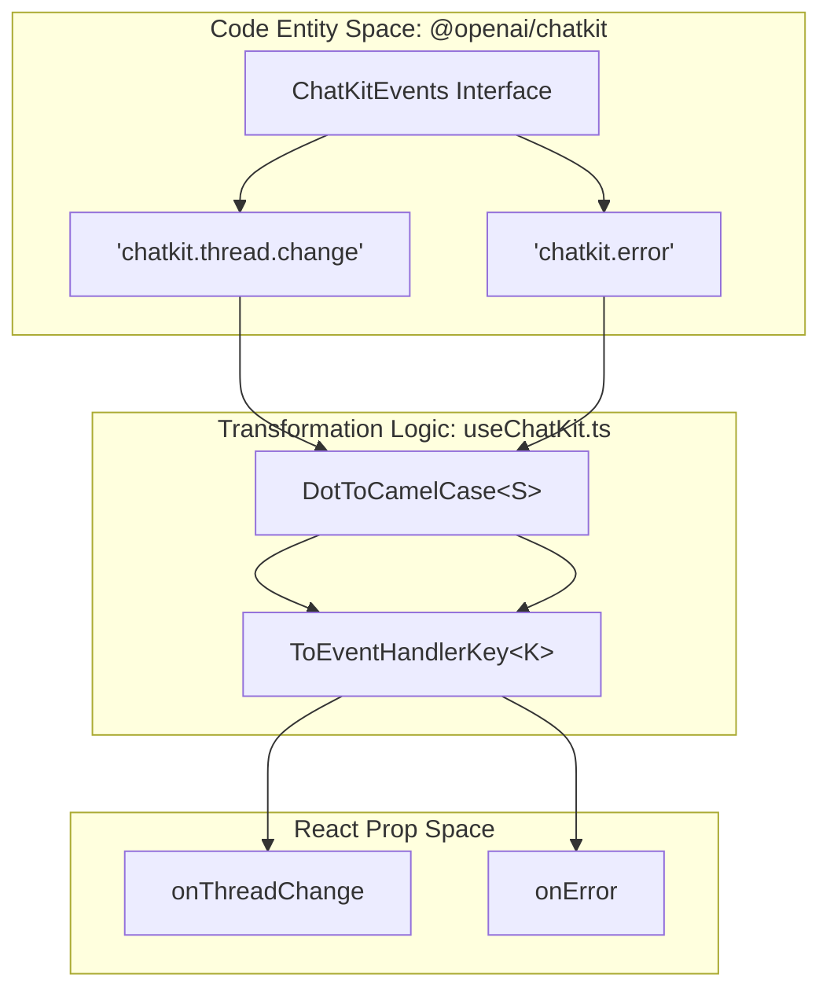
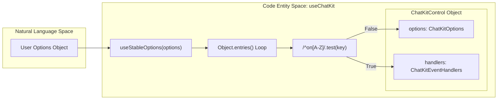

<!-- source: DeepWiki mcp.deepwiki.com · repo openai/chatkit-js · page 3.2 useChatKit Hook · fetched 2026-10-26 -->

# useChatKit Hook

<details>
<summary>Relevant source files</summary>

The following files were used as context for generating this wiki page:

- [packages/chatkit-react/src/useChatKit.ts](packages/chatkit-react/src/useChatKit.ts)
- [packages/chatkit-react/src/useStableOptions.test.ts](packages/chatkit-react/src/useStableOptions.test.ts)
- [packages/chatkit-react/src/useStableOptions.ts](packages/chatkit-react/src/useStableOptions.ts)
- [packages/docs/src/content/docs/quick-reference/use-chatkit.mdx](packages/docs/src/content/docs/quick-reference/use-chatkit.mdx)

</details>


## Purpose and Scope

The `useChatKit` hook provides a React interface for controlling and configuring the `OpenAIChatKit` web component. It serves as the bridge between React's declarative state management and the web component's imperative API. The hook performs three primary functions: stabilizing configuration options to prevent unnecessary re-renders, transforming web component events into React-style camelCase handlers, and providing safe method proxies that forward calls to the underlying custom element.

Sources: [packages/chatkit-react/src/useChatKit.ts:58-108](), [packages/docs/src/content/docs/quick-reference/use-chatkit.mdx:10-12]()

---

## Hook Signature

```typescript
function useChatKit(options: UseChatKitOptions): UseChatKitReturn
```

The hook accepts a combined options object and returns a set of imperative methods, a `control` object for internal component communication, and a `ref` to the underlying element.

Sources: [packages/chatkit-react/src/useChatKit.ts:58-108](), [packages/docs/src/content/docs/quick-reference/use-chatkit.mdx:6-8]()

### Input: UseChatKitOptions

`UseChatKitOptions` merges standard `ChatKitOptions` with dynamically generated event handler types:

```typescript
export type UseChatKitOptions = ChatKitOptions & ChatKitEventHandlers;
```

This structure allows developers to provide both static configuration (like `api` or `theme`) and logic-driven callbacks (like `onThreadChange`) in a single object.

Sources: [packages/chatkit-react/src/useChatKit.ts:45](), [packages/docs/src/content/docs/quick-reference/use-chatkit.mdx:21-33]()

### Output: UseChatKitReturn

The return value provides full control over the chat interface:

| Field | Type | Description |
| :--- | :--- | :--- |
| **Methods** | `ChatKitMethods` | Proxies for imperative actions like `sendUserMessage` or `setThreadId`. |
| **control** | `ChatKitControl` | Bundle of stabilized options and handlers passed to the `<ChatKit />` component. |
| **ref** | `RefObject` | React ref that must be forwarded to the `<ChatKit />` component. |

Sources: [packages/chatkit-react/src/useChatKit.ts:53-56](), [packages/docs/src/content/docs/quick-reference/use-chatkit.mdx:51-81]()

---

## Method Proxy Implementation

The hook creates proxies for specific methods defined in `CHATKIT_METHOD_NAMES`. These proxies ensure that calls to the API are safe even if the underlying web component has not yet mounted.

**Proxied Methods:**
- `focusComposer`: [packages/chatkit-react/src/useChatKit.ts:14]()
- `setThreadId`: [packages/chatkit-react/src/useChatKit.ts:15]()
- `sendUserMessage`: [packages/chatkit-react/src/useChatKit.ts:16]()
- `setComposerValue`: [packages/chatkit-react/src/useChatKit.ts:17]()
- `fetchUpdates`: [packages/chatkit-react/src/useChatKit.ts:18]()
- `sendCustomAction`: [packages/chatkit-react/src/useChatKit.ts:19]()
- `showHistory`: [packages/chatkit-react/src/useChatKit.ts:20]()
- `hideHistory`: [packages/chatkit-react/src/useChatKit.ts:21]()

**Proxy Logic:**
The proxies are created once via `useMemo`. When invoked, they check `ref.current`. If the element is missing, they log a warning; otherwise, they apply the arguments to the web component instance.

```typescript
acc[key] = (...args: any[]) => {
  if (!ref.current) {
    console.warn('ChatKit element is not mounted');
    return;
  }
  return (ref.current as any)[key](...args);
};
```

Sources: [packages/chatkit-react/src/useChatKit.ts:13-22](), [packages/chatkit-react/src/useChatKit.ts:62-74]()

---

## Type System Architecture

### Event Handler Transformation

The hook utilizes advanced TypeScript mapping to convert the web component's dot-notated events into React-friendly props.



The `DotToCamelCase` utility recursively processes strings like `chatkit.thread.change` into `chatkitThreadChange`. The `ToEventHandlerKey` then strips the `chatkit` prefix and adds `on`, resulting in `onThreadChange`.

Sources: [packages/chatkit-react/src/useChatKit.ts:9-11](), [packages/chatkit-react/src/useChatKit.ts:30-33]()

---

## Options Processing Flow

### Separation of Concerns

The hook separates the combined `options` object into standard `ChatKitOptions` and `ChatKitEventHandlers`. This is necessary because the web component expects configuration via properties/attributes, while handlers are typically managed via event listeners.



The logic treats any key starting with `on` followed by a capital letter as a handler, with the specific exception of `onClientTool`, which is treated as a configuration property.

Sources: [packages/chatkit-react/src/useChatKit.ts:83-102]()

### Stable Options Pattern

To prevent infinite render loops when users pass inline objects or functions to `useChatKit`, the hook utilizes `useStableOptions`. 

1. **`deepEqualIgnoringFns`**: Compares the shape of the options object. It ignores function identity, meaning if only a callback function's reference changed but the rest of the object is identical, it considers the objects equal. [packages/chatkit-react/src/useStableOptions.ts:14-61]()
2. **`withLatestFunctionWrappers`**: Recursively wraps all functions in the options object. These wrappers point to a mutable ref that always holds the "latest" version of the function provided by the user. This allows the object reference passed to the web component to remain stable while the execution logic remains fresh. [packages/chatkit-react/src/useStableOptions.ts:63-111]()

Sources: [packages/chatkit-react/src/useStableOptions.ts:113-129](), [packages/chatkit-react/src/useChatKit.ts:60]()

---

## Instance Management

The hook maintains a `ref` to the `OpenAIChatKit` element and provides a `setInstance` callback within the `control` object.

```typescript
const setInstance = React.useCallback(
  (instance: OpenAIChatKit | null): void => {
    ref.current = instance;
  },
  [],
);
```

The `<ChatKit />` component uses this `setInstance` function to register the underlying web component instance back to the hook, enabling the method proxies to function.

Sources: [packages/chatkit-react/src/useChatKit.ts:76-81](), [packages/chatkit-react/src/useChatKit.ts:98]()

---

## Implementation Summary

| Feature | Implementation Detail |
| :--- | :--- |
| **Method List** | Hardcoded in `CHATKIT_METHOD_NAMES` for proxy generation. |
| **Stability** | Handled by `useStableOptions` and `withLatestFunctionWrappers`. |
| **Event Handling** | Handlers receive the `detail` property of the `CustomEvent`. |
| **Memoization** | The final return object is memoized on `methods` and `control`. |

Sources: [packages/chatkit-react/src/useChatKit.ts:13-22](), [packages/chatkit-react/src/useChatKit.ts:35-43](), [packages/chatkit-react/src/useChatKit.ts:104-107]()

---

