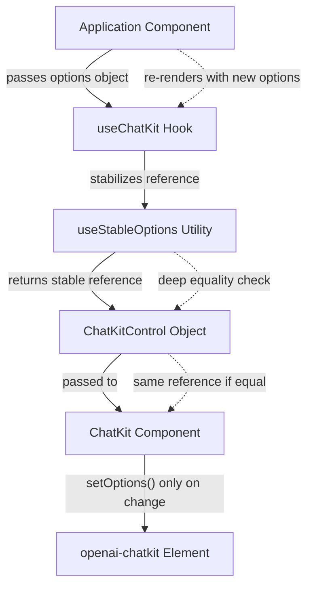
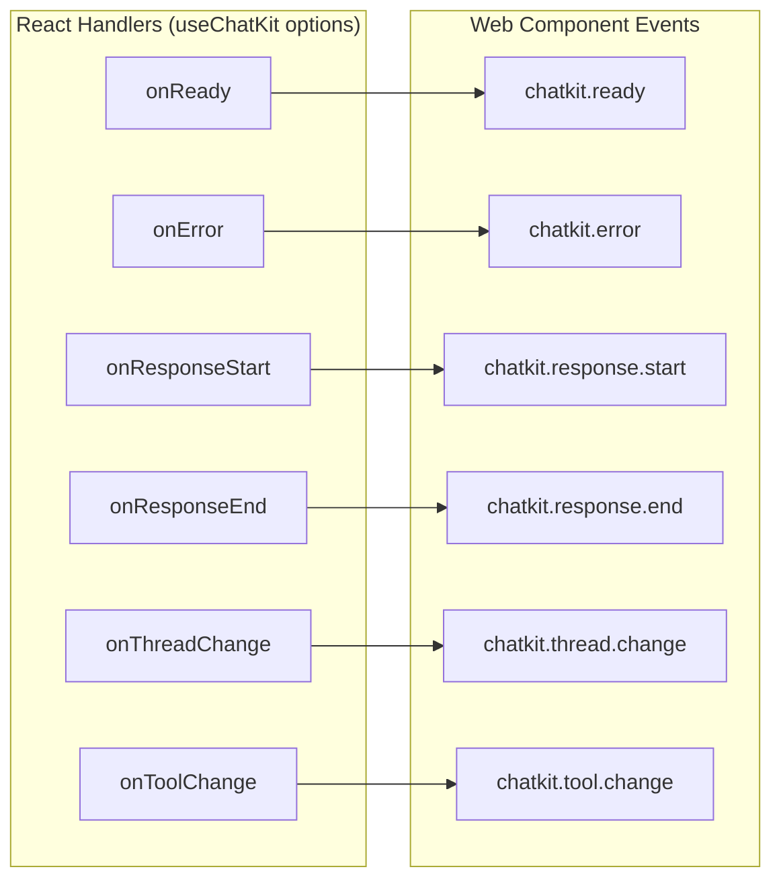
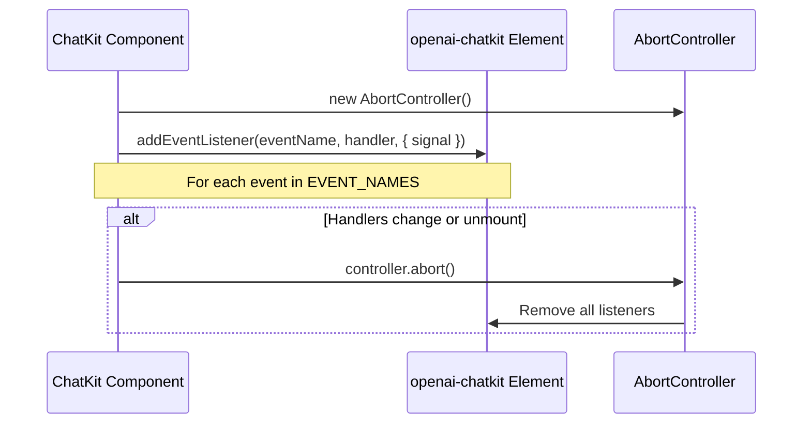
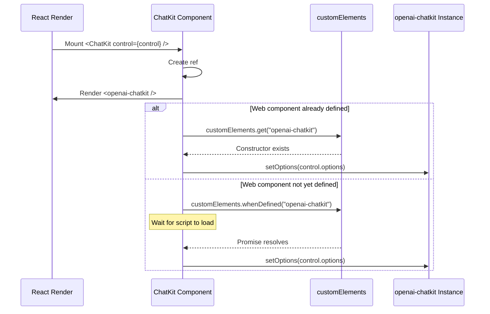
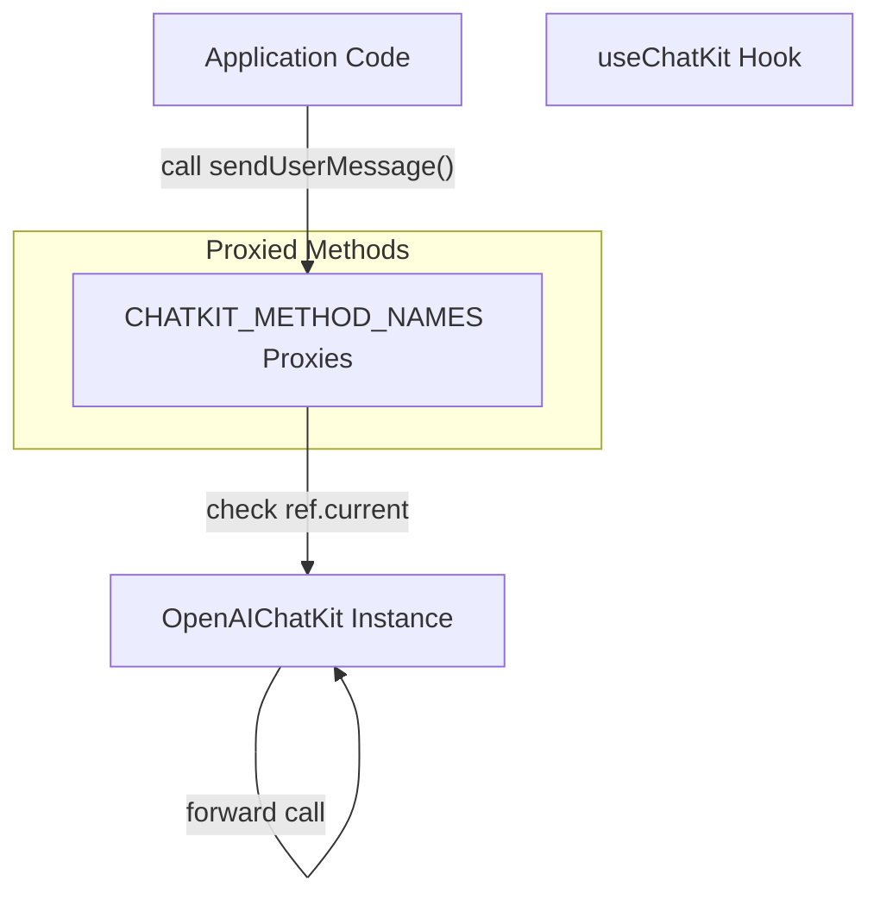
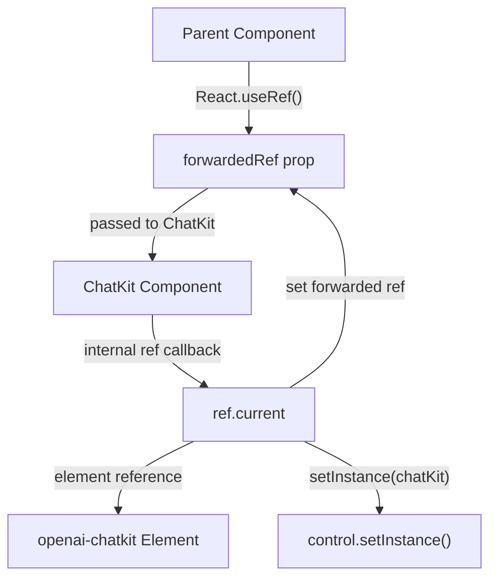

<!-- source: DeepWiki mcp.deepwiki.com · repo openai/chatkit-js · page 3.3 Integration Patterns · fetched 2026-10-26 -->

# Integration Patterns

<details>
<summary>Relevant source files</summary>

The following files were used as context for generating this wiki page:

- [packages/chatkit-react/eslint.config.js](packages/chatkit-react/eslint.config.js)
- [packages/chatkit-react/src/ChatKit.tsx](packages/chatkit-react/src/ChatKit.tsx)
- [packages/chatkit-react/src/useChatKit.ts](packages/chatkit-react/src/useChatKit.ts)
- [packages/docs/src/content/docs/quick-reference/use-chatkit.mdx](packages/docs/src/content/docs/quick-reference/use-chatkit.mdx)

</details>


This page documents common patterns and best practices for integrating ChatKit into React applications using the `@openai/chatkit-react` package. It covers option management, event handling, lifecycle considerations, and imperative control patterns.

For component API details, see [ChatKit Component](#3.1). For hook API details, see [useChatKit Hook](#3.2). For configuration options, see [ChatKitOptions Configuration](#2.1).

---

## Option Stabilization Pattern

The `useChatKit` hook stabilizes options to prevent unnecessary re-renders of the underlying web component. Understanding this mechanism is critical for optimal performance.

### How Option Stabilization Works

The hook internally stabilizes the options object reference so that changes to the options object identity don't trigger re-configuration of the web component unless the actual content changes. This happens through the `useStableOptions` internal utility.

Title: Option Stabilization Data Flow


**Pattern: Define Options Outside Component or Use useMemo**

```tsx
// ❌ Bad: Creates new object every render
function MyChat() {
  const { control } = useChatKit({
    theme: { colorScheme: 'dark' },
    api: { url: '/chatkit', domainKey: 'prod' }
  });
  return <ChatKit control={control} />;
}

// ✅ Good: Stable reference
const CHAT_OPTIONS = {
  theme: { colorScheme: 'dark' },
  api: { url: '/chatkit', domainKey: 'prod' }
};

function MyChat() {
  const { control } = useChatKit(CHAT_OPTIONS);
  return <ChatKit control={control} />;
}

// ✅ Also good: Use useMemo for dynamic options
function MyChat({ userId }: { userId: string }) {
  const options = React.useMemo(() => ({
    api: { 
      url: `/chatkit/${userId}`, 
      domainKey: 'prod' 
    }
  }), [userId]);
  
  const { control } = useChatKit(options);
  return <ChatKit control={control} />;
}
```

**Sources:** [packages/chatkit-react/src/useChatKit.ts:60-60](), [packages/chatkit-react/src/ChatKit.tsx:41-61]()

---

## Event Handler Management

Event handlers in React are transformed from React callback props (e.g., `onError`) to web component event listeners (e.g., `chatkit.error`). The transformation and lifecycle management is handled automatically.

### Event Handler Transformation Map

Title: Mapping React Props to Web Component Events


The `ChatKit` component maintains the `EVENT_HANDLER_MAP` internally and automatically attaches/detaches event listeners as handlers change.

**Sources:** [packages/chatkit-react/src/ChatKit.tsx:20-36](), [packages/chatkit-react/src/useChatKit.ts:30-43]()

### Handler Stability Pattern

Event handlers are extracted from the `control` object and attached with proper cleanup. The implementation uses `AbortController` to ensure clean removal when handlers change or the component unmounts.

Title: Event Listener Lifecycle


The handler extraction and attachment happens in a `useEffect` hook within the `ChatKit` component, ensuring that changing handlers will properly detach old listeners and attach new ones without memory leaks.

**Sources:** [packages/chatkit-react/src/ChatKit.tsx:63-84](), [packages/chatkit-react/src/useChatKit.ts:83-102]()

---

## Component Lifecycle and Web Component Definition

The `ChatKit` component handles the asynchronous nature of web component registration through a two-phase initialization pattern in `useLayoutEffect`.

### Initialization Flow

Title: Web Component Definition Sequence


This pattern ensures that `setOptions` is called at the right time regardless of when the web component script loads.

**Sources:** [packages/chatkit-react/src/ChatKit.tsx:41-61]()

### Fast Path vs. Fallback Path

The component checks if the custom element is already defined before setting options:

| Path | Condition | Behavior |
|------|-----------|----------|
| **Fast Path** | `customElements.get('openai-chatkit')` returns truthy | Immediately call `setOptions()` |
| **Fallback Path** | Custom element not yet defined | Wait for `customElements.whenDefined()` promise, then call `setOptions()` |

**Sources:** [packages/chatkit-react/src/ChatKit.tsx:46-57]()

---

## Imperative Method Control

The `useChatKit` hook returns a set of imperative methods (like `sendUserMessage` and `setThreadId`) that proxy calls to the underlying `OpenAIChatKit` element.

### Control Method Pattern

Title: Imperative Method Proxying


**Pattern: Safe Imperative Calls**

The proxied methods check if the element is mounted before attempting to call the underlying method.

```tsx
function ChatInterface() {
  const { control, sendUserMessage } = useChatKit({
    api: { url: '/chatkit' }
  });
  
  const handleSendMessage = () => {
    // Methods are available immediately but warn if element is unmounted
    sendUserMessage({ text: 'Hello!' });
  };
  
  return (
    <div>
      <ChatKit control={control} />
      <button onClick={handleSendMessage}>Send Message</button>
    </div>
  );
}
```

**Sources:** [packages/chatkit-react/src/useChatKit.ts:13-22](), [packages/chatkit-react/src/useChatKit.ts:62-74]()

---

## Ref Forwarding Pattern

The `ChatKit` component supports ref forwarding, allowing parent components to access the underlying `OpenAIChatKit` element directly while also updating the `ChatKitControl` instance.

### Ref Flow

Title: Multi-Ref Coordination


The ref is set through a callback that coordinates three references: the internal `ref`, the `control.setInstance` reference, and the `forwardedRef` from props.

**Sources:** [packages/chatkit-react/src/ChatKit.tsx:38-40](), [packages/chatkit-react/src/ChatKit.tsx:88-102]()

---

## Summary Table of Integration Entities

| Code Entity | Role | File |
|-------------|------|------|
| `ChatKit` | React component wrapper for the web component | [packages/chatkit-react/src/ChatKit.tsx:38-107]() |
| `useChatKit` | Hook for managing options, handlers, and methods | [packages/chatkit-react/src/useChatKit.ts:58-108]() |
| `ChatKitControl` | Bundle of stable options and extracted handlers | [packages/chatkit-react/src/useChatKit.ts:47-51]() |
| `CHATKIT_METHOD_NAMES` | List of methods proxied from the web component | [packages/chatkit-react/src/useChatKit.ts:13-22]() |
| `EVENT_HANDLER_MAP` | Mapping of web events to React callback props | [packages/chatkit-react/src/ChatKit.tsx:20-34]() |

**Sources:** [packages/chatkit-react/src/ChatKit.tsx:1-107](), [packages/chatkit-react/src/useChatKit.ts:1-108]()

---

