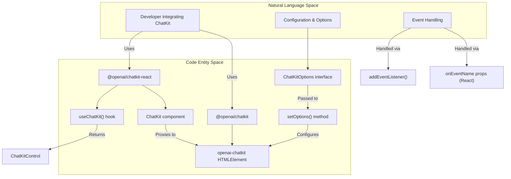
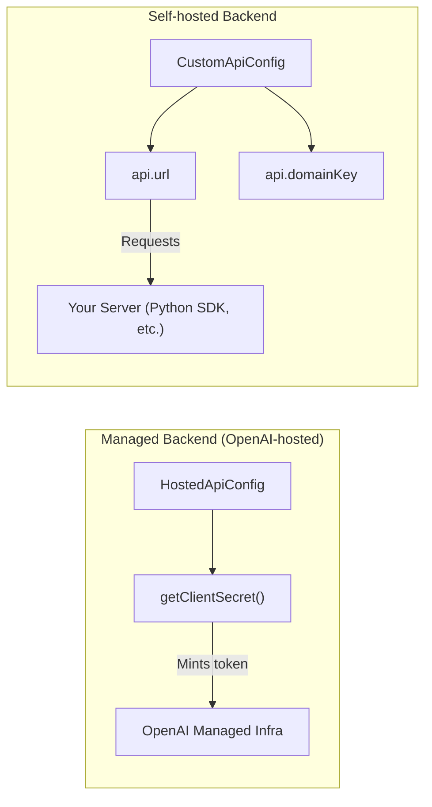

<!-- source: DeepWiki mcp.deepwiki.com · repo openai/chatkit-js · page 4 Integration Guides · fetched 2026-10-26 -->

# Integration Guides

Relevant source files

The following files were used as context for generating this wiki page:

- [packages/docs/src/content/docs/customize.mdx](packages/docs/src/content/docs/customize.mdx)
- [packages/docs/src/content/docs/index.mdx](packages/docs/src/content/docs/index.mdx)
- [packages/docs/src/content/docs/quickstart.mdx](packages/docs/src/content/docs/quickstart.mdx)

This document provides a high-level overview of integrating ChatKit into your application. ChatKit is a framework-agnostic, drop-in solution designed to add advanced conversational intelligence to apps with minimal setup [packages/docs/src/content/docs/index.mdx:59-78]().

For detailed implementation guidance, refer to the following child pages:
- **[Quick Start](#4.1)** — Step-by-step guide for getting started with ChatKit quickly, covering both React and vanilla JavaScript approaches.
- **[Backend Configuration](#4.2)** — Guide to configuring ChatKit with either OpenAI-hosted or self-hosted backends, including authentication and feature availability.
- **[Theming and Customization](#4.3)** — Guide to customizing ChatKit's appearance through theme configuration, including color schemes, typography, and component-specific options.
- **[Client Tools and Extensions](#4.4)** — Guide to using client-side tools, widgets, and entity handling to enhance ChatKit functionality.

---

## Integration Workflow

ChatKit can be integrated via two primary paths: a React-specific wrapper or a standard Web Component. Both paths ultimately interface with the `openai-chatkit` custom element.

### Integration Path Mapping

**Sources:**
- [packages/docs/src/content/docs/index.mdx:19-53]()
- [packages/docs/src/content/docs/quickstart.mdx:25-63]()

---

## Configuration Architecture

ChatKit is fully configurable through a single `ChatKitOptions` object passed via `useChatKit` in React or `chatkit.setOptions` on the web component [packages/docs/src/content/docs/customize.mdx:8-9]().

### Configuration Domains

| Domain | Purpose | Key Code Entities |
| :--- | :--- | :--- |
| **API** | Backend connectivity and auth | `api.url`, `api.domainKey`, `api.getClientSecret` |
| **Theme** | Visual styling | `theme.colorScheme`, `theme.radius`, `theme.color` |
| **Layout** | UI component visibility | `header.enabled`, `history.enabled`, `startScreen` |
| **Composer** | Input area behavior | `composer.placeholder`, `composer.attachments` |
| **Actions** | Message-level interactions | `threadItemActions.feedback`, `threadItemActions.retry` |

**Sources:**
- [packages/docs/src/content/docs/customize.mdx:16-58]()
- [packages/docs/src/content/docs/customize.mdx:113-119]()

---

## Backend Integration Modes

ChatKit supports two primary backend strategies: Managed (OpenAI-hosted) and Self-hosted [packages/docs/src/content/docs/index.mdx:81-83]().

### Backend Strategy Comparison

| Feature | OpenAI-hosted | Self-hosted |
| :--- | :--- | :--- |
| **Best For** | Fast setup, managed infra | Maximum control, proprietary data |
| **Auth** | Short-lived client secrets | Custom fetch / auth headers |
| **Storage** | OpenAI managed | Developer managed |
| **Logic** | Agent Builder workflows | Python SDK or custom Agents SDK |

For details, see **[Backend Configuration](#4.2)**.

**Sources:**
- [packages/docs/src/content/docs/index.mdx:85-102]()
- [packages/docs/src/content/docs/quickstart.mdx:68-70]()

---

## UI Customization

ChatKit provides deep UI customization to ensure the chat interface feels like a first-class part of your application [packages/docs/src/content/docs/index.mdx:63-64]().

Key areas of customization include:
- **Theme**: Dark/light modes, accent colors, and border radius [packages/docs/src/content/docs/customize.mdx:17-23]().
- **Start Screen**: Custom greetings and suggested starter prompts [packages/docs/src/content/docs/customize.mdx:36-50]().
- **History**: Toggleable sidebar for thread management, including delete and rename actions [packages/docs/src/content/docs/customize.mdx:31-35]().

For details, see **[Theming and Customization](#4.3)**.

**Sources:**
- [packages/docs/src/content/docs/customize.mdx:113-119]()

---

## Interactive Features

Beyond simple text chat, ChatKit supports rich interactive features:
- **Streaming**: Built-in response streaming for natural conversations [packages/docs/src/content/docs/index.mdx:64-65]().
- **Widgets**: Rich interactive components rendered directly in the chat [packages/docs/src/content/docs/index.mdx:66-67]().
- **Client Tools**: Ability for the model to trigger actions on the client-side [packages/docs/src/content/docs/index.mdx:97-98]().
- **Annotations**: Support for file, URL, and entity tagging [packages/docs/src/content/docs/index.mdx:69-70]().

For details, see **[Client Tools and Extensions](#4.4)**.

**Sources:**
- [packages/docs/src/content/docs/index.mdx:57-71]()

---

