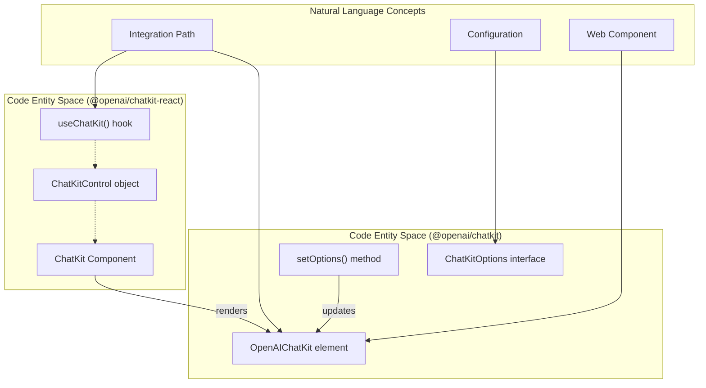
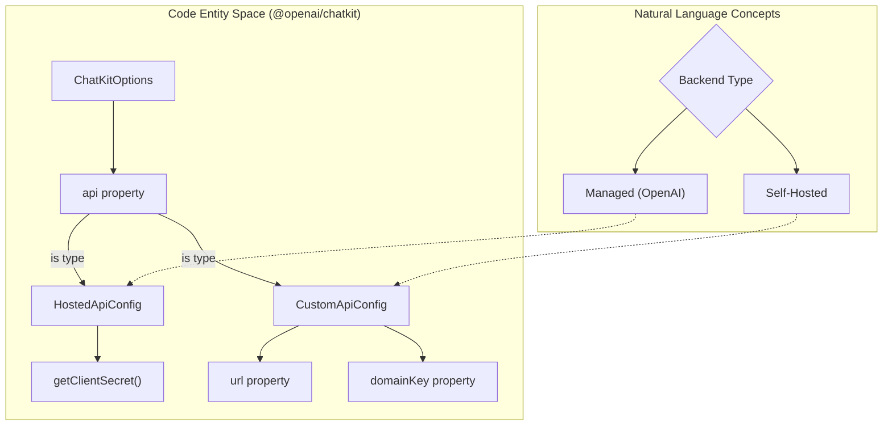

<!-- source: DeepWiki mcp.deepwiki.com · repo openai/chatkit-js · page 4.1 Quick Start · fetched 2026-10-26 -->

# Quick Start

<details>
<summary>Relevant source files</summary>

The following files were used as context for generating this wiki page:

- [packages/docs/src/content/docs/customize.mdx](packages/docs/src/content/docs/customize.mdx)
- [packages/docs/src/content/docs/index.mdx](packages/docs/src/content/docs/index.mdx)
- [packages/docs/src/content/docs/quickstart.mdx](packages/docs/src/content/docs/quickstart.mdx)

</details>


This guide provides step-by-step instructions for integrating ChatKit into your application using either React or vanilla JavaScript. The integration requires loading the ChatKit web component script and configuring the API connection to your backend.

For detailed backend configuration options, see [Backend Configuration](#4.2). For theme and UI customization, see [Theming and Customization](#4.3).

## Integration Overview

ChatKit is distributed as a web component (`openai-chatkit`) loaded from a CDN [packages/docs/src/content/docs/quickstart.mdx:10-16](). The `@openai/chatkit-react` package provides React-specific bindings [packages/docs/src/content/docs/quickstart.mdx:22-22](), while `@openai/chatkit` provides TypeScript type definitions for vanilla JavaScript usage [packages/docs/src/content/docs/quickstart.mdx:44-44]().

### Code-to-System Mapping: Integration Paths

The following diagram bridges the high-level integration concepts to the specific code entities used in the implementation.



**Sources:** [packages/docs/src/content/docs/quickstart.mdx:1-72](), [packages/docs/src/content/docs/index.mdx:19-52]()

## Prerequisites

### Load ChatKit Script

Add the ChatKit script tag to your HTML document. This must be present before the web component can be used.

```html
<script
  src="https://cdn.platform.openai.com/deployments/chatkit/chatkit.js"
  async
></script>
```

This script registers the `openai-chatkit` custom element and must be loaded once in your application's root HTML file [packages/docs/src/content/docs/quickstart.mdx:10-16]().

**Sources:** [packages/docs/src/content/docs/quickstart.mdx:10-16]()

## React Integration

### Installation

Install the React bindings package:

```bash
npm install @openai/chatkit-react
```

**Sources:** [packages/docs/src/content/docs/quickstart.mdx:21-23]()

### Basic Setup

The React integration uses the `useChatKit` hook from `@openai/chatkit-react` to create a control object, which is then passed to the `ChatKit` component [packages/docs/src/content/docs/quickstart.mdx:25-38]().

**Example Implementation:**

```tsx
import { ChatKit, useChatKit } from '@openai/chatkit-react';

export function SupportChat() {
  const { control } = useChatKit({
    api: {
      url: 'http://localhost:8000/chatkit',
      domainKey: 'local-dev',
    },
  });

  return <ChatKit control={control} className="h-[600px] w-[360px]" />;
}
```

**Key Components:**
- **`useChatKit`**: Hook that stabilizes options and returns a `control` object [packages/docs/src/content/docs/index.mdx:24-26]().
- **`ChatKit`**: React component wrapper that renders the underlying custom element [packages/docs/src/content/docs/index.mdx:29-32]().
- **`control`**: An instance of `ChatKitControl` containing methods to interact with the chat [packages/docs/src/content/docs/quickstart.mdx:29-36]().

**Sources:** [packages/docs/src/content/docs/quickstart.mdx:18-40](), [packages/docs/src/content/docs/index.mdx:22-35]()

## Vanilla JavaScript Integration

### Installation

Install the type definitions package for better developer experience:

```bash
npm install @openai/chatkit
```

**Sources:** [packages/docs/src/content/docs/quickstart.mdx:43-45]()

### Basic Setup

The vanilla JavaScript approach directly creates and configures the `openai-chatkit` custom element using standard DOM APIs [packages/docs/src/content/docs/quickstart.mdx:47-63]().

**Example Implementation:**

```html
<div id="chat-root"></div>
<script type="module">
  import '@openai/chatkit';

  const chatkit = document.createElement('openai-chatkit');

  chatkit.setOptions({
    api: {
      url: 'http://localhost:8000/chatkit',
      domainKey: 'local-dev',
    },
  });

  document.getElementById('chat-root')?.append(chatkit);
</script>
```

**Key Methods:**
- **`setOptions(options)`**: Configures the web component with API, theme, and UI settings [packages/docs/src/content/docs/index.mdx:43-43]().
- **`document.createElement('openai-chatkit')`**: Instantiates the custom element [packages/docs/src/content/docs/index.mdx:42-42]().

**Sources:** [packages/docs/src/content/docs/quickstart.mdx:41-66](), [packages/docs/src/content/docs/index.mdx:38-50]()

## Backend Configuration

ChatKit requires a backend configuration in the `api` field of `ChatKitOptions` [packages/docs/src/content/docs/customize.mdx:8-8]().

### Configuration Logic and Code Entities

This diagram shows how the configuration logic maps to specific interface types in the codebase.



| Configuration Type | Key Properties | Use Case |
| :--- | :--- | :--- |
| **Self-Hosted** (`CustomApiConfig`) | `url`, `domainKey` | Best for maximum control using the ChatKit Python SDK [packages/docs/src/content/docs/index.mdx:83-87](). |
| **Managed** (`HostedApiConfig`) | `getClientSecret` | Fastest setup using OpenAI-managed infrastructure [packages/docs/src/content/docs/index.mdx:85-87](). |

**Sources:** [packages/docs/src/content/docs/quickstart.mdx:30-33,54-59](), [packages/docs/src/content/docs/index.mdx:81-103]()

## Customization Quick Start

You can tailor the UI by passing additional fields to the options object. Key areas include:

- **Theme**: `colorScheme`, `radius`, and `color` palettes [packages/docs/src/content/docs/customize.mdx:17-23]().
- **Start Screen**: Custom `greeting` and suggested `prompts` [packages/docs/src/content/docs/customize.mdx:36-50]().
- **Composer**: Custom `placeholder` text [packages/docs/src/content/docs/customize.mdx:51-53]().

**Sources:** [packages/docs/src/content/docs/customize.mdx:13-59,113-120]()

## Next Steps

Once the basic integration is complete:

1. **Customize appearance**: Configure `theme`, `header`, and `history` options (see [Theming and Customization](#4.3)) [packages/docs/src/content/docs/customize.mdx:115-116]().
2. **Handle events**: Listen for `ready`, `error`, or `response` events [packages/docs/src/content/docs/index.mdx:63-69]().
3. **Implement client tools**: Enable interactive widgets and agentic actions [packages/docs/src/content/docs/index.mdx:65-66]().

**Sources:** [packages/docs/src/content/docs/customize.mdx:1-122](), [packages/docs/src/content/docs/index.mdx:57-72]()

---

