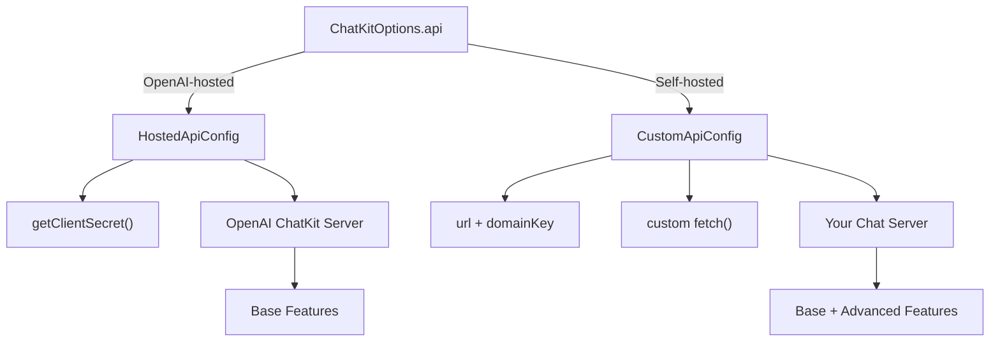
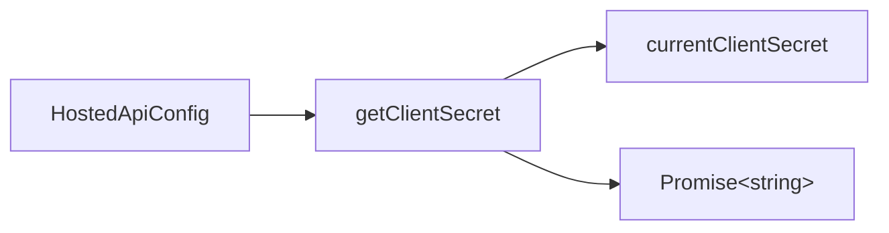
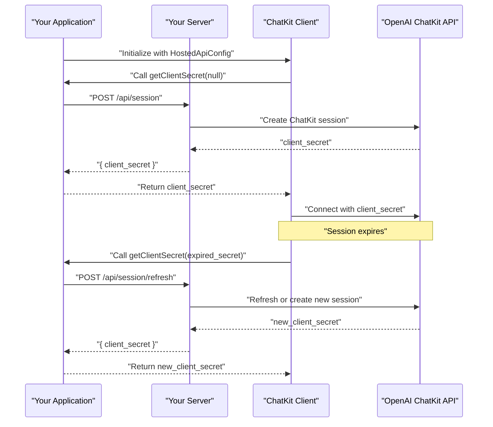
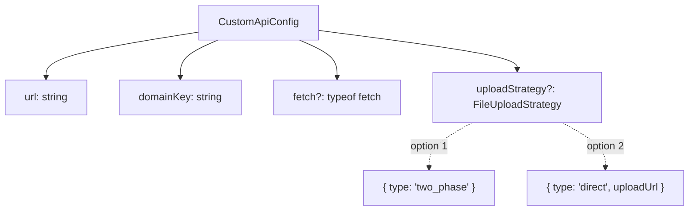
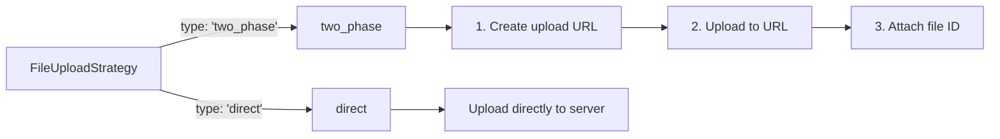
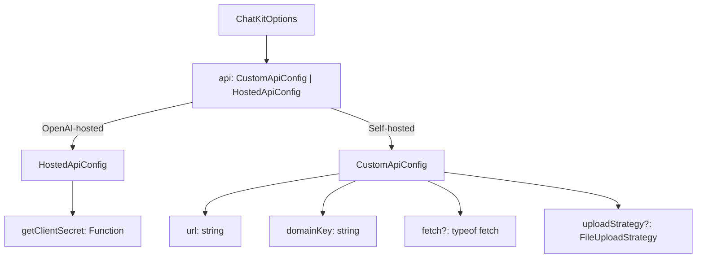

<!-- source: DeepWiki mcp.deepwiki.com · repo openai/chatkit-js · page 4.2 Backend Configuration · fetched 2026-10-26 -->

# Backend Configuration

<details>
<summary>Relevant source files</summary>

The following files were used as context for generating this wiki page:

- [.changeset/calm-geckos-glow.md](.changeset/calm-geckos-glow.md)
- [.changeset/real-coins-look.md](.changeset/real-coins-look.md)
- [packages/chatkit/types/index.d.ts](packages/chatkit/types/index.d.ts)
- [packages/docs/astro.config.ts](packages/docs/astro.config.ts)

</details>


This document explains how to configure ChatKit to communicate with either an OpenAI-hosted backend or a self-hosted backend. It covers the `api` configuration property in `ChatKitOptions`, authentication patterns, and feature availability for each backend type.

For information about getting started quickly with a basic configuration, see [Quick Start](#4.1). For information about customizing the UI appearance, see [Theming and Customization](#4.3).

## Backend Architecture Overview

ChatKit supports two fundamentally different backend architectures, configured through the `api` property in `ChatKitOptions` [packages/chatkit/types/index.d.ts:16-16]():

- **OpenAI-Hosted Backend** (`HostedApiConfig`): OpenAI manages the chat server, storage, and infrastructure. Authentication uses short-lived client secrets.
- **Self-Hosted Backend** (`CustomApiConfig`): You run the chat server on your own infrastructure and control the entire data path. Authentication is handled through custom fetch methods.

**Backend Configuration Decision Flow**



Sources: [packages/chatkit/types/index.d.ts:16-17](), [packages/chatkit/types/index.d.ts:634-669]()

## OpenAI-Hosted Backend Configuration

The `HostedApiConfig` type configures ChatKit to use OpenAI's managed backend infrastructure.

**Configuration Type Structure**



### HostedApiConfig Properties

| Property | Type | Required | Description |
|----------|------|----------|-------------|
| `getClientSecret` | `(currentClientSecret: string \| null) => Promise<string>` | Yes | Function to retrieve or refresh client secrets |

The `getClientSecret` function is called initially with `null` to obtain the first client secret, and subsequently with the current secret when it needs to be refreshed [packages/chatkit/types/index.d.ts:664-669]().

**Example Configuration**

```typescript
const options: ChatKitOptions = {
  api: {
    getClientSecret: async (currentClientSecret) => {
      if (currentClientSecret) {
        // Implement refresh logic if needed
      }
      
      const response = await fetch('/api/chatkit/session', {
        method: 'POST',
        headers: { 'Content-Type': 'application/json' }
      });
      
      const { client_secret } = await response.json();
      return client_secret;
    }
  }
};
```

Sources: [packages/chatkit/types/index.d.ts:664-669]()

### Authentication Flow

**OpenAI-Hosted Backend Authentication Sequence**



Sources: [packages/chatkit/types/index.d.ts:664-669]()

## Self-Hosted Backend Configuration

The `CustomApiConfig` type configures ChatKit to communicate with your own backend server.

**CustomApiConfig Structure**



### CustomApiConfig Properties

| Property | Type | Required | Description |
|----------|------|----------|-------------|
| `url` | `string` | Yes | URL of your ChatKit-compatible API endpoint |
| `domainKey` | `string` | Yes | Domain verification key for your integration |
| `fetch` | `typeof fetch` | No | Custom fetch function for adding auth headers or credentials |
| `uploadStrategy` | `FileUploadStrategy` | No | File upload strategy (required when attachments are enabled) |

Sources: [packages/chatkit/types/index.d.ts:634-662]()

### URL Configuration

The `url` property can be either relative or absolute [packages/chatkit/types/index.d.ts:636-641]():

```typescript
// Relative URL (same domain)
const options: ChatKitOptions = {
  api: {
    url: '/api/chatkit',
    domainKey: 'your-domain-key'
  }
};
```

The endpoint must conform to the ChatKit API specification. OpenAI provides a Python SDK for building compatible backends [packages/docs/astro.config.ts:71-73]().

### Custom Fetch Implementation

Use the `fetch` property to inject authentication headers or modify request behavior [packages/chatkit/types/index.d.ts:643-648]():

```typescript
const options: ChatKitOptions = {
  api: {
    url: '/api/chatkit',
    domainKey: 'your-domain-key',
    fetch: async (input, init) => {
      // Add authentication headers
      const headers = new Headers(init?.headers);
      headers.set('Authorization', `Bearer ${getUserToken()}`);
      
      return fetch(input, {
        ...init,
        headers,
        credentials: 'include'
      });
    }
  }
};
```

Sources: [packages/chatkit/types/index.d.ts:643-648]()

## File Upload Strategies

When attachments are enabled in the composer [packages/chatkit/types/index.d.ts:263-270](), you must configure an upload strategy for the self-hosted backend using the `uploadStrategy` property.

**FileUploadStrategy Types**



### Two-Phase Upload Strategy

The two-phase strategy requests an upload URL from your server before uploading the file. This is useful for direct-to-cloud storage (e.g., S3 presigned URLs) [packages/chatkit/types/index.d.ts:657-661]().

### Direct Upload Strategy

The direct strategy uploads files directly to a specified endpoint provided in `uploadUrl` [packages/chatkit/types/index.d.ts:657-661]().

## Feature Availability by Backend Type

Certain UI components and protocol features are only available or optimized for specific backend types.

| Feature | OpenAI-Hosted | Self-Hosted |
|---------|---------------|-------------|
| **Core Chat** | ✓ | ✓ |
| **History Panel** | ✓ [packages/chatkit/types/index.d.ts:70-74]() | ✓ |
| **Attachments** | ✓ [packages/chatkit/types/index.d.ts:263-270]() | ✓ |
| **Widgets** | ✓ [packages/chatkit/types/index.d.ts:113-117]() | ✓ |
| **Entity Tags** | ✓ [packages/chatkit/types/index.d.ts:106-110]() | ✓ |
| **Feedback Buttons** | ✓ [packages/chatkit/types/index.d.ts:236-243]() | ✓ |
| **Custom Tools** | ✓ [packages/chatkit/types/index.d.ts:51-60]() | ✓ |

### Widgets Support
Both backends support rendering rich interactive widgets. ChatKit threads now support `BasicRoot` widgets [real-coins-look.md:5-6](), allowing for complex UI components like cards and list views [packages/chatkit/types/index.d.ts:193-200]().

## Configuration Interface Mapping

**ChatKitOptions.api Type Resolution**



Sources: [packages/chatkit/types/index.d.ts:10-16](), [packages/chatkit/types/index.d.ts:634-669]()

## Complete Configuration Examples

### Self-Hosted Backend with Authentication and Uploads

```typescript
import { ChatKitOptions } from '@openai/chatkit';

const options: ChatKitOptions = {
  api: {
    url: 'https://api.example.com/chatkit',
    domainKey: 'prod-domain-key-123',
    fetch: async (input, init) => {
      const headers = new Headers(init?.headers);
      headers.set('Authorization', `Bearer ${localStorage.getItem('token')}`);
      return fetch(input, { ...init, headers });
    },
    uploadStrategy: {
      type: 'two_phase'
    }
  },
  composer: {
    attachments: {
      enabled: true
    }
  }
};
```

Sources: [packages/chatkit/types/index.d.ts:634-662](), [packages/chatkit/types/index.d.ts:263-270]()

---

