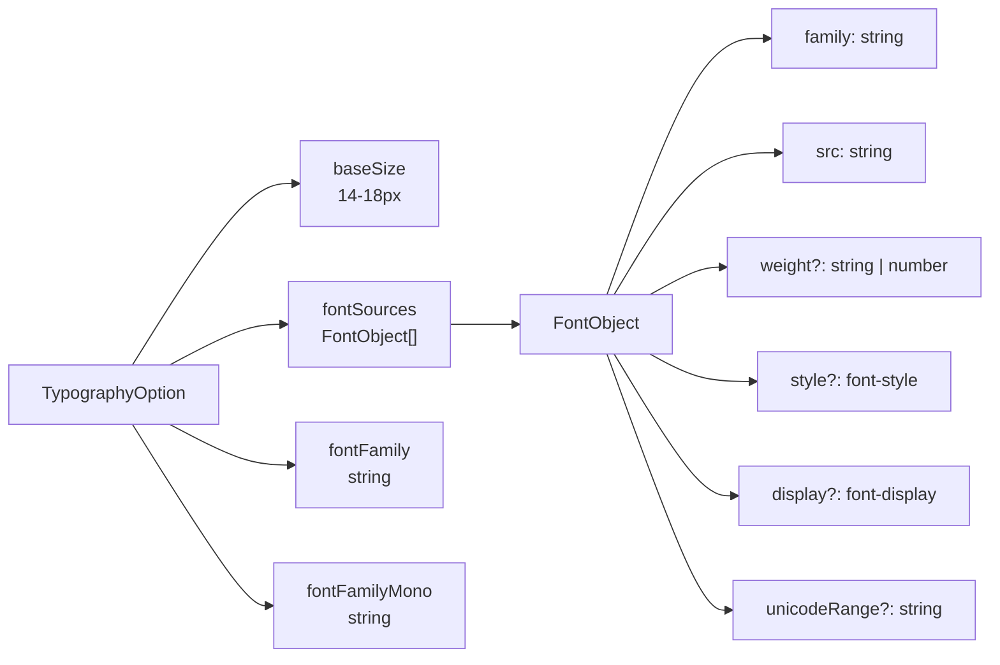
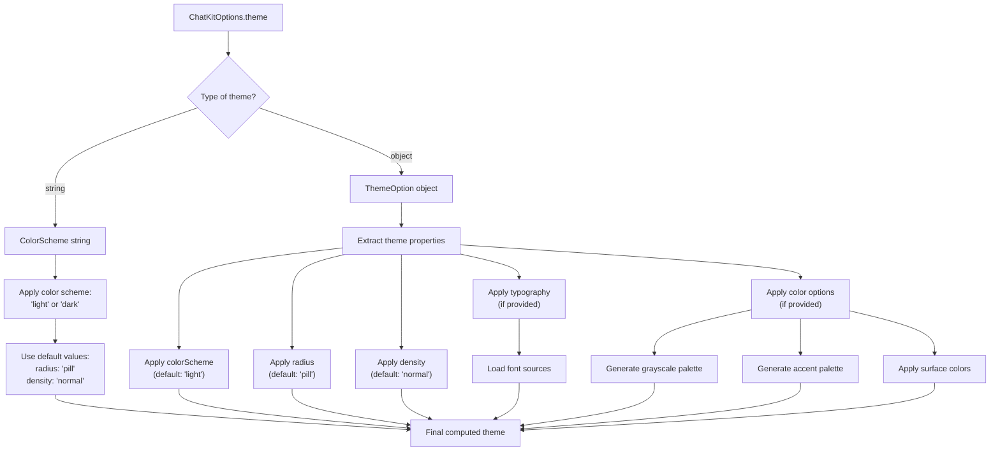

<!-- source: DeepWiki mcp.deepwiki.com · repo openai/chatkit-js · page 4.3 Theming and Customization · fetched 2026-10-26 -->

# Theming and Customization

<details>
<summary>Relevant source files</summary>

The following files were used as context for generating this wiki page:

- [.changeset/calm-geckos-glow.md](.changeset/calm-geckos-glow.md)
- [.changeset/real-coins-look.md](.changeset/real-coins-look.md)
- [packages/chatkit/types/index.d.ts](packages/chatkit/types/index.d.ts)
- [packages/docs/src/content/docs/customize.mdx](packages/docs/src/content/docs/customize.mdx)
- [packages/docs/src/content/docs/quickstart.mdx](packages/docs/src/content/docs/quickstart.mdx)

</details>


This page documents the visual appearance configuration options available through the `theme` property of `ChatKitOptions`. The theme system controls color schemes, border radius, spacing density, typography, and custom color palettes. For configuration of functional UI components (header, composer, history panel, etc.), see other sections in [Integration Guides](#4). For backend-related configuration, see [Backend Configuration](#4.2).

The `theme` property accepts either a simple `ColorScheme` string (`"light"` or `"dark"`) or a detailed `ThemeOption` object for fine-grained control over appearance.

Sources: [packages/chatkit/types/index.d.ts:28-34](), [packages/chatkit/types/index.d.ts:678-714]()

---

## Theme Configuration Structure

The following diagram shows the complete hierarchy of theme configuration options:

```mermaid
graph TB
    ChatKitOptions["ChatKitOptions"]
    theme["theme: ColorScheme | ThemeOption"]
    
    ColorScheme["ColorScheme<br/>'light' | 'dark'"]
    ThemeOption["ThemeOption"]
    
    colorScheme["colorScheme?: ColorScheme"]
    typography["typography?: TypographyOption"]
    radius["radius?: 'pill' | 'round' | 'soft' | 'sharp'"]
    density["density?: 'compact' | 'normal' | 'spacious'"]
    color["color?: ColorOption"]
    
    TypographyOption["TypographyOption"]
    baseSize["baseSize?: 14 | 15 | 16 | 17 | 18"]
    fontSources["fontSources?: FontObject[]"]
    fontFamily["fontFamily?: string"]
    fontFamilyMono["fontFamilyMono?: string"]
    
    FontObject["FontObject"]
    family["family: string"]
    src["src: string"]
    weight["weight?: string | number"]
    style["style?: 'normal' | 'italic' | 'oblique'"]
    display["display?: 'auto' | 'block' | 'swap' | 'fallback' | 'optional'"]
    
    ColorOption["ColorOption"]
    grayscale["grayscale?: GrayscaleOptions"]
    accent["accent?: AccentColor"]
    surface["surface?: SurfaceColors"]
    
    GrayscaleOptions["GrayscaleOptions"]
    hue["hue: number (0-360)"]
    tint["tint: 0 | 1 | 2 | 3 | 4 | 5 | 6 | 7 | 8 | 9"]
    shade["shade?: -4 to 4"]
    
    AccentColor["AccentColor"]
    primary["primary: string"]
    level["level: 0 | 1 | 2 | 3"]
    
    SurfaceColors["SurfaceColors"]
    background["background: string"]
    foreground["foreground: string"]
    
    ChatKitOptions --> theme
    theme -.-> ColorScheme
    theme -.-> ThemeOption
    
    ThemeOption --> colorScheme
    ThemeOption --> typography
    ThemeOption --> radius
    ThemeOption --> density
    ThemeOption --> color
    
    typography --> TypographyOption
    TypographyOption --> baseSize
    TypographyOption --> fontSources
    TypographyOption --> fontFamily
    TypographyOption --> fontFamilyMono
    
    fontSources --> FontObject
    FontObject --> family
    FontObject --> src
    FontObject --> weight
    FontObject --> style
    FontObject --> display
    
    color --> ColorOption
    ColorOption --> grayscale
    ColorOption --> accent
    ColorOption --> surface
    
    grayscale --> GrayscaleOptions
    GrayscaleOptions --> hue
    GrayscaleOptions --> tint
    GrayscaleOptions --> shade
    
    accent --> AccentColor
    AccentColor --> primary
    AccentColor --> level
    
    surface --> SurfaceColors
    SurfaceColors --> background
    SurfaceColors --> foreground
```

**Type Hierarchy for Theme Configuration**

This diagram maps the complete structure of theme-related types in the ChatKit configuration system.

Sources: [packages/chatkit/types/index.d.ts:28-34](), [packages/chatkit/types/index.d.ts:678-714](), [packages/chatkit/types/index.d.ts:716-740]()

---

## Color Scheme

The `colorScheme` property controls whether ChatKit renders in light or dark mode. When the `theme` property is a string, it directly sets the color scheme. When `theme` is a `ThemeOption` object, `colorScheme` is a nested property.

**Type Definition:**

```typescript
type ColorScheme = 'light' | 'dark'
```

**Default:** `"light"`

**Usage:**

```typescript
// Simple color scheme configuration
const options = {
  theme: 'dark'
};

// Color scheme within ThemeOption
const options = {
  theme: {
    colorScheme: 'dark',
    // ... other theme options
  }
};
```

The color scheme affects all default colors, shadows, and contrast ratios throughout the ChatKit UI. Custom color configurations (via `ColorOption`) are applied on top of the base color scheme.

Sources: [packages/chatkit/types/index.d.ts:28-34](), [packages/chatkit/types/index.d.ts:672](), [packages/chatkit/types/index.d.ts:679-686]()

---

## Radius Configuration

The `radius` property determines the overall roundness of UI elements including buttons, inputs, cards, and containers.

**Type Definition:**

```typescript
type radius = 'pill' | 'round' | 'soft' | 'sharp'
```

**Default:** `"pill"`

| Value | Description |
|-------|-------------|
| `pill` | Maximum roundness; buttons and inputs appear fully rounded at the ends |
| `round` | Moderate roundness with noticeable curved corners |
| `soft` | Subtle rounded corners |
| `sharp` | No border radius; all corners are 90-degree angles |

**Usage:**

```typescript
const options = {
  theme: {
    radius: 'soft'
  }
};
```

The radius setting is applied consistently across all interactive elements to maintain visual coherence throughout the interface.

Sources: [packages/chatkit/types/index.d.ts:696-700]()

---

## Density Configuration

The `density` property controls the overall spacing and padding throughout the ChatKit UI, affecting the compactness of the interface.

**Type Definition:**

```typescript
type density = 'compact' | 'normal' | 'spacious'
```

**Default:** `"normal"`

| Value | Description |
|-------|-------------|
| `compact` | Reduced padding and spacing; more content visible in limited space |
| `normal` | Standard spacing optimized for most use cases |
| `spacious` | Increased padding and spacing for a more relaxed layout |

**Usage:**

```typescript
const options = {
  theme: {
    density: 'spacious'
  }
};
```

Density affects padding within components, gaps between elements, and vertical spacing in thread views. Choose `compact` for dense information displays, `normal` for balanced layouts, or `spacious` for accessibility-focused designs.

Sources: [packages/chatkit/types/index.d.ts:702-706]()

---

## Typography Configuration

The `typography` property within `ThemeOption` provides comprehensive control over font families, sizes, and loading behavior.



**Typography Configuration Structure**

Sources: [packages/chatkit/types/index.d.ts:688-693](), [packages/chatkit/types/index.d.ts:716-725](), [packages/chatkit/types/index.d.ts:564-577]()

### Base Font Size

The `baseSize` property sets the root font size in pixels from which all relative text sizes are calculated.

**Type:** `14 | 15 | 16 | 17 | 18`

**Usage:**

```typescript
const options = {
  theme: {
    typography: {
      baseSize: 16
    }
  }
};
```

All text elements scale proportionally from the base size, maintaining visual hierarchy throughout the interface.

Sources: [packages/chatkit/types/index.d.ts:717-718]()

### Font Sources

The `fontSources` property defines custom web fonts to load. Each `FontObject` in the array specifies a font face and its loading parameters.

**FontObject Type Definition:**

| Property | Type | Description |
|----------|------|-------------|
| `family` | `string` | CSS font-family name (required) |
| `src` | `string` | URL of the font file (required) |
| `weight` | `string \| number` | Font weight (e.g., `400`, `"bold"`) |
| `style` | `'normal' \| 'italic' \| 'oblique'` | Font style variant |
| `display` | `'auto' \| 'block' \| 'swap' \| 'fallback' \| 'optional'` | Font rendering behavior |
| `unicodeRange` | `string` | Optional unicode range descriptor |

**Usage:**

```typescript
const options = {
  theme: {
    typography: {
      fontSources: [
        {
          family: 'Inter',
          src: 'https://fonts.example.com/inter-regular.woff2',
          weight: 400,
          style: 'normal',
          display: 'swap'
        },
        {
          family: 'Inter',
          src: 'https://fonts.example.com/inter-bold.woff2',
          weight: 700,
          style: 'normal',
          display: 'swap'
        }
      ],
      fontFamily: 'Inter, sans-serif'
    }
  }
};
```

The `display` property controls font loading behavior:
- `swap`: Text is immediately visible using fallback fonts until custom font loads
- `block`: Brief invisible period, then swap to custom font
- `fallback`: Very brief invisible period, then swap if font loads quickly
- `optional`: Font may not be used if it doesn't load immediately
- `auto`: Browser default behavior

Sources: [packages/chatkit/types/index.d.ts:564-577](), [packages/chatkit/types/index.d.ts:719-722]()

### Font Family

The `fontFamily` and `fontFamilyMono` properties specify CSS font stacks for regular text and monospace text respectively.

**Usage:**

```typescript
const options = {
  theme: {
    typography: {
      fontFamily: 'Inter, -apple-system, BlinkMacSystemFont, sans-serif',
      fontFamilyMono: 'Fira Code, Consolas, Monaco, monospace'
    }
  }
};
```

The `fontFamily` applies to all body text, headers, and UI labels. The `fontFamilyMono` applies to code blocks, technical identifiers, and other monospaced content.

Sources: [packages/chatkit/types/index.d.ts:723-724]()

---

## Color Customization

The `color` property within `ThemeOption` provides granular control over the color palette through three sub-options: `grayscale`, `accent`, and `surface`.

### Grayscale Configuration

The `grayscale` property configures the neutral color palette by specifying a hue and tint parameters that generate a consistent gray scale.

**GrayscaleOptions Type:**

| Property | Type | Description |
|----------|------|-------------|
| `hue` | `number` (0-360) | Hue in degrees for the grayscale palette (required) |
| `tint` | `0 \| 1 \| 2 \| 3 \| 4 \| 5 \| 6 \| 7 \| 8 \| 9` | Tint step applied to grayscale (required) |
| `shade` | `-4 \| -3 \| -2 \| -1 \| 0 \| 1 \| 2 \| 3 \| 4` | Optional shade adjustment |

**Usage:**

```typescript
const options = {
  theme: {
    color: {
      grayscale: {
        hue: 220,  // Blueish gray
        tint: 3,
        shade: 0
      }
    }
  }
};
```

The `hue` value determines the color temperature of neutral tones:
- 0-30: Warm grays (reddish)
- 180-240: Cool grays (blueish)
- 120: Greenish grays

The `tint` parameter controls the saturation level, with higher values producing more colorful grays. The `shade` parameter shifts the entire palette lighter (negative values) or darker (positive values).

Sources: [packages/chatkit/types/index.d.ts:607-614](), [packages/chatkit/types/index.d.ts:729-731]()

### Accent Color Configuration

The `accent` property defines the primary interactive color used for buttons, links, selected states, and focus indicators.

**AccentColor Type:**

| Property | Type | Description |
|----------|------|-------------|
| `primary` | `string` | Base accent color in any CSS color format (required) |
| `level` | `0 \| 1 \| 2 \| 3` | Intensity level for the accent palette (required) |

**Usage:**

```typescript
const options = {
  theme: {
    color: {
      accent: {
        primary: '#8B5CF6',  // Violet
        level: 2
      }
    }
  }
};
```

The `primary` color accepts any CSS color format: hex (`#8B5CF6`), rgb (`rgb(139, 92, 246)`), hsl (`hsl(258, 90%, 66%)`), or named colors.

The `level` parameter controls the intensity of the accent color throughout the UI:
- `0`: Subtle, low-contrast accent
- `1`: Moderate accent presence
- `2`: Standard accent visibility
- `3`: High-contrast, vibrant accent

Sources: [packages/chatkit/types/index.d.ts:597-602](), [packages/chatkit/types/index.d.ts:732-735]()

### Surface Color Configuration

The `surface` property directly overrides the background and foreground colors for the main UI surface, bypassing the default color scheme calculations.

**SurfaceColors Type:**

| Property | Type | Description |
|----------|------|-------------|
| `background` | `string` | Background color for surfaces (required) |
| `foreground` | `string` | Foreground color (text/icons) for surfaces (required) |

**Usage:**

```typescript
const options = {
  theme: {
    color: {
      surface: {
        background: '#1a1a1a',
        foreground: '#e0e0e0'
      }
    }
  }
};
```

The `surface` configuration provides direct control over the primary container colors. The `background` value sets the main surface color, while `foreground` sets the text and icon color rendered on that surface. Ensure sufficient contrast between these values for accessibility.

Sources: [packages/chatkit/types/index.d.ts:587-592](), [packages/chatkit/types/index.d.ts:736-739]()

---

## Complete Configuration Example

The following example demonstrates a comprehensive theme configuration utilizing all available options:

```typescript
const themeConfig = {
  theme: {
    colorScheme: 'dark',
    radius: 'round',
    density: 'normal',
    
    typography: {
      baseSize: 16,
      fontSources: [
        {
          family: 'Inter',
          src: 'https://fonts.gstatic.com/s/inter/v12/UcCO3FwrK3iLTeHuS_fvQtMwCp50KnMw2boKoduKmMEVuLyfAZ9hiA.woff2',
          weight: 400,
          display: 'swap'
        },
        {
          family: 'Inter',
          src: 'https://fonts.gstatic.com/s/inter/v12/UcCO3FwrK3iLTeHuS_fvQtMwCp50KnMw2boKoduKmMEVuGKYAZ9hiA.woff2',
          weight: 600,
          display: 'swap'
        }
      ],
      fontFamily: 'Inter, -apple-system, BlinkMacSystemFont, "Segoe UI", sans-serif',
      fontFamilyMono: 'Fira Code, Consolas, Monaco, "Courier New", monospace'
    },
    
    color: {
      grayscale: {
        hue: 240,
        tint: 4,
        shade: 1
      },
      accent: {
        primary: '#8B5CF6',
        level: 2
      },
      surface: {
        background: '#0f0f0f',
        foreground: '#f5f5f5'
      }
    }
  }
};
```

This configuration creates a dark-themed interface with:
- Rounded corners on UI elements
- Standard spacing density
- 16px base font size with custom Inter font
- Cool-toned grayscale palette (hue 240)
- Violet accent color at moderate intensity
- Custom dark surface colors

Sources: [packages/chatkit/types/index.d.ts:678-740](), [packages/docs/src/content/docs/customize.mdx:13-59]()

---

## Theme Option Resolution

The following diagram illustrates how theme options are resolved and applied:



**Theme Resolution Flow**

This diagram shows how the web component processes theme configuration from input to final applied styles.

Sources: [packages/chatkit/types/index.d.ts:28-34](), [packages/chatkit/types/index.d.ts:678-740]()

---

## Integration with ChatKit Options

Theme configuration is provided through the `theme` property of `ChatKitOptions`. The following table shows where theme configuration fits within the broader options structure:

| ChatKitOptions Property | Purpose | Related Page |
|-------------------------|---------|--------------|
| `api` | Backend configuration | [Backend Configuration](#4.2) |
| `theme` | Visual appearance (documented here) | Current page |
| `header` | Header layout and controls | [Integration Guides](#4) |
| `history` | Thread history panel | [Integration Guides](#4) |
| `startScreen` | New thread greeting screen | [Integration Guides](#4) |
| `composer` | Input field configuration | [Integration Guides](#4) |
| `threadItemActions` | Message action buttons | [Integration Guides](#4) |
| `entities` | Entity tag system | [Client Tools and Extensions](#4.4) |
| `widgets` | Interactive widget system | [Client Tools and Extensions](#4.4) |

The theme configuration applies globally to all visual elements across these areas. For example, the `accent` color defined in the theme is used for:
- Interactive buttons in the `header`
- Submit buttons in the `composer`
- Selected states in the `history` panel
- Action buttons in `threadItemActions`
- Interactive elements within `widgets`

Sources: [packages/chatkit/types/index.d.ts:9-112](), [packages/docs/src/content/docs/customize.mdx:113-120]()

---

## Runtime Theme Updates

Theme options can be updated at runtime using the `setOptions` method on the `OpenAIChatKit` element. When updating theme options, provide a complete `ChatKitOptions` object as options are not merged with existing configuration.

```typescript
// React
import { useChatKit } from '@openai/chatkit-react';

const { control } = useChatKit({
  api: { /* ... */ },
  theme: 'light'
});

// Later, update to dark theme
control.instance?.setOptions({
  api: { /* same api config */ },
  theme: 'dark'
});

// Vanilla JavaScript
const chatkit = document.querySelector('openai-chatkit');

chatkit.setOptions({
  api: { /* ... */ },
  theme: {
    colorScheme: 'dark',
    radius: 'soft'
  }
});
```

**Important:** The `setOptions` method replaces the entire configuration. Always provide complete options when updating, including unchanged properties.

Sources: [packages/chatkit/types/index.d.ts:894-900](), [packages/docs/src/content/docs/customize.mdx:10-111]()

---

