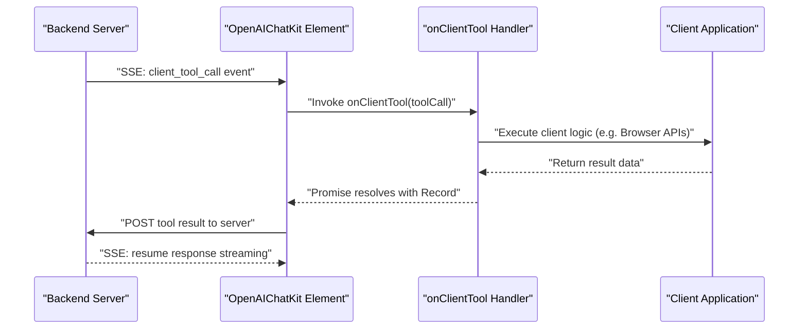
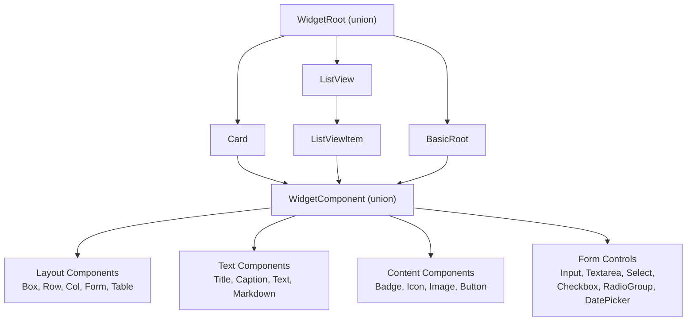
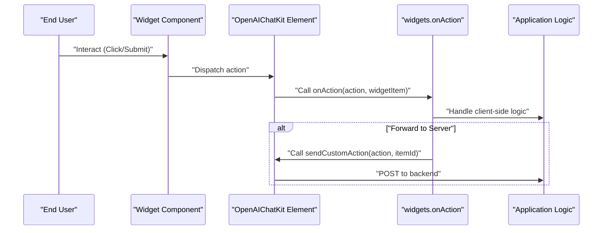
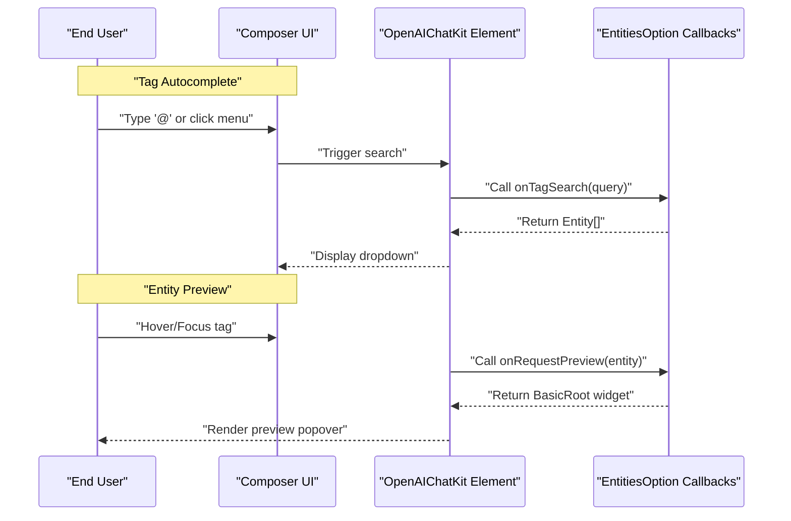

<!-- source: DeepWiki mcp.deepwiki.com · repo openai/chatkit-js · page 4.4 Client Tools and Extensions · fetched 2026-10-26 -->

# Client Tools and Extensions

<details>
<summary>Relevant source files</summary>

The following files were used as context for generating this wiki page:

- [.changeset/calm-geckos-glow.md](.changeset/calm-geckos-glow.md)
- [.changeset/late-falcons-scream.md](.changeset/late-falcons-scream.md)
- [.changeset/light-frogs-cry.md](.changeset/light-frogs-cry.md)
- [.changeset/real-coins-look.md](.changeset/real-coins-look.md)
- [packages/chatkit/CHANGELOG.md](packages/chatkit/CHANGELOG.md)
- [packages/chatkit/types/index.d.ts](packages/chatkit/types/index.d.ts)
- [packages/chatkit/types/widgets.d.ts](packages/chatkit/types/widgets.d.ts)

</details>


This page documents the extension mechanisms that enable ChatKit to integrate with application-specific functionality on the client side. These systems allow the backend to invoke client functions, render rich interactive UIs, handle entity references, and trigger client-side effects.

For information about configuring the composer and attachments, see [Theming and Customization](#4.3). For backend configuration details, see [Backend Configuration](#4.2).

---

## Overview

ChatKit provides four primary extension mechanisms:

| Extension Type | Purpose | Configuration Location |
|----------------|---------|------------------------|
| Client Tools | Synchronous function calls from server to client during response generation | `ChatKitOptions.onClientTool` |
| Widgets | Rich interactive UI components rendered in assistant responses | `ChatKitOptions.widgets.onAction` |
| Entities | Referenceable objects (people, documents, etc.) with search and preview | `ChatKitOptions.entities` |
| Client Effects | Fire-and-forget events triggered by the server | `ChatKitEvents['chatkit.effect']` |

Sources: [packages/chatkit/types/index.d.ts:51-117]()

---

## Client Tool System

Client tools enable the backend to synchronously invoke client-side functions during response generation. When the server needs data or actions that only the client can provide (e.g., reading local storage, accessing browser APIs, or fetching user-specific data), it issues a client tool call that pauses response streaming until the client returns a result.

### Configuration

The `onClientTool` callback is configured in `ChatKitOptions` [packages/chatkit/types/index.d.ts:9-60]():

```typescript
{
  onClientTool?: (toolCall: {
    name: string;
    params: Record<string, unknown>;
  }) => Promise<Record<string, unknown>> | Record<string, unknown>;
}
```

**Execution model:** When the server sends a client tool invocation during response streaming, ChatKit calls the `onClientTool` handler with the tool name and parameters [packages/chatkit/types/index.d.ts:51-60](). The handler must return (or promise) a JSON-serializable object, which is sent back to the server. Response streaming resumes once the result is received.

Sources: [packages/chatkit/types/index.d.ts:51-60]()

### Client Tool Execution Flow



**Sources:** [packages/chatkit/types/index.d.ts:51-60]()

---

## Widget System

Widgets are rich interactive UI components rendered within assistant responses. The widget type system provides layout containers, form controls, text components, and interactive elements that can trigger actions handled by the client application.

### Widget Type Hierarchy

The `WidgetRoot` is a union of `Card`, `ListView`, and `BasicRoot` [packages/chatkit/types/widgets.d.ts:1]().



**Sources:** [packages/chatkit/types/widgets.d.ts:1-28](), [packages/chatkit/types/widgets.d.ts:32-66]()

### Widget Action Handling

Widgets can trigger actions through user interactions (button clicks, form submissions, select changes). These actions are handled by the `onAction` callback in `WidgetsOption` [packages/chatkit/types/index.d.ts:188-200]().

**Configuration:**

```typescript
export type WidgetsOption = {
  onAction?: (
    action: { type: string; payload?: Record<string, unknown> },
    widgetItem: {
      id: string;
      widget: Widgets.Card | Widgets.ListView | Widgets.BasicRoot;
    },
  ) => Promise<void>;
};
```

Sources: [packages/chatkit/types/index.d.ts:188-200]()

### Widget Action Flow



**Sources:** [packages/chatkit/types/index.d.ts:188-200](), [packages/chatkit/types/index.d.ts:2558-2583]()

### Sending Actions to Server

After handling an action client-side, you can forward it to the server using the `sendCustomAction` method on the `OpenAIChatKit` element [packages/chatkit/types/index.d.ts:2558-2583]().

---

## Entity System

Entities represent referenceable objects (people, documents, internal records) that can be tagged in messages, searched via autocomplete, clicked for actions, and previewed with rich widget-based UIs.

### Entity Type Definition

An `Entity` contains metadata used for both display and server-side processing [packages/chatkit/types/index.d.ts:2118-2148]().

```typescript
export type Entity = {
  title: string;
  id: string;
  icon?: string;
  interactive?: boolean;
  group?: string;
  data?: Record<string, string>;
};
```

Sources: [packages/chatkit/types/index.d.ts:2118-2148]()

### Entity Configuration

The `EntitiesOption` interface provides callbacks for search and interaction [packages/chatkit/types/index.d.ts:202-227]():

```typescript
export type EntitiesOption = {
  onTagSearch?: (query: string) => Promise<Entity[]>;
  showComposerMenu?: boolean; // Renders '@' trigger button
  onClick?: (entity: Entity) => void;
  onRequestPreview?: (
    entity: Entity,
  ) => Promise<{ preview: Widgets.BasicRoot | null }>;
};
```

Sources: [packages/chatkit/types/index.d.ts:202-227](), [packages/chatkit/CHANGELOG.md:19]()

### Entity Interaction Flow



**Sources:** [packages/chatkit/types/index.d.ts:202-227]()

### Using Entities in Messages

Entities can be included in user messages via structured content in `sendUserMessage` or `setComposerValue` [packages/chatkit/types/index.d.ts:2585-2620]().

```typescript
type UserMessageContent =
  | { type: 'input_text'; text: string }
  | { 
      type: 'input_tag';
      text: string;
      id: string;
      group?: string;
      data?: Record<string, unknown>;
      interactive?: boolean;
    };
```

Sources: [packages/chatkit/types/index.d.ts:2157-2172]()

---

## Client Effects

Client effects are fire-and-forget events triggered by the server to notify the client of side effects without expecting a response. Unlike client tools, effects do not block response generation.

### Effect Event

The `chatkit.effect` event is dispatched to the client when the server requests a side effect [packages/chatkit/CHANGELOG.md:43]().

```typescript
// Event type in ChatKitEvents
'chatkit.effect': CustomEvent<{
  name: string;
  data?: Record<string, unknown>;
}>;
```

Sources: [packages/chatkit/types/index.d.ts:2725-2729]()

---

## Extension System Summary

| Mechanism | Execution | Response Blocking | Return Value | Use Case |
|-----------|-----------|-------------------|--------------|----------|
| **Client Tools** | Synchronous | Yes | Required `Record` | Server needs browser/client data |
| **Widget Actions** | Asynchronous | No | `Promise<void>` | User clicks a button in a card |
| **Entity Callbacks** | Asynchronous | No | `Entity[]` or `BasicRoot` | Search and preview system objects |
| **Client Effects** | Fire-and-forget | No | None | Notifications, UI state updates |

Sources: [packages/chatkit/types/index.d.ts:51-227](), [packages/chatkit/types/index.d.ts:2725-2729]()

---

