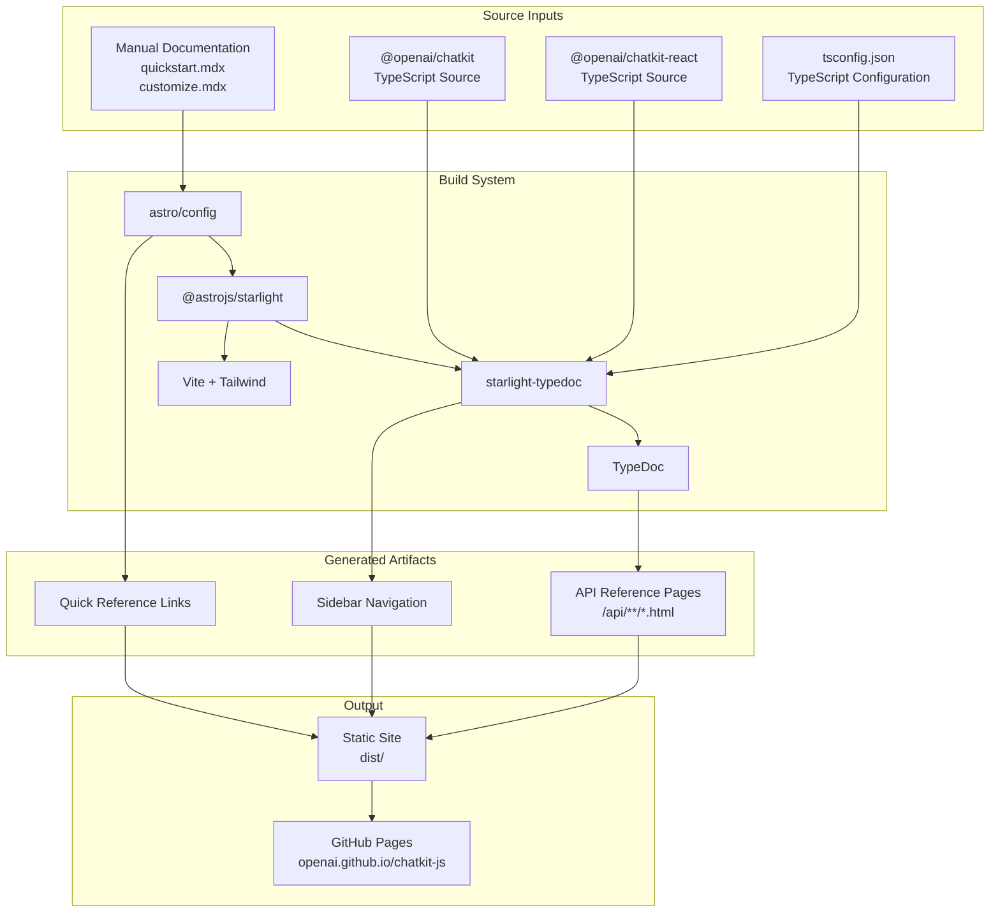
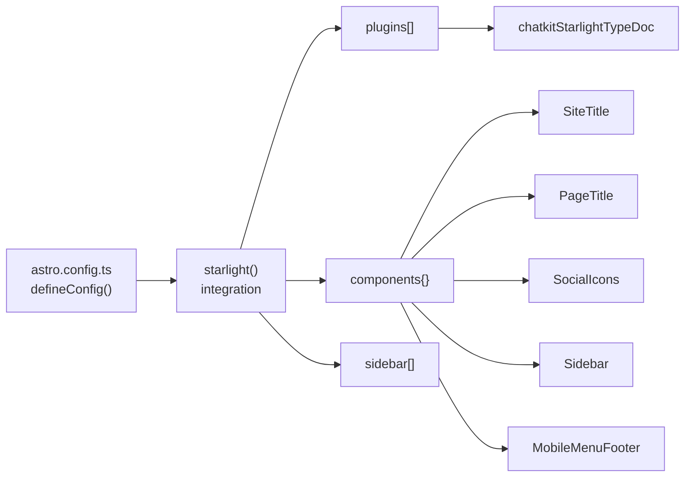
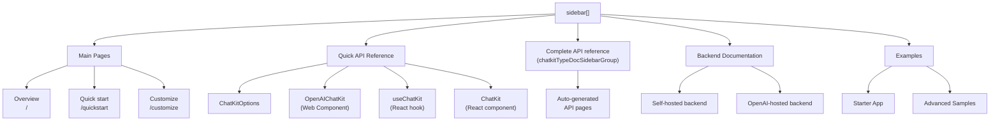
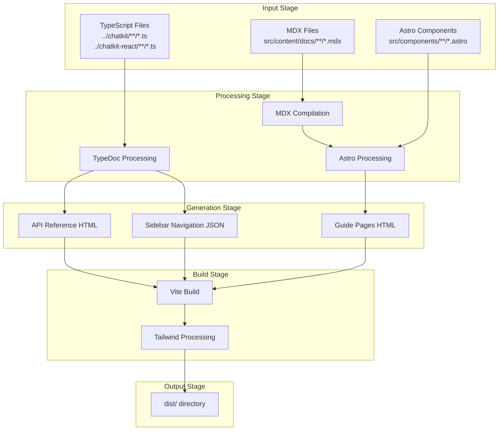
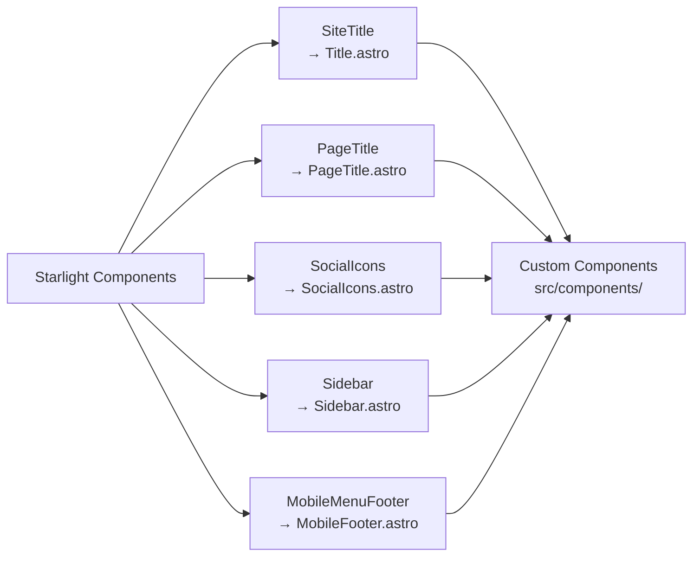

<!-- source: DeepWiki mcp.deepwiki.com · repo openai/chatkit-js · page 5 Documentation System · fetched 2026-10-26 -->

# Documentation System

<details>
<summary>Relevant source files</summary>

The following files were used as context for generating this wiki page:

- [packages/docs/astro.config.ts](packages/docs/astro.config.ts)
- [packages/docs/package.json](packages/docs/package.json)

</details>


## Purpose and Scope

The Documentation System is the infrastructure for building, generating, and deploying the ChatKit.js documentation website. It uses Astro with the Starlight theme to create a static documentation site that combines manually-written guides with automatically-generated API reference documentation extracted from TypeScript source files. The system handles the transformation of TypeScript types, interfaces, and JSDoc comments into readable HTML documentation, manages navigation structure, and deploys to GitHub Pages.

For information about the specific content and usage guides contained in the documentation, see the Integration Guides [Integration Guides](#4). This page focuses on the technical infrastructure that builds and generates the documentation itself.

## System Architecture

The documentation system is implemented as a separate package within the monorepo at `packages/docs/`. It orchestrates multiple tools to transform source files into a deployed website:



**Sources:** [packages/docs/astro.config.ts:1-150]()

## Core Configuration

The entire documentation system is configured through a single `astro.config.ts` file that defines the build process, content sources, and output structure.

### Astro Configuration

The base Astro configuration specifies the deployment target and integrations:

| Configuration | Value | Purpose |
|---------------|-------|---------|
| `site` | `https://openai.github.io` | Base URL for the deployed site [packages/docs/astro.config.ts:101-101]() |
| `base` | `/chatkit-js` | Path prefix for all routes [packages/docs/astro.config.ts:102-102]() |
| `integrations` | `[starlight]` | Uses Starlight theme for documentation [packages/docs/astro.config.ts:105-144]() |
| `vite.plugins` | `[tailwindcss()]` | Enables Tailwind CSS for styling [packages/docs/astro.config.ts:147-149]() |

The Starlight integration provides the documentation theme, navigation components, and plugin system:



**Sources:** [packages/docs/astro.config.ts:100-150]()

### Starlight Configuration

The Starlight integration is configured with custom components, theme settings, and plugins:

| Property | Value | Description |
|----------|-------|-------------|
| `title` | `"OpenAI ChatKit"` | Site title displayed in header [packages/docs/astro.config.ts:114-114]() |
| `locales.root.lang` | `"en"` | Primary language [packages/docs/astro.config.ts:129-134]() |
| `expressiveCode.themes` | `["github-light", "github-dark"]` | Code block themes [packages/docs/astro.config.ts:140-142]() |
| `customCss` | `["./src/styles/global.css"]` | Custom styling [packages/docs/astro.config.ts:143-143]() |
| `editLink.baseUrl` | GitHub edit URL | Enables "Edit this page" links [packages/docs/astro.config.ts:135-138]() |

For details on the site configuration, see [Site Configuration](#5.1).

**Sources:** [packages/docs/astro.config.ts:105-144]()

## TypeDoc Integration

The documentation system uses the `starlight-typedoc` plugin to automatically generate API reference documentation from TypeScript source files. This plugin bridges TypeDoc (a TypeScript documentation generator) with Starlight's page generation system.

### Plugin Initialization

The plugin is initialized using `createStarlightTypeDocPlugin()`, which returns both the plugin instance and a sidebar group:

```typescript
// Line 8-9 of astro.config.ts
const [chatkitStarlightTypeDoc, chatkitTypeDocSidebarGroup] =
  createStarlightTypeDocPlugin();
```

This function returns:
1. `chatkitStarlightTypeDoc` - The plugin instance to be added to Starlight's plugins array.
2. `chatkitTypeDocSidebarGroup` - A pre-generated sidebar group containing all API documentation links.

**Sources:** [packages/docs/astro.config.ts:8-9]()

### Plugin Configuration

The plugin is configured with entry points, TypeScript configuration, and TypeDoc settings:

| Configuration | Value | Purpose |
|---------------|-------|---------|
| `sidebar.label` | `"Complete API reference"` | Label for the API reference section [packages/docs/astro.config.ts:108-108]() |
| `sidebar.collapsed` | `true` | API reference starts collapsed [packages/docs/astro.config.ts:108-108]() |
| `entryPoints` | `["../chatkit", "../chatkit-react"]` | Packages to generate docs from [packages/docs/astro.config.ts:109-109]() |
| `tsconfig` | `"../chatkit/tsconfig.json"` | TypeScript configuration to use [packages/docs/astro.config.ts:110-110]() |
| `typeDoc` | `typeDocConfig` | Detailed TypeDoc settings [packages/docs/astro.config.ts:111-111]() |

For details on how API documentation is generated, see [API Documentation Generation](#5.2).

**Sources:** [packages/docs/astro.config.ts:107-112]()

### TypeDoc Configuration

The `typeDocConfig` object controls how TypeDoc processes TypeScript files and generates documentation:

```mermaid
graph TB
    TYPEDOC_CONFIG["typeDocConfig"]
    
    DISPLAY["Display Options"]
    FORMATTING["Formatting Options"]
    CONTENT["Content Options"]
    VISIBILITY["Visibility Options"]
    PLUGINS_TD["TypeDoc Plugins"]
    
    TYPEDOC_CONFIG --> DISPLAY
    TYPEDOC_CONFIG --> FORMATTING
    TYPEDOC_CONFIG --> CONTENT
    TYPEDOC_CONFIG --> VISIBILITY
    TYPEDOC_CONFIG --> PLUGINS_TD
    
    DISPLAY --> USE_CODE["useCodeBlocks: true"]
    DISPLAY --> PARAMS_FMT["parametersFormat: htmlTable"]
    DISPLAY --> PROPS_FMT["propertyMembersFormat: htmlTable"]
    
    FORMATTING --> PRETTIER["formatWithPrettier: true"]
    FORMATTING --> PRETTIER_CFG["prettierConfigFile: .prettierrc"]
    
    CONTENT --> EXPAND_OBJ["expandObjects: true"]
    CONTENT --> EXPAND_PARAMS["expandParameters: true"]
    CONTENT --> ENTRY_STRATEGY["entryPointStrategy: Packages"]
    CONTENT --> SORT["sort: source-order"]
    
    VISIBILITY --> NO_SOURCES["disableSources: true"]
    VISIBILITY --> NO_EXTERNALS["excludeExternals: true"]
    VISIBILITY --> VIS_FILTERS["visibilityFilters{}"]
    
    PLUGINS_TD --> ZOD["typedoc-plugin-zod"]
    PLUGINS_TD --> FRONTMATTER["typedoc-plugin-frontmatter"]
    PLUGINS_TD --> NO_INHERIT["typedoc-plugin-no-inherit"]
```



**Sources:** [packages/docs/astro.config.ts:11-39]()

#### Display Settings

Controls how code and parameters are rendered:

| Setting | Value | Effect |
|---------|-------|--------|
| `useCodeBlocks` | `true` | Renders type definitions in code blocks [packages/docs/astro.config.ts:12-12]() |
| `parametersFormat` | `"htmlTable"` | Function parameters shown in HTML tables [packages/docs/astro.config.ts:13-13]() |
| `propertyMembersFormat` | `"htmlTable"` | Object properties shown in HTML tables [packages/docs/astro.config.ts:14-14]() |

#### Table Column Settings

Configures which columns appear in generated tables:

| Setting | Value | Effect |
|---------|-------|--------|
| `hideSources` | `true` | Don't show source file locations in tables [packages/docs/astro.config.ts:30-30]() |
| `hideModifiers` | `true` | Don't show access modifiers (public/private) [packages/docs/astro.config.ts:31-31]() |
| `hideOverrides` | `true` | Don't show override indicators [packages/docs/astro.config.ts:32-32]() |

**Sources:** [packages/docs/astro.config.ts:29-33]()

#### Visibility Filters

Controls which declarations are included in the documentation:

| Filter | Value | Effect |
|--------|-------|--------|
| `protected` | `true` | Include protected members [packages/docs/astro.config.ts:35-35]() |
| `private` | `true` | Include private members [packages/docs/astro.config.ts:36-36]() |
| `external` | `false` | Exclude external declarations [packages/docs/astro.config.ts:37-37]() |

**Sources:** [packages/docs/astro.config.ts:34-38]()

#### TypeDoc Plugins

Three TypeDoc plugins extend the documentation generation:

1. **typedoc-plugin-zod** - Adds support for Zod schema documentation [packages/docs/astro.config.ts:25-25]()
2. **typedoc-plugin-frontmatter** - Enables frontmatter in generated pages [packages/docs/astro.config.ts:26-26]()
3. **typedoc-plugin-no-inherit** - Prevents inheritance of documentation from base classes [packages/docs/astro.config.ts:27-27]()

**Sources:** [packages/docs/astro.config.ts:24-28]()

## Navigation Structure

The documentation site's navigation is defined by the `sidebar` array, which creates a hierarchical menu structure:



**Sources:** [packages/docs/astro.config.ts:41-98]()

### Sidebar Structure

The sidebar is organized into five main sections:

#### 1. Main Pages
Static pages with manual content:
- Overview (`/`) [packages/docs/astro.config.ts:42-42]()
- Quick start (`/quickstart`) [packages/docs/astro.config.ts:43-43]()
- Customize (`/customize`) [packages/docs/astro.config.ts:44-44]()

#### 2. Quick API Reference
Direct links to frequently-accessed API documentation pages:

| Label | Link | Description |
|-------|------|-------------|
| `ChatKitOptions` | `/api/openai/chatkit/type-aliases/chatkitoptions/` | Main configuration interface [packages/docs/astro.config.ts:49-51]() |
| `OpenAIChatKit (Web Component)` | `/api/openai/chatkit/interfaces/openaichatkit/` | Web component interface [packages/docs/astro.config.ts:52-55]() |
| `useChatKit (React hook)` | `/quick-reference/use-chatkit/` | React hook documentation [packages/docs/astro.config.ts:56-59]() |
| `ChatKit (React component)` | `/quick-reference/chatkit-component/` | React component documentation [packages/docs/astro.config.ts:60-63]() |

**Sources:** [packages/docs/astro.config.ts:46-65]()

#### 3. Complete API Reference
The `chatkitTypeDocSidebarGroup` variable contains auto-generated navigation for all API documentation:
- All interfaces, types, functions, and classes from `@openai/chatkit`
- All exports from `@openai/chatkit-react`
- Organized by package and module

**Sources:** [packages/docs/astro.config.ts:66-66]()

#### 4. Backend Documentation
External links to backend-specific documentation:

| Section | Links |
|---------|-------|
| Self-hosted backend | ChatKit Python SDK documentation [packages/docs/astro.config.ts:68-75]() |
| OpenAI-hosted backend | Managed ChatKit platform documentation [packages/docs/astro.config.ts:77-84]() |

**Sources:** [packages/docs/astro.config.ts:67-84]()

#### 5. Examples
Links to example repositories:
- Starter App - Basic integration example [packages/docs/astro.config.ts:88-91]()
- Advanced Samples - Complex use cases [packages/docs/astro.config.ts:92-95]()

**Sources:** [packages/docs/astro.config.ts:85-97]()

## Content Processing Pipeline

The documentation system processes content through multiple stages before generating the final static site:



**Sources:** [packages/docs/astro.config.ts:1-150]()

### TypeScript to HTML Pipeline

TypeDoc processes TypeScript source files through several transformation steps:

1. **Parsing** - TypeScript files are parsed using the TypeScript compiler API.
2. **Analysis** - JSDoc comments, type definitions, and exports are extracted.
3. **Transformation** - Type information is converted to markdown/HTML.
4. **Formatting** - Code blocks are formatted with Prettier [packages/docs/astro.config.ts:19-20]().
5. **Page Generation** - Individual HTML pages are created for each symbol.

The `entryPointStrategy: "Packages"` setting treats each entry point as a separate package, creating organized documentation for `@openai/chatkit` and `@openai/chatkit-react` separately [packages/docs/astro.config.ts:22-22]().

**Sources:** [packages/docs/astro.config.ts:11-39]()

### URL Structure

Generated documentation follows a predictable URL pattern:

| Pattern | Example | Description |
|---------|---------|-------------|
| `/api/{package}/` | `/api/openai/chatkit/` | Package index |
| `/api/{package}/interfaces/{name}/` | `/api/openai/chatkit/interfaces/openaichatkit/` | Interface documentation |
| `/api/{package}/type-aliases/{name}/` | `/api/openai/chatkit/type-aliases/chatkitoptions/` | Type alias documentation |
| `/api/{package}/functions/{name}/` | `/api/openai/chatkit-react/functions/usechatkit/` | Function documentation |

This structure is automatically generated by the `starlight-typedoc` plugin based on TypeScript symbol types.

**Sources:** [packages/docs/astro.config.ts:47-63]()

## Custom Components

The documentation system replaces several default Starlight components with custom implementations to match ChatKit branding and functionality:



**Sources:** [packages/docs/astro.config.ts:115-121]()

### Component Overrides

| Default Component | Custom Component | Purpose |
|-------------------|------------------|---------|
| `SiteTitle` | `./src/components/Title.astro` | Custom branding in header [packages/docs/astro.config.ts:116-116]() |
| `PageTitle` | `./src/components/PageTitle.astro` | Custom page title styling [packages/docs/astro.config.ts:117-117]() |
| `SocialIcons` | `./src/components/SocialIcons.astro` | Custom social media links [packages/docs/astro.config.ts:118-118]() |
| `Sidebar` | `./src/components/Sidebar.astro` | Custom navigation behavior [packages/docs/astro.config.ts:119-119]() |
| `MobileMenuFooter` | `./src/components/MobileFooter.astro` | Custom mobile menu footer [packages/docs/astro.config.ts:120-120]() |

For detailed documentation of these custom components, see [Custom Components](#5.3).

**Sources:** [packages/docs/astro.config.ts:115-121]()

## Deployment Configuration

The documentation site is configured for deployment to GitHub Pages:

| Configuration | Value | Purpose |
|---------------|-------|---------|
| `site` | `https://openai.github.io` | GitHub Pages base domain [packages/docs/astro.config.ts:101-101]() |
| `base` | `/chatkit-js` | Repository-specific path prefix [packages/docs/astro.config.ts:102-102]() |
| Output location | `dist/` | Static files directory |

The build process generates a fully static site that can be served from any static hosting provider. All links, assets, and routes are prefixed with `/chatkit-js` to work correctly on GitHub Pages.

**Sources:** [packages/docs/astro.config.ts:101-102]()

### Build Commands

The documentation package defines several build and development commands in its `package.json`:

| Command | Purpose |
|---------|---------|
| `pnpm dev` | Start local development server [packages/docs/package.json:6-6]() |
| `pnpm build` | Build static site for production [packages/docs/package.json:8-8]() |
| `pnpm preview` | Preview production build locally [packages/docs/package.json:9-9]() |

The production build output in `dist/` is suitable for deployment to GitHub Pages, Vercel, Netlify, or any static hosting service.

**Sources:** [packages/docs/package.json:5-13]()

## System Benefits

The documentation system provides several key advantages:

1. **Single Source of Truth** - API documentation is generated directly from TypeScript source files, ensuring it stays synchronized with code.
2. **Type Safety** - TypeScript types are rendered accurately with full type information.
3. **Search Integration** - Starlight provides built-in search across all documentation.
4. **Version Control** - Documentation source (MDX files) is version-controlled alongside code.
5. **Automated Updates** - Sidebar navigation and API reference pages update automatically when types change.
6. **Custom Branding** - Component overrides enable consistent ChatKit branding throughout the site.

**Sources:** [packages/docs/astro.config.ts:1-150]()

---

