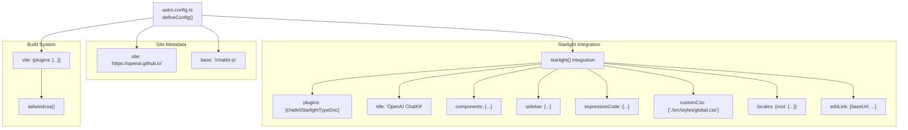
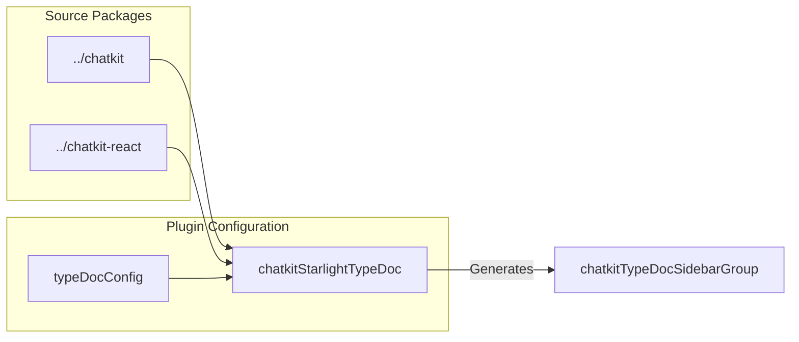

<!-- source: DeepWiki mcp.deepwiki.com · repo openai/chatkit-js · page 5.1 Site Configuration · fetched 2026-10-26 -->

# Site Configuration

Relevant source files

The following files were used as context for generating this wiki page:

- [packages/docs/astro.config.ts](packages/docs/astro.config.ts)
- [packages/docs/src/styles/global.css](packages/docs/src/styles/global.css)
- [packages/docs/tailwind.config.mjs](packages/docs/tailwind.config.mjs)
- [packages/docs/tsconfig.json](packages/docs/tsconfig.json)

## Purpose and Scope

This document describes the Astro and Starlight configuration for the ChatKit.js documentation site. It covers site metadata, sidebar navigation structure, custom component overrides, theme customization, TypeDoc plugin integration, and build system setup.

## Configuration Overview

The documentation site uses Astro as the static site generator and Starlight as the documentation theme. The primary configuration file is [packages/docs/astro.config.ts](), which exports an Astro configuration object using `defineConfig()`.

Title: Astro Configuration Architecture

**Sources:** [packages/docs/astro.config.ts:100-150]()

## Site Metadata

The configuration defines the deployment URL and base path for the documentation site:

| Property | Value | Purpose |
|----------|-------|---------|
| `site` | `'https://openai.github.io'` | Root domain for the deployed site |
| `base` | `'/chatkit-js'` | Base path for all site URLs, allowing deployment to a subdirectory |

**Sources:** [packages/docs/astro.config.ts:101-102]()

## Sidebar Structure

The sidebar navigation is defined as a hierarchical array structure stored in the `sidebar` constant [packages/docs/astro.config.ts:41-98](). The configuration includes manual entries, quick reference links, and auto-generated API reference sections.

Title: Sidebar Data Flow and Hierarchy

```mermaid
graph TB
    Root["sidebar array"]
    
    Overview["Overview<br/>link: '/'"]
    QuickStart["Quick start<br/>link: '/quickstart'"]
    Customize["Customize<br/>link: '/customize'"]
    QuickAPI["Quick API Reference<br/>items: [...]"]
    CompleteAPI["Complete API reference<br/>(chatkitTypeDocSidebarGroup)"]
    SelfHosted["Self-hosted backend<br/>items: [...]"]
    OpenAIHosted["OpenAI-hosted backend<br/>items: [...]"]
    Examples["Examples<br/>items: [...]"]
    
    Root --> Overview
    Root --> QuickStart
    Root --> Customize
    Root --> QuickAPI
    Root --> CompleteAPI
    Root --> SelfHosted
    Root --> OpenAIHosted
    Root --> Examples
    
    subgraph "Quick API Reference Links"
        ChatKitOptions["ChatKitOptions<br/>type-aliases/chatkitoptions/"]
        OpenAIChatKitElement["OpenAIChatKit (Web Component)<br/>interfaces/openaichatkit/"]
        UseChatKitHook["useChatKit (React hook)<br/>quick-reference/use-chatkit/"]
        ChatKitComponent["ChatKit (React component)<br/>quick-reference/chatkit-component/"]
    end
    
    QuickAPI --> ChatKitOptions
    QuickAPI --> OpenAIChatKitElement
    QuickAPI --> UseChatKitHook
    QuickAPI --> ChatKitComponent
    
    subgraph "External Resources"
        PythonSDK["ChatKit Python SDK<br/>openai.github.io/chatkit-python"]
        ManagedDocs["Managed ChatKit Docs<br/>platform.openai.com/docs/guides/chatkit"]
        StarterApp["Starter App<br/>github.com/openai/openai-chatkit-starter-app"]
        AdvancedSamples["Advanced Samples<br/>github.com/openai/openai-chatkit-advanced-samples"]
    end
    
    SelfHosted --> PythonSDK
    OpenAIHosted --> ManagedDocs
    Examples --> StarterApp
    Examples --> AdvancedSamples
```

### Sidebar Components

| Section | Type | Description | Source Lines |
|---------|------|-------------|--------------|
| Overview | Link | Homepage navigation | [packages/docs/astro.config.ts:42]() |
| Quick start | Link | Getting started guide | [packages/docs/astro.config.ts:43]() |
| Customize | Link | Customization documentation | [packages/docs/astro.config.ts:44]() |
| Quick API Reference | Group | Shortcut links to key API types and hooks | [packages/docs/astro.config.ts:45-65]() |
| Complete API reference | Generated | Full API documentation via `chatkitTypeDocSidebarGroup` | [packages/docs/astro.config.ts:66]() |
| Self-hosted backend | Group | External link to Python SDK | [packages/docs/astro.config.ts:67-75]() |
| OpenAI-hosted backend | Group | External link to managed ChatKit documentation | [packages/docs/astro.config.ts:76-84]() |
| Examples | Group | Links to example repositories | [packages/docs/astro.config.ts:85-97]() |

**Sources:** [packages/docs/astro.config.ts:41-98]()

## Custom Components

Starlight allows overriding default components with custom implementations through the `components` configuration object [packages/docs/astro.config.ts:115-121]().

| Component Slot | Custom Path | Purpose |
|----------------|-------------|---------|
| `SiteTitle` | `./src/components/Title.astro` | Custom site header title display |
| `PageTitle` | `./src/components/PageTitle.astro` | Custom page title rendering |
| `SocialIcons` | `./src/components/SocialIcons.astro` | Social media links in header |
| `Sidebar` | `./src/components/Sidebar.astro` | Custom sidebar navigation with sublist rendering |
| `MobileMenuFooter` | `./src/components/MobileFooter.astro` | Footer content in mobile navigation menu |

**Sources:** [packages/docs/astro.config.ts:115-121]()

## Theme and Styling

### Global CSS and OpenAI Branding
The documentation site applies custom styling via [packages/docs/src/styles/global.css](). This file implements the OpenAI visual identity through:
- **Typography**: Imports "OpenAI Sans" in multiple weights (400-700) and styles [packages/docs/src/styles/global.css:5-75]().
- **Color Variables**: Defines CSS variables for both light and dark modes, such as `--openai-background`, `--openai-primary` (`#4db8ff`), and `--openai-green` (`#10a37f`) [packages/docs/src/styles/global.css:80-179]().
- **Starlight Overrides**: Directly modifies Starlight variables like `--sl-color-bg-sidebar` and `--sl-content-width` (set to `60rem`) to align with the custom theme [packages/docs/src/styles/global.css:109-126]().

### Syntax Highlighting
The `expressiveCode` configuration [packages/docs/astro.config.ts:140-142]() enables dual-theme syntax highlighting using `github-light` and `github-dark`.

**Sources:** [packages/docs/src/styles/global.css:1-126](), [packages/docs/astro.config.ts:140-143]()

## Build System and Plugins

### Vite and Tailwind
The build process uses Vite with the Tailwind CSS plugin [packages/docs/astro.config.ts:147-149](). The Tailwind configuration [packages/docs/tailwind.config.mjs]() integrates the `@astrojs/starlight-tailwind` plugin to ensure compatibility between utility classes and Starlight components.

### Starlight-TypeDoc Plugin
The site uses `starlight-typedoc` to generate API documentation from source code. 

Title: TypeDoc Integration Mapping

The `typeDocConfig` [packages/docs/astro.config.ts:11-39]() specifies:
- **Format**: Uses `htmlTable` for parameters and property members [packages/docs/astro.config.ts:13-14]().
- **Strategy**: `entryPointStrategy: 'Packages'` to handle the monorepo structure [packages/docs/astro.config.ts:22]().
- **Plugins**: Includes `typedoc-plugin-zod` and `typedoc-plugin-frontmatter` [packages/docs/astro.config.ts:24-28]().

**Sources:** [packages/docs/astro.config.ts:4-39](), [packages/docs/astro.config.ts:106-113](), [packages/docs/tailwind.config.mjs:1-8]()

---

