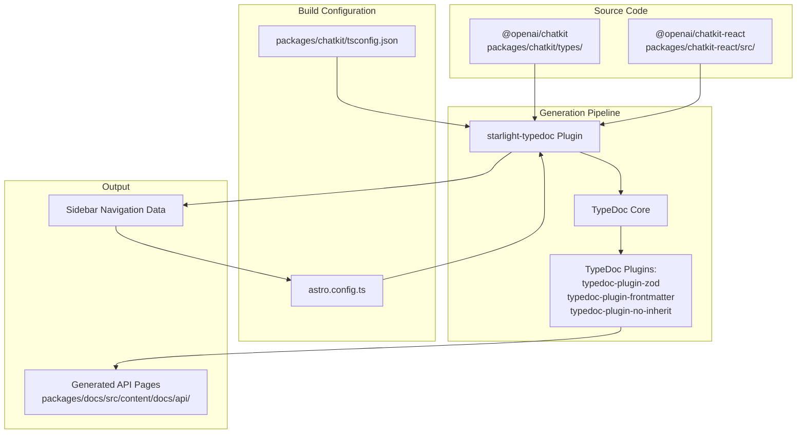
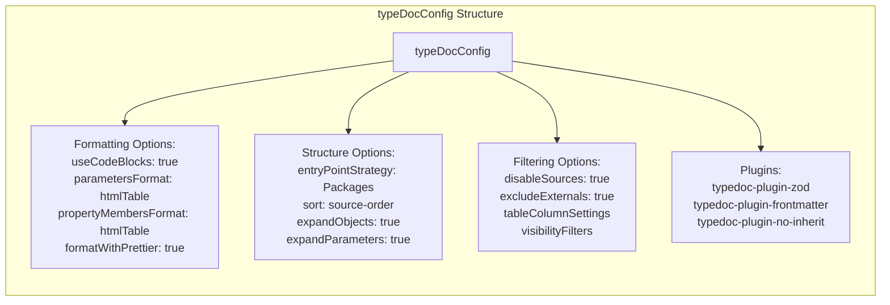
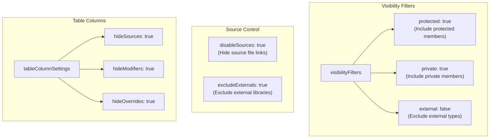
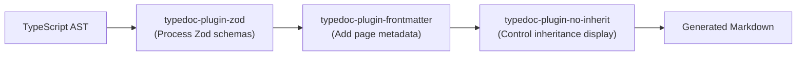
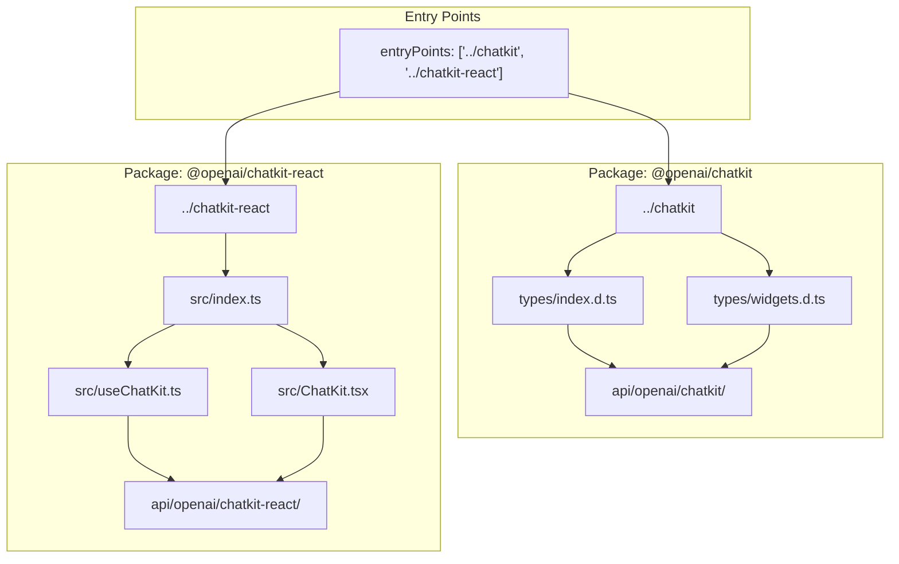
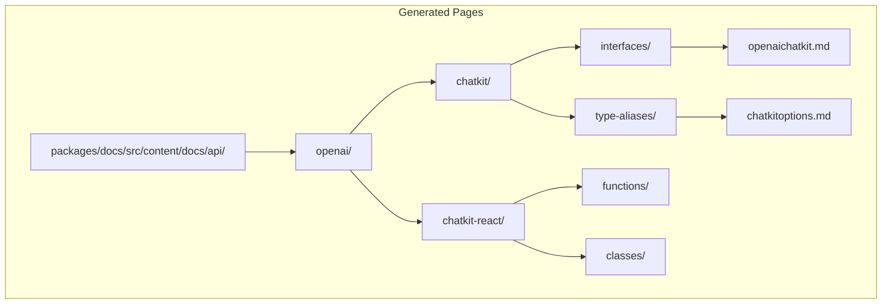
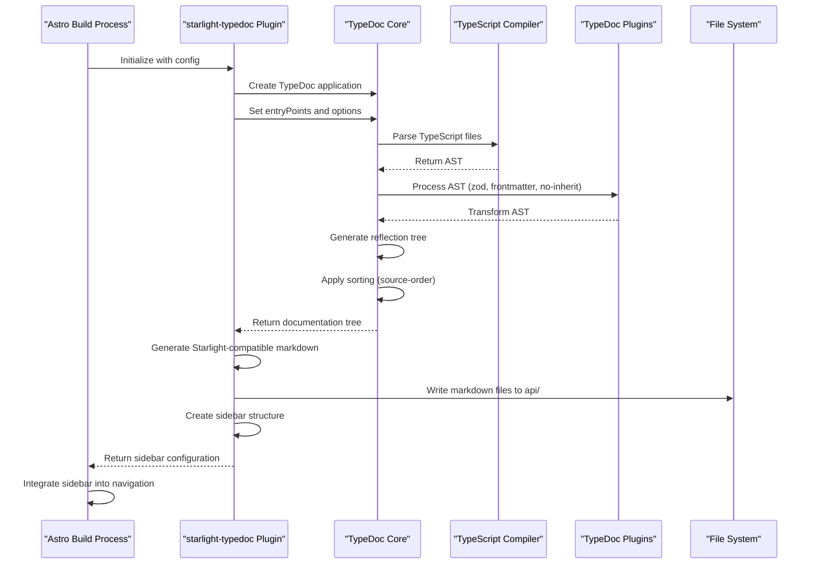
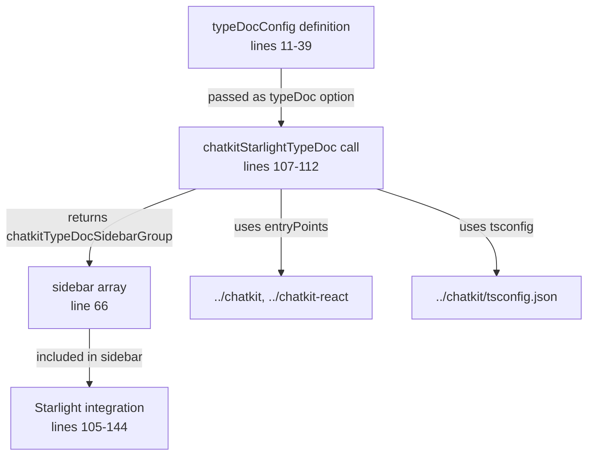

<!-- source: DeepWiki mcp.deepwiki.com · repo openai/chatkit-js · page 5.2 API Documentation Generation · fetched 2026-10-26 -->

# API Documentation Generation

Relevant source files

The following files were used as context for generating this wiki page:

- [packages/docs/astro.config.ts](packages/docs/astro.config.ts)
- [packages/docs/src/content.config.ts](packages/docs/src/content.config.ts)

## Purpose and Scope

This document describes how API reference documentation is automatically generated from TypeScript source code in the ChatKit.js repository. The system uses the `starlight-typedoc` plugin to extract type information, interfaces, classes, and functions from the `@openai/chatkit` and `@openai/chatkit-react` packages and transform them into structured documentation pages.

For information about the overall documentation site configuration, see [Site Configuration](#5.1). For custom documentation components used in manual pages, see [Custom Components](#5.3).

## TypeDoc Integration Architecture

The documentation generation system integrates TypeDoc with the Starlight documentation theme through the `starlight-typedoc` plugin. This plugin acts as a bridge between TypeDoc's AST processing and Starlight's content rendering pipeline.

**Diagram: API Generation Pipeline**

The plugin is instantiated using `createStarlightTypeDocPlugin()`, which returns both a plugin instance (`chatkitStarlightTypeDoc`) and a sidebar group configuration (`chatkitTypeDocSidebarGroup`). This sidebar group is then integrated into the main documentation navigation.

**Sources:** [packages/docs/astro.config.ts:4-9](), [packages/docs/astro.config.ts:107-112]()

## Configuration System

The API documentation generation is configured through two main objects in `astro.config.ts`:

### Plugin Configuration

The `chatkitStarlightTypeDoc` plugin is configured with the following parameters:

| Parameter | Value | Purpose |
|-----------|-------|---------|
| `sidebar.label` | "Complete API reference" | Label for the sidebar group |
| `sidebar.collapsed` | `true` | Initial collapsed state |
| `entryPoints` | `['../chatkit', '../chatkit-react']` | Package directories to process |
| `tsconfig` | `'../chatkit/tsconfig.json'` | TypeScript configuration file |
| `typeDoc` | `typeDocConfig` | Detailed TypeDoc options |

**Sources:** [packages/docs/astro.config.ts:107-112]()

### TypeDoc Configuration Object

The `typeDocConfig` object defines how TypeDoc processes and formats the documentation:

**Diagram: Configuration Structure**

**Sources:** [packages/docs/astro.config.ts:11-39]()

## TypeDoc Options

### Code Presentation Options

The following options control how code and type information is displayed in the generated documentation:

| Option | Value | Effect |
|--------|-------|--------|
| `useCodeBlocks` | `true` | Renders type signatures in syntax-highlighted code blocks |
| `parametersFormat` | `'htmlTable'` | Displays function parameters in HTML tables |
| `propertyMembersFormat` | `'htmlTable'` | Displays object properties in HTML tables |
| `formatWithPrettier` | `true` | Formats code using Prettier |
| `prettierConfigFile` | `'../../.prettierrc'` | Prettier configuration to use |

**Sources:** [packages/docs/astro.config.ts:12-20]()

### Structure and Sorting Options

| Option | Value | Effect |
|--------|-------|--------|
| `entryPointStrategy` | `'Packages'` | Treats each entry point as a separate package |
| `sort` | `['source-order']` | Maintains source file ordering in output |
| `expandObjects` | `true` | Expands object type definitions inline |
| `expandParameters` | `true` | Expands parameter type definitions inline |

**Sources:** [packages/docs/astro.config.ts:17-18](), [packages/docs/astro.config.ts:22-23]()

### Visibility and Filtering Options

The configuration controls which code elements are included in the documentation:

**Diagram: Visibility and Filter Logic**

**Sources:** [packages/docs/astro.config.ts:16](), [packages/docs/astro.config.ts:21](), [packages/docs/astro.config.ts:29-38]()

## Plugin Ecosystem

TypeDoc is extended with three plugins that enhance the documentation generation process:

### Plugin Chain

### Plugin Descriptions

| Plugin | Purpose |
|--------|---------|
| `typedoc-plugin-zod` | Processes Zod schema definitions and generates documentation for runtime-validated types |
| `typedoc-plugin-frontmatter` | Adds YAML frontmatter to generated pages for Starlight integration |
| `typedoc-plugin-no-inherit` | Prevents documentation of inherited members to reduce noise |

**Sources:** [packages/docs/astro.config.ts:24-28]()

## Entry Points and Package Processing

The documentation generator processes two entry points, each corresponding to a package in the monorepo.

**Diagram: Source Mapping to API Pages**

The `entryPointStrategy: 'Packages'` option treats each entry point as a separate package, creating distinct documentation sections for `@openai/chatkit` and `@openai/chatkit-react`.

**Sources:** [packages/docs/astro.config.ts:109](), [packages/docs/astro.config.ts:22]()

## Output Format and Structure

### Generated Page Structure

The TypeDoc plugin generates documentation pages with the following directory structure:

**Diagram: Generated Content Hierarchy**

Each generated page includes:

- **YAML Frontmatter**: Metadata for Starlight integration (title, description, sidebar configuration)
- **Type Signature**: Syntax-highlighted code block showing the type definition
- **Description**: Extracted from JSDoc comments
- **Members Table**: For interfaces and types with properties, displayed as HTML tables
- **Parameters Table**: For functions, showing parameters with types and descriptions
- **Return Type**: For functions, with expanded type information

**Sources:** [packages/docs/astro.config.ts:12-15]()

## Generation Process

### Build-Time Generation Flow

The API documentation is generated during the Astro build process:

### Configuration Flow

The configuration flows from `astro.config.ts` through the plugin system:

**Sources:** [packages/docs/astro.config.ts:8-9](), [packages/docs/astro.config.ts:66](), [packages/docs/astro.config.ts:107-112]()

## Sidebar Integration

The generated API documentation is integrated into the site's navigation through a two-level structure:

### Quick API Reference Section

Manual quick reference links are defined in the `sidebar` array for commonly accessed API elements:

- `ChatKitOptions` type alias
- `OpenAIChatKit` interface (web component)
- `useChatKit` React hook
- `ChatKit` React component

**Sources:** [packages/docs/astro.config.ts:45-65]()

### Complete API Reference Section

The `chatkitTypeDocSidebarGroup` variable, returned by `createStarlightTypeDocPlugin()`, contains the automatically generated navigation tree for all API elements. This group is configured to be collapsed by default and labeled "Complete API reference".

**Sources:** [packages/docs/astro.config.ts:8-9](), [packages/docs/astro.config.ts:66](), [packages/docs/astro.config.ts:108]()

## Table Column Configuration

The `tableColumnSettings` object controls which columns appear in the generated tables for properties and parameters:

| Setting | Value | Effect |
|---------|-------|--------|
| `hideSources` | `true` | Removes the "Defined in" column showing source file locations |
| `hideModifiers` | `true` | Removes columns for access modifiers (public, private, etc.) |
| `hideOverrides` | `true` | Removes columns indicating overridden members |

This configuration creates cleaner tables focused on the essential information: names, types, and descriptions.

**Sources:** [packages/docs/astro.config.ts:29-33]()

---

