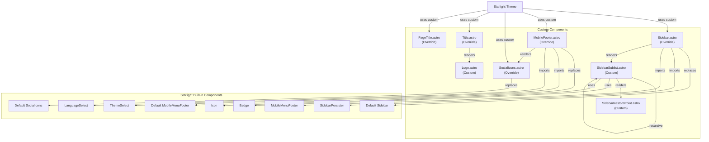
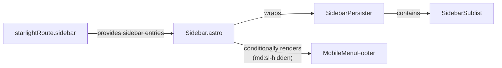
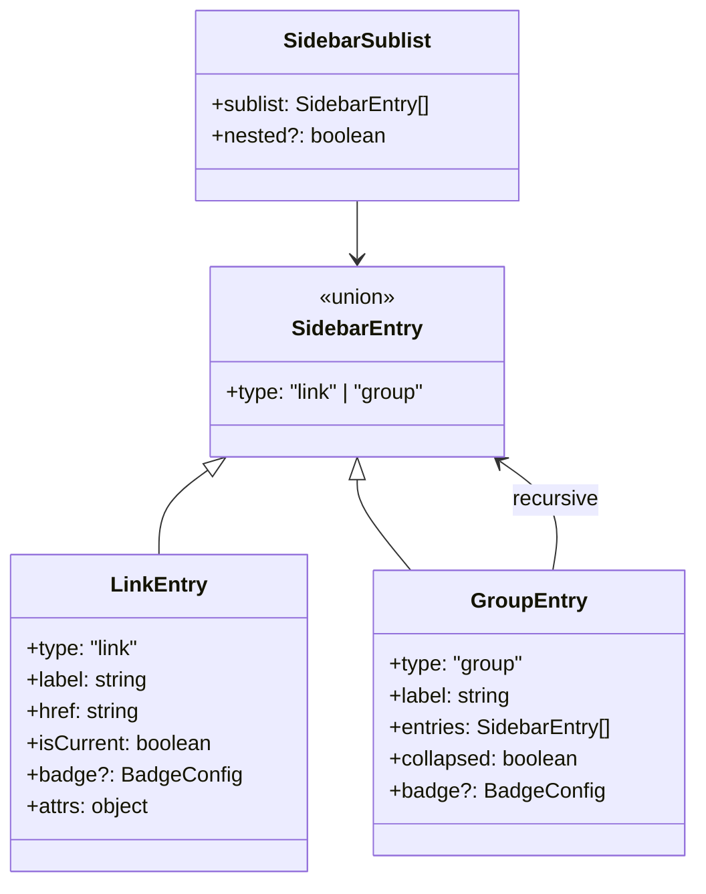
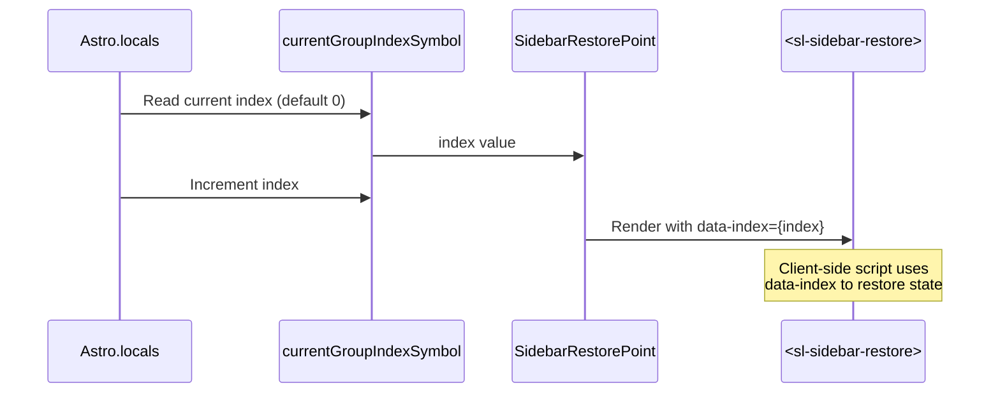

<!-- source: DeepWiki mcp.deepwiki.com · repo openai/chatkit-js · page 5.3 Custom Components · fetched 2026-10-26 -->

# Custom Components

Relevant source files

The following files were used as context for generating this wiki page:

- [packages/docs/src/components/Logo.astro](packages/docs/src/components/Logo.astro)
- [packages/docs/src/components/MobileFooter.astro](packages/docs/src/components/MobileFooter.astro)
- [packages/docs/src/components/PageTitle.astro](packages/docs/src/components/PageTitle.astro)
- [packages/docs/src/components/Sidebar.astro](packages/docs/src/components/Sidebar.astro)
- [packages/docs/src/components/SidebarRestorePoint.astro](packages/docs/src/components/SidebarRestorePoint.astro)
- [packages/docs/src/components/SidebarSublist.astro](packages/docs/src/components/SidebarSublist.astro)
- [packages/docs/src/components/SocialIcons.astro](packages/docs/src/components/SocialIcons.astro)
- [packages/docs/src/components/Title.astro](packages/docs/src/components/Title.astro)

This document describes the custom Astro components developed for the chatkit-js documentation site. These components override or extend Starlight's default components to provide custom branding, enhanced sidebar navigation, and mobile footer preferences.

For information about the overall documentation site configuration, see [Site Configuration](#5.1). For details on API documentation generation, see [API Documentation Generation](#5.2).

## Overview

The documentation site uses Starlight's component override system to replace default components with custom implementations. All custom components are located in [packages/docs/src/components/]() and are automatically used by Starlight when they match the names of built-in components.

### Component Hierarchy

**Sources:** [packages/docs/src/components/Sidebar.astro:1-16](), [packages/docs/src/components/MobileFooter.astro:1-13](), [packages/docs/src/components/SocialIcons.astro:1-19](), [packages/docs/src/components/Title.astro:1-8]()

## Sidebar Component

The `Sidebar` component replaces Starlight's default sidebar implementation to provide custom navigation behavior.

### Implementation

The component uses Starlight's `SidebarPersister` to maintain sidebar state across navigation and renders a custom `SidebarSublist` component for the navigation tree:

| Aspect | Implementation |
|--------|---------------|
| File | [packages/docs/src/components/Sidebar.astro]() |
| Purpose | Root sidebar component that manages navigation state |
| Data Source | `Astro.locals.starlightRoute.sidebar` |
| State Management | `SidebarPersister` component |
| Mobile Behavior | Renders `MobileMenuFooter` on small screens |

The component structure at [packages/docs/src/components/Sidebar.astro:1-16]() shows:
- Access to sidebar data via `Astro.locals.starlightRoute` [packages/docs/src/components/Sidebar.astro:6-6]()
- Use of `SidebarPersister` for state management [packages/docs/src/components/Sidebar.astro:9-11]()
- Conditional mobile footer rendering with CSS media query class `md:sl-hidden` [packages/docs/src/components/Sidebar.astro:13-15]()

**Sources:** [packages/docs/src/components/Sidebar.astro:1-16]()

## SidebarSublist Component

The `SidebarSublist` component is a recursive component that renders the hierarchical navigation structure.

### Component Properties

**Sources:** [packages/docs/src/components/SidebarSublist.astro:1-16]()

### Rendering Logic

The component implements distinct rendering for links and groups:

| Entry Type | Element | Features |
|------------|---------|----------|
| Link | `<a>` | Current page highlighting via `aria-current`, badges, external link icons |
| Group | `
` | Collapsible sections, carets, recursive rendering, auto-open on current child |

The rendering logic at [packages/docs/src/components/SidebarSublist.astro:20-64]() includes:

- **Link entries** ([packages/docs/src/components/SidebarSublist.astro:23-41]()):
  - Set `aria-current="page"` for current page [packages/docs/src/components/SidebarSublist.astro:26-26]()
  - Apply `large` class to top-level links [packages/docs/src/components/SidebarSublist.astro:27-27]()
  - Display badges and external link icons via `isExternalHref` check [packages/docs/src/components/SidebarSublist.astro:38-40]()

- **Group entries** ([packages/docs/src/components/SidebarSublist.astro:42-60]()):
  - Use `
` element for collapsibility
  - Auto-open via `hasCurrentChild()` helper or `collapsed` property [packages/docs/src/components/SidebarSublist.astro:43-43]()
  - Insert `SidebarRestorePoint` for state persistence [packages/docs/src/components/SidebarSublist.astro:44-44]()
  - Recursively render child entries using `Astro.self` [packages/docs/src/components/SidebarSublist.astro:58-58]()

**Sources:** [packages/docs/src/components/SidebarSublist.astro:12-16](), [packages/docs/src/components/SidebarSublist.astro:20-64]()

## SidebarRestorePoint Component

This component manages state persistence for collapsible sidebar groups across page navigations.

The implementation at [packages/docs/src/components/SidebarRestorePoint.astro:1-11]() uses:

- **Symbol-based indexing**: `Symbol.for('starlight-sidebar-group-index')` for unique storage in `Astro.locals` [packages/docs/src/components/SidebarRestorePoint.astro:3-3]()
- **Auto-incrementing**: Each render increments the index stored in locals [packages/docs/src/components/SidebarRestorePoint.astro:6-7]()
- **Custom element**: Renders `<sl-sidebar-restore>` with `data-index` attribute [packages/docs/src/components/SidebarRestorePoint.astro:10-10]()

**Sources:** [packages/docs/src/components/SidebarRestorePoint.astro:1-11]()

## Branding and Title Components

Custom branding is handled by a set of components that override Starlight's header and title logic.

### Logo Component
The `Logo` component ([packages/docs/src/components/Logo.astro]()) renders the OpenAI ChatKit SVG logo. It supports configurable `height`, `alt` text, and optional text display via `showText` [packages/docs/src/components/Logo.astro:2-3]().

### Title Component
The `Title` component ([packages/docs/src/components/Title.astro]()) overrides the site title in the header. It retrieves `siteTitleHref` from `Astro.locals.starlightRoute` and renders the `Logo` component as the primary link target [packages/docs/src/components/Title.astro:3-8]().

### PageTitle Component
The `PageTitle` component ([packages/docs/src/components/PageTitle.astro]()) provides special formatting for the homepage title.
- It detects the homepage by checking if `starlightRoute.id` is empty or matches the language code [packages/docs/src/components/PageTitle.astro:4-6]().
- On the homepage, it highlights the "TypeScript" keyword with a specific `keyword` class [packages/docs/src/components/PageTitle.astro:14-18]().
- For all other pages, it falls back to the `Default` Starlight `PageTitle` [packages/docs/src/components/PageTitle.astro:29-29]().

**Sources:** [packages/docs/src/components/Logo.astro:1-23](), [packages/docs/src/components/Title.astro:1-9](), [packages/docs/src/components/PageTitle.astro:1-31]()

## MobileFooter and SocialIcons

The `MobileFooter` component provides mobile-specific UI for preferences and social links, while `SocialIcons` renders configured links.

### MobileFooter Structure
The component at [packages/docs/src/components/MobileFooter.astro:1-13]() aggregates:
- `SocialIcons`: Virtual component mapping to our custom implementation [packages/docs/src/components/MobileFooter.astro:3]().
- `ThemeSelect` and `LanguageSelect`: Standard Starlight components [packages/docs/src/components/MobileFooter.astro:11-12]().

### SocialIcons Data Flow
The `SocialIcons` component ([packages/docs/src/components/SocialIcons.astro]()) extracts social links from the Starlight user configuration:
- **Link extraction**: `config.social || []` [packages/docs/src/components/SocialIcons.astro:5]().
- **Link mapping**: Renders each link with an `Icon` component and a label span [packages/docs/src/components/SocialIcons.astro:11-16]().

**Sources:** [packages/docs/src/components/MobileFooter.astro:1-13](), [packages/docs/src/components/SocialIcons.astro:1-19]()

## Styling System

All custom components use Starlight's CSS layer system (`@layer starlight.core`) for proper specificity and theme integration.

| Variable Pattern | Usage | File Example |
|-----------------|-------|--------------|
| `--sl-color-*` | Theming and UI colors | [packages/docs/src/components/MobileFooter.astro:30-30]() |
| `--sl-text-*` | Typography sizing | [packages/docs/src/components/SidebarSublist.astro:85-85]() |
| `--sl-sidebar-*` | Sidebar specific spacing | [packages/docs/src/components/SidebarSublist.astro:69-69]() |

**Sources:** [packages/docs/src/components/SidebarSublist.astro:66-167](), [packages/docs/src/components/MobileFooter.astro:15-51](), [packages/docs/src/components/SocialIcons.astro:21-39]()

---

