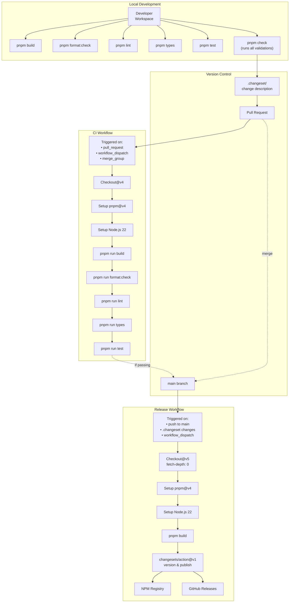
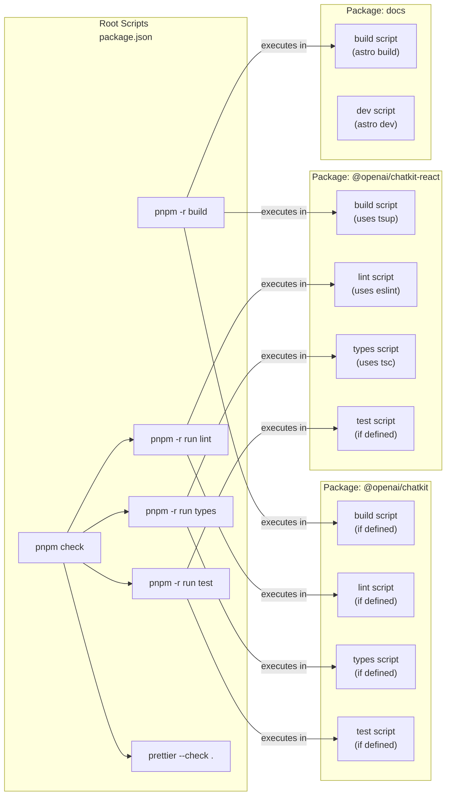
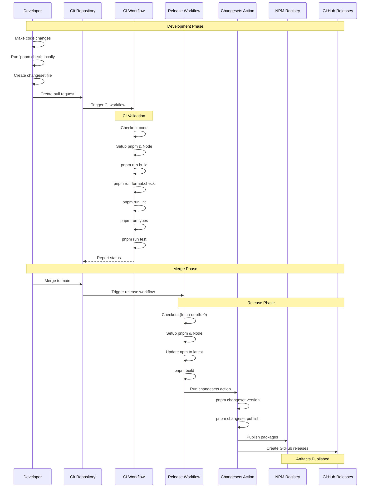

<!-- source: DeepWiki mcp.deepwiki.com · repo openai/chatkit-js · page 6 Development Workflow · fetched 2026-10-26 -->

# Development Workflow

<details>
<summary>Relevant source files</summary>

The following files were used as context for generating this wiki page:

- [.github/workflows/ci.yml](.github/workflows/ci.yml)
- [.github/workflows/docs.yml](.github/workflows/docs.yml)
- [.github/workflows/release.yml](.github/workflows/release.yml)
- [package.json](package.json)

</details>


This document describes the development processes and automation systems in the ChatKit.js monorepo. It covers the development lifecycle from local development through continuous integration to production release, including the automation workflows, script commands, and quality gates enforced throughout the process.

For initial repository setup and local environment configuration, see [Development Setup](#1.3). For detailed CI workflow configuration, see [Continuous Integration](#6.1). For release automation and versioning, see [Release Management](#6.2). For code quality tooling and standards, see [Code Quality Standards](#6.3).

## Development Lifecycle Overview

The ChatKit.js monorepo follows a structured workflow that ensures code quality and automates releases. The lifecycle progresses through three primary stages: local development with quality checks, automated CI validation on pull requests, and automated release publishing on merge to `main`.

### Complete Development Pipeline



**Sources:** [.github/workflows/ci.yml:1-42](), [.github/workflows/release.yml:1-53](), [package.json:5-14]()

## Available Scripts

The root [`package.json`](package.json:1-33) defines workspace-level scripts that orchestrate commands across all packages in the monorepo. These scripts use pnpm's workspace features (`-r` flag for recursive execution, `-F` for filtering specific packages).

| Script | Command | Purpose |
|--------|---------|---------|
| `build` | `pnpm -r build` | Builds all packages in dependency order |
| `dev:docs` | `pnpm -F docs dev` | Starts documentation site in development mode |
| `test` | `pnpm -r run test` | Runs test suites across all packages |
| `lint` | `pnpm -r run lint` | Executes ESLint on all packages |
| `format:check` | `prettier --check .` | Validates code formatting without changes |
| `format` | `prettier --write .` | Applies code formatting across repository |
| `types` | `pnpm -r run types` | Runs TypeScript type checking in all packages |
| `clean` | `pnpm -r run clean` | Removes build artifacts from all packages |
| `check` | See below | Runs complete validation suite |

The `check` script [package.json:14]() runs the complete validation sequence:

```
prettier --check . && pnpm -r run lint && pnpm types && pnpm -r run test
```

This provides a local equivalent to the CI workflow validation.

**Sources:** [package.json:5-14]()

## Script Execution Flow

The following diagram shows how workspace-level scripts delegate to package-specific scripts and the dependencies between them:



**Sources:** [package.json:5-14]()

## Development Tools

The monorepo uses several development tools configured at the workspace root:

### Package Manager

The repository requires **pnpm 10.11.0** as specified in [package.json:32]():

```
"packageManager": "pnpm@10.11.0+sha512.6540583f41cc5f628eb3d9773ecee802f4f9ef9923cc45b69890fb47991d4b092964694ec3a4f738a420c918a333062c8b925d312f42e4f0c263eb603551f977"
```

This exact version and SHA ensure consistent behavior across environments. Both CI workflows use `pnpm/action-setup@v4` to install this version [.github/workflows/ci.yml:18](), [.github/workflows/release.yml:28]().

### Node.js Version

All workflows standardize on **Node.js 22** [.github/workflows/ci.yml:25](), [.github/workflows/release.yml:35](). This ensures consistency between local development, CI validation, and release publishing.

### Quality Tools

The root `devDependencies` [package.json:16-31]() include:

- **@changesets/cli**: Version management and changelog generation
- **prettier**: Code formatting (v3.6.2)
- **eslint**: JavaScript/TypeScript linting (v9.35.0)
- **typescript**: Type checking (v5.8.3)
- **tsup**: Build tool for packages (v8.0.0)
- **rimraf**: Cross-platform file deletion for clean scripts

For detailed configuration of these tools, see [Code Quality Standards](#6.3).

**Sources:** [package.json:16-33](), [.github/workflows/ci.yml:22-26](), [.github/workflows/release.yml:28-40]()

## Workflow Triggers and Permissions

### CI Workflow Triggers

The CI workflow [.github/workflows/ci.yml:3-7]() runs on:

- **pull_request**: Validates all pull requests before merge
- **workflow_dispatch**: Allows manual execution
- **merge_group**: Validates merge queue entries (for repos using merge queues)

No special permissions are required for CI as it only performs validation.

### Release Workflow Triggers

The release workflow [.github/workflows/release.yml:3-10]() runs on:

- **push to main branch**: Automatic releases when changes merge
- **paths filter**: Only triggers when `.changeset/**` or the workflow file itself changes
- **workflow_dispatch**: Allows manual release execution

The release workflow requires elevated permissions [.github/workflows/release.yml:12-15]():

```yaml
permissions:
  id-token: write      # For NPM provenance
  contents: write      # For creating GitHub releases
  pull-requests: write # For creating version PRs
```

**Sources:** [.github/workflows/ci.yml:3-7](), [.github/workflows/release.yml:3-15]()

## Workflow Integration



**Sources:** [.github/workflows/ci.yml:9-42](), [.github/workflows/release.yml:18-53]()

## Changesets Workflow

The monorepo uses Changesets to manage versioning and changelogs. Developers create changeset files in the `.changeset/` directory that describe their changes. The release workflow consumes these files to:

1. Determine version bumps (major, minor, patch) per package
2. Update package.json versions via `pnpm changeset version` [.github/workflows/release.yml:48]()
3. Publish updated packages via `pnpm changeset publish` [.github/workflows/release.yml:49]()
4. Create GitHub releases with changelog information [.github/workflows/release.yml:50]()

The workflow only triggers when changesets exist [.github/workflows/release.yml:8](), preventing unnecessary workflow runs.

For complete details on the release process, see [Release Management](#6.2).

**Sources:** [.github/workflows/release.yml:8-50]()

## Build Dependencies

The build process follows package dependencies. The `@openai/chatkit-react` package depends on `@openai/chatkit` (via workspace:* dependency), so builds must execute in dependency order. The `pnpm -r build` command [package.json:6]() handles this automatically using pnpm's workspace topology sorting.

The release workflow includes a full build step [.github/workflows/release.yml:42-43]() before publishing to ensure all packages are built with the final version numbers applied by Changesets.

**Sources:** [package.json:6](), [.github/workflows/release.yml:42-43]()

## NPM Registry Configuration

The release workflow configures NPM registry access [.github/workflows/release.yml:33-37]():

```yaml
- name: Setup Node.js
  uses: actions/setup-node@v5
  with:
    node-version: 22
    cache: 'pnpm'
    registry-url: 'https://registry.npmjs.org'
```

The workflow also updates npm to the latest version [.github/workflows/release.yml:39-40]() before publishing to ensure compatibility with the latest registry features.

Package publishing uses the `NODE_AUTH_TOKEN` environment variable (provided by `setup-node` with `registry-url`) and the `GITHUB_TOKEN` for creating releases [.github/workflows/release.yml:52]().

**Sources:** [.github/workflows/release.yml:33-40](), [.github/workflows/release.yml:52]()

## Checkout Configuration Differences

The two workflows use different checkout configurations:

**CI Workflow** [.github/workflows/ci.yml:15]():
```yaml
uses: actions/checkout@v4
```
Uses default shallow checkout (no history) since CI only validates current code.

**Release Workflow** [.github/workflows/release.yml:23-25]():
```yaml
uses: actions/checkout@v5
with:
  fetch-depth: 0
```
Uses full history (`fetch-depth: 0`) because Changesets needs git history to generate accurate changelogs and determine which commits belong to which versions.

**Sources:** [.github/workflows/ci.yml:14-15](), [.github/workflows/release.yml:22-25]()

---

