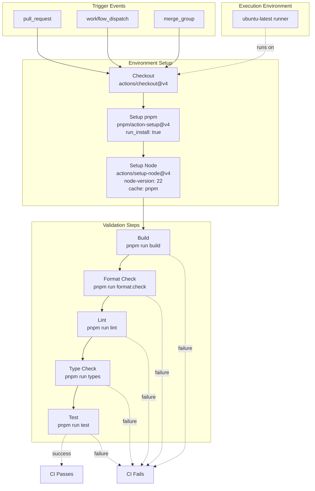
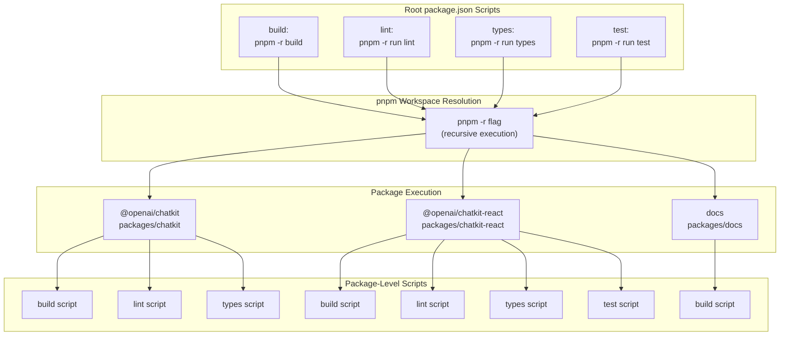
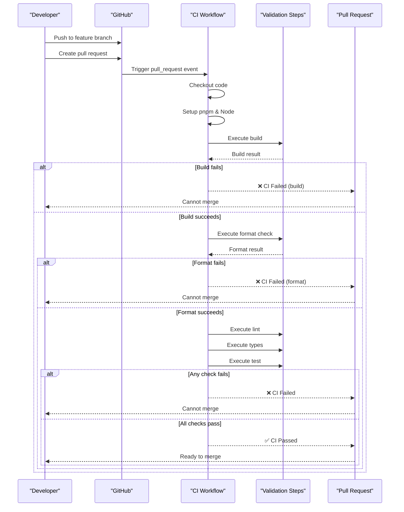

<!-- source: DeepWiki mcp.deepwiki.com · repo openai/chatkit-js · page 6.1 Continuous Integration · fetched 2026-10-26 -->

# Continuous Integration

<details>
<summary>Relevant source files</summary>

The following files were used as context for generating this wiki page:

- [.github/workflows/ci.yml](.github/workflows/ci.yml)
- [.github/workflows/docs.yml](.github/workflows/docs.yml)
- [.github/workflows/release.yml](.github/workflows/release.yml)
- [package.json](package.json)

</details>


## Purpose and Scope

This document describes the Continuous Integration (CI) pipeline for the `chatkit-js` repository, which automatically validates code quality on every pull request. The CI system executes a series of automated checks including builds, tests, linting, formatting verification, and type checking across all packages in the monorepo.

For information about the release and publishing process that runs after CI passes, see [6.2 Release Management](). For details on the specific code quality standards enforced by CI, see [6.3 Code Quality Standards]().

**Sources:** [.github/workflows/ci.yml:1-42]()

## Workflow Triggers

The CI workflow is configured to run in three scenarios:

| Trigger Type | Event | Purpose |
|-------------|-------|---------|
| `pull_request` | Any pull request created or updated | Primary quality gate for code changes |
| `workflow_dispatch` | Manual trigger | Allows manual re-runs of CI checks |
| `merge_group` | Merge queue checks | Validates code in GitHub merge queues |

The workflow does not trigger on pushes to branches, ensuring CI resources are focused on validating changes intended for merge rather than in-progress development work.

**Sources:** [.github/workflows/ci.yml:3-7]()

## CI Pipeline Architecture



**CI Pipeline Execution Flow**

This diagram shows the complete CI workflow as defined in the GitHub Actions configuration, using the actual step names and action versions from the codebase.

**Sources:** [.github/workflows/ci.yml:9-42]()

## Validation Steps

The CI pipeline executes five validation steps in sequence. Each step must pass before the next begins, implementing a fail-fast approach that saves resources by stopping at the first failure.

### Build Step

```yaml
- name: Build
  run: pnpm run build
```

The build step compiles all packages in the monorepo using the workspace-level `build` script, which executes `pnpm -r build` to recursively build all packages. This ensures that TypeScript compilation succeeds and all distributable artifacts can be generated.

**Sources:** [.github/workflows/ci.yml:28-29](), [package.json:6]()

### Format Check Step

```yaml
- name: Format
  run: pnpm run format:check
```

The format check validates that all code adheres to Prettier formatting rules using `prettier --check .`. This step does not modify files; it only reports formatting violations. Developers can run `pnpm format` locally to automatically fix formatting issues.

**Sources:** [.github/workflows/ci.yml:31-32](), [package.json:10-11]()

### Lint Step

```yaml
- name: Lint
  run: pnpm run lint
```

The lint step executes ESLint across all packages via `pnpm -r run lint`. This validates code quality rules, identifies potential bugs, and enforces consistent code patterns. The repository uses ESLint 9 with TypeScript-specific rules and React-specific plugins.

**Sources:** [.github/workflows/ci.yml:34-35](), [package.json:9](), [package.json:18-25]()

### Type Check Step

```yaml
- name: Types
  run: pnpm run types
```

The type check step runs TypeScript's type checker across all packages using `pnpm -r run types`. This validates type correctness without emitting compiled output, catching type errors that might not be detected during the build step.

**Sources:** [.github/workflows/ci.yml:37-38](), [package.json:12]()

### Test Step

```yaml
- name: Test
  run: pnpm run test
```

The test step executes the test suite across all packages via `pnpm -r run test`. Currently, test implementation varies by package, with individual packages defining their own test scripts.

**Sources:** [.github/workflows/ci.yml:40-41](), [package.json:8]()

## Monorepo Script Execution



**Monorepo Command Execution Pattern**

This diagram illustrates how CI commands propagate through the pnpm workspace structure. The `pnpm -r` (recursive) flag causes each root script to execute the corresponding script in all workspace packages that define it.

**Sources:** [package.json:6-13](), [.github/workflows/docs.yml:41]()

## Environment Configuration

The CI workflow executes in a standardized environment with specific tool versions:

| Component | Version/Configuration | Rationale |
|-----------|---------------------|-----------|
| Runner | `ubuntu-latest` | Provides consistent Linux environment |
| Node.js | `22` | Latest LTS release with modern JavaScript features |
| pnpm | `10.11.0+sha512...` | Version pinned in `packageManager` field |
| Cache | pnpm store | Speeds up dependency installation |

The setup process follows this sequence:

1. **Checkout**: Clones repository code using `actions/checkout@v4` [ .github/workflows/ci.yml:14-15]()
2. **pnpm Setup**: Installs pnpm and runs `pnpm install` via `pnpm/action-setup@v4` with `run_install: true` [ .github/workflows/ci.yml:17-21]()
3. **Node Setup**: Configures Node.js 22 with pnpm cache via `actions/setup-node@v4` [ .github/workflows/ci.yml:22-26]()

The `run_install: true` configuration in the pnpm setup action ensures dependencies are installed immediately, making them available for subsequent build and test steps.

**Sources:** [.github/workflows/ci.yml:14-26](), [package.json:32]()

## CI Integration Points



**Pull Request Validation Sequence**

This sequence diagram shows how the CI workflow integrates with the GitHub pull request flow, enforcing quality gates before code can be merged.

**Sources:** [.github/workflows/ci.yml:1-42]()

## Fail-Fast Behavior

The CI workflow implements fail-fast execution, where each step depends on the success of the previous step. This approach provides several benefits:

- **Resource Efficiency**: Stops execution immediately upon first failure, conserving CI minutes.
- **Fast Feedback**: Developers receive failure notifications quickly without waiting for all checks.
- **Logical Ordering**: Steps are ordered by execution speed and likelihood of failure.
  - `build` runs first as it's most likely to fail and catches compilation errors.
  - `format:check` runs second as it's fast and catches obvious style issues.
  - `lint`, `types`, and `test` run last as they require built artifacts or deeper analysis.

If any step fails, the workflow stops immediately and reports the failure to GitHub, blocking the pull request from merging until the issues are resolved.

**Sources:** [.github/workflows/ci.yml:28-41]()

## Local Validation

Developers can replicate the full CI pipeline locally using the `check` script:

```bash
pnpm check
```

This composite script defined in [package.json:14]() executes the same validation sequence as CI:

```json
"check": "prettier --check . && pnpm -r run lint && pnpm types && pnpm -r run test"
```

This allows developers to validate their changes before pushing, reducing CI failures and iteration time. Note that the `check` script does not include the build step by default, though CI explicitly runs it to ensure artifact generation.

**Sources:** [package.json:14]()

## Comparison with Other Workflows

The repository maintains separate workflows for releases and documentation deployment:

| Aspect | CI Workflow (`ci.yml`) | Release Workflow (`release.yml`) | Docs Workflow (`docs.yml`) |
|--------|-------------|------------------|------------------|
| Trigger | Pull requests, manual | Push to `main` (changeset paths) | Push to `main` |
| Purpose | Validate code quality | Publish packages to NPM | Deploy Astro site to Pages |
| Permissions | Default | Write (contents, PRs, tokens) | Write (contents, pages, tokens) |
| Steps After Build | Format, lint, types, test | `pnpm changeset publish` | `withastro/action` upload |
| Artifacts | None | NPM packages, GH releases | GitHub Pages site |

The CI workflow acts as a quality gate, while the release workflow acts as a deployment pipeline for packages, and the docs workflow handles documentation site updates.

**Sources:** [.github/workflows/ci.yml:1-42](), [.github/workflows/release.yml:1-53](), [.github/workflows/docs.yml:1-47]()

---

