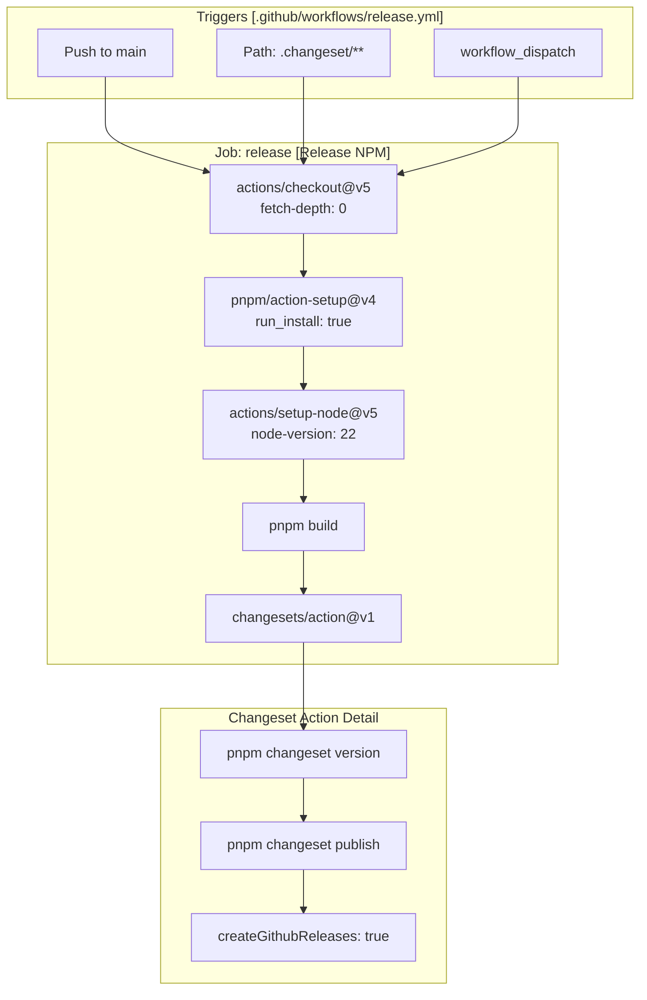
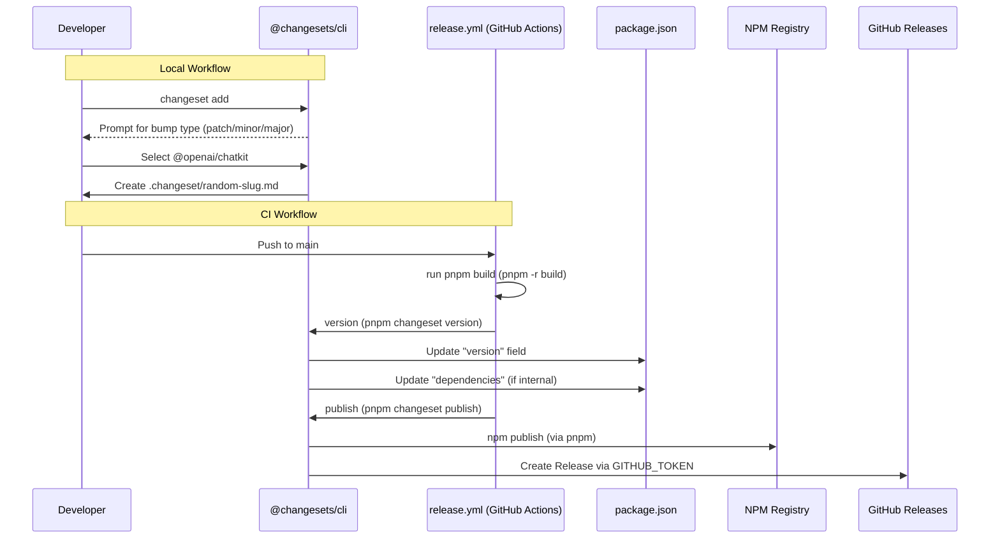

<!-- source: DeepWiki mcp.deepwiki.com · repo openai/chatkit-js · page 6.2 Release Management · fetched 2026-10-26 -->

# Release Management

Relevant source files

The following files were used as context for generating this wiki page:

- [.changeset/README.md](.changeset/README.md)
- [.changeset/config.json](.changeset/config.json)
- [.github/workflows/release.yml](.github/workflows/release.yml)
- [package.json](package.json)

## Purpose and Scope

This document describes the automated release workflow that publishes packages from the `chatkit-js` repository to NPM. The release process is managed by **Changesets**, a tool that handles version bumping, changelog generation, and package publishing in monorepos.

The release pipeline ensures that `@openai/chatkit` and `@openai/chatkit-react` are versioned according to Semantic Versioning (SemVer) and published consistently to the NPM registry.

**Sources:** [.changeset/README.md:1-9](), [.github/workflows/release.yml:1-53]()

---

## Changesets Overview

The repository uses `@changesets/cli` to manage releases across the monorepo packages defined in the `pnpm` workspace. 

When developers contribute changes, they create **changeset files** in the `.changeset/` directory. These are small markdown files that specify:
- The packages affected by the change.
- The type of SemVer bump (`major`, `minor`, or `patch`).
- A summary of the changes for the changelog.

The CI workflow consumes these files to automate the versioning and publishing process.

**Sources:** [.changeset/README.md:1-9](), [package.json:17-17]()

---

## Release Configuration

The release behavior is governed by `.changeset/config.json`. This file defines the rules for how the CLI interacts with the repository and the NPM registry.

### Configuration Specification

| Option | Value | Purpose |
|--------|-------|---------|
| `changelog` | `"@changesets/cli/changelog"` | Specifies the default changelog generator. |
| `commit` | `false` | Disables automatic git commits by the CLI during versioning. |
| `access` | `"public"` | Ensures packages are published with public visibility on NPM. |
| `baseBranch` | `"main"` | The target branch for calculating changes. |
| `updateInternalDependencies` | `"patch"` | Forces a patch bump on dependents when a dependency is updated. |

### Versioning Logic

**Internal Dependencies**: The `updateInternalDependencies: "patch"` setting [.changeset/config.json:9]() is critical for this monorepo. Because `@openai/chatkit-react` depends on `@openai/chatkit`, any update to the core package will automatically trigger a patch version increase in the React bindings to ensure compatibility.

**Sources:** [.changeset/config.json:1-11]()

---

## GitHub Actions Release Workflow

The `Release NPM` workflow automates the transition from code changes to published artifacts.

### Workflow Execution Path

**Diagram: Release Workflow Execution Path**

### Key Workflow Steps

1.  **Checkout**: Uses `fetch-depth: 0` [.github/workflows/release.yml:25-25]() to ensure the full git history is available, which is required for Changesets to determine the correct version increments and generate changelogs.
2.  **Environment Setup**: Configures Node.js 22 and pnpm v4 [.github/workflows/release.yml:28-35](). It also sets the registry URL to `https://registry.npmjs.org` [.github/workflows/release.yml:37-37]().
3.  **Build**: Executes `pnpm build` [.github/workflows/release.yml:43-43](). This triggers the root script `pnpm -r build` [package.json:6-6](), ensuring all packages are compiled before publishing.
4.  **Changeset Action**: This step [.github/workflows/release.yml:45-50]() handles two distinct states:
    *   **Versioning**: If changeset files exist, it runs `pnpm changeset version` to consume them and update `package.json` files.
    *   **Publishing**: It runs `pnpm changeset publish` to push the built artifacts to NPM and creates corresponding GitHub Releases.

**Sources:** [.github/workflows/release.yml:1-53](), [package.json:1-6]()

---

## Release Data Flow

The following diagram maps the flow of data from the developer's local environment through the CI system to the external registries, referencing specific code entities.

**Diagram: Release Data Flow and Entity Interaction**

### Permissions and Security

The workflow requires specific permissions to interact with GitHub and NPM:
- `id-token: write`: Required for NPM provenance [.github/workflows/release.yml:13-13]().
- `contents: write`: Allows the action to create tags and push version updates [.github/workflows/release.yml:14-14]().
- `pull-requests: write`: Allows the action to create versioning PRs if configured [.github/workflows/release.yml:15-15]().
- `GITHUB_TOKEN`: Passed to the action to authorize GitHub Release creation [.github/workflows/release.yml:52-52]().

**Sources:** [.github/workflows/release.yml:12-16](), [.github/workflows/release.yml:51-52]()

---

## Publishing Commands

The publishing process utilizes `pnpm` workspace capabilities. While the workflow uses the high-level `changeset publish` command, the underlying operations are:

| Command | File Context | Description |
|---------|--------------|-------------|
| `pnpm build` | [package.json:6-6]() | Runs `pnpm -r build` to build all workspace packages. |
| `pnpm changeset version` | [.github/workflows/release.yml:48-48]() | Consumes `.changeset/*.md` files and updates versions. |
| `pnpm changeset publish` | [.github/workflows/release.yml:49-49]() | Publishes packages that have a version not yet on the registry. |

**Sources:** [package.json:5-15](), [.github/workflows/release.yml:45-50]()

---

