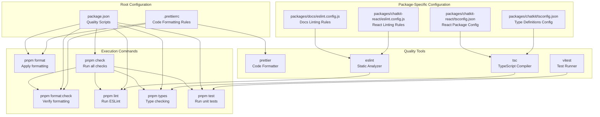
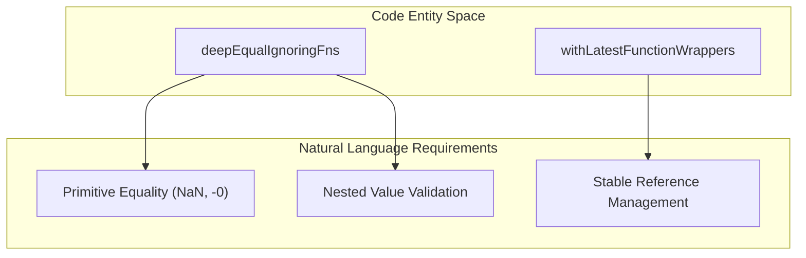

<!-- source: DeepWiki mcp.deepwiki.com · repo openai/chatkit-js · page 6.3 Code Quality Standards · fetched 2026-10-26 -->

# Code Quality Standards

Relevant source files

The following files were used as context for generating this wiki page:

- [.prettierignore](.prettierignore)
- [.prettierrc](.prettierrc)
- [packages/chatkit-react/eslint.config.js](packages/chatkit-react/eslint.config.js)
- [packages/chatkit-react/src/useStableOptions.test.ts](packages/chatkit-react/src/useStableOptions.test.ts)
- [packages/docs/eslint.config.js](packages/docs/eslint.config.js)

This page documents the code quality infrastructure and standards enforced across the chatkit-js monorepo. The repository uses a combination of Prettier for code formatting, ESLint for static analysis, TypeScript for type safety, and Vitest for unit testing. These tools are configured at both the root and package levels to maintain consistent code quality standards.

For detailed information about CI validation workflows, see page 6.1 (Continuous Integration).

## Quality Tool Architecture

The monorepo employs a layered approach to code quality, with shared root-level configurations and package-specific overrides where necessary.

**Sources:** [.prettierrc:1-5](), [packages/chatkit-react/eslint.config.js:1-37](), [packages/docs/eslint.config.js:1-21]()

## Code Formatting with Prettier

The repository uses Prettier for consistent code formatting across all packages. The configuration is defined at the root level in `.prettierrc` and applies to all TypeScript, JavaScript, JSON, and Markdown files.

### Prettier Configuration

| Setting | Value | Purpose |
|---------|-------|---------|
| `singleQuote` | `true` | Use single quotes for strings |
| `tabWidth` | `2` | Two-space indentation |
| `useTabs` | `false` | Spaces instead of tabs |

The minimal configuration relies on Prettier's opinionated defaults for most formatting decisions. The configuration file is located at `.prettierrc` in the repository root [.prettierrc:1-5]().

### Exclusions
The `.prettierignore` file ensures that generated artifacts and lockfiles are not modified by the formatter:
- `**/dist/**` [.prettierignore:1]()
- `pnpm-lock.yaml` [.prettierignore:2]()
- `*.mdx` [.prettierignore:4]()

**Sources:** [.prettierrc:1-5](), [.prettierignore:1-4]()

## Linting Configuration

ESLint provides static analysis and catches potential bugs. The repository uses the modern Flat Config format across packages.

### React Package Linting (`@openai/chatkit-react`)
The configuration in `packages/chatkit-react/eslint.config.js` is optimized for React development and TypeScript safety.

| Plugin/Config | Source |
|---------------|--------|
| `js.configs.recommended` | Standard JavaScript rules [packages/chatkit-react/eslint.config.js:8]() |
| `tseslint.configs.strict` | Strict TypeScript rules [packages/chatkit-react/eslint.config.js:9]() |
| `reactPlugin` | React-specific patterns [packages/chatkit-react/eslint.config.js:20]() |
| `reactHooksPlugin` | Enforces Rules of Hooks [packages/chatkit-react/eslint.config.js:21]() |

**Key Rule Overrides:**
- `@typescript-eslint/no-namespace`: Set to `off` to allow namespace patterns in type definitions [packages/chatkit-react/eslint.config.js:27]().
- `@typescript-eslint/no-explicit-any`: Set to `off` to allow flexibility in complex generic mappings [packages/chatkit-react/eslint.config.js:28]().

### Documentation Package Linting (`docs`)
The documentation site uses a simpler configuration focused on TypeScript and JavaScript logic within the Astro environment [packages/docs/eslint.config.js:1-21](). It specifically ignores build artifacts in `.astro/**` and `dist/**` [packages/docs/eslint.config.js:19]().

**Sources:** [packages/chatkit-react/eslint.config.js:1-37](), [packages/docs/eslint.config.js:1-21]()

## Testing Requirements

Unit testing is enforced for logic-heavy utilities and React hooks using Vitest.

### Test Patterns
Tests must follow the `describe`/`it` structure and use the `expect` assertion style [packages/chatkit-react/src/useStableOptions.test.ts:1-8]().

### Case Study: `useStableOptions.test.ts`
This test file demonstrates the standard for testing complex utility functions like `deepEqualIgnoringFns` and `withLatestFunctionWrappers`.

| Test Category | Description | Implementation Example |
|---------------|-------------|------------------------|
| **Primitive Comparison** | Checks Object.is semantics for NaN and -0 | [packages/chatkit-react/src/useStableOptions.test.ts:9-20]() |
| **Function Transparency** | Ensures functions are treated as equal if they remain functions | [packages/chatkit-react/src/useStableOptions.test.ts:22-29]() |
| **Deep Equality** | Validates nested objects and arrays | [packages/chatkit-react/src/useStableOptions.test.ts:31-45]() |
| **Cyclic References** | Validates that comparison handles circularity | [packages/chatkit-react/src/useStableOptions.test.ts:62-74]() |
| **Function Wrapping** | Verifies that wrapped functions always call the latest reference | [packages/chatkit-react/src/useStableOptions.test.ts:124-136]() |

**Sources:** [packages/chatkit-react/src/useStableOptions.test.ts:1-222]()

## Quality Check Workflow

The repository enforces a "Check Before Merge" policy. Developers are expected to run the following checks locally:

1. **Type Checking**: `pnpm types` (runs `tsc --noEmit`)
2. **Linting**: `pnpm lint` (runs `eslint`)
3. **Testing**: `pnpm test` (runs `vitest`)
4. **Formatting**: `pnpm format:check` (runs `prettier --check`)

The `pnpm check` command is a shortcut that executes all of the above in sequence.

**Sources:** [packages/chatkit-react/eslint.config.js:35-36](), [packages/docs/eslint.config.js:19]()

---

