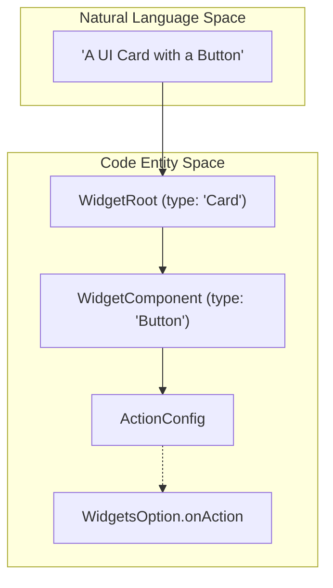
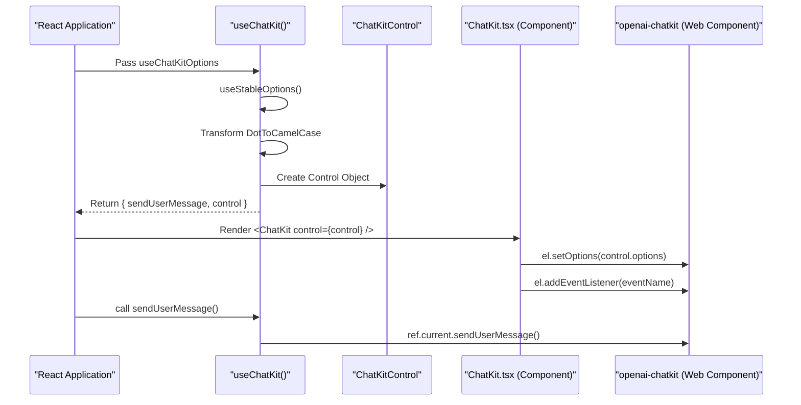

<!-- source: DeepWiki mcp.deepwiki.com · repo openai/chatkit-js · page 7 Glossary · fetched 2026-10-26 -->

# Glossary

Relevant source files

The following files were used as context for generating this wiki page:

- [.changeset/calm-geckos-glow.md](.changeset/calm-geckos-glow.md)
- [.changeset/late-falcons-scream.md](.changeset/late-falcons-scream.md)
- [.changeset/light-frogs-cry.md](.changeset/light-frogs-cry.md)
- [.changeset/real-coins-look.md](.changeset/real-coins-look.md)
- [.github/workflows/release.yml](.github/workflows/release.yml)
- [package.json](package.json)
- [packages/chatkit-react/src/ChatKit.tsx](packages/chatkit-react/src/ChatKit.tsx)
- [packages/chatkit-react/src/useChatKit.ts](packages/chatkit-react/src/useChatKit.ts)
- [packages/chatkit/types/index.d.ts](packages/chatkit/types/index.d.ts)
- [packages/chatkit/types/widgets.d.ts](packages/chatkit/types/widgets.d.ts)
- [packages/docs/src/content/docs/quick-reference/use-chatkit.mdx](packages/docs/src/content/docs/quick-reference/use-chatkit.mdx)

This glossary provides definitions for codebase-specific terms, architectural concepts, and technical jargon used throughout the ChatKit repository. It is intended to help onboarding engineers navigate the relationship between the Web Component core and the React integration layer.

## Core Concepts & Elements

### OpenAIChatKit
The primary Custom Element (`<openai-chatkit>`) that serves as the entry point for the entire ChatKit UI. It is a framework-agnostic Web Component that encapsulates the chat interface, message history, and composer.
*   **Implementation**: Defined as an interface extending `HTMLElement`.
*   **Key Methods**: Includes `setOptions`, `sendUserMessage`, `setComposerValue`, and `fetchUpdates`.
*   **Sources**: [packages/chatkit/types/index.d.ts:2552-2633]()

### ChatKitOptions
The comprehensive configuration object used to initialize and update the ChatKit instance. It covers everything from API connectivity and theming to specific UI component toggles.
*   **Usage**: Passed to the `setOptions()` method of `OpenAIChatKit`.
*   **Key Fields**: `api`, `theme`, `header`, `history`, `composer`, and `widgets`.
*   **Sources**: [packages/chatkit/types/index.d.ts:9-118]()

### Composer
The input area where users type messages. In ChatKit, the composer is highly configurable, supporting attachments, custom placeholders, and entity tagging (mentions).
*   **Configuration**: Managed via the `ComposerOption` type.
*   **Sources**: [packages/chatkit/types/index.d.ts:253-294]()

### Entity Tags
A system for "mentions" (e.g., `@name`) within the composer. When configured, ChatKit triggers a search callback as the user types, allowing for custom autocomplete and rendering of rich entity previews.
*   **Implementation**: Controlled by `EntitiesOption` and the `onTagSearch` hook.
*   **Sources**: [packages/chatkit/types/index.d.ts:202-227]()

---

## React Integration Terms

### useChatKit
A custom React hook that bridges the gap between React's declarative state and the Web Component's imperative API. It manages the lifecycle of the `OpenAIChatKit` instance and provides stable references to its methods.
*   **Returns**: An object containing `control`, `ref`, and proxied methods like `sendUserMessage`.
*   **Sources**: [packages/chatkit-react/src/useChatKit.ts:58-108](), [packages/docs/src/content/docs/quick-reference/use-chatkit.mdx:7-12]()

### ChatKitControl
An internal state object created by `useChatKit` and passed to the `ChatKit` React component. It acts as a "mailbox" to transport options and event handlers from the hook to the actual DOM element.
*   **Properties**: `setInstance` (callback to capture the ref), `options` (the filtered `ChatKitOptions`), and `handlers` (the extracted event listeners).
*   **Sources**: [packages/chatkit-react/src/useChatKit.ts:47-51]()

### useStableOptions
A utility hook used inside `useChatKit` to prevent unnecessary re-renders or updates to the Web Component. It ensures that the options object passed to the element only changes when its properties actually change.
*   **Sources**: [packages/chatkit-react/src/useChatKit.ts:60-60]()

### CHATKIT_METHOD_NAMES
A constant array of strings defining which imperative methods from the Web Component are exposed through the `useChatKit` hook.
*   **Values**: `focusComposer`, `setThreadId`, `sendUserMessage`, `setComposerValue`, `fetchUpdates`, `sendCustomAction`, `showHistory`, `hideHistory`.
*   **Sources**: [packages/chatkit-react/src/useChatKit.ts:13-22]()

### DotToCamelCase
A TypeScript utility type used to transform event names from the Web Component's dot-notation (e.g., `chatkit.response.start`) into React-style camelCase props (e.g., `onResponseStart`).
*   **Sources**: [packages/chatkit-react/src/useChatKit.ts:9-11]()

---

## Widget System

### WidgetRoot
The top-level container for a rich UI element rendered within the chat stream.
*   **Types**: `Card`, `ListView`, or `BasicRoot`.
*   **Sources**: [packages/chatkit/types/widgets.d.ts:1-1]()

### WidgetComponent
The atomic building blocks used to construct widgets. These are defined in JSON and rendered by ChatKit's internal engine.
*   **Examples**: `Text`, `Image`, `Button`, `Form`, `Table`, `Markdown`.
*   **Sources**: [packages/chatkit/types/widgets.d.ts:3-28]()

### Natural Language to Code Mapping: Widgets
The following diagram illustrates how a conceptual "Card" in the UI maps to the underlying type definitions.

**Widget Entity Mapping**

*Sources: [packages/chatkit/types/widgets.d.ts:41-56](), [packages/chatkit/types/index.d.ts:188-200]()*

---

## API Configuration

### HostedApiConfig
Configuration used when connecting ChatKit directly to OpenAI's managed infrastructure. It requires a `projectKey` and `userToken`.
*   **Sources**: [packages/chatkit/types/index.d.ts:14-16]()

### CustomApiConfig
Configuration used when ChatKit communicates with a developer-hosted backend. This allows for custom authentication and proxying of requests.
*   **Sources**: [packages/chatkit/types/index.d.ts:13-16]()

---

## Tooling & Infrastructure

### changeset
A tool used for managing versioning and changelogs in the monorepo. Developers create "changeset" files (Markdown) to describe changes, which are later consumed to automate NPM releases.
*   **Sources**: [.changeset/calm-geckos-glow.md:1-5](), [.github/workflows/release.yml:45-50]()

### starlight-typedoc
A documentation plugin that automatically generates API reference pages from TypeScript definitions. It bridges the `types/index.d.ts` file into the Astro-based documentation site.
*   **Context**: Used to generate the "API Reference" section of the docs.

### System Flow: React Hook to Web Component
This diagram shows how data flows from a React component through the glossary terms defined above to reach the DOM.

**React to Web Component Data Flow**

*Sources: [packages/chatkit-react/src/useChatKit.ts:58-108](), [packages/chatkit-react/src/ChatKit.tsx:38-107]()*

---
**Sources:**
- [packages/chatkit/types/index.d.ts:9-2633]()
- [packages/chatkit/types/widgets.d.ts:1-334]()
- [packages/chatkit-react/src/useChatKit.ts:1-109]()
- [packages/chatkit-react/src/ChatKit.tsx:1-107]()
- [packages/docs/src/content/docs/quick-reference/use-chatkit.mdx:1-94]()
- [.github/workflows/release.yml:45-50]()