# Page: Overview

# Overview

<details>
<summary>Relevant source files</summary>

The following files were used as context for generating this wiki page:

- [README.md](README.md)
- [packages/chatkit-react/README.md](packages/chatkit-react/README.md)
- [packages/chatkit/README.md](packages/chatkit/README.md)

</details>


This document introduces the `chatkit-js` repository, a monorepo containing TypeScript type definitions and React bindings for the ChatKit web component. It explains the repository's purpose, structure, and the two primary integration approaches (React and vanilla JavaScript). For detailed architecture information, see [High-Level Architecture](#1.1). For package-specific details, see [Packages](#1.2).

## What is ChatKit.js

ChatKit.js is a framework for building AI-powered chat experiences. The repository provides type-safe wrappers and bindings that enable developers to embed a production-ready chat interface with minimal configuration [README.md:1-13](). The actual chat UI implementation is delivered via the `openai-chatkit` custom element, which is loaded from OpenAI's CDN [README.md:48-55]().

The framework supports two primary use cases:

1.  **React applications**: Using the `@openai/chatkit-react` package with the `useChatKit` hook and `ChatKit` component [packages/chatkit-react/README.md:1-9]().
2.  **Vanilla JavaScript applications**: Using the `@openai/chatkit` types with the `openai-chatkit` custom element directly [packages/chatkit/README.md:1-17]().

Sources: [README.md:1-19](), [packages/chatkit/README.md:1-17](), [packages/chatkit-react/README.md:1-9]()

## Repository Structure

The `chatkit-js` repository is organized as a monorepo with three distinct packages:

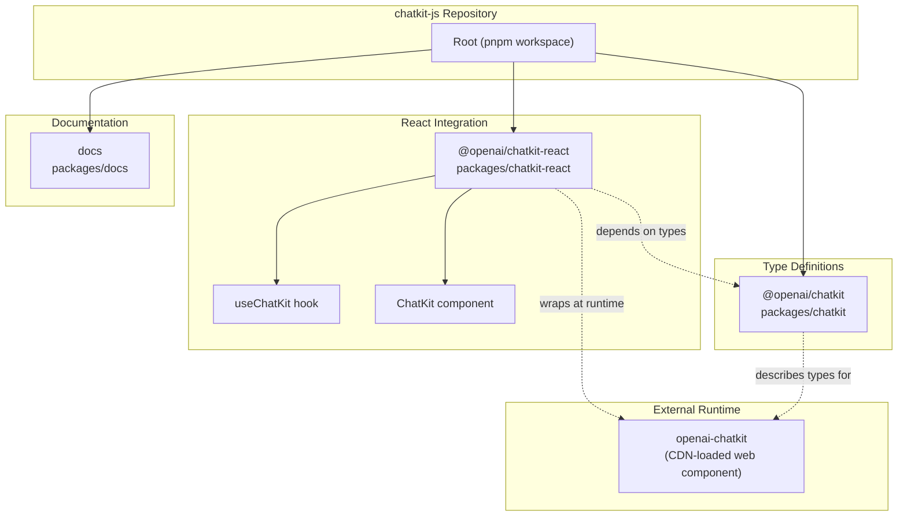

**Repository Structure: Monorepo Packages and Dependencies**

| Package | Path | Purpose |
| :--- | :--- | :--- |
| `@openai/chatkit` | `packages/chatkit` | TypeScript type definitions for the web component [packages/chatkit/README.md:1-3]() |
| `@openai/chatkit-react` | `packages/chatkit-react` | React hooks and components [packages/chatkit-react/README.md:1-4]() |
| `docs` | `packages/docs` | Documentation site infrastructure |

Sources: [README.md:42-46](), [packages/chatkit/README.md:1-17](), [packages/chatkit-react/README.md:1-9]()

## Integration Approaches

ChatKit.js supports two integration patterns, both interacting with the `openai-chatkit` custom element at runtime.

### React Integration

React applications use the `useChatKit` hook to configure the chat instance and obtain a `control` object, which is passed to the `ChatKit` component:

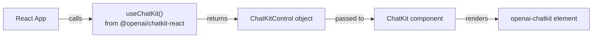

**React Integration Flow: Hook to Component to Web Element**

The hook accepts configuration and returns a control object used to manage the chat lifecycle and methods [README.md:60-84]().

Sources: [README.md:60-84](), [packages/chatkit-react/README.md:1-9]()

### Vanilla JavaScript Integration

Applications can also use the web component directly by including the script and using the `openai-chatkit` custom element:

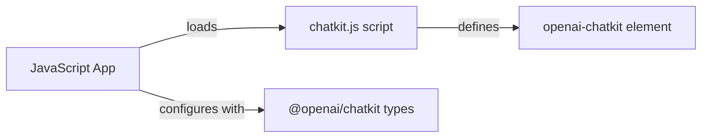

**Vanilla JS Integration: Direct Web Component Usage**

The `@openai/chatkit` package provides TypeScript types to ensure the custom element is available globally in JSX or TypeScript environments [packages/chatkit/README.md:7-17]().

Sources: [README.md:48-55](), [packages/chatkit/README.md:1-17]()

## Backend Configuration

ChatKit requires a backend session to function, typically initialized by generating a client token on a server [README.md:21-40]().

| Configuration Area | Role | Implementation |
| :--- | :--- | :--- |
| **Server-side** | Session Creation | Call OpenAI API to create a session and return `client_secret` [README.md:34-39]() |
| **Client-side** | Token Retrieval | Implement `getClientSecret` to fetch the token from your server [README.md:64-79]() |

Sources: [README.md:21-40](), [README.md:64-79]()

## Key Capabilities

ChatKit provides the following capabilities out of the box [README.md:3-11]():

*   **Deep UI customization**: Tailor the interface to match your application's design.
*   **Built-in response streaming**: Interactive, natural conversations.
*   **Tool and workflow integration**: Visualizing agentic actions and chain-of-thought reasoning.
*   **Rich interactive widgets**: Rendered directly inside the chat.
*   **Attachment handling**: Support for file and image uploads.
*   **Thread and message management**: Organizing complex conversations.
*   **Source annotations and entity tagging**: Transparency and references.

Sources: [README.md:3-11]()

## Development Environment

The repository uses `pnpm` workspaces for monorepo management. For development setup instructions, including installing dependencies and running the documentation site locally, see [Development Setup](#1.3).

For information about the CI/CD pipeline and release process, see [Development Workflow](#6).

Sources: [README.md:42-46]()

---

# Page: High-Level Architecture

# High-Level Architecture

<details>
<summary>Relevant source files</summary>

The following files were used as context for generating this wiki page:

- [.changeset/calm-geckos-glow.md](.changeset/calm-geckos-glow.md)
- [.changeset/real-coins-look.md](.changeset/real-coins-look.md)
- [packages/chatkit-react/src/ChatKit.tsx](packages/chatkit-react/src/ChatKit.tsx)
- [packages/chatkit/package.json](packages/chatkit/package.json)
- [packages/chatkit/types/index.d.ts](packages/chatkit/types/index.d.ts)

</details>


This document describes the three-layer architecture of ChatKit.js: the core web component, React bindings, and backend integration patterns. It explains how the packages in the monorepo relate to each other at build-time and runtime, and how configuration and events flow between layers.

For package-specific implementation details, see [Packages](#1.2). For development workflow and build processes, see [Development Setup](#1.3).

## Package Structure

ChatKit.js is organized as a monorepo containing two main NPM packages that serve distinct purposes:

| Package | Purpose | Build Output | Dependencies |
|---------|---------|--------------|--------------|
| `@openai/chatkit` | TypeScript type definitions for the web component | Types only (`types/index.d.ts`) | None |
| `@openai/chatkit-react` | React bindings for the web component | ESM + CJS + Types (`dist/`) | `@openai/chatkit` (workspace), `react>=18` (peer) |

The core package provides the `ChatKitOptions`, `ChatKitEvents`, `OpenAIChatKit`, and `Widgets` type definitions that describe the web component's interface. The React package depends on these types via a workspace dependency and provides the `useChatKit` hook and `ChatKit` component that integrate the web component into React applications.

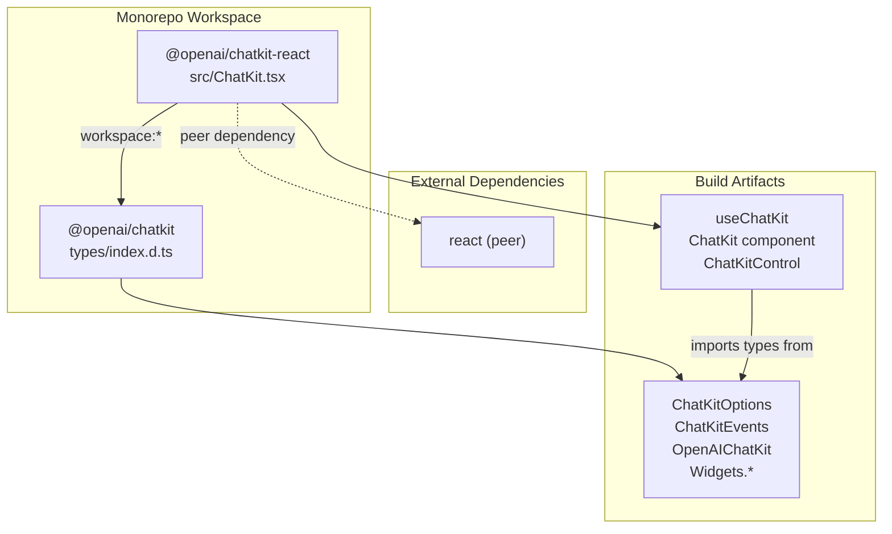

**Sources:** [packages/chatkit/package.json:1-16](), [packages/chatkit/types/index.d.ts:1-5]()

## Three-Layer Runtime Architecture

The runtime architecture consists of three distinct layers that communicate through well-defined interfaces:

### Layer 1: Web Component (`openai-chatkit`)

The foundation is a custom web component registered as `openai-chatkit`. This component is defined externally and provides the core chat UI functionality. The TypeScript interface `OpenAIChatKit` describes its programmatic API:

- `setOptions(options: ChatKitOptions): void` - Configures the component.
- `focusComposer(): Promise<void>` - Focuses the message input.
- `setThreadId(threadId: string | null): Promise<void>` - Switches threads.
- `sendUserMessage(params): Promise<void>` - Sends a message programmatically.
- `sendCustomAction(action, itemId?): Promise<void>` - Sends widget actions to backend.
- `fetchUpdates(): Promise<void>` - Manually syncs with server.

**Sources:** [packages/chatkit/types/index.d.ts:786-919]()

### Layer 2: React Bindings

The React layer consists of two primary exports from `@openai/chatkit-react`:

**ChatKit Component** [packages/chatkit-react/src/ChatKit.tsx:38-107]()

A React component that renders the `<openai-chatkit>` custom element and manages its lifecycle:

- Accepts a `control` prop containing options and event handlers.
- Uses `useLayoutEffect` [packages/chatkit-react/src/ChatKit.tsx:42-61]() to call `setOptions()` when the web component is defined.
- Uses `useEffect` [packages/chatkit-react/src/ChatKit.tsx:63-84]() to attach event listeners with `AbortController` for cleanup.
- Forwards refs to the underlying web component element.
- Declares the `openai-chatkit` intrinsic element type [packages/chatkit-react/src/ChatKit.tsx:9-18]() for JSX support.

**useChatKit Hook**

Provides the `control` object consumed by the `ChatKit` component. The control object contains:
- `options`: The `ChatKitOptions` configuration.
- `handlers`: Event callbacks mapped to `ChatKitEvents`.
- `setInstance`: Internal method to track the web component instance.
- Methods proxied to the web component instance.

### Layer 3: Application

Application code interacts only with the React bindings:

```typescript
const { control, ref } = useChatKit({
  api: { getClientSecret: async () => fetchToken() },
  theme: 'dark',
  onReady: () => console.log('ChatKit initialized')
});

<ChatKit control={control} ref={ref} />
```

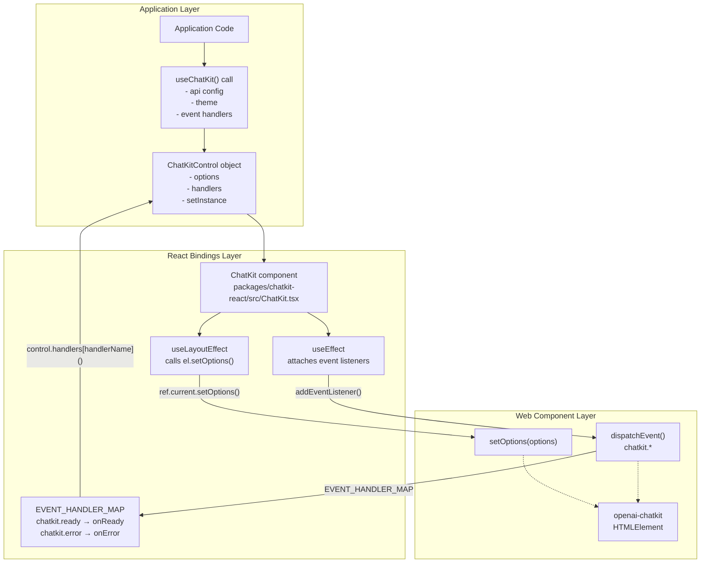

**Sources:** [packages/chatkit-react/src/ChatKit.tsx:38-107](), [packages/chatkit/types/index.d.ts:786-919]()

## Configuration Flow

Configuration flows through the layers via the `ChatKitOptions` interface [packages/chatkit/types/index.d.ts:9-118](), which defines all configurable aspects:

| Configuration Area | Type | Purpose |
|--------------------|------|---------|
| `api` | `CustomApiConfig \| HostedApiConfig` | Backend connectivity and authentication. |
| `theme` | `ColorScheme \| ThemeOption` | Visual appearance (colors, typography, density, radius). |
| `locale` | `SupportedLocale` | UI language override. |
| `initialThread` | `string \| null` | Thread to show on mount. |
| `header` | `HeaderOption` | Header visibility and custom actions. |
| `history` | `HistoryOption` | Thread history panel configuration. |
| `startScreen` | `StartScreenOption` | Greeting text and starter prompts. |
| `composer` | `ComposerOption` | Input placeholder and attachments. |
| `threadItemActions` | `ThreadItemActionsOption` | Feedback and retry buttons. |
| `disclaimer` | `DisclaimerOption` | Markdown text below composer. |
| `entities` | `EntitiesOption` | Tag search and preview widgets. |
| `widgets` | `WidgetsOption` | Widget action handler. |
| `onClientTool` | Function | Client-side tool execution. |

The configuration lifecycle:

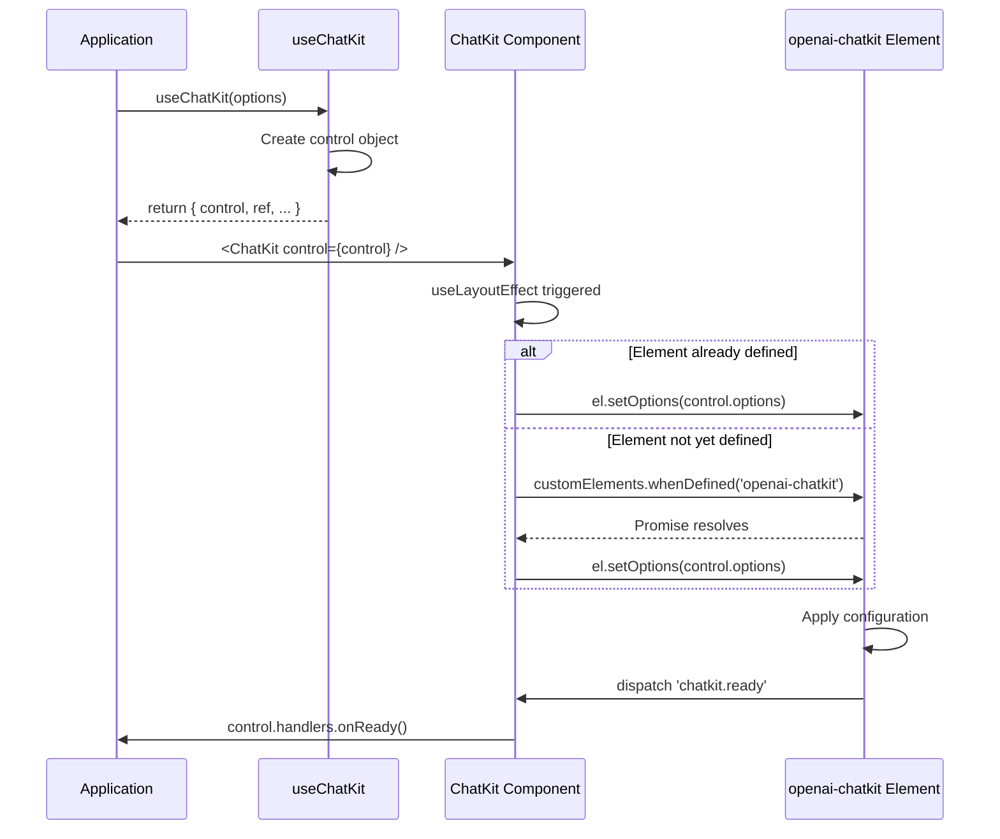

The `ChatKit` component uses `useLayoutEffect` [packages/chatkit-react/src/ChatKit.tsx:42-61]() to call `setOptions()` synchronously after the DOM element is created but before paint, ensuring configuration is applied before the user sees the UI. It handles cases where the custom element definition may not be loaded yet by using `customElements.whenDefined()`.

**Sources:** [packages/chatkit/types/index.d.ts:9-118](), [packages/chatkit-react/src/ChatKit.tsx:42-61]()

## Event System

Events flow from the web component to the application through a mapping system. The web component emits DOM `CustomEvent` instances with names like `chatkit.ready`, `chatkit.error`, etc. [packages/chatkit/types/index.d.ts:924-957](). The `ChatKit` component maps these to React-style callback props:

```typescript
const EVENT_HANDLER_MAP: {
  [K in keyof ChatKitEvents]: ToEventHandlerKey<K>;
} = {
  'chatkit.error': 'onError',
  'chatkit.response.end': 'onResponseEnd',
  'chatkit.response.start': 'onResponseStart',
  'chatkit.log': 'onLog',
  'chatkit.thread.change': 'onThreadChange',
  'chatkit.thread.load.start': 'onThreadLoadStart',
  'chatkit.thread.load.end': 'onThreadLoadEnd',
  'chatkit.tool.change': 'onToolChange',
  'chatkit.ready': 'onReady',
  'chatkit.effect': 'onEffect',
  'chatkit.deeplink': 'onDeeplink',
};
```

The `useEffect` hook [packages/chatkit-react/src/ChatKit.tsx:63-84]() iterates through all event names, attaching listeners that invoke the corresponding handler from `control.handlers`. Event listeners are registered with an `AbortController` signal to ensure cleanup.

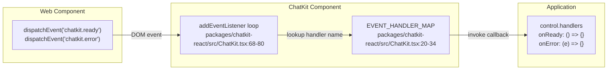

**Sources:** [packages/chatkit-react/src/ChatKit.tsx:20-84](), [packages/chatkit/types/index.d.ts:924-957]()

## Backend Integration

ChatKit supports two backend integration modes defined by the `api` configuration field [packages/chatkit/types/index.d.ts:16]():

### CustomApiConfig

For self-hosted backends that implement the ChatKit protocol [packages/chatkit/types/index.d.ts:564-590]():

```typescript
{
  api: {
    url: '/api/chatkit',
    domainKey: 'xxx',
    fetch?: customFetch,
    uploadStrategy: { type: 'two_phase' }
  }
}
```

The web component makes requests directly to the specified URL. The custom backend must handle message submission, thread management, and widget actions.

### HostedApiConfig

For OpenAI's managed ChatKit service [packages/chatkit/types/index.d.ts:592-597]():

```typescript
{
  api: {
    getClientSecret: async (currentSecret) => {
      const res = await fetch('/api/chatkit/token');
      const data = await res.json();
      return data.client_secret;
    }
  }
}
```

The `getClientSecret` function is called to fetch a short-lived token from your backend, which should proxy the request to OpenAI's sessions API. This keeps API keys secure on the server while enabling client-side functionality.

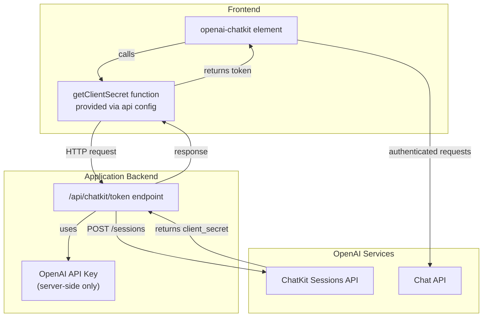

**Sources:** [packages/chatkit/types/index.d.ts:564-597]()

## Type System Integration

The core package exports TypeScript types that both consumers and the React bindings depend on [packages/chatkit/types/index.d.ts:1-4]():

- `ChatKitOptions`: Configuration interface.
- `ChatKitEvents`: Event payload types.
- `OpenAIChatKit`: Web component interface.
- `Widgets.*`: Widget type system (Card, ListView, BasicRoot).

The React bindings import these types and extend them for React usage, including the JSX namespace extension [packages/chatkit-react/src/ChatKit.tsx:9-18]() to enable `<openai-chatkit>` as a valid JSX element.

**Sources:** [packages/chatkit/types/index.d.ts:1-4](), [packages/chatkit-react/src/ChatKit.tsx:1-18]()

---

# Page: Packages

# Packages

<details>
<summary>Relevant source files</summary>

The following files were used as context for generating this wiki page:

- [packages/chatkit-react/CHANGELOG.md](packages/chatkit-react/CHANGELOG.md)
- [packages/chatkit-react/package.json](packages/chatkit-react/package.json)
- [packages/chatkit/package.json](packages/chatkit/package.json)
- [packages/docs/package.json](packages/docs/package.json)
- [pnpm-workspace.yaml](pnpm-workspace.yaml)

</details>


This document describes the three main packages in the `chatkit-js` monorepo: `@openai/chatkit` (type definitions), `@openai/chatkit-react` (React bindings), and `docs` (documentation site). Each package has a distinct purpose and is independently versioned and published.

## Package Overview

The `chatkit-js` repository is structured as a `pnpm` monorepo containing three packages defined in the workspace configuration:

[pnpm-workspace.yaml:1-3]()

| Package | NPM Name | Purpose | Published |
|---------|----------|---------|-----------|
| `chatkit` | `@openai/chatkit` | TypeScript type definitions for the ChatKit web component | Yes |
| `chatkit-react` | `@openai/chatkit-react` | React bindings and hooks for integrating ChatKit | Yes |
| `docs` | `docs` (private) | Documentation site built with Astro and Starlight | No |

Sources: [packages/chatkit/package.json:2-5](), [packages/chatkit-react/package.json:2-4](), [packages/docs/package.json:2-3](), [pnpm-workspace.yaml:1-3]()

## Package Dependencies and Flow

The following diagram illustrates how the packages relate to each other and to external dependencies like the core ChatKit Web Component.

### Monorepo Dependency Graph
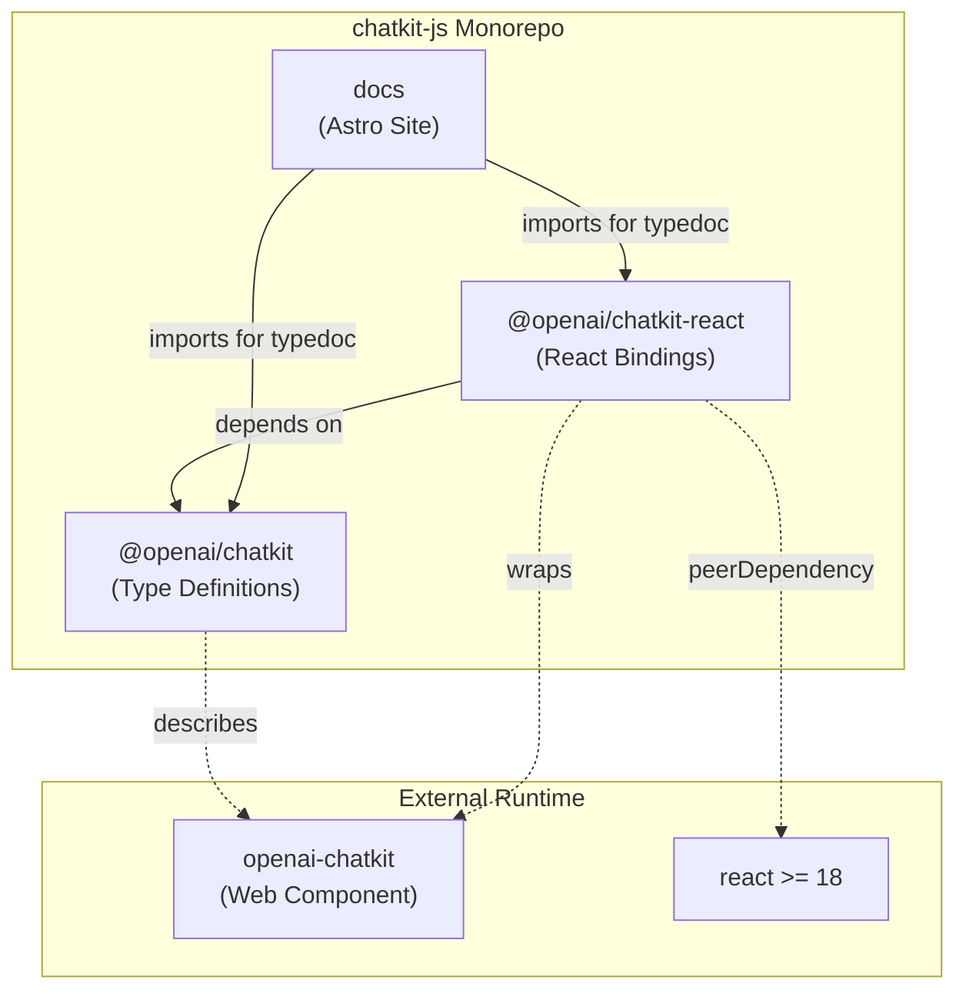
Sources: [packages/chatkit-react/package.json:22-28](), [packages/docs/package.json:15-22]()

## @openai/chatkit (Core Types)

The `@openai/chatkit` package provides the TypeScript type definitions for the ChatKit web component. It contains no runtime logic; its primary purpose is to provide type safety for developers interacting with the `openai-chatkit` custom element.

### Configuration and Exports
The package exports only type definitions via the `types` field in `package.json`:

[packages/chatkit/package.json:11-16]()

- **Location**: `packages/chatkit/`
- **Version**: `1.6.0` [packages/chatkit/package.json:3]()
- **Main Entry**: `types/index.d.ts` [packages/chatkit/package.json:11]()

### Key Responsibilities
- **Interface Definitions**: Defines `ChatKitOptions`, which governs the configuration of the UI (themes, API endpoints, etc.).
- **Method Signatures**: Defines the public API of the `OpenAIChatKit` HTMLElement, including methods like `sendUserMessage` and `setThreadId`.
- **Event Mapping**: Provides types for the `ChatKitEvents` system (e.g., `ready`, `error`, `response`).

Sources: [packages/chatkit/package.json:1-30]()

## @openai/chatkit-react (React Bindings)

The `@openai/chatkit-react` package provides a React-idiomatic way to use ChatKit. It abstracts the manual DOM manipulation and event listener management required by the web component.

### Build and Distribution
The package is built using `tsup` to provide both ESM and CommonJS support:

[packages/chatkit-react/package.json:36-36]()

- **ESM Entry**: `dist/index.js` [packages/chatkit-react/package.json:12]()
- **CJS Entry**: `dist/index.cjs` [packages/chatkit-react/package.json:11]()
- **Peer Dependencies**: Requires `react` and `react-dom` version 18 or higher [packages/chatkit-react/package.json:22-25]().

### Recent Evolutions
As of version `1.5.0`, the React package has expanded to support deeper integration features:
- **Event Hooks**: Added support for `onDeeplink`, `onToolChange`, `onEffect`, and `onReady` [packages/chatkit-react/CHANGELOG.md:7-86]().
- **Method Proxies**: Exposes underlying web component methods such as `showHistory()` and `hideHistory()` through the `useChatKit` hook [packages/chatkit-react/CHANGELOG.md:40-40]().
- **Rich Content**: Updated `setComposerValue` and `sendUserMessage` to support rich-content segments and inference options [packages/chatkit-react/CHANGELOG.md:42-43]().

Sources: [packages/chatkit-react/package.json:1-51](), [packages/chatkit-react/CHANGELOG.md:1-119]()

## docs (Documentation Site)

The `docs` package is a private workspace package used to generate the project's documentation site. It is built using the **Astro** framework with the **Starlight** theme.

### Implementation Space to Code Entity Space
The documentation site bridges the gap between natural language guides and the underlying TypeScript entities using `starlight-typedoc`.

### Documentation Pipeline
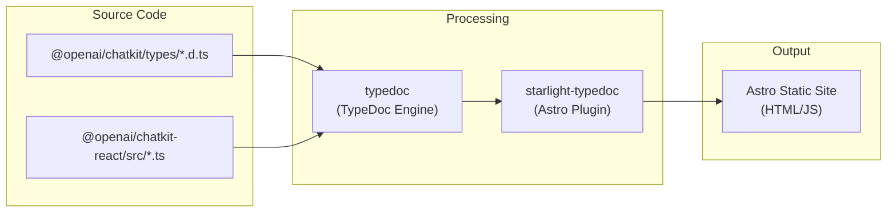

### Key Technologies
- **Astro & Starlight**: The core site engine and documentation theme [packages/docs/package.json:15-18]().
- **TypeDoc Integration**: Uses `typedoc` and `starlight-typedoc` to automatically extract API references from the source code of the other two packages [packages/docs/package.json:22-24]().
- **Styling**: Uses Tailwind CSS for custom components [packages/docs/package.json:16-17]().

Sources: [packages/docs/package.json:1-33]()

## Summary of Package Scripts

Each package contains scripts for local development, type checking, and building.

| Package | Build Command | Type Check | Test Command |
|---------|---------------|------------|--------------|
| `chatkit` | N/A (Types only) | `pnpm types` | N/A |
| `chatkit-react` | `pnpm build` (`tsup`) | `pnpm types` | `pnpm test` (`vitest`) |
| `docs` | `pnpm build` (`astro build`) | `pnpm types` | N/A |

Sources: [packages/chatkit/package.json:17-20](), [packages/chatkit-react/package.json:35-41](), [packages/docs/package.json:5-13]()

---

# Page: Development Setup

# Development Setup

<details>
<summary>Relevant source files</summary>

The following files were used as context for generating this wiki page:

- [.github/workflows/release.yml](.github/workflows/release.yml)
- [package.json](package.json)
- [pnpm-lock.yaml](pnpm-lock.yaml)
- [pnpm-workspace.yaml](pnpm-workspace.yaml)

</details>


This page provides instructions for setting up a local development environment for the `chatkit-js` monorepo. It covers prerequisites, repository setup, workspace structure, and common development commands.

## Prerequisites

The `chatkit-js` repository requires the following tools:

| Tool | Version | Purpose |
|------|---------|---------|
| Node.js | 22 | Runtime environment |
| pnpm | 10.11.0+ | Package manager |

### Installing pnpm

The repository uses `pnpm` as its package manager, as specified in [package.json:32](). Install pnpm globally:

```bash
npm install -g pnpm@10.11.0
```

Alternatively, use the GitHub Actions configuration as a reference for the environment setup:
- **Node Version**: 22 [[.github/workflows/release.yml:35]()]
- **pnpm Version**: 10.11.0 [[package.json:32]()]

**Sources:** [package.json:32](), [.github/workflows/release.yml:28-35]()

## Repository Setup

### Cloning the Repository

```bash
git clone https://github.com/openai/chatkit-js.git
cd chatkit-js
```

### Installing Dependencies

The monorepo uses `pnpm` workspaces. Install all dependencies across all packages:

```bash
pnpm install
```

This command installs dependencies for all workspace packages and links local packages together (e.g., `@openai/chatkit-react` depends on `@openai/chatkit` via the `workspace:*` specifier) [[pnpm-lock.yaml:58-60]()].

**Sources:** [.github/workflows/release.yml:30](), [pnpm-lock.yaml:58-60]()

## Workspace Structure

The repository is organized as a `pnpm` workspace monorepo defined in `pnpm-workspace.yaml` [[pnpm-workspace.yaml:1-3]()].

### Code Entity Space to System Names

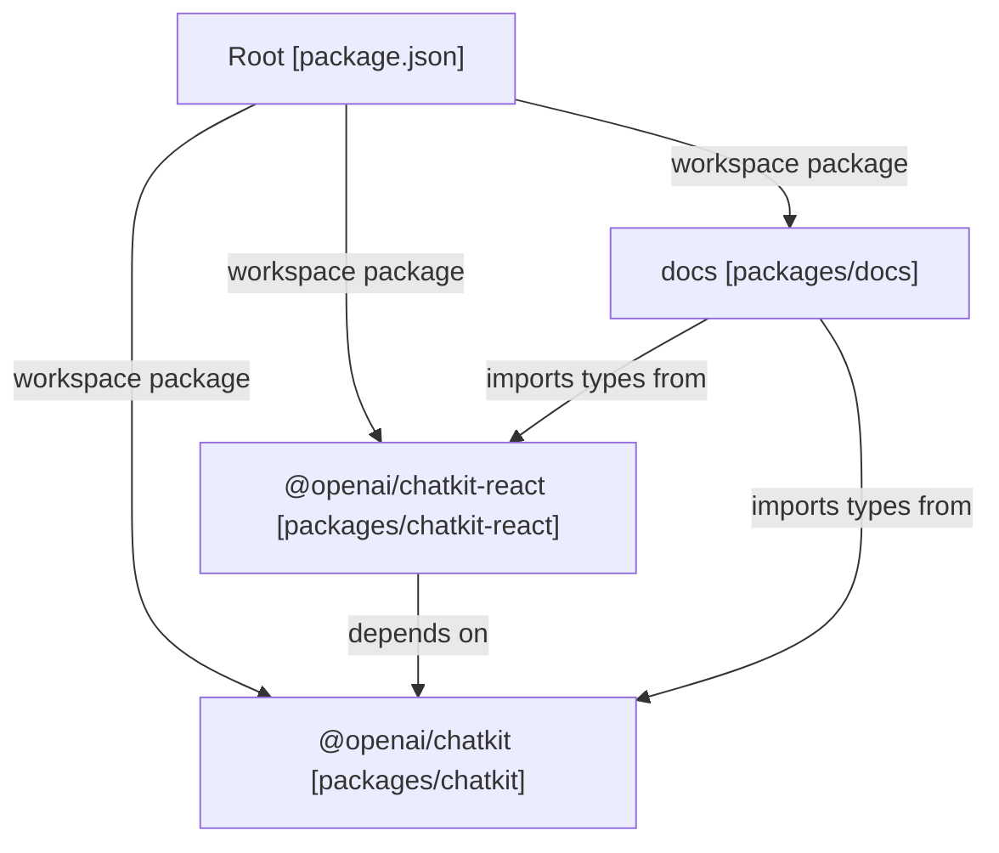

**Sources:** [pnpm-workspace.yaml:1-3](), [pnpm-lock.yaml:54-129]()

## Development Commands

### Root-Level Commands

The root `package.json` defines scripts for managing the entire monorepo [[package.json:5-15]()].

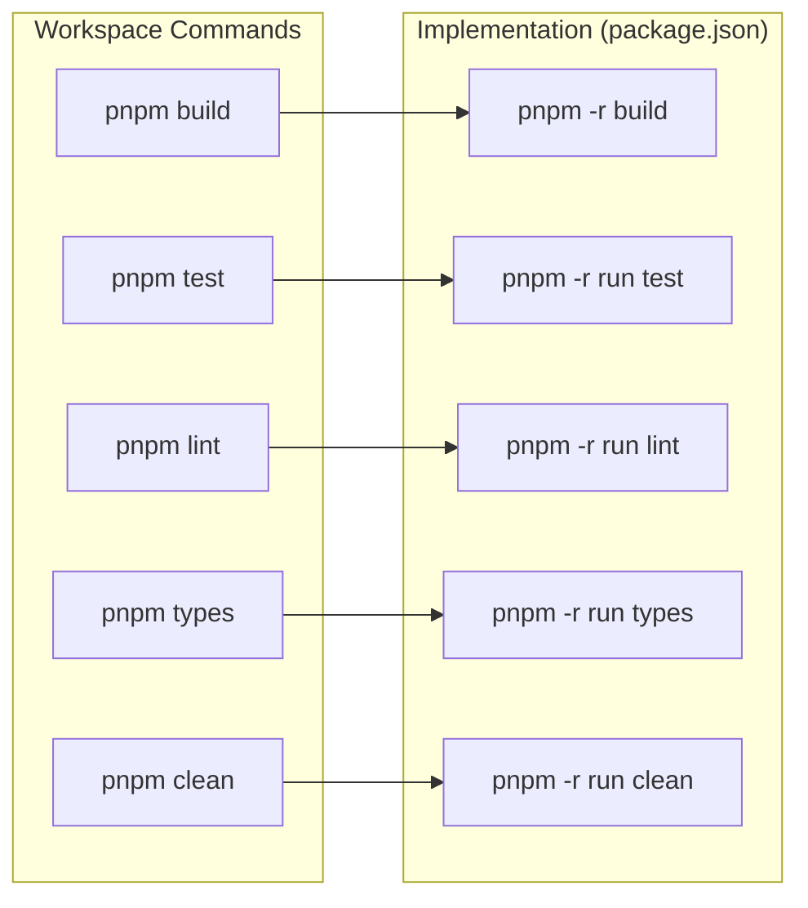

**Command Reference**

| Command | Script | Description |
|---------|--------|-------------|
| `pnpm build` | `pnpm -r build` | Build all packages recursively [[package.json:6]()] |
| `pnpm dev:docs` | `pnpm -F docs dev` | Run documentation site in dev mode [[package.json:7]()] |
| `pnpm test` | `pnpm -r run test` | Run tests across all packages [[package.json:8]()] |
| `pnpm lint` | `pnpm -r run lint` | Lint all packages [[package.json:9]()] |
| `pnpm format` | `prettier --write .` | Format code using Prettier [[package.json:11]()] |
| `pnpm check` | `prettier --check . && pnpm -r run lint && pnpm types && pnpm -r run test` | Full CI-style check [[package.json:14]()] |

**Sources:** [package.json:5-15]()

## Running the Documentation Site

The documentation site is built with Astro and Starlight, located in `packages/docs`.

### Development Server

Start the local documentation server:

```bash
pnpm dev:docs
```

This targets the `docs` package specifically using the `--filter` (`-F`) flag [[package.json:7]()].

### Documentation Pipeline

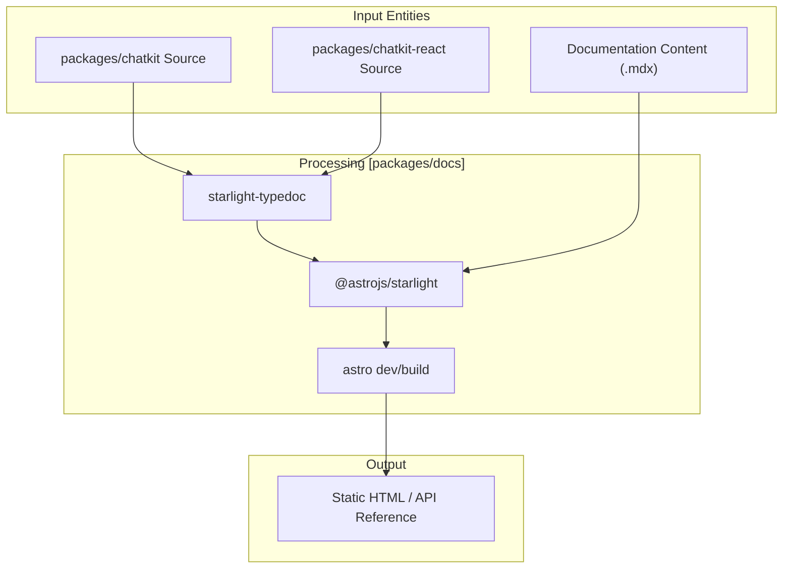

**Sources:** [package.json:7](), [pnpm-lock.yaml:81-112]()

## Continuous Integration & Release

The repository uses GitHub Actions for releases. The `Release NPM` workflow automates the build and publishing process [[.github/workflows/release.yml:1-53]()].

### Release Workflow Logic

1.  **Setup**: Installs `pnpm` and `Node.js` (v22) [[.github/workflows/release.yml:27-38]()].
2.  **Build**: Runs `pnpm build` to compile all workspace packages [[.github/workflows/release.yml:43]()].
3.  **Publish**: Uses `@changesets/cli` to manage versioning and publish to NPM [[.github/workflows/release.yml:45-50]()].

**Sources:** [.github/workflows/release.yml:18-53](), [package.json:17]()

## Troubleshooting

- **pnpm version mismatch**: Ensure you are using version `10.11.0` as specified in `package.json` [[package.json:32]()].
- **Build failures**: Ensure you have run `pnpm install` at the root to link workspace packages.
- **Linting errors**: Run `pnpm format` to automatically fix formatting issues before running `pnpm lint` [[package.json:11,14]()].

**Sources:** [package.json:11-32]()

---

# Page: Core Package (@openai/chatkit)

# Core Package (@openai/chatkit)

<details>
<summary>Relevant source files</summary>

The following files were used as context for generating this wiki page:

- [.changeset/calm-geckos-glow.md](.changeset/calm-geckos-glow.md)
- [.changeset/real-coins-look.md](.changeset/real-coins-look.md)
- [packages/chatkit/CHANGELOG.md](packages/chatkit/CHANGELOG.md)
- [packages/chatkit/package.json](packages/chatkit/package.json)
- [packages/chatkit/types/index.d.ts](packages/chatkit/types/index.d.ts)

</details>


The `@openai/chatkit` package provides comprehensive TypeScript type definitions for the ChatKit web component system. This package does not contain implementation code; instead, it defines the public API contract for the `openai-chatkit` custom element and all associated configuration options, events, and data structures.

For React-specific integration patterns using these types, see [React Bindings (@openai/chatkit-react)](#3). For practical integration guides using these types in applications, see [Integration Guides](#4).

## Package Overview

The `@openai/chatkit` package is a pure type definition package published to NPM. It serves as the TypeScript interface layer between applications and the `openai-chatkit` web component, which is loaded from CDN at runtime.

**Package Structure:**
```
packages/chatkit/
├── types/
│   ├── index.d.ts      # Main type definitions
│   └── widgets.d.ts    # Widget type system
├── package.json        # Package configuration
└── README.md          # Basic setup instructions
```

The package exports types only, with no runtime JavaScript code. The `package.json` marks this explicitly with `"sideEffects": false` [packages/chatkit/package.json:6]() and exports only type definitions through the `types` field [packages/chatkit/package.json:11]().

**Key characteristics:**
- **No runtime code**: All files are `.d.ts` TypeScript declaration files.
- **Single entry point**: [packages/chatkit/types/index.d.ts:1-1104]()
- **Widget subsystem**: [packages/chatkit/types/widgets.d.ts]() (referenced at [packages/chatkit/types/index.d.ts:1]())
- **Version**: 1.6.0 as of current release [packages/chatkit/package.json:3]()

Sources: [packages/chatkit/package.json:1-30](), [packages/chatkit/types/index.d.ts:1-5]()

## Type Definition Architecture

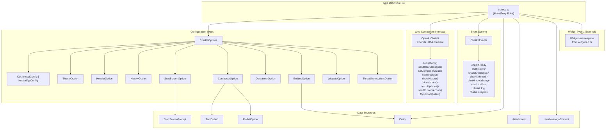

The type system is organized hierarchically with `ChatKitOptions` as the central configuration interface. All configuration surfaces branch from this root type, enabling strongly-typed configuration of every aspect of the ChatKit UI.

Sources: [packages/chatkit/types/index.d.ts:1-118]()

## Primary Type Exports

### ChatKitOptions Interface

The `ChatKitOptions` type [packages/chatkit/types/index.d.ts:9-118]() is the primary configuration interface for initializing ChatKit. It aggregates all configuration options into a single object structure:

| Property | Type | Purpose | Required |
|----------|------|---------|----------|
| `api` | `CustomApiConfig \| HostedApiConfig` | Backend communication configuration | Yes |
| `locale` | `SupportedLocale` | UI language override | No |
| `theme` | `ColorScheme \| ThemeOption` | Visual appearance settings | No |
| `initialThread` | `string \| null` | Thread to show on mount | No |
| `onClientTool` | Function | Client-side tool handler | No |
| `header` | `HeaderOption` | Header configuration | No |
| `history` | `HistoryOption` | History panel configuration | No |
| `startScreen` | `StartScreenOption` | New thread screen configuration | No |
| `threadItemActions` | `ThreadItemActionsOption` | Message action buttons configuration | No |
| `composer` | `ComposerOption` | Input composer configuration | No |
| `disclaimer` | `DisclaimerOption` | Disclaimer text configuration | No |
| `entities` | `EntitiesOption` | Entity handling configuration | No |
| `widgets` | `WidgetsOption` | Widget action handlers | No |

**Backend Configuration Options:**

Two mutually exclusive backend configuration types exist:

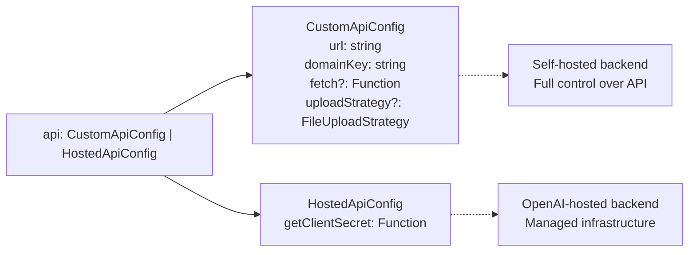

- **CustomApiConfig** [packages/chatkit/types/index.d.ts:634-662](): For self-hosted backends with custom URL and domain verification.
- **HostedApiConfig** [packages/chatkit/types/index.d.ts:664-669](): For OpenAI-hosted backends using client secret authentication.

Sources: [packages/chatkit/types/index.d.ts:9-118](), [packages/chatkit/types/index.d.ts:634-669]()

### OpenAIChatKit Element Interface

The `OpenAIChatKit` interface [packages/chatkit/types/index.d.ts:894-1062]() extends `HTMLElement` and defines the web component's imperative API. This interface is implemented by the `openai-chatkit` custom element loaded from CDN.

```mermaid
graph TB
    ELEMENT["OpenAIChatKit interface<br/>extends HTMLElement"]
    
    CONFIG["Configuration Methods"]
    SETOPT["setOptions(options: ChatKitOptions): void"]
    
    MESSAGE["Message Methods"]
    SEND["sendUserMessage(params): Promise&lt;void&gt;"]
    SETCOMP["setComposerValue(params): Promise&lt;void&gt;"]
    CUSTOM["sendCustomAction(action, itemId?): Promise&lt;void&gt;"]
    
    NAV["Navigation Methods"]
    SETTHREAD["setThreadId(threadId): Promise&lt;void&gt;"]
    SHOWHIST["showHistory(): Promise&lt;void&gt;"]
    HIDEHIST["hideHistory(): Promise&lt;void&gt;"]
    
    UTIL["Utility Methods"]
    FOCUS["focusComposer(): Promise&lt;void&gt;"]
    FETCH["fetchUpdates(): Promise&lt;void&gt;"]
    
    EVENT["Event Methods"]
    ADDLIST["addEventListener&lt;K&gt;(type, listener, options?)"]
    REMLIST["removeEventListener&lt;K&gt;(type, listener, options?)"]
    
    ELEMENT --> CONFIG
    CONFIG --> SETOPT
    
    ELEMENT --> MESSAGE
    MESSAGE --> SEND
    MESSAGE --> SETCOMP
    MESSAGE --> CUSTOM
    
    ELEMENT --> NAV
    NAV --> SETTHREAD
    NAV --> SHOWHIST
    NAV --> HIDEHIST
    
    ELEMENT --> UTIL
    UTIL --> FOCUS
    UTIL --> FETCH
    
    ELEMENT --> EVENT
    EVENT --> ADDLIST
    EVENT --> REMLIST
```

**Method Signatures:**

- **setOptions** [packages/chatkit/types/index.d.ts:900](): Applies configuration. Note: Options are not merged; the full options object must be provided each time.
- **sendUserMessage** [packages/chatkit/types/index.d.ts:937-952](): Sends message with optional text, content, attachments, and inference options (`toolChoice`, `model`).
- **setComposerValue** [packages/chatkit/types/index.d.ts:954-971](): Pre-fills composer without sending, supports rich-content segments, optional tool/model selection, and file attachments.
- **setThreadId** [packages/chatkit/types/index.d.ts:906](): Switches active thread (pass `null` for new thread).
- **sendCustomAction** [packages/chatkit/types/index.d.ts:912-934](): Sends application-defined actions to backend.
- **showHistory/hideHistory** [packages/chatkit/types/index.d.ts:979-984](): Programmatically controls history panel visibility.
- **fetchUpdates** [packages/chatkit/types/index.d.ts:991](): Manually syncs thread state from server.
- **focusComposer** [packages/chatkit/types/index.d.ts:903](): Sets focus to composer input field.

Sources: [packages/chatkit/types/index.d.ts:894-1062]()

### ChatKitEvents Type Map

The `ChatKitEvents` type [packages/chatkit/types/index.d.ts:1067-1103]() defines all custom events emitted by the web component. Each event is typed as a `CustomEvent` with a specific detail payload.

| Event Name | Detail Type | Purpose |
|------------|-------------|---------|
| `chatkit.ready` | `void` | Frame loaded and ready |
| `chatkit.error` | `{ error: Error }` | Error occurred |
| `chatkit.effect` | `{ name: string; data?: Record }` | Server-pushed effect |
| `chatkit.response.start` | `void` | Assistant response begins |
| `chatkit.response.end` | `void` | Assistant response completes |
| `chatkit.thread.change` | `{ threadId: string \| null }` | Active thread changed |
| `chatkit.tool.change` | `{ toolId: string \| null }` | Composer tool selection changed |
| `chatkit.deeplink` | `{ url: string }` | Deeplink navigation triggered |
| `chatkit.log` | `{ name: string; data?: Record }` | Diagnostic event |

The `addEventListener` and `removeEventListener` methods on `OpenAIChatKit` are generically typed to accept these event names [packages/chatkit/types/index.d.ts:1005-1020]().

Sources: [packages/chatkit/types/index.d.ts:1067-1103]()

## Supporting Data Structures

### Entity Type

The `Entity` type [packages/chatkit/types/index.d.ts:507-535]() represents referenceable items like people, documents, or business objects that can be tagged, clicked, or previewed:

```typescript
type Entity = {
  title: string;           // Display name (e.g., "Harry Potter")
  id: string;              // Unique identifier
  icon?: string;           // Optional icon URL
  interactive?: boolean;   // Whether clickable/previewable
  group?: string;          // Optional grouping (e.g., "People")
  data?: Record<string, string>;  // Arbitrary metadata
}
```

Used in `EntitiesOption` [packages/chatkit/types/index.d.ts:202-227]() callbacks for tag autocomplete and preview rendering.

### Attachment Type

The `Attachment` type [packages/chatkit/types/index.d.ts:387-407]() represents uploaded files or images in messages:

```typescript
type Attachment = 
  | { type: 'file'; id: string; name: string; mime_type: string }
  | { type: 'image'; id: string; preview_url: string; name: string; mime_type: string }
```

Files must be uploaded to the server before being attached. The `id` field references the server-generated identifier.

### UserMessageContent Type

The `UserMessageContent` type [packages/chatkit/types/index.d.ts:547-559]() represents structured message segments for rich input:

```typescript
type UserMessageContent = 
  | { type: 'input_text'; text: string }
  | { type: 'input_tag'; text: string; id: string; group?: string; data?: Record; interactive?: boolean }
```

This mirrors the server-side SDK's content structure and enables messages with embedded entity tags.

Sources: [packages/chatkit/types/index.d.ts:387-559]()

## Configuration Type Deep Dive

### Theme Configuration

The `ThemeOption` type [packages/chatkit/types/index.d.ts:679-714]() controls visual appearance:

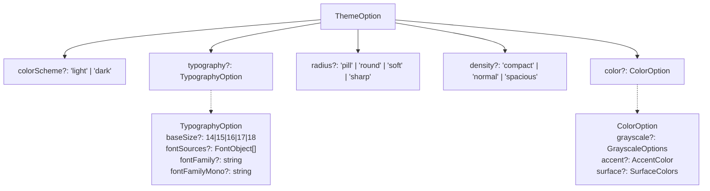

- **Typography** [packages/chatkit/types/index.d.ts:716-725](): Font family, size, and web font sources.
- **Color** [packages/chatkit/types/index.d.ts:727-740](): Grayscale palette, accent colors, and surface colors.
- **Radius**: Controls border-radius throughout UI.
- **Density**: Controls spacing between elements.

### Composer Configuration

The `ComposerOption` type [packages/chatkit/types/index.d.ts:253-308]() configures the message input area:

```typescript
type ComposerOption = {
  placeholder?: string;                // Default: "Message the AI"
  attachments?: {
    enabled: boolean;
    maxSize?: number;                  // Default: 100MB
    maxCount?: number;                 // Default: 10
    accept?: Record<string, string[]>; // MIME type filters
  };
  tools?: ToolOption[];                // Selectable tools
  models?: ModelOption[];              // Selectable models
  dictation?: boolean;                 // Voice input support
}
```

**ToolOption** [packages/chatkit/types/index.d.ts:461-494]() defines selectable tools with icons, labels, and behavior flags (`pinned`, `persistent`).

**ModelOption** [packages/chatkit/types/index.d.ts:616-632]() defines model choices with labels, descriptions, and disabled state.

Sources: [packages/chatkit/types/index.d.ts:253-308](), [packages/chatkit/types/index.d.ts:461-494](), [packages/chatkit/types/index.d.ts:616-632]()

## Icon Type Systems

ChatKit provides two distinct icon type unions for different UI contexts:

**ChatKitIcon** [packages/chatkit/types/index.d.ts:313-376](): General-purpose icons for tools, prompts, and UI elements. Supports Lucide icons via `lucide:` prefix [packages/chatkit/CHANGELOG.md:25]().

**HeaderIcon** [packages/chatkit/types/index.d.ts:412-456](): Header-specific icons for navigation and controls. Includes standard glyphs and recently added icons like `share` and `bug` [.changeset/calm-geckos-glow.md:3]().

Sources: [packages/chatkit/types/index.d.ts:313-456](), [.changeset/calm-geckos-glow.md:1-5]()

## Localization Support

ChatKit supports internationalization through the `locale` property in `ChatKitOptions` [packages/chatkit/types/index.d.ts:25]().

**Type hierarchy:**
- `TranslatedLocale` [packages/chatkit/types/index.d.ts:745-808](): 68 locales with actual translation files.
- `SupportedLocale` [packages/chatkit/types/index.d.ts:816-868](): Extends `TranslatedLocale` with language codes that map to translated locales (e.g., `'en'`, `'es'`, `'fr'`).

Sources: [packages/chatkit/types/index.d.ts:745-868]()

## Widget Type System

The package re-exports the entire `Widgets` namespace from `widgets.d.ts` [packages/chatkit/types/index.d.ts:1-3]():

```typescript
import type * as Widgets from './widgets';
export type { Widgets };
```

This namespace contains type definitions for all widget components. ChatKit threads now support `BasicRoot` widgets [.changeset/real-coins-look.md:5](). For detailed documentation of widget types, see [Widget System](#2.2).

Sources: [packages/chatkit/types/index.d.ts:1-3](), [.changeset/real-coins-look.md:1-6]()

---

# Page: ChatKitOptions Configuration

# ChatKitOptions Configuration

<details>
<summary>Relevant source files</summary>

The following files were used as context for generating this wiki page:

- [.changeset/calm-geckos-glow.md](.changeset/calm-geckos-glow.md)
- [.changeset/real-coins-look.md](.changeset/real-coins-look.md)
- [packages/chatkit/CHANGELOG.md](packages/chatkit/CHANGELOG.md)
- [packages/chatkit/types/index.d.ts](packages/chatkit/types/index.d.ts)

</details>


This page documents the `ChatKitOptions` interface, which serves as the primary configuration object for initializing and customizing ChatKit. This interface controls all aspects of the ChatKit UI, including backend communication, visual appearance, component behavior, and interactive features.

For information about using these options in React applications, see [useChatKit Hook](#3.2). For details on the web component interface that accepts these options, see [OpenAIChatKit Element Interface](#2.3).

**Sources:** [packages/chatkit/types/index.d.ts:9-118]()

---

## Overview

The `ChatKitOptions` interface is defined at [packages/chatkit/types/index.d.ts:9-118](). It is passed to the web component via the `setOptions` method or provided to the React `useChatKit` hook. All configuration is declarative and can be tested interactively at https://chatkit.studio/playground.

### Configuration Structure

```mermaid
graph TB
    ChatKitOptions["ChatKitOptions<br/>(packages/chatkit/types/index.d.ts:9)"]
    
    api["api<br/>CustomApiConfig | HostedApiConfig<br/>(line 16)"]
    locale["locale?<br/>SupportedLocale<br/>(line 25)"]
    theme["theme?<br/>ColorScheme | ThemeOption<br/>(line 34)"]
    frameTitle["frameTitle?<br/>string<br/>(line 40)"]
    initialThread["initialThread?<br/>string | null<br/>(line 48)"]
    onClientTool["onClientTool?<br/>Function<br/>(line 57)"]
    
    header["header?<br/>HeaderOption<br/>(line 67)"]
    history["history?<br/>HistoryOption<br/>(line 74)"]
    startScreen["startScreen?<br/>StartScreenOption<br/>(line 81)"]
    threadItemActions["threadItemActions?<br/>ThreadItemActionsOption<br/>(line 88)"]
    composer["composer?<br/>ComposerOption<br/>(line 96)"]
    disclaimer["disclaimer?<br/>DisclaimerOption<br/>(line 103)"]
    entities["entities?<br/>EntitiesOption<br/>(line 110)"]
    widgets["widgets?<br/>WidgetsOption<br/>(line 117)"]
    
    ChatKitOptions --> api
    ChatKitOptions --> locale
    ChatKitOptions --> theme
    ChatKitOptions --> frameTitle
    ChatKitOptions --> initialThread
    ChatKitOptions --> onClientTool
    ChatKitOptions --> header
    ChatKitOptions --> history
    ChatKitOptions --> startScreen
    ChatKitOptions --> threadItemActions
    ChatKitOptions --> composer
    ChatKitOptions --> disclaimer
    ChatKitOptions --> entities
    ChatKitOptions --> widgets
```

**Configuration Categories**

| Category | Option Field | Required | Purpose |
|----------|-------------|----------|---------|
| Backend | `api` | Yes | Defines backend communication strategy |
| Localization | `locale` | No | Override UI language (defaults to browser) |
| Appearance | `theme` | No | Control colors, typography, spacing, radius |
| Accessibility | `frameTitle` | No | Accessible title for the iframe element |
| Navigation | `initialThread` | No | Set initial thread on mount |
| Interactivity | `onClientTool` | No | Handle client-side tool invocations |
| UI Components | `header` | No | Configure header bar |
| UI Components | `history` | No | Configure thread history panel |
| UI Components | `startScreen` | No | Configure new thread greeting and prompts |
| UI Components | `threadItemActions` | No | Configure feedback and retry buttons |
| UI Components | `composer` | No | Configure input, attachments, dictation |
| UI Components | `disclaimer` | No | Add disclaimer text below composer |
| Extensions | `entities` | No | Configure entity tags and previews |
| Extensions | `widgets` | No | Handle widget action callbacks |

**Sources:** [packages/chatkit/types/index.d.ts:9-118]()

---

## API Configuration

The `api` field is **required** and determines how ChatKit communicates with your backend. Two configuration types are supported: `CustomApiConfig` for self-hosted servers and `HostedApiConfig` for OpenAI-managed infrastructure.

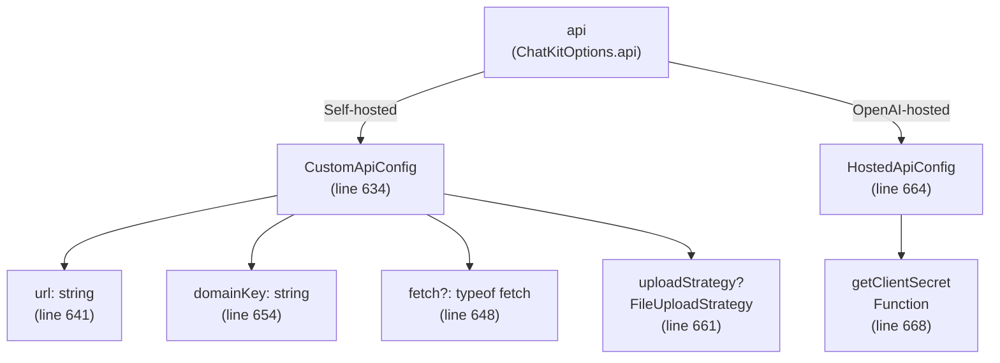

### CustomApiConfig

Defined at [packages/chatkit/types/index.d.ts:634-662](), `CustomApiConfig` is used when you host your own ChatKit-compatible server (e.g., using the ChatKit Python SDK).

| Field | Type | Required | Description |
|-------|------|----------|-------------|
| `url` | `string` | Yes | Relative or absolute URL of your ChatKit API endpoint |
| `domainKey` | `string` | Yes | Domain verification key for your integration |
| `fetch` | `typeof fetch` | No | Custom fetch implementation for request interception |
| `uploadStrategy` | `FileUploadStrategy` | No | Required when `composer.attachments.enabled` is true |

**FileUploadStrategy** ([packages/chatkit/types/index.d.ts:499-501]()):
```typescript
type FileUploadStrategy =
  | { type: 'two_phase' }
  | { type: 'direct'; uploadUrl: string };
```

**Sources:** [packages/chatkit/types/index.d.ts:634-662]()

### HostedApiConfig

Defined at [packages/chatkit/types/index.d.ts:664-669](), `HostedApiConfig` is used when leveraging OpenAI's managed ChatKit service.

| Field | Type | Required | Description |
|-------|------|----------|-------------|
| `getClientSecret` | `(currentClientSecret: string \| null) => Promise<string>` | Yes | Function to retrieve or refresh client authentication token |

**Sources:** [packages/chatkit/types/index.d.ts:664-669]()

---

## Theme Configuration

The `theme` field controls visual appearance. It accepts either a simple `ColorScheme` string or a detailed `ThemeOption` object.

Defined at [packages/chatkit/types/index.d.ts:679-714]().

| Field | Type | Default | Description |
|-------|------|---------|-------------|
| `colorScheme` | `'light' \| 'dark'` | `'light'` | Base color mode |
| `typography` | `TypographyOption` | - | Font customization |
| `radius` | `'pill' \| 'round' \| 'soft' \| 'sharp'` | `'pill'` | Border roundness |
| `density` | `'compact' \| 'normal' \| 'spacious'` | `'normal'` | Spacing between elements |
| `color` | `ColorOption` | - | Color palette customization |

### TypographyOption

Defined at [packages/chatkit/types/index.d.ts:716-725]().

| Field | Type | Description |
|-------|------|-------------|
| `baseSize` | `14 \| 15 \| 16 \| 17 \| 18` | Base font size in pixels |
| `fontSources` | `FontObject[]` | Array of webfont sources to load |
| `fontFamily` | `string` | CSS font-family for body text |
| `fontFamilyMono` | `string` | CSS font-family for monospace text |

**Sources:** [packages/chatkit/types/index.d.ts:679-740](), [packages/chatkit/types/index.d.ts:564-614]()

---

## Header Configuration

The `header` field controls the header bar UI, including title display and custom action buttons.

Defined at [packages/chatkit/types/index.d.ts:120-161]().

| Field | Type | Default | Description |
|-------|------|---------|-------------|
| `enabled` | `boolean` | `true` | Show/hide the header |
| `title` | `object` | - | Title display configuration |
| `title.enabled` | `boolean` | `true` | Show/hide the title area |
| `title.text` | `string` | - | Static text (overrides thread title) |
| `leftAction` | `object` | - | Custom button on left side |
| `rightAction` | `object` | - | Custom button on right side |

### Header Actions

Both `leftAction` and `rightAction` accept:
- `icon`: A `HeaderIcon` type. Supported icons include standard glyphs and Lucide icons via the `lucide:` prefix [packages/chatkit/CHANGELOG.md:25](). Recent additions include `share` and `bug` icons [.changeset/calm-geckos-glow.md:3]().
- `onClick`: Callback function invoked when clicked.

**Sources:** [packages/chatkit/types/index.d.ts:120-161](), [packages/chatkit/CHANGELOG.md:25](), [.changeset/calm-geckos-glow.md:1-5]()

---

## Start Screen Configuration

The `startScreen` field customizes the greeting and starter prompts shown in the new thread view.

Defined at [packages/chatkit/types/index.d.ts:172-186]().

| Field | Type | Default | Description |
|-------|------|---------|-------------|
| `greeting` | `string` | `"What can I help with today?"` | Greeting text displayed in new thread view |
| `prompts` | `StartScreenPrompt[]` | - | Array of starter prompts |

### StartScreenPrompt

Defined at [packages/chatkit/types/index.d.ts:359-376](). Prompts now support entity tags in the content [packages/chatkit/CHANGELOG.md:34]().

**Sources:** [packages/chatkit/types/index.d.ts:172-186](), [packages/chatkit/types/index.d.ts:359-376](), [packages/chatkit/CHANGELOG.md:34]()

---

## Composer Configuration

The `composer` field controls the message input area, including placeholder text, file attachments, and dictation.

Defined at [packages/chatkit/types/index.d.ts:253-289]().

| Field | Type | Default | Description |
|-------|------|---------|-------------|
| `placeholder` | `string` | `"Message the AI"` | Placeholder text in composer input |
| `attachments` | `object` | - | File attachment configuration |
| `dictation` | `object` | - | Voice input configuration |

### Dictation

Voice input can be enabled via `composer.dictation.enabled`. This is disabled by default [packages/chatkit/CHANGELOG.md:13]().

### Attachments Configuration

| Field | Type | Default | Description |
|-------|------|---------|-------------|
| `enabled` | `boolean` | `false` | Enable/disable file attachments |
| `maxSize` | `number` | `104857600` (100MB) | Maximum file size in bytes |
| `maxCount` | `number` | `10` | Maximum attachments per message |

**Sources:** [packages/chatkit/types/index.d.ts:253-289](), [packages/chatkit/CHANGELOG.md:13]()

---

## Entities Configuration

The `entities` field enables entity tags, autocomplete, and previews.

Defined at [packages/chatkit/types/index.d.ts:202-227]().

| Field | Type | Description |
|-------|------|-------------|
| `onTagSearch` | `(query: string) => Promise<Entity[]>` | Returns entities for autocomplete |
| `showComposerMenu` | `boolean` | Renders a button to trigger tag search [packages/chatkit/CHANGELOG.md:19]() |
| `onClick` | `(entity: Entity) => void` | Called when rendered entity is clicked |
| `onRequestPreview` | `(entity: Entity) => Promise<preview>` | Returns widget preview for entity |

**Sources:** [packages/chatkit/types/index.d.ts:202-227](), [packages/chatkit/CHANGELOG.md:19]()

---

## Widgets Configuration

The `widgets` field configures handling of widget actions.

Defined at [packages/chatkit/types/index.d.ts:188-200]().

| Field | Type | Description |
|-------|------|-------------|
| `onAction` | `(action, widgetItem) => Promise<void>` | Called when widget action is triggered |

ChatKit threads now support `BasicRoot` widgets in addition to `Card` and `ListView` [.changeset/real-coins-look.md:5]().

**Sources:** [packages/chatkit/types/index.d.ts:188-200](), [.changeset/real-coins-look.md:1-6]()

---

## Option Handling

### Web Component Usage

The `OpenAIChatKit` element accepts options via the `setOptions` method:

```typescript
// packages/chatkit/types/index.d.ts:900
chatkit.setOptions({ /* ChatKitOptions */ });
```

### React Usage

In React applications, pass options to the `useChatKit` hook. The hook handles option stabilization to prevent unnecessary re-renders.

**Sources:** [packages/chatkit/types/index.d.ts:900]()

---

# Page: Widget System

# Widget System

<details>
<summary>Relevant source files</summary>

The following files were used as context for generating this wiki page:

- [.changeset/calm-geckos-glow.md](.changeset/calm-geckos-glow.md)
- [.changeset/late-falcons-scream.md](.changeset/late-falcons-scream.md)
- [.changeset/light-frogs-cry.md](.changeset/light-frogs-cry.md)
- [.changeset/real-coins-look.md](.changeset/real-coins-look.md)
- [packages/chatkit/types/index.d.ts](packages/chatkit/types/index.d.ts)
- [packages/chatkit/types/widgets.d.ts](packages/chatkit/types/widgets.d.ts)

</details>


The Widget System provides TypeScript type definitions for building rich, interactive user interfaces within ChatKit responses. Widgets are server-rendered UI components that can be included in assistant messages to display structured data, forms, and interactive elements beyond simple text.

For information about configuring widget action handlers in your application, see the `widgets` option in [ChatKitOptions Configuration](#2.1). For details on entity previews (which also use widgets), see the entities section in [ChatKitOptions Configuration](#2.1).

---

## Overview

Widgets are JSON-serializable UI components that your backend server can include in assistant responses. The widget type system defines the complete set of available components and their properties. All widget types are defined in the `Widgets` namespace exported from the core package [[packages/chatkit/types/index.d.ts:1-3]]().

The widget system supports:
- **Structured layouts**: Cards, lists, tables, and flexible box layouts [[packages/chatkit/types/widgets.d.ts:32-130]]().
- **Rich content**: Text, images, icons, badges, and markdown [[packages/chatkit/types/widgets.d.ts:134-223]]().
- **Form controls**: Inputs, selects, checkboxes, and date pickers [[packages/chatkit/types/widgets.d.ts:285-354]]().
- **Interactive actions**: Buttons and form submissions with custom action handlers [[packages/chatkit/types/widgets.d.ts:225-252]]().
- **Theming**: Light/dark mode support with customizable colors [[packages/chatkit/types/widgets.d.ts:37-39]]().

**Sources:** [packages/chatkit/types/widgets.d.ts:1-600](), [packages/chatkit/types/index.d.ts:1-118]()

---

## Type Hierarchy

The widget type system is organized into two main categories: root-level widgets that can be rendered directly, and component widgets that are composed within root widgets.

### Widget Type Structure

```mermaid
graph TB
    subgraph "Root Types"
        WidgetRoot["WidgetRoot"]
        Card["Card"]
        ListView["ListView"]
        BasicRoot["BasicRoot"]
    end
    
    subgraph "Component Types"
        WidgetComponent["WidgetComponent"]
        
        subgraph "Layout"
            Box["Box"]
            Row["Row"]
            Col["Col"]
            Form["Form"]
            Spacer["Spacer"]
            Divider["Divider"]
            Transition["Transition"]
            Table["Table"]
        end
        
        subgraph "Text"
            Title["Title"]
            Caption["Caption"]
            TextComponent["TextComponent"]
            Markdown["Markdown"]
        end
        
        subgraph "Content"
            Badge["Badge"]
            Icon["Icon"]
            Image["Image"]
            Button["Button"]
        end
        
        subgraph "Forms"
            Input["Input"]
            Textarea["Textarea"]
            Select["Select"]
            DatePicker["DatePicker"]
            Checkbox["Checkbox"]
            RadioGroup["RadioGroup"]
            Label["Label"]
        end
    end
    
    WidgetRoot --> Card
    WidgetRoot --> ListView
    WidgetRoot --> BasicRoot
    
    WidgetComponent --> Box
    WidgetComponent --> Row
    WidgetComponent --> Col
    WidgetComponent --> Form
    WidgetComponent --> Spacer
    WidgetComponent --> Divider
    WidgetComponent --> Transition
    WidgetComponent --> Table
    
    WidgetComponent --> Title
    WidgetComponent --> Caption
    WidgetComponent --> TextComponent
    WidgetComponent --> Markdown
    
    WidgetComponent --> Badge
    WidgetComponent --> Icon
    WidgetComponent --> Image
    WidgetComponent --> Button
    
    WidgetComponent --> Input
    WidgetComponent --> Textarea
    WidgetComponent --> Select
    WidgetComponent --> DatePicker
    WidgetComponent --> Checkbox
    WidgetComponent --> RadioGroup
    WidgetComponent --> Label
    
    Card -.->|"children"| WidgetComponent
    ListView -.->|"children"| ListViewItem["ListViewItem"]
    ListViewItem -.->|"children"| WidgetComponent
    BasicRoot -.->|"children"| WidgetComponent
    BasicRoot -.->|"children"| WidgetRoot
```

**Sources:** [packages/chatkit/types/widgets.d.ts:1-28](), [packages/chatkit/types/widgets.d.ts:32-66]()

---

## Widget Root Types

Root-level widgets are the top-level containers that can be rendered in assistant messages or entity previews. There are three root types available.

### Card

The `Card` type provides a contained, styled container for displaying structured content. Cards support status indicators, collapsible state, and optional confirmation/cancellation actions.

| Property | Type | Description |
|----------|------|-------------|
| `type` | `'Card'` | Widget type identifier |
| `children` | `WidgetComponent[]` | Child components to render |
| `background` | `string \| ThemeColor` | Background color override |
| `border` | `number \| Border \| Borders` | Border configuration [[packages/chatkit/types/widgets.d.ts:48]]() |
| `size` | `'sm' \| 'md' \| 'lg' \| 'full'` | Card width preset |
| `padding` | `number \| string \| Spacing` | Internal padding configuration |
| `status` | `WidgetStatus` | Optional status text with icon or favicon |
| `collapsed` | `boolean` | Whether card content is collapsed by default |
| `confirm` | `CardAction` | Optional confirmation action |
| `cancel` | `CardAction` | Optional cancellation action |
| `asForm` | `boolean` | Whether to render as a form element |
| `theme` | `'light' \| 'dark'` | Theme override for this widget |

**Sources:** [packages/chatkit/types/widgets.d.ts:41-56](), [.changeset/late-falcons-scream.md:5-5]()

### ListView

The `ListView` type displays a scrollable list of items with optional pagination. Each item can have custom actions triggered on click.

| Property | Type | Description |
|----------|------|-------------|
| `type` | `'ListView'` | Widget type identifier |
| `children` | `ListViewItem[]` | List items to display |
| `limit` | `number \| 'auto'` | Maximum visible items before pagination |
| `status` | `WidgetStatus` | Optional status text with icon or favicon |
| `theme` | `'light' \| 'dark'` | Theme override for this widget |

Each `ListViewItem` has its own structure:

| Property | Type | Description |
|----------|------|-------------|
| `type` | `'ListViewItem'` | Item type identifier |
| `children` | `WidgetComponent[]` | Components to render in the item |
| `onClickAction` | `ActionConfig` | Optional action triggered when item is clicked |
| `gap` | `number \| string` | Spacing between children |
| `align` | `Alignment` | Cross-axis alignment |

**Sources:** [packages/chatkit/types/widgets.d.ts:58-77]()

### BasicRoot

The `BasicRoot` type provides a simple container with flexible layout options. Unlike `Card` and `ListView`, it can nest other root widgets [[packages/chatkit/types/widgets.d.ts:36]]().

| Property | Type | Description |
|----------|------|-------------|
| `type` | `'Basic'` | Widget type identifier |
| `children` | `(WidgetComponent \| WidgetRoot)[]` | Child components or widgets |
| `theme` | `'light' \| 'dark'` | Theme override for this widget |
| `direction` | `'row' \| 'col'` | Layout direction |
| `gap` | `number \| string` | Spacing between children |
| `padding` | `number \| string \| Spacing` | Internal padding |
| `align` | `Alignment` | Cross-axis alignment |
| `justify` | `Justification` | Main-axis justification |

**Sources:** [packages/chatkit/types/widgets.d.ts:32-39](), [.changeset/real-coins-look.md:5-5]()

---

## Layout Components

Layout components organize and structure other widgets within their containers.

### Box, Row, and Col

These components provide flexible box model layouts with full control over spacing, alignment, and styling.

| Component | Type Value | Direction |
|-----------|------------|-----------|
| `Box` | `'Box'` | Configurable via `direction` prop |
| `Row` | `'Row'` | Horizontal (implicit) |
| `Col` | `'Col'` | Vertical (implicit) |

Common layout properties (defined in `BoxBaseProps`):

| Property | Type | Description |
|----------|------|-------------|
| `children` | `WidgetComponent[]` | Child components |
| `align` | `Alignment` | Cross-axis alignment: `'start' \| 'center' \| 'end' \| 'baseline' \| 'stretch'` |
| `justify` | `Justification` | Main-axis distribution: `'start' \| 'center' \| 'end' \| 'between' \| 'around' \| 'evenly' \| 'stretch'` |
| `wrap` | `'nowrap' \| 'wrap' \| 'wrap-reverse'` | Flex wrap behavior |
| `flex` | `number \| string` | Flex grow/shrink/basis shorthand |
| `gap` | `number \| string` | Spacing between children |
| `padding` | `number \| string \| Spacing` | Internal padding |
| `border` | `number \| Border \| Borders` | Border configuration |
| `background` | `string \| ThemeColor` | Background color |

**Sources:** [packages/chatkit/types/widgets.d.ts:81-98](), [packages/chatkit/types/widgets.d.ts:477-497]()

### Table

The Table system allows for tabular data representation using `Table`, `Table.Row`, and `Table.Cell` components [[packages/chatkit/types/widgets.d.ts:254-281]]().

| Component | Type Value | Description |
|-----------|------------|-------------|
| `Table` | `'Table'` | Parent container for rows |
| `TableRow` | `'Table.Row'` | Container for cells; can be marked as `header` |
| `TableCell` | `'Table.Cell'` | Individual cell containing `WidgetComponent[]` |

**Sources:** [packages/chatkit/types/widgets.d.ts:254-281](), [.changeset/light-frogs-cry.md:5-5]()

### Form

The `Form` component wraps form controls and handles submission via action handlers.

| Property | Type | Description |
|----------|------|-------------|
| `type` | `'Form'` | Widget type identifier |
| `onSubmitAction` | `ActionConfig` | Action triggered on form submission |
| `direction` | `'row' \| 'col'` | Layout direction |

**Sources:** [packages/chatkit/types/widgets.d.ts:100-106]()

---

## Text Components

### TextComponent

Body text with additional formatting options and streaming support.

| Property | Type | Description |
|----------|------|-------------|
| `type` | `'Text'` | Type identifier |
| `value` | `string` | Content |
| `streaming` | `boolean` | Whether text is being streamed [[packages/chatkit/types/widgets.d.ts:154]]() |
| `editable` | `false \| EditableConfig` | Inline editing configuration [[packages/chatkit/types/widgets.d.ts:160-171]]() |

**Sources:** [packages/chatkit/types/widgets.d.ts:149-172]()

### Markdown

Renders formatted markdown content with streaming support.

| Property | Type | Description |
|----------|------|-------------|
| `type` | `'Markdown'` | Type identifier |
| `value` | `string` | Markdown source |
| `streaming` | `boolean` | Whether content is being streamed [[packages/chatkit/types/widgets.d.ts:179]]() |

**Sources:** [packages/chatkit/types/widgets.d.ts:174-180]()

---

## Action System

Widgets support interactive actions triggered by user interactions. Actions are defined using the `ActionConfig` type.

### Action Mapping

```mermaid
graph LR
    subgraph "Natural Language"
        Click["User Clicks Button"]
        Submit["User Submits Form"]
        Change["User Changes Select"]
    end

    subgraph "Code Entities"
        onClickAction["onClickAction"]
        onSubmitAction["onSubmitAction"]
        onChangeAction["onChangeAction"]
        ActionConfig["ActionConfig"]
        onAction["widgets.onAction"]
    end

    Click --> onClickAction
    Submit --> onSubmitAction
    Change --> onChangeAction
    onClickAction --> ActionConfig
    onSubmitAction --> ActionConfig
    onChangeAction --> ActionConfig
    ActionConfig --> onAction
```

**Sources:** [packages/chatkit/types/widgets.d.ts:458-460](), [packages/chatkit/types/index.d.ts:188-200]()

### Widget Action Handler

Widget actions are handled through the `onAction` callback in `WidgetsOption` [[packages/chatkit/types/index.d.ts:188-200]]():

```typescript
export type WidgetsOption = {
  onAction?: (
    action: { type: string; payload?: Record<string, unknown> },
    widgetItem: {
      id: string;
      widget: Widgets.Card | Widgets.ListView | Widgets.BasicRoot;
    },
  ) => Promise<void>;
};
```

**Sources:** [packages/chatkit/types/index.d.ts:188-200]()

---

## Content and Icons

### Icon System

The `Icon` widget displays glyphs from a predefined set.

| Property | Type | Description |
|----------|------|-------------|
| `type` | `'Icon'` | Type identifier |
| `name` | `WidgetIcon` | Icon name (e.g., `'share'`, `'bug'`, `'sparkle'`) |

The `WidgetIcon` union includes recent additions like `'share'` and `'bug'` [[.changeset/calm-geckos-glow.md:3-4]]().

**Sources:** [packages/chatkit/types/widgets.d.ts:195-202](), [packages/chatkit/types/widgets.d.ts:498-561]()

### Image

Displays an image with configurable sizing and positioning.

| Property | Type | Description |
|----------|------|-------------|
| `type` | `'Image'` | Type identifier |
| `src` | `string` | Image URL |
| `fit` | Object fit mode | `'cover' \| 'contain' \| 'fill' \| 'scale-down' \| 'none'` |

**Sources:** [packages/chatkit/types/widgets.d.ts:204-223]()

---

# Page: OpenAIChatKit Element Interface

# OpenAIChatKit Element Interface

<details>
<summary>Relevant source files</summary>

The following files were used as context for generating this wiki page:

- [.changeset/calm-geckos-glow.md](.changeset/calm-geckos-glow.md)
- [.changeset/real-coins-look.md](.changeset/real-coins-look.md)
- [packages/chatkit/types/dom-augment.d.ts](packages/chatkit/types/dom-augment.d.ts)
- [packages/chatkit/types/index.d.ts](packages/chatkit/types/index.d.ts)

</details>


This document describes the `OpenAIChatKit` interface, which defines the public API of the ChatKit Web Component. This interface exposes methods for configuration, thread management, message sending, and event handling that are available to both vanilla JavaScript and React integrations.

For information about configuration options passed to `setOptions`, see [ChatKitOptions Configuration](#2.1). For details about event types and event-driven communication, see [Event System](#2.4). For React-specific wrappers around this interface, see [ChatKit Component](#3.1) and [useChatKit Hook](#3.2).

---

## Interface Overview

The `OpenAIChatKit` interface extends `HTMLElement` and represents the `<openai-chatkit>` custom element. It provides imperative methods for controlling the ChatKit instance programmatically, allowing applications to manage configuration, threads, messages, and event subscriptions.

**OpenAIChatKit Interface Structure**

```mermaid
classDiagram
    class OpenAIChatKit {
        <<interface>>
        +setOptions(options: ChatKitOptions) void
        +focusComposer() Promise~void~
        +setThreadId(threadId: string | null) Promise~void~
        +sendCustomAction(action, itemId?) Promise~void~
        +sendUserMessage(params) Promise~void~
        +setComposerValue(params) Promise~void~
        +fetchUpdates() Promise~void~
        +showHistory() Promise~void~
        +hideHistory() Promise~void~
        +addEventListener(type, listener, options?) void
        +removeEventListener(type, listener, options?) void
    }
    
    class HTMLElement {
        <<browser>>
    }
    
    class ChatKitOptions {
        <<type>>
    }
    
    class ChatKitEvents {
        <<type>>
    }
    
    OpenAIChatKit --|> HTMLElement
    OpenAIChatKit ..> ChatKitOptions : uses
    OpenAIChatKit ..> ChatKitEvents : emits
```

**Sources:** [packages/chatkit/types/index.d.ts:894-1061]()

---

## Configuration Method

### setOptions

**Signature:** `setOptions(options: ChatKitOptions): void`

Applies configuration options to the ChatKit instance. This method completely replaces the existing configuration rather than merging with it.

**Important:** This method does not merge new options with existing options. You must provide a complete `ChatKitOptions` object every time you call `setOptions`. The Web Component will reconfigure itself based on the new options, potentially triggering UI updates, authentication flows, or backend reconnections.

**Parameters:**
- `options`: Complete configuration object conforming to the `ChatKitOptions` interface [packages/chatkit/types/index.d.ts:9-118]()

**Example usage:**

```typescript
// Vanilla JS
const chatkit = document.querySelector('openai-chatkit');
chatkit.setOptions({
  api: {
    url: '/api/chatkit',
    domainKey: 'my-domain-key',
  },
  theme: 'dark',
  composer: {
    placeholder: 'Ask me anything...',
  },
});
```

**Configuration Lifecycle:**

```mermaid
sequenceDiagram
    participant App as "Application"
    participant Element as "openai-chatkit Element"
    participant Backend as "Backend API"
    
    App->>Element: setOptions(config)
    Element->>Element: "Validate configuration"
    Element->>Element: "Apply theme & UI options"
    
    alt First configuration
        Element->>Backend: "Initialize session"
        Backend-->>Element: "Session credentials"
        Element->>App: "Emit chatkit.ready"
    else Reconfiguration
        Element->>Element: "Teardown existing state"
        Element->>Backend: "Re-initialize if API changed"
        Backend-->>Element: "New credentials"
        Element->>Element: "Rebuild UI"
    end
```

**Sources:** [packages/chatkit/types/index.d.ts:895-900]()

---

## Thread Management Methods

### setThreadId

**Signature:** `setThreadId(threadId: string | null): Promise<void>`

Changes the active thread displayed in ChatKit. Pass `null` to switch to a new thread (showing the start screen). This method is asynchronous and resolves when the thread has been loaded.

**Parameters:**
- `threadId`: Thread identifier to load, or `null` for a new thread

**Behavior:**
1. Emits `chatkit.thread.load.start` event
2. Fetches thread content from backend if `threadId` is not `null`
3. Updates UI to display the thread
4. Emits `chatkit.thread.load.end` event
5. Emits `chatkit.thread.change` event

**Example usage:**

```typescript
// Load a specific thread
await chatkit.setThreadId('thread_abc123');

// Start a new thread
await chatkit.setThreadId(null);
```

**Sources:** [packages/chatkit/types/index.d.ts:906]()

---

### showHistory

**Signature:** `showHistory(): Promise<void>`

Opens the thread history view. This method is intended for applications with custom headers or navigation that need to show the history panel programmatically.

**Use cases:**
- Triggering history from a custom header button
- Opening history in response to application events
- Building custom navigation flows

**Example usage:**

```typescript
// Open history from custom button
document.getElementById('history-btn').addEventListener('click', async () => {
  await chatkit.showHistory();
});
```

**Sources:** [packages/chatkit/types/index.d.ts:973-979]()

---

### hideHistory

**Signature:** `hideHistory(): Promise<void>`

Closes the thread history view and returns to the current thread.

**Example usage:**

```typescript
// Close history programmatically
await chatkit.hideHistory();
```

**Sources:** [packages/chatkit/types/index.d.ts:981-984]()

---

### fetchUpdates

**Signature:** `fetchUpdates(): Promise<void>`

Manually fetches updates from the server to synchronize the client state. Use this method when you have modified thread or thread items on the backend and need the client to reflect those changes.

**Use cases:**
- After programmatically modifying thread data via backend API
- When implementing custom synchronization logic
- After handling widget actions that modify server state

**Example usage:**

```typescript
// After a backend operation that modifies the current thread
await fetch('/api/modify-thread', { method: 'POST', body: threadData });
await chatkit.fetchUpdates();
```

**Sources:** [packages/chatkit/types/index.d.ts:986-991]()

---

## Message Methods

### sendUserMessage

**Signature:** `sendUserMessage(params: SendUserMessageParams): Promise<void>`

Sends a user message programmatically. This method allows applications to submit messages on behalf of the user, useful for implementing custom UI flows or integrations.

**Parameters:**

| Parameter | Type | Required | Description |
|-----------|------|----------|-------------|
| `text` | `string` | No* | Message text content (use `text` or `content`, not both) |
| `content` | `UserMessageContent[]` | No* | Structured message content with text and entity tags |
| `reply` | `string` | No | ID of the message being replied to |
| `attachments` | `Attachment[]` | No | Array of uploaded file attachments |
| `newThread` | `boolean` | No | Whether to create a new thread for this message |
| `toolChoice` | `ToolChoice` | No | Tool to use for this message (server inference option) |
| `model` | `string` | No | Model to use for this message (server inference option) |

**Structured Content:**

When using `content` instead of `text`, you can include rich content segments such as text and entity tags. The `UserMessageContent` type is defined at [packages/chatkit/types/index.d.ts:547-559]():

- **Text segment:** `{ type: 'input_text', text: string }`
- **Tag segment:** `{ type: 'input_tag', text: string, id: string, group?: string, data?: Record<string, unknown>, interactive?: boolean }`

**Inference Options:**

The `toolChoice` and `model` parameters map directly to backend `inference_options` for the submitted user message. These options do not update the selected tool or model in the composer UI. To update the composer selection, use `setComposerValue({ selectedToolId, selectedModelId })`.

**Attachment Structure:**

Attachments must be uploaded to your server before being passed to `sendUserMessage`. The `Attachment` type is defined at [packages/chatkit/types/index.d.ts:387-407]() and includes:

- **File attachments:** `{ type: 'file', id: string, name: string, mime_type: string }`
- **Image attachments:** `{ type: 'image', id: string, preview_url: string, name: string, mime_type: string }`

**Example usage:**

```typescript
// Simple text message
await chatkit.sendUserMessage({
  text: 'What is the status of order #12345?',
});

// Message with structured content including entity tags
await chatkit.sendUserMessage({
  content: [
    { type: 'input_text', text: 'What is the status of ' },
    { type: 'input_tag', text: 'Order #12345', id: 'order_12345', group: 'Orders' },
    { type: 'input_text', text: '?' },
  ],
});
```

**Sources:** [packages/chatkit/types/index.d.ts:936-952](), [packages/chatkit/types/index.d.ts:387-407](), [packages/chatkit/types/index.d.ts:547-559](), [packages/chatkit/types/index.d.ts:541]()

---

### setComposerValue

**Signature:** `setComposerValue(params: SetComposerValueParams): Promise<void>`

Sets the content of the composer input without sending a message. This is useful for pre-populating the composer based on application state or user interactions.

**Parameters:**

| Parameter | Type | Required | Description |
|-----------|------|----------|-------------|
| `text` | `string` | No* | Text to populate in composer (use `text` or `content`, not both) |
| `content` | `UserMessageContent[]` | No* | Structured content with text and entity tags |
| `reply` | `string` | No | ID of message to reply to |
| `attachments` | `Attachment[]` | No | Attachments to add to composer (already uploaded) |
| `files` | `File[]` | No | Files to upload and attach to composer |
| `selectedToolId` | `string` | No | ID of tool to select in composer |
| `selectedModelId` | `string` | No | ID of model to select in composer |

**File Uploads:**

Use the `files` parameter to provide `File` objects that will be uploaded and attached to the composer. Use `attachments` when files are already uploaded and you have their server-generated IDs [packages/chatkit/types/index.d.ts:954-971]().

**Sources:** [packages/chatkit/types/index.d.ts:954-971](), [packages/chatkit/types/index.d.ts:547-559]()

---

### focusComposer

**Signature:** `focusComposer(): Promise<void>`

Focuses the composer input field, allowing the user to immediately begin typing. This method is useful for improving UX by directing attention to the input area after certain interactions.

**Sources:** [packages/chatkit/types/index.d.ts:902-903]()

---

## Action Methods

### sendCustomAction

**Signature:** `sendCustomAction(action: { type: string; payload?: Record<string, unknown> }, itemId?: string): Promise<void>`

Sends a custom application-defined action to your backend. This method enables bidirectional communication for widget interactions and custom application flows.

**Action Flow Diagram:**

```mermaid
sequenceDiagram
    participant Widget as "Widget UI"
    participant App as "Application"
    participant Element as "openai-chatkit"
    participant Backend as "Backend"
    
    Widget->>App: "User clicks widget button"
    App->>App: "widgets.onAction(action, widgetItem)"
    App->>App: "Perform client-side handling"
    App->>Element: "sendCustomAction(action, widgetItem.id)"
    Element->>Backend: "POST action to backend"
    Backend->>Backend: "Process action"
    Backend-->>Element: "Return updated state"
    Element->>Element: "Update UI"
```

**Sources:** [packages/chatkit/types/index.d.ts:908-934]()

---

## Event Listener Methods

### addEventListener

**Signature:** `addEventListener<K extends keyof ChatKitEvents>(type: K, listener: EventHandler<K>, options?: boolean | AddEventListenerOptions): void`

Adds an event listener for ChatKit events. The interface provides type-safe event handling with properly typed event detail objects.

**Common Events:**

| Event | Detail Type | Description |
|-------|-------------|-------------|
| `chatkit.ready` | `void` | ChatKit frame has loaded |
| `chatkit.error` | `{ error: Error }` | Error occurred |
| `chatkit.thread.change` | `{ threadId: string \| null }` | Active thread changed |

**Sources:** [packages/chatkit/types/index.d.ts:1005-1020](), [packages/chatkit/types/index.d.ts:1067-1103]()

---

### removeEventListener

**Signature:** `removeEventListener<K extends keyof ChatKitEvents>(type: K, listener: EventHandler<K>, options?: boolean | EventListenerOptions): void`

Removes a previously registered event listener.

**Sources:** [packages/chatkit/types/index.d.ts:1039-1061]()

---

## Integration Patterns

### React Integration

The React bindings wrap the `OpenAIChatKit` interface, providing a more idiomatic React experience. The `ChatKit` component manages the element lifecycle and exposes the underlying element via ref forwarding.

**Component Architecture:**

```mermaid
graph TB
    subgraph "React_Application_Layer"
        App["React App Component"]
        Hook["useChatKit Hook"]
        Component["ChatKit React Component"]
    end
    
    subgraph "Web_Component_Layer"
        Element["openai-chatkit HTMLElement"]
        Methods["setOptions()<br/>setThreadId()<br/>sendUserMessage()<br/>showHistory()<br/>hideHistory()<br/>focusComposer()"]
        Events["chatkit.ready<br/>chatkit.error<br/>chatkit.thread.change<br/>chatkit.tool.change"]
    end
    
    App -->|"useChatKit(options)"| Hook
    Hook -->|"returns control"| App
    App -->|"control prop"| Component
    Component -->|"manages lifecycle"| Element
    Component -->|"ref forwarding"| Element
    Component -->|"calls methods"| Methods
    Element -->|"emits"| Events
    Events -->|"converted to onEvent props"| Component
    Component -->|"React callbacks"| App
    
    Methods -.->|"part of"| Element
    Events -.->|"emitted by"| Element
```

**Sources:** [packages/chatkit/types/index.d.ts:894-1061](), [packages/chatkit/types/dom-augment.d.ts:1-13]()

---

## Method Summary Table

| Method | Return Type | Purpose | Async |
|--------|-------------|---------|-------|
| `setOptions` | `void` | Configure ChatKit instance | No |
| `focusComposer` | `Promise<void>` | Focus composer input | Yes |
| `setThreadId` | `Promise<void>` | Change active thread | Yes |
| `sendCustomAction` | `Promise<void>` | Send custom action to backend | Yes |
| `sendUserMessage` | `Promise<void>` | Send user message programmatically | Yes |
| `setComposerValue` | `Promise<void>` | Pre-populate composer without sending | Yes |
| `fetchUpdates` | `Promise<void>` | Manually sync with server | Yes |
| `showHistory` | `Promise<void>` | Open history panel | Yes |
| `hideHistory` | `Promise<void>` | Close history panel | Yes |
| `addEventListener` | `void` | Register event listener | No |
| `removeEventListener` | `void` | Unregister event listener | No |

**Sources:** [packages/chatkit/types/index.d.ts:894-1061]()

---

# Page: Event System

# Event System

<details>
<summary>Relevant source files</summary>

The following files were used as context for generating this wiki page:

- [.changeset/calm-geckos-glow.md](.changeset/calm-geckos-glow.md)
- [.changeset/real-coins-look.md](.changeset/real-coins-look.md)
- [packages/chatkit/CHANGELOG.md](packages/chatkit/CHANGELOG.md)
- [packages/chatkit/types/index.d.ts](packages/chatkit/types/index.d.ts)

</details>


The Event System provides the primary mechanism for the `openai-chatkit` web component to communicate state changes, lifecycle events, and errors back to the integrating application. This page documents all available `ChatKitEvents`, their payload structures, lifecycle timing, and usage patterns for both direct integration and React bindings.

For information about programmatically controlling the ChatKit instance, see [OpenAIChatKit Element Interface](2.3). For React-specific event handling patterns, see [useChatKit Hook](3.2).

## Overview

ChatKit emits strongly-typed DOM events through the standard Web Component event system. All events extend `CustomEvent` and follow the naming convention `chatkit.*`. The type definitions in [packages/chatkit/types/index.d.ts:921-972]() define several distinct event types organized into five categories:

| Category | Events | Purpose |
|----------|--------|---------|
| Lifecycle | `chatkit.ready` | Web component initialization complete |
| Response | `chatkit.response.start`, `chatkit.response.end` | Assistant response streaming boundaries |
| Thread | `chatkit.thread.change`, `chatkit.thread.load.start`, `chatkit.thread.load.end` | Thread state and navigation management |
| Tools | `chatkit.tool.change` | Tool selection updates |
| Effects & Diagnostics | `chatkit.effect`, `chatkit.deeplink`, `chatkit.error`, `chatkit.log` | Server-driven effects, deep linking, and monitoring |

The `OpenAIChatKit` interface [packages/chatkit/types/index.d.ts:786-919]() extends `HTMLElement` and provides type-safe `addEventListener` and `removeEventListener` methods that enforce correct event names and handler signatures.

**Sources:** [packages/chatkit/types/index.d.ts:921-972](), [packages/chatkit/types/index.d.ts:786-919]()

## Event Flow Architecture

```mermaid
sequenceDiagram
    participant Backend as "Backend API"
    participant WC as "OpenAIChatKit Element"
    participant DOM as "DOM Event System"
    participant Handler as "Application Handler"
    
    Note over Backend,Handler: Initialization Phase
    WC->>WC: Initialize UI
    WC->>DOM: dispatch("chatkit.ready")
    DOM->>Handler: CustomEvent<void>
    
    Note over Backend,Handler: Response Streaming Phase
    Handler->>WC: sendUserMessage()
    WC->>Backend: POST message
    Backend-->>WC: Stream start
    WC->>DOM: dispatch("chatkit.response.start")
    DOM->>Handler: CustomEvent<void>
    Backend-->>WC: Stream chunks...
    Backend-->>WC: Stream end
    WC->>DOM: dispatch("chatkit.response.end")
    DOM->>Handler: CustomEvent<void>
    
    Note over Backend,Handler: Thread Management Phase
    Handler->>WC: setThreadId(threadId)
    WC->>DOM: dispatch("chatkit.thread.load.start")
    DOM->>Handler: CustomEvent<{threadId}>
    WC->>Backend: Fetch thread data
    Backend-->>WC: Thread data
    WC->>WC: Render thread
    WC->>DOM: dispatch("chatkit.thread.load.end")
    DOM->>Handler: CustomEvent<{threadId}>
    WC->>DOM: dispatch("chatkit.thread.change")
    DOM->>Handler: CustomEvent<{threadId}>
    
    Note over Backend,Handler: Tool & Effect Handling
    Backend-->>WC: Server effect directive
    WC->>DOM: dispatch("chatkit.effect")
    DOM->>Handler: CustomEvent<{name, data}>
    
    WC->>WC: Tool selection changed
    WC->>DOM: dispatch("chatkit.tool.change")
    DOM->>Handler: CustomEvent<{toolId}>
```

This diagram shows how events flow from the web component through the DOM event system to application handlers. Events are dispatched synchronously except for response streaming, which follows the server's streaming timeline.

**Sources:** [packages/chatkit/types/index.d.ts:921-972]()

## Event Type Reference

### Lifecycle Events

#### `chatkit.ready`
Emitted once when the ChatKit web component has completed initialization and is ready for interaction.

```typescript
type ReadyEvent = CustomEvent<void>
```

**Timing:** Dispatched after the web component mounts and internal UI components are initialized. This is the earliest point at which methods like `focusComposer()` or `setThreadId()` can be called reliably [packages/chatkit/CHANGELOG.md:61-62]().

**Sources:** [packages/chatkit/types/index.d.ts:926](), [packages/chatkit/CHANGELOG.md:61-62]()

### Response Lifecycle Events

#### `chatkit.response.start`
Emitted when the assistant begins streaming a response to a user message.

```typescript
type ResponseStartEvent = CustomEvent<void>
```

**Timing:** Dispatched immediately when the first token of the assistant's response is received from the backend [packages/chatkit/types/index.d.ts:941]().

**Sources:** [packages/chatkit/types/index.d.ts:941]()

#### `chatkit.response.end`
Emitted when the assistant completes streaming a response [packages/chatkit/types/index.d.ts:944]().

**Sources:** [packages/chatkit/types/index.d.ts:944]()

### Thread Management Events

#### `chatkit.thread.change`
Emitted whenever the active thread changes, whether by user selection, programmatic call to `setThreadId()`, or when starting a new thread [packages/chatkit/types/index.d.ts:947]().

```typescript
type ThreadChangeEvent = CustomEvent<{ threadId: string | null }>
```

**Sources:** [packages/chatkit/types/index.d.ts:947]()

#### `chatkit.thread.load.start` / `chatkit.thread.load.end`
These events bracket the asynchronous operation of fetching and rendering thread data from the backend [packages/chatkit/types/index.d.ts:950-953]().

**Sources:** [packages/chatkit/types/index.d.ts:950-953]()

### Tool Events

#### `chatkit.tool.change`
Emitted when the selected tool for the conversation is updated.

```typescript
type ToolChangeEvent = CustomEvent<{ toolId: string | null }>
```

**Timing:** Dispatched when a user changes the tool selection in the UI or when the system automatically updates the selected tool [packages/chatkit/CHANGELOG.md:32]().

**Sources:** [packages/chatkit/types/index.d.ts:956](), [packages/chatkit/CHANGELOG.md:32]()

### Effect and Diagnostic Events

#### `chatkit.effect`
Emitted when the server sends a fire-and-forget effect directive. This enables server-driven client-side actions like opening modals or playing sounds [packages/chatkit/CHANGELOG.md:43]().

```typescript
type EffectEvent = CustomEvent<{
  name: string;
  data?: Record<string, unknown>;
}>
```

**Sources:** [packages/chatkit/types/index.d.ts:932-935](), [packages/chatkit/CHANGELOG.md:43]()

#### `chatkit.deeplink`
Emitted when a deep link action is triggered within the chat interface.

```typescript
type DeeplinkEvent = CustomEvent<{ url: string }>
```

**Sources:** [packages/chatkit/types/index.d.ts:938](), [packages/chatkit/CHANGELOG.md:7]()

#### `chatkit.error`
Emitted when an error occurs within the ChatKit component. Use this for integration with error tracking services [packages/chatkit/types/index.d.ts:929]().

**Sources:** [packages/chatkit/types/index.d.ts:929]()

## Event Handler Registration

### Direct Web Component Integration

The `OpenAIChatKit` interface provides type-safe event listener methods:

```typescript
const chatKit = document.querySelector('openai-chatkit');

// Type-safe event listener for thread changes
chatKit.addEventListener('chatkit.thread.change', (event) => {
  const { threadId } = event.detail;
  console.log('Active thread changed to:', threadId);
});
```

The interface definition at [packages/chatkit/types/index.d.ts:862-877]() shows the type-safe method signature, while [packages/chatkit/types/index.d.ts:880-884]() provides the internal overload for compatibility with standard DOM methods.

**Sources:** [packages/chatkit/types/index.d.ts:862-918]()

## Event Lifecycle State Machine

```mermaid
stateDiagram-v2
    [*] --> Initializing: Element mounted
    Initializing --> Ready: "chatkit.ready"
    
    state Ready {
        [*] --> Idle
        Idle --> LoadingThread: setThreadId()
        LoadingThread --> Idle: "chatkit.thread.load.end"
        
        Idle --> Generating: User Message
        Generating --> Generating: "chatkit.response.start"
        Generating --> Idle: "chatkit.response.end"
        
        Idle --> Idle: "chatkit.tool.change"
        Idle --> Idle: "chatkit.thread.change"
    }
    
    Ready --> Ready: "chatkit.effect"
    Ready --> Ready: "chatkit.deeplink"
    
    Initializing --> Error: "chatkit.error"
    Ready --> Error: "chatkit.error"
```

This state diagram illustrates the relationship between ChatKit's internal states and the events emitted during transitions.

**Sources:** [packages/chatkit/types/index.d.ts:921-972]()

## Type Definitions

All event types are defined in the `ChatKitEvents` interface at [packages/chatkit/types/index.d.ts:921-972](). This interface serves as a type map for the `addEventListener` and `removeEventListener` methods.

The `EventHandler` type at [packages/chatkit/types/index.d.ts:602-604]() provides the generic handler signature:

```typescript
export type EventHandler<K extends keyof ChatKitEvents> = (
  event: ChatKitEvents[K],
) => any;
```

**Sources:** [packages/chatkit/types/index.d.ts:602-604](), [packages/chatkit/types/index.d.ts:921-972]()

---

# Page: React Bindings (@openai/chatkit-react)

# React Bindings (@openai/chatkit-react)

<details>
<summary>Relevant source files</summary>

The following files were used as context for generating this wiki page:

- [packages/chatkit-react/CHANGELOG.md](packages/chatkit-react/CHANGELOG.md)
- [packages/chatkit-react/package.json](packages/chatkit-react/package.json)
- [packages/chatkit-react/src/index.ts](packages/chatkit-react/src/index.ts)

</details>


The `@openai/chatkit-react` package provides React-specific bindings for the ChatKit Web Component. It wraps the underlying `openai-chatkit` custom element with React-friendly APIs, offering a `useChatKit` hook for configuration management and a `ChatKit` component for rendering. This package handles the lifecycle integration between React's component model and the Web Component's imperative API, converting Web Component events to React callback props. [packages/chatkit-react/package.json:4-4]()

For the core type definitions and Web Component interface, see [Core Package (@openai/chatkit)](#2). For integration patterns specific to React applications, see [Integration Patterns](#3.3).

## Package Overview

The `@openai/chatkit-react` package is a peer-dependency-based React wrapper that requires React 18 or higher. [packages/chatkit-react/package.json:22-25](). It depends on `@openai/chatkit` for type definitions and exports both ESM and CommonJS formats. [packages/chatkit-react/package.json:26-28]().

**Package Configuration:**

| Property | Value |
|----------|-------|
| Name | `@openai/chatkit-react` |
| Version | 1.5.0 |
| Peer Dependencies | `react >=18`, `react-dom >=18` |
| Dependencies | `@openai/chatkit` (workspace) |
| Main Export | `./dist/index.cjs` (CJS) |
| Module Export | `./dist/index.js` (ESM) |
| Types | `./dist/index.d.ts` |

**Sources:** [packages/chatkit-react/package.json:1-51]()

## Architecture and Component Model

The React bindings implement a two-layer architecture: the `useChatKit` hook manages the Web Component lifecycle and configuration, while the `ChatKit` component handles rendering and event binding.

**Entity Mapping: Natural Language to Code**

| System Concept | Code Entity | File Reference |
|----------------|-------------|----------------|
| **React Hook** | `useChatKit` | [packages/chatkit-react/src/index.ts:4-4]() |
| **Control Interface** | `ChatKitControl` | [packages/chatkit-react/src/index.ts:7-7]() |
| **React Component** | `ChatKit` | [packages/chatkit-react/src/index.ts:2-2]() |
| **Config Interface** | `UseChatKitOptions` | [packages/chatkit-react/src/index.ts:5-5]() |

**Control Flow Diagram:**

```mermaid
graph TB
    subgraph "React Application"
        App["React App Component"]
        State["React State & Hooks"]
    end
    
    subgraph "@openai/chatkit-react"
        Hook["useChatKit()"]
        Control["ChatKitControl"]
        Component["ChatKit"]
        EventMapper["Event to Props Mapper"]
    end
    
    subgraph "Web Component Layer"
        WC["openai-chatkit Element"]
        Methods["setOptions()<br/>sendUserMessage()<br/>setThreadId()"]
        Events["CustomEvent Emitters"]
    end
    
    App -->|"calls"| Hook
    Hook -->|"returns"| Control
    App -->|"renders with control"| Component
    App -->|"passes callbacks"| Component
    
    Component -->|"creates & manages ref"| WC
    Component -->|"registers listeners"| Events
    Control -->|"proxies calls to"| Methods
    Events -->|"mapped to"| EventMapper
    EventMapper -->|"invokes"| App
    
    State -.->|"triggers re-render"| Component
```

**Sources:** [packages/chatkit-react/src/index.ts:1-9]()

## Main Exports

### useChatKit Hook

The `useChatKit` hook initializes and configures a ChatKit instance. It accepts options that match the `ChatKitOptions` interface from `@openai/chatkit` and returns a `ChatKitControl` object. [packages/chatkit-react/src/index.ts:4-8]().

**Hook Return Interface (`ChatKitControl`):**
The hook returns a control object that includes a `ref` to the underlying `OpenAIChatKit` DOM element. [packages/chatkit-react/CHANGELOG.md:103-103]().

**UseChatKitOptions Enhancements:**
Recent updates have expanded the options available in the hook:
- `onReady`: Callback for initialization. [packages/chatkit-react/CHANGELOG.md:86-86]()
- `onEffect`: Support for effect-based integrations. [packages/chatkit-react/CHANGELOG.md:55-55]()
- `onToolChange`: Callback for tool state updates. [packages/chatkit-react/CHANGELOG.md:39-39]()
- `onDeeplink`: Support for deep link handling. [packages/chatkit-react/CHANGELOG.md:7-7]()

For details, see [useChatKit Hook](#3.2).

### ChatKit Component

The `ChatKit` component renders the `openai-chatkit` Web Component and manages its lifecycle within React's rendering system. [packages/chatkit-react/src/index.ts:2-2]().

**Component Features:**
- **Ref Forwarding**: Exposes the underlying `OpenAIChatKit` DOM element. [packages/chatkit-react/CHANGELOG.md:103-103]()
- **Event Mapping**: Automatically converts Web Component events (e.g., `chatkit.ready`, `chatkit.error`) into React callback props.
- **Method Proxies**: Supports methods like `showHistory()`, `hideHistory()`, and rich-content updates via `setComposerValue()`. [packages/chatkit-react/CHANGELOG.md:40-42]()

For details, see [ChatKit Component](#3.1).

## TypeScript and Module Integration

The package provides full TypeScript support, exporting all core types from the base `@openai/chatkit` package alongside React-specific types. [packages/chatkit-react/src/index.ts:1-1]().

**Code Entity Space Mapping:**

```mermaid
graph LR
    subgraph "@openai/chatkit-react"
        A["ChatKit Component"]
        B["useChatKit Hook"]
        C["ChatKitControl Type"]
    end
    
    subgraph "@openai/chatkit (Core)"
        D["OpenAIChatKit Element"]
        E["ChatKitOptions"]
        F["ChatKitEvents"]
    end
    
    B -- "manages" --> E
    A -- "renders" --> D
    C -- "ref to" --> D
    A -- "proxies" --> F
```

**Build and Distribution:**
The package is built using `tsup` and supports dual-module formats (ESM and CJS) with full type definitions. [packages/chatkit-react/package.json:36-36]().

| Format | File |
|--------|------|
| **ESM** | `dist/index.js` |
| **CommonJS** | `dist/index.cjs` |
| **Types** | `dist/index.d.ts` |

**Sources:** [packages/chatkit-react/package.json:11-21](), [packages/chatkit-react/src/index.ts:1-9]()

## Version History and Evolution

The package has evolved to expose more of the underlying Web Component's imperative power to React users:

- **v1.1.0**: Exposed the `ref` to the underlying `OpenAIChatKit` element in the `useChatKit` return. [packages/chatkit-react/CHANGELOG.md:103-103]()
- **v1.4.0**: Added `onToolChange`, exposed `showHistory()`/`hideHistory()`, and updated `setComposerValue()` to support rich-content segments and file attachments. [packages/chatkit-react/CHANGELOG.md:39-44]()
- **v1.5.0**: Added `onDeeplink` support. [packages/chatkit-react/CHANGELOG.md:7-7]()

For detailed best practices on using these features, see [Integration Patterns](#3.3).

**Sources:** [packages/chatkit-react/CHANGELOG.md:1-119]()

---

# Page: ChatKit Component

# ChatKit Component

<details>
<summary>Relevant source files</summary>

The following files were used as context for generating this wiki page:

- [packages/chatkit-react/src/ChatKit.tsx](packages/chatkit-react/src/ChatKit.tsx)
- [packages/docs/src/content/docs/quick-reference/chatkit-component.mdx](packages/docs/src/content/docs/quick-reference/chatkit-component.mdx)

</details>


The `ChatKit` component is a React wrapper that renders the `<openai-chatkit>` web component. It serves as the primary interface for embedding ChatKit in React applications, bridging React's declarative paradigm with the web component's imperative API. The component handles event handler transformation, option synchronization, and ref management. [packages/chatkit-react/src/ChatKit.tsx:38-107]()

For information about creating the `control` object, see **3.2 useChatKit Hook**. For details about the underlying web component interface, see **2.3 OpenAIChatKit Element Interface**.

## Component Interface

The `ChatKit` component is defined as a forward ref component that accepts `ChatKitProps` and forwards a ref to the underlying `OpenAIChatKit` element. [packages/chatkit-react/src/ChatKit.tsx:38-39]()

### Props

```mermaid
graph TB
    ChatKitProps["ChatKitProps"]
    HTMLAttributes["React.HTMLAttributes&lt;OpenAIChatKit&gt;"]
    control["control: ChatKitControl"]
    
    ChatKitProps -->|"extends"| HTMLAttributes
    ChatKitProps -->|"adds"| control
    
    control -->|"contains"| options["options: ChatKitOptions"]
    control -->|"contains"| handlers["handlers: EventHandlers"]
    control -->|"contains"| setInstance["setInstance: (el) => void"]
```

**Sources:** [packages/chatkit-react/src/ChatKit.tsx:5-7]()

The `ChatKitProps` interface extends standard HTML attributes and adds a required `control` property:

| Prop | Type | Required | Description |
|------|------|----------|-------------|
| `control` | `ChatKitControl` | Yes | Control object returned by `useChatKit` hook [packages/chatkit-react/src/ChatKit.tsx:6]() |
| `...htmlProps` | `React.HTMLAttributes<OpenAIChatKit>` | No | Standard DOM attributes (`className`, `style`, `aria-*`, etc.) [packages/chatkit-react/src/ChatKit.tsx:5]() |

**Sources:** [packages/chatkit-react/src/ChatKit.tsx:5-7](), [packages/docs/src/content/docs/quick-reference/chatkit-component.mdx:22-33]()

### JSX Type Declaration

The component declares the custom element type in React's JSX namespace to enable TypeScript support for the `<openai-chatkit>` element. [packages/chatkit-react/src/ChatKit.tsx:9-18]()

```mermaid
graph LR
    ReactJSX["React.JSX.IntrinsicElements"]
    CustomElement["'openai-chatkit'"]
    DetailedProps["DetailedHTMLProps&lt;HTMLAttributes, OpenAIChatKit&gt;"]
    
    ReactJSX -->|"adds"| CustomElement
    CustomElement -->|"typed as"| DetailedProps
```

**Sources:** [packages/chatkit-react/src/ChatKit.tsx:9-18]()

This declaration allows TypeScript to recognize `<openai-chatkit>` as a valid JSX element and provides type checking for its attributes.

## Event Handler Mapping System

The component transforms React-style event handler props (e.g., `onError`, `onReady`) into web component event listeners (e.g., `chatkit.error`, `chatkit.ready`). [packages/chatkit-react/src/ChatKit.tsx:20-34]()

### Mapping Table

```mermaid
graph TB
    subgraph "React Event Handlers (ToEventHandlerKey)"
        onError["onError"]
        onReady["onReady"]
        onResponseStart["onResponseStart"]
        onResponseEnd["onResponseEnd"]
        onThreadChange["onThreadChange"]
        onToolChange["onToolChange"]
        onLog["onLog"]
        onThreadLoadStart["onThreadLoadStart"]
        onThreadLoadEnd["onThreadLoadEnd"]
        onEffect["onEffect"]
        onDeeplink["onDeeplink"]
    end
    
    subgraph "Web Component Events (ChatKitEvents)"
        errorEvent["chatkit.error"]
        readyEvent["chatkit.ready"]
        responseStartEvent["chatkit.response.start"]
        responseEndEvent["chatkit.response.end"]
        threadChangeEvent["chatkit.thread.change"]
        toolChangeEvent["chatkit.tool.change"]
        logEvent["chatkit.log"]
        threadLoadStartEvent["chatkit.thread.load.start"]
        threadLoadEndEvent["chatkit.thread.load.end"]
        effectEvent["chatkit.effect"]
        deeplinkEvent["chatkit.deeplink"]
    end
    
    onError -.->|"EVENT_HANDLER_MAP"| errorEvent
    onReady -.->|"EVENT_HANDLER_MAP"| readyEvent
    onResponseStart -.->|"EVENT_HANDLER_MAP"| responseStartEvent
    onResponseEnd -.->|"EVENT_HANDLER_MAP"| responseEndEvent
    onThreadChange -.->|"EVENT_HANDLER_MAP"| threadChangeEvent
    onToolChange -.->|"EVENT_HANDLER_MAP"| toolChangeEvent
    onLog -.->|"EVENT_HANDLER_MAP"| logEvent
    onThreadLoadStart -.->|"EVENT_HANDLER_MAP"| threadLoadStartEvent
    onThreadLoadEnd -.->|"EVENT_HANDLER_MAP"| threadLoadEndEvent
    onEffect -.->|"EVENT_HANDLER_MAP"| effectEvent
    onDeeplink -.->|"EVENT_HANDLER_MAP"| deeplinkEvent
```

**Sources:** [packages/chatkit-react/src/ChatKit.tsx:20-34]()

The `EVENT_HANDLER_MAP` constant defines the bidirectional mapping:

| Web Component Event | React Handler Prop |
|---------------------|-------------------|
| `chatkit.error` | `onError` |
| `chatkit.ready` | `onReady` |
| `chatkit.response.start` | `onResponseStart` |
| `chatkit.response.end` | `onResponseEnd` |
| `chatkit.thread.change` | `onThreadChange` |
| `chatkit.thread.load.start` | `onThreadLoadStart` |
| `chatkit.thread.load.end` | `onThreadLoadEnd` |
| `chatkit.tool.change` | `onToolChange` |
| `chatkit.log` | `onLog` |
| `chatkit.effect` | `onEffect` |
| `chatkit.deeplink` | `onDeeplink` |

**Sources:** [packages/chatkit-react/src/ChatKit.tsx:20-34]()

### Event Listener Registration

The component registers event listeners in a `useEffect` hook that depends on `control.handlers`. When handlers change, all listeners are removed and re-registered with the new handlers using an `AbortController`. [packages/chatkit-react/src/ChatKit.tsx:63-84]()

```mermaid
sequenceDiagram
    participant Effect as "React.useEffect"
    participant Element as "ref.current (OpenAIChatKit)"
    participant Controller as "AbortController"
    participant WebComponent as "openai-chatkit"
    
    Effect->>Controller: new AbortController()
    
    loop for each EVENT_NAME
        Effect->>Element: addEventListener(eventName, handler, {signal})
    end
    
    WebComponent->>Element: Dispatches event
    Element->>Effect: Event listener invoked
    Effect->>Effect: handlerName = EVENT_HANDLER_MAP[eventName]
    Effect->>Effect: handler = control.handlers[handlerName]
    Effect->>Effect: handler(e.detail)
    
    Note over Effect: Cleanup on unmount or handlers change
    Effect->>Controller: abort()
    Controller->>Element: Remove all listeners via signal
```

**Sources:** [packages/chatkit-react/src/ChatKit.tsx:63-84]()

## Lifecycle Management

The component uses two React hooks to manage initialization and updates:

### Option Synchronization (useLayoutEffect)

The component uses `useLayoutEffect` to synchronize options before browser paint. This ensures the web component displays with the correct configuration immediately. [packages/chatkit-react/src/ChatKit.tsx:42-61]()

```mermaid
graph TB
    useLayoutEffect["useLayoutEffect[control.options]"]
    checkElement["Check if ref.current exists"]
    fastPath["Fast path: customElements.get('openai-chatkit')"]
    fallbackPath["Fallback: customElements.whenDefined('openai-chatkit')"]
    setOptions["el.setOptions(control.options)"]
    
    useLayoutEffect --> checkElement
    checkElement -->|"element exists"| fastPath
    fastPath -->|"already defined"| setOptions
    fastPath -->|"not defined"| fallbackPath
    fallbackPath -->|"promise resolves"| setOptions
```

**Sources:** [packages/chatkit-react/src/ChatKit.tsx:42-61]()

The implementation handles two scenarios:
1. **Fast path**: If the custom element is already defined via `customElements.get`, `setOptions` is called immediately. [packages/chatkit-react/src/ChatKit.tsx:47-50]()
2. **Fallback path**: If the element is not yet defined, it waits for the `customElements.whenDefined` promise to resolve. [packages/chatkit-react/src/ChatKit.tsx:53-57]()

The effect tracks an `active` flag to prevent calling `setOptions` after component unmount. [packages/chatkit-react/src/ChatKit.tsx:52-60]()

## Ref Management

The component handles ref forwarding through a callback ref that coordinates three responsibilities. [packages/chatkit-react/src/ChatKit.tsx:88-102]()

```mermaid
graph TB
    callbackRef["Callback Ref Function"]
    internalRef["Internal ref.current"]
    controlInstance["control.setInstance(chatKit)"]
    forwardedRef["Forward to forwardedRef"]
    
    callbackRef --> internalRef
    callbackRef --> controlInstance
    callbackRef --> forwardedRef
    
    internalRef -.->|"used by"| useLayoutEffect["useLayoutEffect"]
    internalRef -.->|"used by"| useEffect["useEffect"]
    
    controlInstance -.->|"enables"| methodProxies["Method proxies in useChatKit"]
    
    forwardedRef -.->|"function ref"| functionCall["forwardedRef(chatKit)"]
    forwardedRef -.->|"object ref"| objectAssign["forwardedRef.current = chatKit"]
```

**Sources:** [packages/chatkit-react/src/ChatKit.tsx:88-102]()

The callback ref performs three assignments:
1. **Internal ref**: Sets `ref.current` for use by internal hooks. [packages/chatkit-react/src/ChatKit.tsx:89]()
2. **Control instance**: Calls `control.setInstance(chatKit)` to enable method proxies in `useChatKit`. [packages/chatkit-react/src/ChatKit.tsx:91]()
3. **Forwarded ref**: Forwards the element to the ref passed by the parent component, supporting both function refs and object refs. [packages/chatkit-react/src/ChatKit.tsx:93-97]()

## Component Rendering

The component renders the `<openai-chatkit>` custom element and spreads any additional HTML props. [packages/chatkit-react/src/ChatKit.tsx:87-104]()

```mermaid
graph LR
    Component["ChatKit Component"]
    JSXElement["&lt;openai-chatkit&gt;"]
    refCallback["ref callback"]
    htmlProps["...htmlProps"]
    
    Component -->|"renders"| JSXElement
    JSXElement -->|"receives"| refCallback
    JSXElement -->|"receives"| htmlProps
    
    htmlProps -.->|"can include"| className["className"]
    htmlProps -.->|"can include"| style["style"]
    htmlProps -.->|"can include"| ariaLabel["aria-*"]
```

**Sources:** [packages/chatkit-react/src/ChatKit.tsx:87-104]()

## Usage Patterns

### Basic Usage

The `ChatKit` component takes the `control` object returned by `useChatKit` and renders the underlying web component. [packages/docs/src/content/docs/quick-reference/chatkit-component.mdx:10-13]()

```tsx
import { ChatKit, useChatKit } from '@openai/chatkit-react';

function MyChat() {
  const { control } = useChatKit({
    api: {
      url: 'https://api.example.com',
    },
  });

  return <ChatKit control={control} />;
}
```

### With Layout Props

Any additional props are spread onto the `<openai-chatkit>` element. [packages/docs/src/content/docs/quick-reference/chatkit-component.mdx:31-33]()

```tsx
<ChatKit 
  control={control} 
  className="my-chat-container" 
  style={{ height: '500px' }} 
/>
```

## Initialization Flow

```mermaid
sequenceDiagram
    participant App as "React App"
    participant ChatKit as "ChatKit Component"
    participant Hook as "useChatKit Hook"
    participant Element as "openai-chatkit Element"
    participant CustomElements as "Browser customElements API"
    
    App->>Hook: useChatKit(options)
    Hook-->>App: Return { control }
    
    App->>ChatKit: <ChatKit control={control} />
    ChatKit->>Element: Render <openai-chatkit>
    
    Note over ChatKit: Callback ref invoked
    ChatKit->>ChatKit: Set ref.current
    ChatKit->>Hook: control.setInstance(element)
    
    Note over ChatKit: useLayoutEffect runs
    ChatKit->>CustomElements: customElements.get('openai-chatkit')
    
    alt Element already defined
        ChatKit->>Element: setOptions(control.options)
    else Element not defined
        ChatKit->>CustomElements: whenDefined('openai-chatkit')
        CustomElements-->>ChatKit: Promise resolves
        ChatKit->>Element: setOptions(control.options)
    end
    
    Note over ChatKit: useEffect runs
    ChatKit->>Element: addEventListener for each event
    Element-->>ChatKit: chatkit.ready event
    ChatKit->>Hook: Call control.handlers.onReady()
```

**Sources:** [packages/chatkit-react/src/ChatKit.tsx:38-107]()

---

# Page: useChatKit Hook

# useChatKit Hook

<details>
<summary>Relevant source files</summary>

The following files were used as context for generating this wiki page:

- [packages/chatkit-react/src/useChatKit.ts](packages/chatkit-react/src/useChatKit.ts)
- [packages/chatkit-react/src/useStableOptions.test.ts](packages/chatkit-react/src/useStableOptions.test.ts)
- [packages/chatkit-react/src/useStableOptions.ts](packages/chatkit-react/src/useStableOptions.ts)
- [packages/docs/src/content/docs/quick-reference/use-chatkit.mdx](packages/docs/src/content/docs/quick-reference/use-chatkit.mdx)

</details>


## Purpose and Scope

The `useChatKit` hook provides a React interface for controlling and configuring the `OpenAIChatKit` web component. It serves as the bridge between React's declarative state management and the web component's imperative API. The hook performs three primary functions: stabilizing configuration options to prevent unnecessary re-renders, transforming web component events into React-style camelCase handlers, and providing safe method proxies that forward calls to the underlying custom element.

Sources: [packages/chatkit-react/src/useChatKit.ts:58-108](), [packages/docs/src/content/docs/quick-reference/use-chatkit.mdx:10-12]()

---

## Hook Signature

```typescript
function useChatKit(options: UseChatKitOptions): UseChatKitReturn
```

The hook accepts a combined options object and returns a set of imperative methods, a `control` object for internal component communication, and a `ref` to the underlying element.

Sources: [packages/chatkit-react/src/useChatKit.ts:58-108](), [packages/docs/src/content/docs/quick-reference/use-chatkit.mdx:6-8]()

### Input: UseChatKitOptions

`UseChatKitOptions` merges standard `ChatKitOptions` with dynamically generated event handler types:

```typescript
export type UseChatKitOptions = ChatKitOptions & ChatKitEventHandlers;
```

This structure allows developers to provide both static configuration (like `api` or `theme`) and logic-driven callbacks (like `onThreadChange`) in a single object.

Sources: [packages/chatkit-react/src/useChatKit.ts:45](), [packages/docs/src/content/docs/quick-reference/use-chatkit.mdx:21-33]()

### Output: UseChatKitReturn

The return value provides full control over the chat interface:

| Field | Type | Description |
| :--- | :--- | :--- |
| **Methods** | `ChatKitMethods` | Proxies for imperative actions like `sendUserMessage` or `setThreadId`. |
| **control** | `ChatKitControl` | Bundle of stabilized options and handlers passed to the `<ChatKit />` component. |
| **ref** | `RefObject` | React ref that must be forwarded to the `<ChatKit />` component. |

Sources: [packages/chatkit-react/src/useChatKit.ts:53-56](), [packages/docs/src/content/docs/quick-reference/use-chatkit.mdx:51-81]()

---

## Method Proxy Implementation

The hook creates proxies for specific methods defined in `CHATKIT_METHOD_NAMES`. These proxies ensure that calls to the API are safe even if the underlying web component has not yet mounted.

**Proxied Methods:**
- `focusComposer`: [packages/chatkit-react/src/useChatKit.ts:14]()
- `setThreadId`: [packages/chatkit-react/src/useChatKit.ts:15]()
- `sendUserMessage`: [packages/chatkit-react/src/useChatKit.ts:16]()
- `setComposerValue`: [packages/chatkit-react/src/useChatKit.ts:17]()
- `fetchUpdates`: [packages/chatkit-react/src/useChatKit.ts:18]()
- `sendCustomAction`: [packages/chatkit-react/src/useChatKit.ts:19]()
- `showHistory`: [packages/chatkit-react/src/useChatKit.ts:20]()
- `hideHistory`: [packages/chatkit-react/src/useChatKit.ts:21]()

**Proxy Logic:**
The proxies are created once via `useMemo`. When invoked, they check `ref.current`. If the element is missing, they log a warning; otherwise, they apply the arguments to the web component instance.

```typescript
acc[key] = (...args: any[]) => {
  if (!ref.current) {
    console.warn('ChatKit element is not mounted');
    return;
  }
  return (ref.current as any)[key](...args);
};
```

Sources: [packages/chatkit-react/src/useChatKit.ts:13-22](), [packages/chatkit-react/src/useChatKit.ts:62-74]()

---

## Type System Architecture

### Event Handler Transformation

The hook utilizes advanced TypeScript mapping to convert the web component's dot-notated events into React-friendly props.

```mermaid
graph TD
    subgraph "Code Entity Space: @openai/chatkit"
        EVENTS["ChatKitEvents Interface"]
        E1["'chatkit.thread.change'"]
        E2["'chatkit.error'"]
    end

    subgraph "Transformation Logic: useChatKit.ts"
        DTC["DotToCamelCase&lt;S&gt;"]
        TEHK["ToEventHandlerKey&lt;K&gt;"]
    end

    subgraph "React Prop Space"
        P1["onThreadChange"]
        P2["onError"]
    end

    EVENTS --> E1 & E2
    E1 --> DTC --> TEHK --> P1
    E2 --> DTC --> TEHK --> P2
```

The `DotToCamelCase` utility recursively processes strings like `chatkit.thread.change` into `chatkitThreadChange`. The `ToEventHandlerKey` then strips the `chatkit` prefix and adds `on`, resulting in `onThreadChange`.

Sources: [packages/chatkit-react/src/useChatKit.ts:9-11](), [packages/chatkit-react/src/useChatKit.ts:30-33]()

---

## Options Processing Flow

### Separation of Concerns

The hook separates the combined `options` object into standard `ChatKitOptions` and `ChatKitEventHandlers`. This is necessary because the web component expects configuration via properties/attributes, while handlers are typically managed via event listeners.

```mermaid
graph LR
    subgraph "Natural Language Space"
        USER_INPUT["User Options Object"]
    end

    subgraph "Code Entity Space: useChatKit"
        STABLE["useStableOptions(options)"]
        LOOP["Object.entries() Loop"]
        REGEX["/^on[A-Z]/.test(key)"]
        
        subgraph "ChatKitControl Object"
            OPTS_OUT["options: ChatKitOptions"]
            HAND_OUT["handlers: ChatKitEventHandlers"]
        end
    end

    USER_INPUT --> STABLE
    STABLE --> LOOP
    LOOP --> REGEX
    REGEX -- "True" --> HAND_OUT
    REGEX -- "False" --> OPTS_OUT
```

The logic treats any key starting with `on` followed by a capital letter as a handler, with the specific exception of `onClientTool`, which is treated as a configuration property.

Sources: [packages/chatkit-react/src/useChatKit.ts:83-102]()

### Stable Options Pattern

To prevent infinite render loops when users pass inline objects or functions to `useChatKit`, the hook utilizes `useStableOptions`. 

1. **`deepEqualIgnoringFns`**: Compares the shape of the options object. It ignores function identity, meaning if only a callback function's reference changed but the rest of the object is identical, it considers the objects equal. [packages/chatkit-react/src/useStableOptions.ts:14-61]()
2. **`withLatestFunctionWrappers`**: Recursively wraps all functions in the options object. These wrappers point to a mutable ref that always holds the "latest" version of the function provided by the user. This allows the object reference passed to the web component to remain stable while the execution logic remains fresh. [packages/chatkit-react/src/useStableOptions.ts:63-111]()

Sources: [packages/chatkit-react/src/useStableOptions.ts:113-129](), [packages/chatkit-react/src/useChatKit.ts:60]()

---

## Instance Management

The hook maintains a `ref` to the `OpenAIChatKit` element and provides a `setInstance` callback within the `control` object.

```typescript
const setInstance = React.useCallback(
  (instance: OpenAIChatKit | null): void => {
    ref.current = instance;
  },
  [],
);
```

The `<ChatKit />` component uses this `setInstance` function to register the underlying web component instance back to the hook, enabling the method proxies to function.

Sources: [packages/chatkit-react/src/useChatKit.ts:76-81](), [packages/chatkit-react/src/useChatKit.ts:98]()

---

## Implementation Summary

| Feature | Implementation Detail |
| :--- | :--- |
| **Method List** | Hardcoded in `CHATKIT_METHOD_NAMES` for proxy generation. |
| **Stability** | Handled by `useStableOptions` and `withLatestFunctionWrappers`. |
| **Event Handling** | Handlers receive the `detail` property of the `CustomEvent`. |
| **Memoization** | The final return object is memoized on `methods` and `control`. |

Sources: [packages/chatkit-react/src/useChatKit.ts:13-22](), [packages/chatkit-react/src/useChatKit.ts:35-43](), [packages/chatkit-react/src/useChatKit.ts:104-107]()

---

# Page: Integration Patterns

# Integration Patterns

<details>
<summary>Relevant source files</summary>

The following files were used as context for generating this wiki page:

- [packages/chatkit-react/eslint.config.js](packages/chatkit-react/eslint.config.js)
- [packages/chatkit-react/src/ChatKit.tsx](packages/chatkit-react/src/ChatKit.tsx)
- [packages/chatkit-react/src/useChatKit.ts](packages/chatkit-react/src/useChatKit.ts)
- [packages/docs/src/content/docs/quick-reference/use-chatkit.mdx](packages/docs/src/content/docs/quick-reference/use-chatkit.mdx)

</details>


This page documents common patterns and best practices for integrating ChatKit into React applications using the `@openai/chatkit-react` package. It covers option management, event handling, lifecycle considerations, and imperative control patterns.

For component API details, see [ChatKit Component](#3.1). For hook API details, see [useChatKit Hook](#3.2). For configuration options, see [ChatKitOptions Configuration](#2.1).

---

## Option Stabilization Pattern

The `useChatKit` hook stabilizes options to prevent unnecessary re-renders of the underlying web component. Understanding this mechanism is critical for optimal performance.

### How Option Stabilization Works

The hook internally stabilizes the options object reference so that changes to the options object identity don't trigger re-configuration of the web component unless the actual content changes. This happens through the `useStableOptions` internal utility.

Title: Option Stabilization Data Flow
```mermaid
graph TB
    App["Application Component"]
    Hook["useChatKit Hook"]
    Stable["useStableOptions Utility"]
    Control["ChatKitControl Object"]
    Component["ChatKit Component"]
    WC["openai-chatkit Element"]
    
    App -->|"passes options object"| Hook
    Hook -->|"stabilizes reference"| Stable
    Stable -->|"returns stable reference"| Control
    Control -->|"passed to"| Component
    Component -->|"setOptions() only on change"| WC
    
    App -.->|"re-renders with new options"| Hook
    Stable -.->|"deep equality check"| Control
    Control -.->|"same reference if equal"| Component
```

**Pattern: Define Options Outside Component or Use useMemo**

```tsx
// ❌ Bad: Creates new object every render
function MyChat() {
  const { control } = useChatKit({
    theme: { colorScheme: 'dark' },
    api: { url: '/chatkit', domainKey: 'prod' }
  });
  return <ChatKit control={control} />;
}

// ✅ Good: Stable reference
const CHAT_OPTIONS = {
  theme: { colorScheme: 'dark' },
  api: { url: '/chatkit', domainKey: 'prod' }
};

function MyChat() {
  const { control } = useChatKit(CHAT_OPTIONS);
  return <ChatKit control={control} />;
}

// ✅ Also good: Use useMemo for dynamic options
function MyChat({ userId }: { userId: string }) {
  const options = React.useMemo(() => ({
    api: { 
      url: `/chatkit/${userId}`, 
      domainKey: 'prod' 
    }
  }), [userId]);
  
  const { control } = useChatKit(options);
  return <ChatKit control={control} />;
}
```

**Sources:** [packages/chatkit-react/src/useChatKit.ts:60-60](), [packages/chatkit-react/src/ChatKit.tsx:41-61]()

---

## Event Handler Management

Event handlers in React are transformed from React callback props (e.g., `onError`) to web component event listeners (e.g., `chatkit.error`). The transformation and lifecycle management is handled automatically.

### Event Handler Transformation Map

Title: Mapping React Props to Web Component Events
```mermaid
graph LR
    subgraph "React Handlers (useChatKit options)"
        onReady["onReady"]
        onError["onError"]
        onResponseStart["onResponseStart"]
        onResponseEnd["onResponseEnd"]
        onThreadChange["onThreadChange"]
        onToolChange["onToolChange"]
    end
    
    subgraph "Web Component Events"
        ready["chatkit.ready"]
        error["chatkit.error"]
        respStart["chatkit.response.start"]
        respEnd["chatkit.response.end"]
        threadChange["chatkit.thread.change"]
        toolChange["chatkit.tool.change"]
    end
    
    onReady --> ready
    onError --> error
    onResponseStart --> respStart
    onResponseEnd --> respEnd
    onThreadChange --> threadChange
    onToolChange --> toolChange
```

The `ChatKit` component maintains the `EVENT_HANDLER_MAP` internally and automatically attaches/detaches event listeners as handlers change.

**Sources:** [packages/chatkit-react/src/ChatKit.tsx:20-36](), [packages/chatkit-react/src/useChatKit.ts:30-43]()

### Handler Stability Pattern

Event handlers are extracted from the `control` object and attached with proper cleanup. The implementation uses `AbortController` to ensure clean removal when handlers change or the component unmounts.

Title: Event Listener Lifecycle
```mermaid
sequenceDiagram
    participant Component as ChatKit Component
    participant WC as openai-chatkit Element
    participant Controller as AbortController
    
    Component->>Controller: new AbortController()
    Component->>WC: addEventListener(eventName, handler, { signal })
    Note over Component,WC: For each event in EVENT_NAMES
    
    alt Handlers change or unmount
        Component->>Controller: controller.abort()
        Controller->>WC: Remove all listeners
    end
```

The handler extraction and attachment happens in a `useEffect` hook within the `ChatKit` component, ensuring that changing handlers will properly detach old listeners and attach new ones without memory leaks.

**Sources:** [packages/chatkit-react/src/ChatKit.tsx:63-84](), [packages/chatkit-react/src/useChatKit.ts:83-102]()

---

## Component Lifecycle and Web Component Definition

The `ChatKit` component handles the asynchronous nature of web component registration through a two-phase initialization pattern in `useLayoutEffect`.

### Initialization Flow

Title: Web Component Definition Sequence
```mermaid
sequenceDiagram
    participant React as React Render
    participant Component as ChatKit Component
    participant Registry as customElements
    participant WC as openai-chatkit Instance
    
    React->>Component: Mount <ChatKit control={control} />
    Component->>Component: Create ref
    Component->>React: Render <openai-chatkit />
    
    alt Web component already defined
        Component->>Registry: customElements.get("openai-chatkit")
        Registry-->>Component: Constructor exists
        Component->>WC: setOptions(control.options)
    else Web component not yet defined
        Component->>Registry: customElements.whenDefined("openai-chatkit")
        Note over Component: Wait for script to load
        Registry-->>Component: Promise resolves
        Component->>WC: setOptions(control.options)
    end
```

This pattern ensures that `setOptions` is called at the right time regardless of when the web component script loads.

**Sources:** [packages/chatkit-react/src/ChatKit.tsx:41-61]()

### Fast Path vs. Fallback Path

The component checks if the custom element is already defined before setting options:

| Path | Condition | Behavior |
|------|-----------|----------|
| **Fast Path** | `customElements.get('openai-chatkit')` returns truthy | Immediately call `setOptions()` |
| **Fallback Path** | Custom element not yet defined | Wait for `customElements.whenDefined()` promise, then call `setOptions()` |

**Sources:** [packages/chatkit-react/src/ChatKit.tsx:46-57]()

---

## Imperative Method Control

The `useChatKit` hook returns a set of imperative methods (like `sendUserMessage` and `setThreadId`) that proxy calls to the underlying `OpenAIChatKit` element.

### Control Method Pattern

Title: Imperative Method Proxying
```mermaid
graph TB
    App["Application Code"]
    Hook["useChatKit Hook"]
    Methods["CHATKIT_METHOD_NAMES Proxies"]
    Instance["OpenAIChatKit Instance"]
    
    App -->|"call sendUserMessage()"| Methods
    Methods -->|"check ref.current"| Instance
    Instance -->|"forward call"| Instance
    
    subgraph "Proxied Methods"
        Methods
    end
```

**Pattern: Safe Imperative Calls**

The proxied methods check if the element is mounted before attempting to call the underlying method.

```tsx
function ChatInterface() {
  const { control, sendUserMessage } = useChatKit({
    api: { url: '/chatkit' }
  });
  
  const handleSendMessage = () => {
    // Methods are available immediately but warn if element is unmounted
    sendUserMessage({ text: 'Hello!' });
  };
  
  return (
    <div>
      <ChatKit control={control} />
      <button onClick={handleSendMessage}>Send Message</button>
    </div>
  );
}
```

**Sources:** [packages/chatkit-react/src/useChatKit.ts:13-22](), [packages/chatkit-react/src/useChatKit.ts:62-74]()

---

## Ref Forwarding Pattern

The `ChatKit` component supports ref forwarding, allowing parent components to access the underlying `OpenAIChatKit` element directly while also updating the `ChatKitControl` instance.

### Ref Flow

Title: Multi-Ref Coordination
```mermaid
graph TB
    Parent["Parent Component"]
    ForwardedRef["forwardedRef prop"]
    Component["ChatKit Component"]
    InternalRef["ref.current"]
    Control["control.setInstance()"]
    WCElement["openai-chatkit Element"]
    
    Parent -->|"React.useRef()"| ForwardedRef
    ForwardedRef -->|"passed to ChatKit"| Component
    Component -->|"internal ref callback"| InternalRef
    InternalRef -->|"element reference"| WCElement
    InternalRef -->|"setInstance(chatKit)"| Control
    InternalRef -->|"set forwarded ref"| ForwardedRef
```

The ref is set through a callback that coordinates three references: the internal `ref`, the `control.setInstance` reference, and the `forwardedRef` from props.

**Sources:** [packages/chatkit-react/src/ChatKit.tsx:38-40](), [packages/chatkit-react/src/ChatKit.tsx:88-102]()

---

## Summary Table of Integration Entities

| Code Entity | Role | File |
|-------------|------|------|
| `ChatKit` | React component wrapper for the web component | [packages/chatkit-react/src/ChatKit.tsx:38-107]() |
| `useChatKit` | Hook for managing options, handlers, and methods | [packages/chatkit-react/src/useChatKit.ts:58-108]() |
| `ChatKitControl` | Bundle of stable options and extracted handlers | [packages/chatkit-react/src/useChatKit.ts:47-51]() |
| `CHATKIT_METHOD_NAMES` | List of methods proxied from the web component | [packages/chatkit-react/src/useChatKit.ts:13-22]() |
| `EVENT_HANDLER_MAP` | Mapping of web events to React callback props | [packages/chatkit-react/src/ChatKit.tsx:20-34]() |

**Sources:** [packages/chatkit-react/src/ChatKit.tsx:1-107](), [packages/chatkit-react/src/useChatKit.ts:1-108]()

---

# Page: Integration Guides

# Integration Guides

<details>
<summary>Relevant source files</summary>

The following files were used as context for generating this wiki page:

- [packages/docs/src/content/docs/customize.mdx](packages/docs/src/content/docs/customize.mdx)
- [packages/docs/src/content/docs/index.mdx](packages/docs/src/content/docs/index.mdx)
- [packages/docs/src/content/docs/quickstart.mdx](packages/docs/src/content/docs/quickstart.mdx)

</details>


This document provides a high-level overview of integrating ChatKit into your application. ChatKit is a framework-agnostic, drop-in solution designed to add advanced conversational intelligence to apps with minimal setup [packages/docs/src/content/docs/index.mdx:59-78]().

For detailed implementation guidance, refer to the following child pages:
- **[Quick Start](#4.1)** — Step-by-step guide for getting started with ChatKit quickly, covering both React and vanilla JavaScript approaches.
- **[Backend Configuration](#4.2)** — Guide to configuring ChatKit with either OpenAI-hosted or self-hosted backends, including authentication and feature availability.
- **[Theming and Customization](#4.3)** — Guide to customizing ChatKit's appearance through theme configuration, including color schemes, typography, and component-specific options.
- **[Client Tools and Extensions](#4.4)** — Guide to using client-side tools, widgets, and entity handling to enhance ChatKit functionality.

---

## Integration Workflow

ChatKit can be integrated via two primary paths: a React-specific wrapper or a standard Web Component. Both paths ultimately interface with the `openai-chatkit` custom element.

### Integration Path Mapping

```mermaid
graph TB
    subgraph "Natural Language Space"
        User["Developer integrating ChatKit"]
        Config["Configuration & Options"]
        Events["Event Handling"]
    end

    subgraph "Code Entity Space"
        React["@openai/chatkit-react"]
        Core["@openai/chatkit"]
        
        UseCK["useChatKit() hook"]
        CKComp["ChatKit component"]
        
        WC["openai-chatkit HTMLElement"]
        SetOpt["setOptions() method"]
        
        Options["ChatKitOptions interface"]
    end

    User -->|Uses| React
    User -->|Uses| Core
    
    React --> UseCK
    React --> CKComp
    
    Core --> WC
    
    UseCK -->|Returns| Control["ChatKitControl"]
    CKComp -->|Proxies to| WC
    
    Config --> Options
    Options -->|Passed to| SetOpt
    SetOpt -->|Configures| WC
    
    Events -->|Handled via| AddEvent["addEventListener()"]
    Events -->|Handled via| Props["onEventName props (React)"]
```

**Sources:**
- [packages/docs/src/content/docs/index.mdx:19-53]()
- [packages/docs/src/content/docs/quickstart.mdx:25-63]()

---

## Configuration Architecture

ChatKit is fully configurable through a single `ChatKitOptions` object passed via `useChatKit` in React or `chatkit.setOptions` on the web component [packages/docs/src/content/docs/customize.mdx:8-9]().

### Configuration Domains

| Domain | Purpose | Key Code Entities |
| :--- | :--- | :--- |
| **API** | Backend connectivity and auth | `api.url`, `api.domainKey`, `api.getClientSecret` |
| **Theme** | Visual styling | `theme.colorScheme`, `theme.radius`, `theme.color` |
| **Layout** | UI component visibility | `header.enabled`, `history.enabled`, `startScreen` |
| **Composer** | Input area behavior | `composer.placeholder`, `composer.attachments` |
| **Actions** | Message-level interactions | `threadItemActions.feedback`, `threadItemActions.retry` |

**Sources:**
- [packages/docs/src/content/docs/customize.mdx:16-58]()
- [packages/docs/src/content/docs/customize.mdx:113-119]()

---

## Backend Integration Modes

ChatKit supports two primary backend strategies: Managed (OpenAI-hosted) and Self-hosted [packages/docs/src/content/docs/index.mdx:81-83]().

### Backend Strategy Comparison

```mermaid
graph LR
    subgraph "Managed Backend (OpenAI-hosted)"
        H_API["HostedApiConfig"]
        H_Auth["getClientSecret()"]
        H_Infra["OpenAI Managed Infra"]
    end

    subgraph "Self-hosted Backend"
        C_API["CustomApiConfig"]
        C_Url["api.url"]
        C_Key["api.domainKey"]
        C_Infra["Your Server (Python SDK, etc.)"]
    end

    H_API --> H_Auth
    H_Auth -->|Mints token| H_Infra
    
    C_API --> C_Url
    C_API --> C_Key
    C_Url -->|Requests| C_Infra
```

| Feature | OpenAI-hosted | Self-hosted |
| :--- | :--- | :--- |
| **Best For** | Fast setup, managed infra | Maximum control, proprietary data |
| **Auth** | Short-lived client secrets | Custom fetch / auth headers |
| **Storage** | OpenAI managed | Developer managed |
| **Logic** | Agent Builder workflows | Python SDK or custom Agents SDK |

For details, see **[Backend Configuration](#4.2)**.

**Sources:**
- [packages/docs/src/content/docs/index.mdx:85-102]()
- [packages/docs/src/content/docs/quickstart.mdx:68-70]()

---

## UI Customization

ChatKit provides deep UI customization to ensure the chat interface feels like a first-class part of your application [packages/docs/src/content/docs/index.mdx:63-64]().

Key areas of customization include:
- **Theme**: Dark/light modes, accent colors, and border radius [packages/docs/src/content/docs/customize.mdx:17-23]().
- **Start Screen**: Custom greetings and suggested starter prompts [packages/docs/src/content/docs/customize.mdx:36-50]().
- **History**: Toggleable sidebar for thread management, including delete and rename actions [packages/docs/src/content/docs/customize.mdx:31-35]().

For details, see **[Theming and Customization](#4.3)**.

**Sources:**
- [packages/docs/src/content/docs/customize.mdx:113-119]()

---

## Interactive Features

Beyond simple text chat, ChatKit supports rich interactive features:
- **Streaming**: Built-in response streaming for natural conversations [packages/docs/src/content/docs/index.mdx:64-65]().
- **Widgets**: Rich interactive components rendered directly in the chat [packages/docs/src/content/docs/index.mdx:66-67]().
- **Client Tools**: Ability for the model to trigger actions on the client-side [packages/docs/src/content/docs/index.mdx:97-98]().
- **Annotations**: Support for file, URL, and entity tagging [packages/docs/src/content/docs/index.mdx:69-70]().

For details, see **[Client Tools and Extensions](#4.4)**.

**Sources:**
- [packages/docs/src/content/docs/index.mdx:57-71]()

---

# Page: Quick Start

# Quick Start

<details>
<summary>Relevant source files</summary>

The following files were used as context for generating this wiki page:

- [packages/docs/src/content/docs/customize.mdx](packages/docs/src/content/docs/customize.mdx)
- [packages/docs/src/content/docs/index.mdx](packages/docs/src/content/docs/index.mdx)
- [packages/docs/src/content/docs/quickstart.mdx](packages/docs/src/content/docs/quickstart.mdx)

</details>


This guide provides step-by-step instructions for integrating ChatKit into your application using either React or vanilla JavaScript. The integration requires loading the ChatKit web component script and configuring the API connection to your backend.

For detailed backend configuration options, see [Backend Configuration](#4.2). For theme and UI customization, see [Theming and Customization](#4.3).

## Integration Overview

ChatKit is distributed as a web component (`openai-chatkit`) loaded from a CDN [packages/docs/src/content/docs/quickstart.mdx:10-16](). The `@openai/chatkit-react` package provides React-specific bindings [packages/docs/src/content/docs/quickstart.mdx:22-22](), while `@openai/chatkit` provides TypeScript type definitions for vanilla JavaScript usage [packages/docs/src/content/docs/quickstart.mdx:44-44]().

### Code-to-System Mapping: Integration Paths

The following diagram bridges the high-level integration concepts to the specific code entities used in the implementation.

```mermaid
graph TB
    subgraph "Natural Language Concepts"
        Integration["Integration Path"]
        Config["Configuration"]
        Element["Web Component"]
    end

    subgraph "Code Entity Space (@openai/chatkit-react)"
        ChatKitComponent["ChatKit Component"]
        UseChatKitHook["useChatKit() hook"]
        ChatKitControl["ChatKitControl object"]
    end

    subgraph "Code Entity Space (@openai/chatkit)"
        OpenAIChatKit["OpenAIChatKit element"]
        ChatKitOptions["ChatKitOptions interface"]
        SetOptionsMethod["setOptions() method"]
    end

    Integration --> UseChatKitHook
    Integration --> OpenAIChatKit
    Config --> ChatKitOptions
    Element --> OpenAIChatKit
    
    UseChatKitHook -.-> ChatKitControl
    ChatKitControl -.-> ChatKitComponent
    ChatKitComponent -- "renders" --> OpenAIChatKit
    SetOptionsMethod -- "updates" --> OpenAIChatKit
```

**Sources:** [packages/docs/src/content/docs/quickstart.mdx:1-72](), [packages/docs/src/content/docs/index.mdx:19-52]()

## Prerequisites

### Load ChatKit Script

Add the ChatKit script tag to your HTML document. This must be present before the web component can be used.

```html
<script
  src="https://cdn.platform.openai.com/deployments/chatkit/chatkit.js"
  async
></script>
```

This script registers the `openai-chatkit` custom element and must be loaded once in your application's root HTML file [packages/docs/src/content/docs/quickstart.mdx:10-16]().

**Sources:** [packages/docs/src/content/docs/quickstart.mdx:10-16]()

## React Integration

### Installation

Install the React bindings package:

```bash
npm install @openai/chatkit-react
```

**Sources:** [packages/docs/src/content/docs/quickstart.mdx:21-23]()

### Basic Setup

The React integration uses the `useChatKit` hook from `@openai/chatkit-react` to create a control object, which is then passed to the `ChatKit` component [packages/docs/src/content/docs/quickstart.mdx:25-38]().

**Example Implementation:**

```tsx
import { ChatKit, useChatKit } from '@openai/chatkit-react';

export function SupportChat() {
  const { control } = useChatKit({
    api: {
      url: 'http://localhost:8000/chatkit',
      domainKey: 'local-dev',
    },
  });

  return <ChatKit control={control} className="h-[600px] w-[360px]" />;
}
```

**Key Components:**
- **`useChatKit`**: Hook that stabilizes options and returns a `control` object [packages/docs/src/content/docs/index.mdx:24-26]().
- **`ChatKit`**: React component wrapper that renders the underlying custom element [packages/docs/src/content/docs/index.mdx:29-32]().
- **`control`**: An instance of `ChatKitControl` containing methods to interact with the chat [packages/docs/src/content/docs/quickstart.mdx:29-36]().

**Sources:** [packages/docs/src/content/docs/quickstart.mdx:18-40](), [packages/docs/src/content/docs/index.mdx:22-35]()

## Vanilla JavaScript Integration

### Installation

Install the type definitions package for better developer experience:

```bash
npm install @openai/chatkit
```

**Sources:** [packages/docs/src/content/docs/quickstart.mdx:43-45]()

### Basic Setup

The vanilla JavaScript approach directly creates and configures the `openai-chatkit` custom element using standard DOM APIs [packages/docs/src/content/docs/quickstart.mdx:47-63]().

**Example Implementation:**

```html
<div id="chat-root"></div>
<script type="module">
  import '@openai/chatkit';

  const chatkit = document.createElement('openai-chatkit');

  chatkit.setOptions({
    api: {
      url: 'http://localhost:8000/chatkit',
      domainKey: 'local-dev',
    },
  });

  document.getElementById('chat-root')?.append(chatkit);
</script>
```

**Key Methods:**
- **`setOptions(options)`**: Configures the web component with API, theme, and UI settings [packages/docs/src/content/docs/index.mdx:43-43]().
- **`document.createElement('openai-chatkit')`**: Instantiates the custom element [packages/docs/src/content/docs/index.mdx:42-42]().

**Sources:** [packages/docs/src/content/docs/quickstart.mdx:41-66](), [packages/docs/src/content/docs/index.mdx:38-50]()

## Backend Configuration

ChatKit requires a backend configuration in the `api` field of `ChatKitOptions` [packages/docs/src/content/docs/customize.mdx:8-8]().

### Configuration Logic and Code Entities

This diagram shows how the configuration logic maps to specific interface types in the codebase.

```mermaid
graph TB
    subgraph "Natural Language Concepts"
        BackendChoice{"Backend Type"}
        Managed["Managed (OpenAI)"]
        Self["Self-Hosted"]
    end

    subgraph "Code Entity Space (@openai/chatkit)"
        ChatKitOptions["ChatKitOptions"]
        ApiField["api property"]
        HostedApiConfig["HostedApiConfig"]
        CustomApiConfig["CustomApiConfig"]
        GetClientSecret["getClientSecret()"]
        UrlProperty["url property"]
        DomainKeyProperty["domainKey property"]
    end

    BackendChoice --> Managed
    BackendChoice --> Self
    
    ChatKitOptions --> ApiField
    ApiField -- "is type" --> HostedApiConfig
    ApiField -- "is type" --> CustomApiConfig
    
    Managed -.-> HostedApiConfig
    Self -.-> CustomApiConfig
    
    HostedApiConfig --> GetClientSecret
    CustomApiConfig --> UrlProperty
    CustomApiConfig --> DomainKeyProperty
```

| Configuration Type | Key Properties | Use Case |
| :--- | :--- | :--- |
| **Self-Hosted** (`CustomApiConfig`) | `url`, `domainKey` | Best for maximum control using the ChatKit Python SDK [packages/docs/src/content/docs/index.mdx:83-87](). |
| **Managed** (`HostedApiConfig`) | `getClientSecret` | Fastest setup using OpenAI-managed infrastructure [packages/docs/src/content/docs/index.mdx:85-87](). |

**Sources:** [packages/docs/src/content/docs/quickstart.mdx:30-33,54-59](), [packages/docs/src/content/docs/index.mdx:81-103]()

## Customization Quick Start

You can tailor the UI by passing additional fields to the options object. Key areas include:

- **Theme**: `colorScheme`, `radius`, and `color` palettes [packages/docs/src/content/docs/customize.mdx:17-23]().
- **Start Screen**: Custom `greeting` and suggested `prompts` [packages/docs/src/content/docs/customize.mdx:36-50]().
- **Composer**: Custom `placeholder` text [packages/docs/src/content/docs/customize.mdx:51-53]().

**Sources:** [packages/docs/src/content/docs/customize.mdx:13-59,113-120]()

## Next Steps

Once the basic integration is complete:

1. **Customize appearance**: Configure `theme`, `header`, and `history` options (see [Theming and Customization](#4.3)) [packages/docs/src/content/docs/customize.mdx:115-116]().
2. **Handle events**: Listen for `ready`, `error`, or `response` events [packages/docs/src/content/docs/index.mdx:63-69]().
3. **Implement client tools**: Enable interactive widgets and agentic actions [packages/docs/src/content/docs/index.mdx:65-66]().

**Sources:** [packages/docs/src/content/docs/customize.mdx:1-122](), [packages/docs/src/content/docs/index.mdx:57-72]()

---

# Page: Backend Configuration

# Backend Configuration

<details>
<summary>Relevant source files</summary>

The following files were used as context for generating this wiki page:

- [.changeset/calm-geckos-glow.md](.changeset/calm-geckos-glow.md)
- [.changeset/real-coins-look.md](.changeset/real-coins-look.md)
- [packages/chatkit/types/index.d.ts](packages/chatkit/types/index.d.ts)
- [packages/docs/astro.config.ts](packages/docs/astro.config.ts)

</details>


This document explains how to configure ChatKit to communicate with either an OpenAI-hosted backend or a self-hosted backend. It covers the `api` configuration property in `ChatKitOptions`, authentication patterns, and feature availability for each backend type.

For information about getting started quickly with a basic configuration, see [Quick Start](#4.1). For information about customizing the UI appearance, see [Theming and Customization](#4.3).

## Backend Architecture Overview

ChatKit supports two fundamentally different backend architectures, configured through the `api` property in `ChatKitOptions` [packages/chatkit/types/index.d.ts:16-16]():

- **OpenAI-Hosted Backend** (`HostedApiConfig`): OpenAI manages the chat server, storage, and infrastructure. Authentication uses short-lived client secrets.
- **Self-Hosted Backend** (`CustomApiConfig`): You run the chat server on your own infrastructure and control the entire data path. Authentication is handled through custom fetch methods.

**Backend Configuration Decision Flow**

```mermaid
graph TB
    START["ChatKitOptions.api"]
    
    HOSTED["HostedApiConfig"]
    CUSTOM["CustomApiConfig"]
    
    HOSTED_SECRET["getClientSecret()"]
    HOSTED_SERVER["OpenAI ChatKit Server"]
    HOSTED_FEATURES["Base Features"]
    
    CUSTOM_URL["url + domainKey"]
    CUSTOM_FETCH["custom fetch()"]
    CUSTOM_SERVER["Your Chat Server"]
    CUSTOM_FEATURES["Base + Advanced Features"]
    
    START -->|"OpenAI-hosted"| HOSTED
    START -->|"Self-hosted"| CUSTOM
    
    HOSTED --> HOSTED_SECRET
    HOSTED --> HOSTED_SERVER
    HOSTED_SERVER --> HOSTED_FEATURES
    
    CUSTOM --> CUSTOM_URL
    CUSTOM --> CUSTOM_FETCH
    CUSTOM --> CUSTOM_SERVER
    CUSTOM_SERVER --> CUSTOM_FEATURES
```

Sources: [packages/chatkit/types/index.d.ts:16-17](), [packages/chatkit/types/index.d.ts:634-669]()

## OpenAI-Hosted Backend Configuration

The `HostedApiConfig` type configures ChatKit to use OpenAI's managed backend infrastructure.

**Configuration Type Structure**

```mermaid
graph LR
    HOSTED["HostedApiConfig"]
    SECRET["getClientSecret"]
    
    CURRENT["currentClientSecret"]
    PROMISE["Promise&lt;string&gt;"]
    
    HOSTED --> SECRET
    SECRET --> CURRENT
    SECRET --> PROMISE
```

### HostedApiConfig Properties

| Property | Type | Required | Description |
|----------|------|----------|-------------|
| `getClientSecret` | `(currentClientSecret: string \| null) => Promise<string>` | Yes | Function to retrieve or refresh client secrets |

The `getClientSecret` function is called initially with `null` to obtain the first client secret, and subsequently with the current secret when it needs to be refreshed [packages/chatkit/types/index.d.ts:664-669]().

**Example Configuration**

```typescript
const options: ChatKitOptions = {
  api: {
    getClientSecret: async (currentClientSecret) => {
      if (currentClientSecret) {
        // Implement refresh logic if needed
      }
      
      const response = await fetch('/api/chatkit/session', {
        method: 'POST',
        headers: { 'Content-Type': 'application/json' }
      });
      
      const { client_secret } = await response.json();
      return client_secret;
    }
  }
};
```

Sources: [packages/chatkit/types/index.d.ts:664-669]()

### Authentication Flow

**OpenAI-Hosted Backend Authentication Sequence**

```mermaid
sequenceDiagram
    participant App as "Your Application"
    participant Server as "Your Server"
    participant ChatKit as "ChatKit Client"
    participant OpenAI as "OpenAI ChatKit API"
    
    App->>ChatKit: "Initialize with HostedApiConfig"
    ChatKit->>App: "Call getClientSecret(null)"
    App->>Server: "POST /api/session"
    Server->>OpenAI: "Create ChatKit session"
    OpenAI-->>Server: "client_secret"
    Server-->>App: "{ client_secret }"
    App-->>ChatKit: "Return client_secret"
    ChatKit->>OpenAI: "Connect with client_secret"
    
    Note over ChatKit,OpenAI: "Session expires"
    
    ChatKit->>App: "Call getClientSecret(expired_secret)"
    App->>Server: "POST /api/session/refresh"
    Server->>OpenAI: "Refresh or create new session"
    OpenAI-->>Server: "new_client_secret"
    Server-->>App: "{ client_secret }"
    App-->>ChatKit: "Return new_client_secret"
```

Sources: [packages/chatkit/types/index.d.ts:664-669]()

## Self-Hosted Backend Configuration

The `CustomApiConfig` type configures ChatKit to communicate with your own backend server.

**CustomApiConfig Structure**

```mermaid
graph TB
    CUSTOM["CustomApiConfig"]
    
    URL["url: string"]
    DOMAIN["domainKey: string"]
    FETCH["fetch?: typeof fetch"]
    UPLOAD["uploadStrategy?: FileUploadStrategy"]
    
    TWO_PHASE["{ type: 'two_phase' }"]
    DIRECT["{ type: 'direct', uploadUrl }"]
    
    CUSTOM --> URL
    CUSTOM --> DOMAIN
    CUSTOM --> FETCH
    CUSTOM --> UPLOAD
    
    UPLOAD -.->|"option 1"| TWO_PHASE
    UPLOAD -.->|"option 2"| DIRECT
```

### CustomApiConfig Properties

| Property | Type | Required | Description |
|----------|------|----------|-------------|
| `url` | `string` | Yes | URL of your ChatKit-compatible API endpoint |
| `domainKey` | `string` | Yes | Domain verification key for your integration |
| `fetch` | `typeof fetch` | No | Custom fetch function for adding auth headers or credentials |
| `uploadStrategy` | `FileUploadStrategy` | No | File upload strategy (required when attachments are enabled) |

Sources: [packages/chatkit/types/index.d.ts:634-662]()

### URL Configuration

The `url` property can be either relative or absolute [packages/chatkit/types/index.d.ts:636-641]():

```typescript
// Relative URL (same domain)
const options: ChatKitOptions = {
  api: {
    url: '/api/chatkit',
    domainKey: 'your-domain-key'
  }
};
```

The endpoint must conform to the ChatKit API specification. OpenAI provides a Python SDK for building compatible backends [packages/docs/astro.config.ts:71-73]().

### Custom Fetch Implementation

Use the `fetch` property to inject authentication headers or modify request behavior [packages/chatkit/types/index.d.ts:643-648]():

```typescript
const options: ChatKitOptions = {
  api: {
    url: '/api/chatkit',
    domainKey: 'your-domain-key',
    fetch: async (input, init) => {
      // Add authentication headers
      const headers = new Headers(init?.headers);
      headers.set('Authorization', `Bearer ${getUserToken()}`);
      
      return fetch(input, {
        ...init,
        headers,
        credentials: 'include'
      });
    }
  }
};
```

Sources: [packages/chatkit/types/index.d.ts:643-648]()

## File Upload Strategies

When attachments are enabled in the composer [packages/chatkit/types/index.d.ts:263-270](), you must configure an upload strategy for the self-hosted backend using the `uploadStrategy` property.

**FileUploadStrategy Types**

```mermaid
graph LR
    STRATEGY["FileUploadStrategy"]
    
    TWO["two_phase"]
    DIRECT["direct"]
    
    TWO_CREATE["1. Create upload URL"]
    TWO_UPLOAD["2. Upload to URL"]
    TWO_ATTACH["3. Attach file ID"]
    
    DIRECT_UPLOAD["Upload directly to server"]
    
    STRATEGY -->|"type: 'two_phase'"| TWO
    STRATEGY -->|"type: 'direct'"| DIRECT
    
    TWO --> TWO_CREATE
    TWO_CREATE --> TWO_UPLOAD
    TWO_UPLOAD --> TWO_ATTACH
    
    DIRECT --> DIRECT_UPLOAD
```

### Two-Phase Upload Strategy

The two-phase strategy requests an upload URL from your server before uploading the file. This is useful for direct-to-cloud storage (e.g., S3 presigned URLs) [packages/chatkit/types/index.d.ts:657-661]().

### Direct Upload Strategy

The direct strategy uploads files directly to a specified endpoint provided in `uploadUrl` [packages/chatkit/types/index.d.ts:657-661]().

## Feature Availability by Backend Type

Certain UI components and protocol features are only available or optimized for specific backend types.

| Feature | OpenAI-Hosted | Self-Hosted |
|---------|---------------|-------------|
| **Core Chat** | ✓ | ✓ |
| **History Panel** | ✓ [packages/chatkit/types/index.d.ts:70-74]() | ✓ |
| **Attachments** | ✓ [packages/chatkit/types/index.d.ts:263-270]() | ✓ |
| **Widgets** | ✓ [packages/chatkit/types/index.d.ts:113-117]() | ✓ |
| **Entity Tags** | ✓ [packages/chatkit/types/index.d.ts:106-110]() | ✓ |
| **Feedback Buttons** | ✓ [packages/chatkit/types/index.d.ts:236-243]() | ✓ |
| **Custom Tools** | ✓ [packages/chatkit/types/index.d.ts:51-60]() | ✓ |

### Widgets Support
Both backends support rendering rich interactive widgets. ChatKit threads now support `BasicRoot` widgets [real-coins-look.md:5-6](), allowing for complex UI components like cards and list views [packages/chatkit/types/index.d.ts:193-200]().

## Configuration Interface Mapping

**ChatKitOptions.api Type Resolution**

```mermaid
graph TB
    OPTIONS["ChatKitOptions"]
    API["api: CustomApiConfig | HostedApiConfig"]
    
    HOSTED_TYPE["HostedApiConfig"]
    CUSTOM_TYPE["CustomApiConfig"]
    
    HOSTED_PROPS["getClientSecret: Function"]
    
    CUSTOM_PROPS_URL["url: string"]
    CUSTOM_PROPS_KEY["domainKey: string"]
    CUSTOM_PROPS_FETCH["fetch?: typeof fetch"]
    CUSTOM_PROPS_UPLOAD["uploadStrategy?: FileUploadStrategy"]
    
    OPTIONS --> API
    API -->|"OpenAI-hosted"| HOSTED_TYPE
    API -->|"Self-hosted"| CUSTOM_TYPE
    
    HOSTED_TYPE --> HOSTED_PROPS
    
    CUSTOM_TYPE --> CUSTOM_PROPS_URL
    CUSTOM_TYPE --> CUSTOM_PROPS_KEY
    CUSTOM_TYPE --> CUSTOM_PROPS_FETCH
    CUSTOM_TYPE --> CUSTOM_PROPS_UPLOAD
```

Sources: [packages/chatkit/types/index.d.ts:10-16](), [packages/chatkit/types/index.d.ts:634-669]()

## Complete Configuration Examples

### Self-Hosted Backend with Authentication and Uploads

```typescript
import { ChatKitOptions } from '@openai/chatkit';

const options: ChatKitOptions = {
  api: {
    url: 'https://api.example.com/chatkit',
    domainKey: 'prod-domain-key-123',
    fetch: async (input, init) => {
      const headers = new Headers(init?.headers);
      headers.set('Authorization', `Bearer ${localStorage.getItem('token')}`);
      return fetch(input, { ...init, headers });
    },
    uploadStrategy: {
      type: 'two_phase'
    }
  },
  composer: {
    attachments: {
      enabled: true
    }
  }
};
```

Sources: [packages/chatkit/types/index.d.ts:634-662](), [packages/chatkit/types/index.d.ts:263-270]()

---

# Page: Theming and Customization

# Theming and Customization

<details>
<summary>Relevant source files</summary>

The following files were used as context for generating this wiki page:

- [.changeset/calm-geckos-glow.md](.changeset/calm-geckos-glow.md)
- [.changeset/real-coins-look.md](.changeset/real-coins-look.md)
- [packages/chatkit/types/index.d.ts](packages/chatkit/types/index.d.ts)
- [packages/docs/src/content/docs/customize.mdx](packages/docs/src/content/docs/customize.mdx)
- [packages/docs/src/content/docs/quickstart.mdx](packages/docs/src/content/docs/quickstart.mdx)

</details>


This page documents the visual appearance configuration options available through the `theme` property of `ChatKitOptions`. The theme system controls color schemes, border radius, spacing density, typography, and custom color palettes. For configuration of functional UI components (header, composer, history panel, etc.), see other sections in [Integration Guides](#4). For backend-related configuration, see [Backend Configuration](#4.2).

The `theme` property accepts either a simple `ColorScheme` string (`"light"` or `"dark"`) or a detailed `ThemeOption` object for fine-grained control over appearance.

Sources: [packages/chatkit/types/index.d.ts:28-34](), [packages/chatkit/types/index.d.ts:678-714]()

---

## Theme Configuration Structure

The following diagram shows the complete hierarchy of theme configuration options:

```mermaid
graph TB
    ChatKitOptions["ChatKitOptions"]
    theme["theme: ColorScheme | ThemeOption"]
    
    ColorScheme["ColorScheme<br/>'light' | 'dark'"]
    ThemeOption["ThemeOption"]
    
    colorScheme["colorScheme?: ColorScheme"]
    typography["typography?: TypographyOption"]
    radius["radius?: 'pill' | 'round' | 'soft' | 'sharp'"]
    density["density?: 'compact' | 'normal' | 'spacious'"]
    color["color?: ColorOption"]
    
    TypographyOption["TypographyOption"]
    baseSize["baseSize?: 14 | 15 | 16 | 17 | 18"]
    fontSources["fontSources?: FontObject[]"]
    fontFamily["fontFamily?: string"]
    fontFamilyMono["fontFamilyMono?: string"]
    
    FontObject["FontObject"]
    family["family: string"]
    src["src: string"]
    weight["weight?: string | number"]
    style["style?: 'normal' | 'italic' | 'oblique'"]
    display["display?: 'auto' | 'block' | 'swap' | 'fallback' | 'optional'"]
    
    ColorOption["ColorOption"]
    grayscale["grayscale?: GrayscaleOptions"]
    accent["accent?: AccentColor"]
    surface["surface?: SurfaceColors"]
    
    GrayscaleOptions["GrayscaleOptions"]
    hue["hue: number (0-360)"]
    tint["tint: 0 | 1 | 2 | 3 | 4 | 5 | 6 | 7 | 8 | 9"]
    shade["shade?: -4 to 4"]
    
    AccentColor["AccentColor"]
    primary["primary: string"]
    level["level: 0 | 1 | 2 | 3"]
    
    SurfaceColors["SurfaceColors"]
    background["background: string"]
    foreground["foreground: string"]
    
    ChatKitOptions --> theme
    theme -.-> ColorScheme
    theme -.-> ThemeOption
    
    ThemeOption --> colorScheme
    ThemeOption --> typography
    ThemeOption --> radius
    ThemeOption --> density
    ThemeOption --> color
    
    typography --> TypographyOption
    TypographyOption --> baseSize
    TypographyOption --> fontSources
    TypographyOption --> fontFamily
    TypographyOption --> fontFamilyMono
    
    fontSources --> FontObject
    FontObject --> family
    FontObject --> src
    FontObject --> weight
    FontObject --> style
    FontObject --> display
    
    color --> ColorOption
    ColorOption --> grayscale
    ColorOption --> accent
    ColorOption --> surface
    
    grayscale --> GrayscaleOptions
    GrayscaleOptions --> hue
    GrayscaleOptions --> tint
    GrayscaleOptions --> shade
    
    accent --> AccentColor
    AccentColor --> primary
    AccentColor --> level
    
    surface --> SurfaceColors
    SurfaceColors --> background
    SurfaceColors --> foreground
```

**Type Hierarchy for Theme Configuration**

This diagram maps the complete structure of theme-related types in the ChatKit configuration system.

Sources: [packages/chatkit/types/index.d.ts:28-34](), [packages/chatkit/types/index.d.ts:678-714](), [packages/chatkit/types/index.d.ts:716-740]()

---

## Color Scheme

The `colorScheme` property controls whether ChatKit renders in light or dark mode. When the `theme` property is a string, it directly sets the color scheme. When `theme` is a `ThemeOption` object, `colorScheme` is a nested property.

**Type Definition:**

```typescript
type ColorScheme = 'light' | 'dark'
```

**Default:** `"light"`

**Usage:**

```typescript
// Simple color scheme configuration
const options = {
  theme: 'dark'
};

// Color scheme within ThemeOption
const options = {
  theme: {
    colorScheme: 'dark',
    // ... other theme options
  }
};
```

The color scheme affects all default colors, shadows, and contrast ratios throughout the ChatKit UI. Custom color configurations (via `ColorOption`) are applied on top of the base color scheme.

Sources: [packages/chatkit/types/index.d.ts:28-34](), [packages/chatkit/types/index.d.ts:672](), [packages/chatkit/types/index.d.ts:679-686]()

---

## Radius Configuration

The `radius` property determines the overall roundness of UI elements including buttons, inputs, cards, and containers.

**Type Definition:**

```typescript
type radius = 'pill' | 'round' | 'soft' | 'sharp'
```

**Default:** `"pill"`

| Value | Description |
|-------|-------------|
| `pill` | Maximum roundness; buttons and inputs appear fully rounded at the ends |
| `round` | Moderate roundness with noticeable curved corners |
| `soft` | Subtle rounded corners |
| `sharp` | No border radius; all corners are 90-degree angles |

**Usage:**

```typescript
const options = {
  theme: {
    radius: 'soft'
  }
};
```

The radius setting is applied consistently across all interactive elements to maintain visual coherence throughout the interface.

Sources: [packages/chatkit/types/index.d.ts:696-700]()

---

## Density Configuration

The `density` property controls the overall spacing and padding throughout the ChatKit UI, affecting the compactness of the interface.

**Type Definition:**

```typescript
type density = 'compact' | 'normal' | 'spacious'
```

**Default:** `"normal"`

| Value | Description |
|-------|-------------|
| `compact` | Reduced padding and spacing; more content visible in limited space |
| `normal` | Standard spacing optimized for most use cases |
| `spacious` | Increased padding and spacing for a more relaxed layout |

**Usage:**

```typescript
const options = {
  theme: {
    density: 'spacious'
  }
};
```

Density affects padding within components, gaps between elements, and vertical spacing in thread views. Choose `compact` for dense information displays, `normal` for balanced layouts, or `spacious` for accessibility-focused designs.

Sources: [packages/chatkit/types/index.d.ts:702-706]()

---

## Typography Configuration

The `typography` property within `ThemeOption` provides comprehensive control over font families, sizes, and loading behavior.

```mermaid
graph LR
    TypographyOption["TypographyOption"]
    
    baseSize["baseSize<br/>14-18px"]
    fontSources["fontSources<br/>FontObject[]"]
    fontFamily["fontFamily<br/>string"]
    fontFamilyMono["fontFamilyMono<br/>string"]
    
    FontObject["FontObject"]
    family_prop["family: string"]
    src_prop["src: string"]
    weight_prop["weight?: string | number"]
    style_prop["style?: font-style"]
    display_prop["display?: font-display"]
    unicodeRange_prop["unicodeRange?: string"]
    
    TypographyOption --> baseSize
    TypographyOption --> fontSources
    TypographyOption --> fontFamily
    TypographyOption --> fontFamilyMono
    
    fontSources --> FontObject
    FontObject --> family_prop
    FontObject --> src_prop
    FontObject --> weight_prop
    FontObject --> style_prop
    FontObject --> display_prop
    FontObject --> unicodeRange_prop
```

**Typography Configuration Structure**

Sources: [packages/chatkit/types/index.d.ts:688-693](), [packages/chatkit/types/index.d.ts:716-725](), [packages/chatkit/types/index.d.ts:564-577]()

### Base Font Size

The `baseSize` property sets the root font size in pixels from which all relative text sizes are calculated.

**Type:** `14 | 15 | 16 | 17 | 18`

**Usage:**

```typescript
const options = {
  theme: {
    typography: {
      baseSize: 16
    }
  }
};
```

All text elements scale proportionally from the base size, maintaining visual hierarchy throughout the interface.

Sources: [packages/chatkit/types/index.d.ts:717-718]()

### Font Sources

The `fontSources` property defines custom web fonts to load. Each `FontObject` in the array specifies a font face and its loading parameters.

**FontObject Type Definition:**

| Property | Type | Description |
|----------|------|-------------|
| `family` | `string` | CSS font-family name (required) |
| `src` | `string` | URL of the font file (required) |
| `weight` | `string \| number` | Font weight (e.g., `400`, `"bold"`) |
| `style` | `'normal' \| 'italic' \| 'oblique'` | Font style variant |
| `display` | `'auto' \| 'block' \| 'swap' \| 'fallback' \| 'optional'` | Font rendering behavior |
| `unicodeRange` | `string` | Optional unicode range descriptor |

**Usage:**

```typescript
const options = {
  theme: {
    typography: {
      fontSources: [
        {
          family: 'Inter',
          src: 'https://fonts.example.com/inter-regular.woff2',
          weight: 400,
          style: 'normal',
          display: 'swap'
        },
        {
          family: 'Inter',
          src: 'https://fonts.example.com/inter-bold.woff2',
          weight: 700,
          style: 'normal',
          display: 'swap'
        }
      ],
      fontFamily: 'Inter, sans-serif'
    }
  }
};
```

The `display` property controls font loading behavior:
- `swap`: Text is immediately visible using fallback fonts until custom font loads
- `block`: Brief invisible period, then swap to custom font
- `fallback`: Very brief invisible period, then swap if font loads quickly
- `optional`: Font may not be used if it doesn't load immediately
- `auto`: Browser default behavior

Sources: [packages/chatkit/types/index.d.ts:564-577](), [packages/chatkit/types/index.d.ts:719-722]()

### Font Family

The `fontFamily` and `fontFamilyMono` properties specify CSS font stacks for regular text and monospace text respectively.

**Usage:**

```typescript
const options = {
  theme: {
    typography: {
      fontFamily: 'Inter, -apple-system, BlinkMacSystemFont, sans-serif',
      fontFamilyMono: 'Fira Code, Consolas, Monaco, monospace'
    }
  }
};
```

The `fontFamily` applies to all body text, headers, and UI labels. The `fontFamilyMono` applies to code blocks, technical identifiers, and other monospaced content.

Sources: [packages/chatkit/types/index.d.ts:723-724]()

---

## Color Customization

The `color` property within `ThemeOption` provides granular control over the color palette through three sub-options: `grayscale`, `accent`, and `surface`.

### Grayscale Configuration

The `grayscale` property configures the neutral color palette by specifying a hue and tint parameters that generate a consistent gray scale.

**GrayscaleOptions Type:**

| Property | Type | Description |
|----------|------|-------------|
| `hue` | `number` (0-360) | Hue in degrees for the grayscale palette (required) |
| `tint` | `0 \| 1 \| 2 \| 3 \| 4 \| 5 \| 6 \| 7 \| 8 \| 9` | Tint step applied to grayscale (required) |
| `shade` | `-4 \| -3 \| -2 \| -1 \| 0 \| 1 \| 2 \| 3 \| 4` | Optional shade adjustment |

**Usage:**

```typescript
const options = {
  theme: {
    color: {
      grayscale: {
        hue: 220,  // Blueish gray
        tint: 3,
        shade: 0
      }
    }
  }
};
```

The `hue` value determines the color temperature of neutral tones:
- 0-30: Warm grays (reddish)
- 180-240: Cool grays (blueish)
- 120: Greenish grays

The `tint` parameter controls the saturation level, with higher values producing more colorful grays. The `shade` parameter shifts the entire palette lighter (negative values) or darker (positive values).

Sources: [packages/chatkit/types/index.d.ts:607-614](), [packages/chatkit/types/index.d.ts:729-731]()

### Accent Color Configuration

The `accent` property defines the primary interactive color used for buttons, links, selected states, and focus indicators.

**AccentColor Type:**

| Property | Type | Description |
|----------|------|-------------|
| `primary` | `string` | Base accent color in any CSS color format (required) |
| `level` | `0 \| 1 \| 2 \| 3` | Intensity level for the accent palette (required) |

**Usage:**

```typescript
const options = {
  theme: {
    color: {
      accent: {
        primary: '#8B5CF6',  // Violet
        level: 2
      }
    }
  }
};
```

The `primary` color accepts any CSS color format: hex (`#8B5CF6`), rgb (`rgb(139, 92, 246)`), hsl (`hsl(258, 90%, 66%)`), or named colors.

The `level` parameter controls the intensity of the accent color throughout the UI:
- `0`: Subtle, low-contrast accent
- `1`: Moderate accent presence
- `2`: Standard accent visibility
- `3`: High-contrast, vibrant accent

Sources: [packages/chatkit/types/index.d.ts:597-602](), [packages/chatkit/types/index.d.ts:732-735]()

### Surface Color Configuration

The `surface` property directly overrides the background and foreground colors for the main UI surface, bypassing the default color scheme calculations.

**SurfaceColors Type:**

| Property | Type | Description |
|----------|------|-------------|
| `background` | `string` | Background color for surfaces (required) |
| `foreground` | `string` | Foreground color (text/icons) for surfaces (required) |

**Usage:**

```typescript
const options = {
  theme: {
    color: {
      surface: {
        background: '#1a1a1a',
        foreground: '#e0e0e0'
      }
    }
  }
};
```

The `surface` configuration provides direct control over the primary container colors. The `background` value sets the main surface color, while `foreground` sets the text and icon color rendered on that surface. Ensure sufficient contrast between these values for accessibility.

Sources: [packages/chatkit/types/index.d.ts:587-592](), [packages/chatkit/types/index.d.ts:736-739]()

---

## Complete Configuration Example

The following example demonstrates a comprehensive theme configuration utilizing all available options:

```typescript
const themeConfig = {
  theme: {
    colorScheme: 'dark',
    radius: 'round',
    density: 'normal',
    
    typography: {
      baseSize: 16,
      fontSources: [
        {
          family: 'Inter',
          src: 'https://fonts.gstatic.com/s/inter/v12/UcCO3FwrK3iLTeHuS_fvQtMwCp50KnMw2boKoduKmMEVuLyfAZ9hiA.woff2',
          weight: 400,
          display: 'swap'
        },
        {
          family: 'Inter',
          src: 'https://fonts.gstatic.com/s/inter/v12/UcCO3FwrK3iLTeHuS_fvQtMwCp50KnMw2boKoduKmMEVuGKYAZ9hiA.woff2',
          weight: 600,
          display: 'swap'
        }
      ],
      fontFamily: 'Inter, -apple-system, BlinkMacSystemFont, "Segoe UI", sans-serif',
      fontFamilyMono: 'Fira Code, Consolas, Monaco, "Courier New", monospace'
    },
    
    color: {
      grayscale: {
        hue: 240,
        tint: 4,
        shade: 1
      },
      accent: {
        primary: '#8B5CF6',
        level: 2
      },
      surface: {
        background: '#0f0f0f',
        foreground: '#f5f5f5'
      }
    }
  }
};
```

This configuration creates a dark-themed interface with:
- Rounded corners on UI elements
- Standard spacing density
- 16px base font size with custom Inter font
- Cool-toned grayscale palette (hue 240)
- Violet accent color at moderate intensity
- Custom dark surface colors

Sources: [packages/chatkit/types/index.d.ts:678-740](), [packages/docs/src/content/docs/customize.mdx:13-59]()

---

## Theme Option Resolution

The following diagram illustrates how theme options are resolved and applied:

```mermaid
graph TD
    Input["ChatKitOptions.theme"]
    
    CheckType{Type of theme?}
    
    StringPath["ColorScheme string"]
    ObjectPath["ThemeOption object"]
    
    ApplyScheme["Apply color scheme:<br/>'light' or 'dark'"]
    UseDefaults["Use default values:<br/>radius: 'pill'<br/>density: 'normal'"]
    
    ExtractOptions["Extract theme properties"]
    ApplyColorScheme["Apply colorScheme<br/>(default: 'light')"]
    ApplyRadius["Apply radius<br/>(default: 'pill')"]
    ApplyDensity["Apply density<br/>(default: 'normal')"]
    ApplyTypography["Apply typography<br/>(if provided)"]
    ApplyColors["Apply color options<br/>(if provided)"]
    
    LoadFonts["Load font sources"]
    GenerateGrayscale["Generate grayscale palette"]
    GenerateAccent["Generate accent palette"]
    ApplySurface["Apply surface colors"]
    
    FinalTheme["Final computed theme"]
    
    Input --> CheckType
    CheckType -->|string| StringPath
    CheckType -->|object| ObjectPath
    
    StringPath --> ApplyScheme
    ApplyScheme --> UseDefaults
    UseDefaults --> FinalTheme
    
    ObjectPath --> ExtractOptions
    ExtractOptions --> ApplyColorScheme
    ExtractOptions --> ApplyRadius
    ExtractOptions --> ApplyDensity
    ExtractOptions --> ApplyTypography
    ExtractOptions --> ApplyColors
    
    ApplyTypography --> LoadFonts
    ApplyColors --> GenerateGrayscale
    ApplyColors --> GenerateAccent
    ApplyColors --> ApplySurface
    
    ApplyColorScheme --> FinalTheme
    ApplyRadius --> FinalTheme
    ApplyDensity --> FinalTheme
    LoadFonts --> FinalTheme
    GenerateGrayscale --> FinalTheme
    GenerateAccent --> FinalTheme
    ApplySurface --> FinalTheme
```

**Theme Resolution Flow**

This diagram shows how the web component processes theme configuration from input to final applied styles.

Sources: [packages/chatkit/types/index.d.ts:28-34](), [packages/chatkit/types/index.d.ts:678-740]()

---

## Integration with ChatKit Options

Theme configuration is provided through the `theme` property of `ChatKitOptions`. The following table shows where theme configuration fits within the broader options structure:

| ChatKitOptions Property | Purpose | Related Page |
|-------------------------|---------|--------------|
| `api` | Backend configuration | [Backend Configuration](#4.2) |
| `theme` | Visual appearance (documented here) | Current page |
| `header` | Header layout and controls | [Integration Guides](#4) |
| `history` | Thread history panel | [Integration Guides](#4) |
| `startScreen` | New thread greeting screen | [Integration Guides](#4) |
| `composer` | Input field configuration | [Integration Guides](#4) |
| `threadItemActions` | Message action buttons | [Integration Guides](#4) |
| `entities` | Entity tag system | [Client Tools and Extensions](#4.4) |
| `widgets` | Interactive widget system | [Client Tools and Extensions](#4.4) |

The theme configuration applies globally to all visual elements across these areas. For example, the `accent` color defined in the theme is used for:
- Interactive buttons in the `header`
- Submit buttons in the `composer`
- Selected states in the `history` panel
- Action buttons in `threadItemActions`
- Interactive elements within `widgets`

Sources: [packages/chatkit/types/index.d.ts:9-112](), [packages/docs/src/content/docs/customize.mdx:113-120]()

---

## Runtime Theme Updates

Theme options can be updated at runtime using the `setOptions` method on the `OpenAIChatKit` element. When updating theme options, provide a complete `ChatKitOptions` object as options are not merged with existing configuration.

```typescript
// React
import { useChatKit } from '@openai/chatkit-react';

const { control } = useChatKit({
  api: { /* ... */ },
  theme: 'light'
});

// Later, update to dark theme
control.instance?.setOptions({
  api: { /* same api config */ },
  theme: 'dark'
});

// Vanilla JavaScript
const chatkit = document.querySelector('openai-chatkit');

chatkit.setOptions({
  api: { /* ... */ },
  theme: {
    colorScheme: 'dark',
    radius: 'soft'
  }
});
```

**Important:** The `setOptions` method replaces the entire configuration. Always provide complete options when updating, including unchanged properties.

Sources: [packages/chatkit/types/index.d.ts:894-900](), [packages/docs/src/content/docs/customize.mdx:10-111]()

---

# Page: Client Tools and Extensions

# Client Tools and Extensions

<details>
<summary>Relevant source files</summary>

The following files were used as context for generating this wiki page:

- [.changeset/calm-geckos-glow.md](.changeset/calm-geckos-glow.md)
- [.changeset/late-falcons-scream.md](.changeset/late-falcons-scream.md)
- [.changeset/light-frogs-cry.md](.changeset/light-frogs-cry.md)
- [.changeset/real-coins-look.md](.changeset/real-coins-look.md)
- [packages/chatkit/CHANGELOG.md](packages/chatkit/CHANGELOG.md)
- [packages/chatkit/types/index.d.ts](packages/chatkit/types/index.d.ts)
- [packages/chatkit/types/widgets.d.ts](packages/chatkit/types/widgets.d.ts)

</details>


This page documents the extension mechanisms that enable ChatKit to integrate with application-specific functionality on the client side. These systems allow the backend to invoke client functions, render rich interactive UIs, handle entity references, and trigger client-side effects.

For information about configuring the composer and attachments, see [Theming and Customization](#4.3). For backend configuration details, see [Backend Configuration](#4.2).

---

## Overview

ChatKit provides four primary extension mechanisms:

| Extension Type | Purpose | Configuration Location |
|----------------|---------|------------------------|
| Client Tools | Synchronous function calls from server to client during response generation | `ChatKitOptions.onClientTool` |
| Widgets | Rich interactive UI components rendered in assistant responses | `ChatKitOptions.widgets.onAction` |
| Entities | Referenceable objects (people, documents, etc.) with search and preview | `ChatKitOptions.entities` |
| Client Effects | Fire-and-forget events triggered by the server | `ChatKitEvents['chatkit.effect']` |

Sources: [packages/chatkit/types/index.d.ts:51-117]()

---

## Client Tool System

Client tools enable the backend to synchronously invoke client-side functions during response generation. When the server needs data or actions that only the client can provide (e.g., reading local storage, accessing browser APIs, or fetching user-specific data), it issues a client tool call that pauses response streaming until the client returns a result.

### Configuration

The `onClientTool` callback is configured in `ChatKitOptions` [packages/chatkit/types/index.d.ts:9-60]():

```typescript
{
  onClientTool?: (toolCall: {
    name: string;
    params: Record<string, unknown>;
  }) => Promise<Record<string, unknown>> | Record<string, unknown>;
}
```

**Execution model:** When the server sends a client tool invocation during response streaming, ChatKit calls the `onClientTool` handler with the tool name and parameters [packages/chatkit/types/index.d.ts:51-60](). The handler must return (or promise) a JSON-serializable object, which is sent back to the server. Response streaming resumes once the result is received.

Sources: [packages/chatkit/types/index.d.ts:51-60]()

### Client Tool Execution Flow

```mermaid
sequenceDiagram
    participant Server as "Backend Server"
    participant WC as "OpenAIChatKit Element"
    participant Handler as "onClientTool Handler"
    participant Client as "Client Application"

    Server->>WC: "SSE: client_tool_call event"
    WC->>Handler: "Invoke onClientTool(toolCall)"
    Handler->>Client: "Execute client logic (e.g. Browser APIs)"
    Client-->>Handler: "Return result data"
    Handler-->>WC: "Promise resolves with Record"
    WC->>Server: "POST tool result to server"
    Server-->>WC: "SSE: resume response streaming"
```

**Sources:** [packages/chatkit/types/index.d.ts:51-60]()

---

## Widget System

Widgets are rich interactive UI components rendered within assistant responses. The widget type system provides layout containers, form controls, text components, and interactive elements that can trigger actions handled by the client application.

### Widget Type Hierarchy

The `WidgetRoot` is a union of `Card`, `ListView`, and `BasicRoot` [packages/chatkit/types/widgets.d.ts:1]().

```mermaid
graph TD
    WidgetRoot["WidgetRoot (union)"]
    Card["Card"]
    ListView["ListView"]
    BasicRoot["BasicRoot"]
    
    WidgetComponent["WidgetComponent (union)"]
    Layout["Layout Components<br/>Box, Row, Col, Form, Table"]
    Text["Text Components<br/>Title, Caption, Text, Markdown"]
    Content["Content Components<br/>Badge, Icon, Image, Button"]
    Controls["Form Controls<br/>Input, Textarea, Select,<br/>Checkbox, RadioGroup, DatePicker"]
    
    WidgetRoot --> Card
    WidgetRoot --> ListView
    WidgetRoot --> BasicRoot
    
    Card --> WidgetComponent
    ListView --> ListViewItem["ListViewItem"]
    ListViewItem --> WidgetComponent
    BasicRoot --> WidgetComponent
    
    WidgetComponent --> Layout
    WidgetComponent --> Text
    WidgetComponent --> Content
    WidgetComponent --> Controls
```

**Sources:** [packages/chatkit/types/widgets.d.ts:1-28](), [packages/chatkit/types/widgets.d.ts:32-66]()

### Widget Action Handling

Widgets can trigger actions through user interactions (button clicks, form submissions, select changes). These actions are handled by the `onAction` callback in `WidgetsOption` [packages/chatkit/types/index.d.ts:188-200]().

**Configuration:**

```typescript
export type WidgetsOption = {
  onAction?: (
    action: { type: string; payload?: Record<string, unknown> },
    widgetItem: {
      id: string;
      widget: Widgets.Card | Widgets.ListView | Widgets.BasicRoot;
    },
  ) => Promise<void>;
};
```

Sources: [packages/chatkit/types/index.d.ts:188-200]()

### Widget Action Flow

```mermaid
sequenceDiagram
    participant User as "End User"
    participant Widget as "Widget Component"
    participant WC as "OpenAIChatKit Element"
    participant Handler as "widgets.onAction"
    participant App as "Application Logic"

    User->>Widget: "Interact (Click/Submit)"
    Widget->>WC: "Dispatch action"
    WC->>Handler: "Call onAction(action, widgetItem)"
    Handler->>App: "Handle client-side logic"
    
    alt "Forward to Server"
        Handler->>WC: "Call sendCustomAction(action, itemId)"
        WC->>App: "POST to backend"
    end
```

**Sources:** [packages/chatkit/types/index.d.ts:188-200](), [packages/chatkit/types/index.d.ts:2558-2583]()

### Sending Actions to Server

After handling an action client-side, you can forward it to the server using the `sendCustomAction` method on the `OpenAIChatKit` element [packages/chatkit/types/index.d.ts:2558-2583]().

---

## Entity System

Entities represent referenceable objects (people, documents, internal records) that can be tagged in messages, searched via autocomplete, clicked for actions, and previewed with rich widget-based UIs.

### Entity Type Definition

An `Entity` contains metadata used for both display and server-side processing [packages/chatkit/types/index.d.ts:2118-2148]().

```typescript
export type Entity = {
  title: string;
  id: string;
  icon?: string;
  interactive?: boolean;
  group?: string;
  data?: Record<string, string>;
};
```

Sources: [packages/chatkit/types/index.d.ts:2118-2148]()

### Entity Configuration

The `EntitiesOption` interface provides callbacks for search and interaction [packages/chatkit/types/index.d.ts:202-227]():

```typescript
export type EntitiesOption = {
  onTagSearch?: (query: string) => Promise<Entity[]>;
  showComposerMenu?: boolean; // Renders '@' trigger button
  onClick?: (entity: Entity) => void;
  onRequestPreview?: (
    entity: Entity,
  ) => Promise<{ preview: Widgets.BasicRoot | null }>;
};
```

Sources: [packages/chatkit/types/index.d.ts:202-227](), [packages/chatkit/CHANGELOG.md:19]()

### Entity Interaction Flow

```mermaid
sequenceDiagram
    participant User as "End User"
    participant Composer as "Composer UI"
    participant WC as "OpenAIChatKit Element"
    participant Handlers as "EntitiesOption Callbacks"

    Note over User,Composer: "Tag Autocomplete"
    User->>Composer: "Type '@' or click menu"
    Composer->>WC: "Trigger search"
    WC->>Handlers: "Call onTagSearch(query)"
    Handlers-->>WC: "Return Entity[]"
    WC-->>Composer: "Display dropdown"
    
    Note over User,Composer: "Entity Preview"
    User->>Composer: "Hover/Focus tag"
    WC->>Handlers: "Call onRequestPreview(entity)"
    Handlers-->>WC: "Return BasicRoot widget"
    WC-->>User: "Render preview popover"
```

**Sources:** [packages/chatkit/types/index.d.ts:202-227]()

### Using Entities in Messages

Entities can be included in user messages via structured content in `sendUserMessage` or `setComposerValue` [packages/chatkit/types/index.d.ts:2585-2620]().

```typescript
type UserMessageContent =
  | { type: 'input_text'; text: string }
  | { 
      type: 'input_tag';
      text: string;
      id: string;
      group?: string;
      data?: Record<string, unknown>;
      interactive?: boolean;
    };
```

Sources: [packages/chatkit/types/index.d.ts:2157-2172]()

---

## Client Effects

Client effects are fire-and-forget events triggered by the server to notify the client of side effects without expecting a response. Unlike client tools, effects do not block response generation.

### Effect Event

The `chatkit.effect` event is dispatched to the client when the server requests a side effect [packages/chatkit/CHANGELOG.md:43]().

```typescript
// Event type in ChatKitEvents
'chatkit.effect': CustomEvent<{
  name: string;
  data?: Record<string, unknown>;
}>;
```

Sources: [packages/chatkit/types/index.d.ts:2725-2729]()

---

## Extension System Summary

| Mechanism | Execution | Response Blocking | Return Value | Use Case |
|-----------|-----------|-------------------|--------------|----------|
| **Client Tools** | Synchronous | Yes | Required `Record` | Server needs browser/client data |
| **Widget Actions** | Asynchronous | No | `Promise<void>` | User clicks a button in a card |
| **Entity Callbacks** | Asynchronous | No | `Entity[]` or `BasicRoot` | Search and preview system objects |
| **Client Effects** | Fire-and-forget | No | None | Notifications, UI state updates |

Sources: [packages/chatkit/types/index.d.ts:51-227](), [packages/chatkit/types/index.d.ts:2725-2729]()

---

# Page: Documentation System

# Documentation System

<details>
<summary>Relevant source files</summary>

The following files were used as context for generating this wiki page:

- [packages/docs/astro.config.ts](packages/docs/astro.config.ts)
- [packages/docs/package.json](packages/docs/package.json)

</details>


## Purpose and Scope

The Documentation System is the infrastructure for building, generating, and deploying the ChatKit.js documentation website. It uses Astro with the Starlight theme to create a static documentation site that combines manually-written guides with automatically-generated API reference documentation extracted from TypeScript source files. The system handles the transformation of TypeScript types, interfaces, and JSDoc comments into readable HTML documentation, manages navigation structure, and deploys to GitHub Pages.

For information about the specific content and usage guides contained in the documentation, see the Integration Guides [Integration Guides](#4). This page focuses on the technical infrastructure that builds and generates the documentation itself.

## System Architecture

The documentation system is implemented as a separate package within the monorepo at `packages/docs/`. It orchestrates multiple tools to transform source files into a deployed website:

```mermaid
graph TB
    subgraph "Source Inputs"
        MDX["Manual Documentation<br/>quickstart.mdx<br/>customize.mdx"]
        CHATKIT_SRC["@openai/chatkit<br/>TypeScript Source"]
        REACT_SRC["@openai/chatkit-react<br/>TypeScript Source"]
        TSCONFIG["tsconfig.json<br/>TypeScript Configuration"]
    end
    
    subgraph "Build System"
        ASTRO["astro/config"]
        STARLIGHT["@astrojs/starlight"]
        TYPEDOC_PLUGIN["starlight-typedoc"]
        TYPEDOC["TypeDoc"]
        VITE["Vite + Tailwind"]
    end
    
    subgraph "Generated Artifacts"
        API_PAGES["API Reference Pages<br/>/api/**/*.html"]
        QUICK_REF["Quick Reference Links"]
        SIDEBAR_DATA["Sidebar Navigation"]
    end
    
    subgraph "Output"
        STATIC_SITE["Static Site<br/>dist/"]
        GH_PAGES["GitHub Pages<br/>openai.github.io/chatkit-js"]
    end
    
    MDX --> ASTRO
    CHATKIT_SRC --> TYPEDOC_PLUGIN
    REACT_SRC --> TYPEDOC_PLUGIN
    TSCONFIG --> TYPEDOC_PLUGIN
    
    ASTRO --> STARLIGHT
    STARLIGHT --> TYPEDOC_PLUGIN
    TYPEDOC_PLUGIN --> TYPEDOC
    
    TYPEDOC --> API_PAGES
    TYPEDOC_PLUGIN --> SIDEBAR_DATA
    ASTRO --> QUICK_REF
    
    STARLIGHT --> VITE
    API_PAGES --> STATIC_SITE
    QUICK_REF --> STATIC_SITE
    SIDEBAR_DATA --> STATIC_SITE
    
    STATIC_SITE --> GH_PAGES
```

**Sources:** [packages/docs/astro.config.ts:1-150]()

## Core Configuration

The entire documentation system is configured through a single `astro.config.ts` file that defines the build process, content sources, and output structure.

### Astro Configuration

The base Astro configuration specifies the deployment target and integrations:

| Configuration | Value | Purpose |
|---------------|-------|---------|
| `site` | `https://openai.github.io` | Base URL for the deployed site [packages/docs/astro.config.ts:101-101]() |
| `base` | `/chatkit-js` | Path prefix for all routes [packages/docs/astro.config.ts:102-102]() |
| `integrations` | `[starlight]` | Uses Starlight theme for documentation [packages/docs/astro.config.ts:105-144]() |
| `vite.plugins` | `[tailwindcss()]` | Enables Tailwind CSS for styling [packages/docs/astro.config.ts:147-149]() |

The Starlight integration provides the documentation theme, navigation components, and plugin system:

```mermaid
graph LR
    ASTRO_CONFIG["astro.config.ts<br/>defineConfig()"]
    STARLIGHT_CONFIG["starlight()<br/>integration"]
    PLUGINS["plugins[]"]
    COMPONENTS["components{}"]
    SIDEBAR["sidebar[]"]
    
    ASTRO_CONFIG --> STARLIGHT_CONFIG
    STARLIGHT_CONFIG --> PLUGINS
    STARLIGHT_CONFIG --> COMPONENTS
    STARLIGHT_CONFIG --> SIDEBAR
    
    PLUGINS --> TYPEDOC["chatkitStarlightTypeDoc"]
    
    COMPONENTS --> SITE_TITLE["SiteTitle"]
    COMPONENTS --> PAGE_TITLE["PageTitle"]
    COMPONENTS --> SOCIAL_ICONS["SocialIcons"]
    COMPONENTS --> SIDEBAR_COMP["Sidebar"]
    COMPONENTS --> MOBILE_FOOTER["MobileMenuFooter"]
```

**Sources:** [packages/docs/astro.config.ts:100-150]()

### Starlight Configuration

The Starlight integration is configured with custom components, theme settings, and plugins:

| Property | Value | Description |
|----------|-------|-------------|
| `title` | `"OpenAI ChatKit"` | Site title displayed in header [packages/docs/astro.config.ts:114-114]() |
| `locales.root.lang` | `"en"` | Primary language [packages/docs/astro.config.ts:129-134]() |
| `expressiveCode.themes` | `["github-light", "github-dark"]` | Code block themes [packages/docs/astro.config.ts:140-142]() |
| `customCss` | `["./src/styles/global.css"]` | Custom styling [packages/docs/astro.config.ts:143-143]() |
| `editLink.baseUrl` | GitHub edit URL | Enables "Edit this page" links [packages/docs/astro.config.ts:135-138]() |

For details on the site configuration, see [Site Configuration](#5.1).

**Sources:** [packages/docs/astro.config.ts:105-144]()

## TypeDoc Integration

The documentation system uses the `starlight-typedoc` plugin to automatically generate API reference documentation from TypeScript source files. This plugin bridges TypeDoc (a TypeScript documentation generator) with Starlight's page generation system.

### Plugin Initialization

The plugin is initialized using `createStarlightTypeDocPlugin()`, which returns both the plugin instance and a sidebar group:

```typescript
// Line 8-9 of astro.config.ts
const [chatkitStarlightTypeDoc, chatkitTypeDocSidebarGroup] =
  createStarlightTypeDocPlugin();
```

This function returns:
1. `chatkitStarlightTypeDoc` - The plugin instance to be added to Starlight's plugins array.
2. `chatkitTypeDocSidebarGroup` - A pre-generated sidebar group containing all API documentation links.

**Sources:** [packages/docs/astro.config.ts:8-9]()

### Plugin Configuration

The plugin is configured with entry points, TypeScript configuration, and TypeDoc settings:

| Configuration | Value | Purpose |
|---------------|-------|---------|
| `sidebar.label` | `"Complete API reference"` | Label for the API reference section [packages/docs/astro.config.ts:108-108]() |
| `sidebar.collapsed` | `true` | API reference starts collapsed [packages/docs/astro.config.ts:108-108]() |
| `entryPoints` | `["../chatkit", "../chatkit-react"]` | Packages to generate docs from [packages/docs/astro.config.ts:109-109]() |
| `tsconfig` | `"../chatkit/tsconfig.json"` | TypeScript configuration to use [packages/docs/astro.config.ts:110-110]() |
| `typeDoc` | `typeDocConfig` | Detailed TypeDoc settings [packages/docs/astro.config.ts:111-111]() |

For details on how API documentation is generated, see [API Documentation Generation](#5.2).

**Sources:** [packages/docs/astro.config.ts:107-112]()

### TypeDoc Configuration

The `typeDocConfig` object controls how TypeDoc processes TypeScript files and generates documentation:

```mermaid
graph TB
    TYPEDOC_CONFIG["typeDocConfig"]
    
    DISPLAY["Display Options"]
    FORMATTING["Formatting Options"]
    CONTENT["Content Options"]
    VISIBILITY["Visibility Options"]
    PLUGINS_TD["TypeDoc Plugins"]
    
    TYPEDOC_CONFIG --> DISPLAY
    TYPEDOC_CONFIG --> FORMATTING
    TYPEDOC_CONFIG --> CONTENT
    TYPEDOC_CONFIG --> VISIBILITY
    TYPEDOC_CONFIG --> PLUGINS_TD
    
    DISPLAY --> USE_CODE["useCodeBlocks: true"]
    DISPLAY --> PARAMS_FMT["parametersFormat: htmlTable"]
    DISPLAY --> PROPS_FMT["propertyMembersFormat: htmlTable"]
    
    FORMATTING --> PRETTIER["formatWithPrettier: true"]
    FORMATTING --> PRETTIER_CFG["prettierConfigFile: .prettierrc"]
    
    CONTENT --> EXPAND_OBJ["expandObjects: true"]
    CONTENT --> EXPAND_PARAMS["expandParameters: true"]
    CONTENT --> ENTRY_STRATEGY["entryPointStrategy: Packages"]
    CONTENT --> SORT["sort: source-order"]
    
    VISIBILITY --> NO_SOURCES["disableSources: true"]
    VISIBILITY --> NO_EXTERNALS["excludeExternals: true"]
    VISIBILITY --> VIS_FILTERS["visibilityFilters{}"]
    
    PLUGINS_TD --> ZOD["typedoc-plugin-zod"]
    PLUGINS_TD --> FRONTMATTER["typedoc-plugin-frontmatter"]
    PLUGINS_TD --> NO_INHERIT["typedoc-plugin-no-inherit"]
```

**Sources:** [packages/docs/astro.config.ts:11-39]()

#### Display Settings

Controls how code and parameters are rendered:

| Setting | Value | Effect |
|---------|-------|--------|
| `useCodeBlocks` | `true` | Renders type definitions in code blocks [packages/docs/astro.config.ts:12-12]() |
| `parametersFormat` | `"htmlTable"` | Function parameters shown in HTML tables [packages/docs/astro.config.ts:13-13]() |
| `propertyMembersFormat` | `"htmlTable"` | Object properties shown in HTML tables [packages/docs/astro.config.ts:14-14]() |

#### Table Column Settings

Configures which columns appear in generated tables:

| Setting | Value | Effect |
|---------|-------|--------|
| `hideSources` | `true` | Don't show source file locations in tables [packages/docs/astro.config.ts:30-30]() |
| `hideModifiers` | `true` | Don't show access modifiers (public/private) [packages/docs/astro.config.ts:31-31]() |
| `hideOverrides` | `true` | Don't show override indicators [packages/docs/astro.config.ts:32-32]() |

**Sources:** [packages/docs/astro.config.ts:29-33]()

#### Visibility Filters

Controls which declarations are included in the documentation:

| Filter | Value | Effect |
|--------|-------|--------|
| `protected` | `true` | Include protected members [packages/docs/astro.config.ts:35-35]() |
| `private` | `true` | Include private members [packages/docs/astro.config.ts:36-36]() |
| `external` | `false` | Exclude external declarations [packages/docs/astro.config.ts:37-37]() |

**Sources:** [packages/docs/astro.config.ts:34-38]()

#### TypeDoc Plugins

Three TypeDoc plugins extend the documentation generation:

1. **typedoc-plugin-zod** - Adds support for Zod schema documentation [packages/docs/astro.config.ts:25-25]()
2. **typedoc-plugin-frontmatter** - Enables frontmatter in generated pages [packages/docs/astro.config.ts:26-26]()
3. **typedoc-plugin-no-inherit** - Prevents inheritance of documentation from base classes [packages/docs/astro.config.ts:27-27]()

**Sources:** [packages/docs/astro.config.ts:24-28]()

## Navigation Structure

The documentation site's navigation is defined by the `sidebar` array, which creates a hierarchical menu structure:

```mermaid
graph TB
    SIDEBAR["sidebar[]"]
    
    MAIN["Main Pages"]
    QUICK_API["Quick API Reference"]
    COMPLETE_API["Complete API reference<br/>(chatkitTypeDocSidebarGroup)"]
    BACKEND["Backend Documentation"]
    EXAMPLES["Examples"]
    
    SIDEBAR --> MAIN
    SIDEBAR --> QUICK_API
    SIDEBAR --> COMPLETE_API
    SIDEBAR --> BACKEND
    SIDEBAR --> EXAMPLES
    
    MAIN --> OVERVIEW["Overview<br/>/"]
    MAIN --> QUICKSTART["Quick start<br/>/quickstart"]
    MAIN --> CUSTOMIZE["Customize<br/>/customize"]
    
    QUICK_API --> OPT["ChatKitOptions"]
    QUICK_API --> WC["OpenAIChatKit<br/>(Web Component)"]
    QUICK_API --> HOOK["useChatKit<br/>(React hook)"]
    QUICK_API --> COMP["ChatKit<br/>(React component)"]
    
    COMPLETE_API --> AUTO["Auto-generated<br/>API pages"]
    
    BACKEND --> SELF["Self-hosted backend"]
    BACKEND --> HOSTED["OpenAI-hosted backend"]
    
    EXAMPLES --> STARTER["Starter App"]
    EXAMPLES --> ADVANCED["Advanced Samples"]
```

**Sources:** [packages/docs/astro.config.ts:41-98]()

### Sidebar Structure

The sidebar is organized into five main sections:

#### 1. Main Pages
Static pages with manual content:
- Overview (`/`) [packages/docs/astro.config.ts:42-42]()
- Quick start (`/quickstart`) [packages/docs/astro.config.ts:43-43]()
- Customize (`/customize`) [packages/docs/astro.config.ts:44-44]()

#### 2. Quick API Reference
Direct links to frequently-accessed API documentation pages:

| Label | Link | Description |
|-------|------|-------------|
| `ChatKitOptions` | `/api/openai/chatkit/type-aliases/chatkitoptions/` | Main configuration interface [packages/docs/astro.config.ts:49-51]() |
| `OpenAIChatKit (Web Component)` | `/api/openai/chatkit/interfaces/openaichatkit/` | Web component interface [packages/docs/astro.config.ts:52-55]() |
| `useChatKit (React hook)` | `/quick-reference/use-chatkit/` | React hook documentation [packages/docs/astro.config.ts:56-59]() |
| `ChatKit (React component)` | `/quick-reference/chatkit-component/` | React component documentation [packages/docs/astro.config.ts:60-63]() |

**Sources:** [packages/docs/astro.config.ts:46-65]()

#### 3. Complete API Reference
The `chatkitTypeDocSidebarGroup` variable contains auto-generated navigation for all API documentation:
- All interfaces, types, functions, and classes from `@openai/chatkit`
- All exports from `@openai/chatkit-react`
- Organized by package and module

**Sources:** [packages/docs/astro.config.ts:66-66]()

#### 4. Backend Documentation
External links to backend-specific documentation:

| Section | Links |
|---------|-------|
| Self-hosted backend | ChatKit Python SDK documentation [packages/docs/astro.config.ts:68-75]() |
| OpenAI-hosted backend | Managed ChatKit platform documentation [packages/docs/astro.config.ts:77-84]() |

**Sources:** [packages/docs/astro.config.ts:67-84]()

#### 5. Examples
Links to example repositories:
- Starter App - Basic integration example [packages/docs/astro.config.ts:88-91]()
- Advanced Samples - Complex use cases [packages/docs/astro.config.ts:92-95]()

**Sources:** [packages/docs/astro.config.ts:85-97]()

## Content Processing Pipeline

The documentation system processes content through multiple stages before generating the final static site:

```mermaid
graph TB
    subgraph "Input Stage"
        TS_FILES["TypeScript Files<br/>../chatkit/**/*.ts<br/>../chatkit-react/**/*.ts"]
        MDX_FILES["MDX Files<br/>src/content/docs/**/*.mdx"]
        COMPONENTS["Astro Components<br/>src/components/**/*.astro"]
    end
    
    subgraph "Processing Stage"
        TYPEDOC_PROC["TypeDoc Processing"]
        ASTRO_PROC["Astro Processing"]
        MDX_PROC["MDX Compilation"]
    end
    
    subgraph "Generation Stage"
        API_HTML["API Reference HTML"]
        GUIDE_HTML["Guide Pages HTML"]
        SIDEBAR_JSON["Sidebar Navigation JSON"]
    end
    
    subgraph "Build Stage"
        VITE_BUILD["Vite Build"]
        TAILWIND_PROC["Tailwind Processing"]
    end
    
    subgraph "Output Stage"
        DIST["dist/ directory"]
    end
    
    TS_FILES --> TYPEDOC_PROC
    TYPEDOC_PROC --> API_HTML
    TYPEDOC_PROC --> SIDEBAR_JSON
    
    MDX_FILES --> MDX_PROC
    MDX_PROC --> ASTRO_PROC
    COMPONENTS --> ASTRO_PROC
    
    ASTRO_PROC --> GUIDE_HTML
    
    API_HTML --> VITE_BUILD
    GUIDE_HTML --> VITE_BUILD
    SIDEBAR_JSON --> VITE_BUILD
    
    VITE_BUILD --> TAILWIND_PROC
    TAILWIND_PROC --> DIST
```

**Sources:** [packages/docs/astro.config.ts:1-150]()

### TypeScript to HTML Pipeline

TypeDoc processes TypeScript source files through several transformation steps:

1. **Parsing** - TypeScript files are parsed using the TypeScript compiler API.
2. **Analysis** - JSDoc comments, type definitions, and exports are extracted.
3. **Transformation** - Type information is converted to markdown/HTML.
4. **Formatting** - Code blocks are formatted with Prettier [packages/docs/astro.config.ts:19-20]().
5. **Page Generation** - Individual HTML pages are created for each symbol.

The `entryPointStrategy: "Packages"` setting treats each entry point as a separate package, creating organized documentation for `@openai/chatkit` and `@openai/chatkit-react` separately [packages/docs/astro.config.ts:22-22]().

**Sources:** [packages/docs/astro.config.ts:11-39]()

### URL Structure

Generated documentation follows a predictable URL pattern:

| Pattern | Example | Description |
|---------|---------|-------------|
| `/api/{package}/` | `/api/openai/chatkit/` | Package index |
| `/api/{package}/interfaces/{name}/` | `/api/openai/chatkit/interfaces/openaichatkit/` | Interface documentation |
| `/api/{package}/type-aliases/{name}/` | `/api/openai/chatkit/type-aliases/chatkitoptions/` | Type alias documentation |
| `/api/{package}/functions/{name}/` | `/api/openai/chatkit-react/functions/usechatkit/` | Function documentation |

This structure is automatically generated by the `starlight-typedoc` plugin based on TypeScript symbol types.

**Sources:** [packages/docs/astro.config.ts:47-63]()

## Custom Components

The documentation system replaces several default Starlight components with custom implementations to match ChatKit branding and functionality:

```mermaid
graph LR
    STARLIGHT_COMP["Starlight Components"]
    CUSTOM["Custom Components<br/>src/components/"]
    
    STARLIGHT_COMP --> SITE_TITLE_OVERRIDE["SiteTitle<br/>→ Title.astro"]
    STARLIGHT_COMP --> PAGE_TITLE_OVERRIDE["PageTitle<br/>→ PageTitle.astro"]
    STARLIGHT_COMP --> SOCIAL_OVERRIDE["SocialIcons<br/>→ SocialIcons.astro"]
    STARLIGHT_COMP --> SIDEBAR_OVERRIDE["Sidebar<br/>→ Sidebar.astro"]
    STARLIGHT_COMP --> MOBILE_OVERRIDE["MobileMenuFooter<br/>→ MobileFooter.astro"]
    
    SITE_TITLE_OVERRIDE --> CUSTOM
    PAGE_TITLE_OVERRIDE --> CUSTOM
    SOCIAL_OVERRIDE --> CUSTOM
    SIDEBAR_OVERRIDE --> CUSTOM
    MOBILE_OVERRIDE --> CUSTOM
```

**Sources:** [packages/docs/astro.config.ts:115-121]()

### Component Overrides

| Default Component | Custom Component | Purpose |
|-------------------|------------------|---------|
| `SiteTitle` | `./src/components/Title.astro` | Custom branding in header [packages/docs/astro.config.ts:116-116]() |
| `PageTitle` | `./src/components/PageTitle.astro` | Custom page title styling [packages/docs/astro.config.ts:117-117]() |
| `SocialIcons` | `./src/components/SocialIcons.astro` | Custom social media links [packages/docs/astro.config.ts:118-118]() |
| `Sidebar` | `./src/components/Sidebar.astro` | Custom navigation behavior [packages/docs/astro.config.ts:119-119]() |
| `MobileMenuFooter` | `./src/components/MobileFooter.astro` | Custom mobile menu footer [packages/docs/astro.config.ts:120-120]() |

For detailed documentation of these custom components, see [Custom Components](#5.3).

**Sources:** [packages/docs/astro.config.ts:115-121]()

## Deployment Configuration

The documentation site is configured for deployment to GitHub Pages:

| Configuration | Value | Purpose |
|---------------|-------|---------|
| `site` | `https://openai.github.io` | GitHub Pages base domain [packages/docs/astro.config.ts:101-101]() |
| `base` | `/chatkit-js` | Repository-specific path prefix [packages/docs/astro.config.ts:102-102]() |
| Output location | `dist/` | Static files directory |

The build process generates a fully static site that can be served from any static hosting provider. All links, assets, and routes are prefixed with `/chatkit-js` to work correctly on GitHub Pages.

**Sources:** [packages/docs/astro.config.ts:101-102]()

### Build Commands

The documentation package defines several build and development commands in its `package.json`:

| Command | Purpose |
|---------|---------|
| `pnpm dev` | Start local development server [packages/docs/package.json:6-6]() |
| `pnpm build` | Build static site for production [packages/docs/package.json:8-8]() |
| `pnpm preview` | Preview production build locally [packages/docs/package.json:9-9]() |

The production build output in `dist/` is suitable for deployment to GitHub Pages, Vercel, Netlify, or any static hosting service.

**Sources:** [packages/docs/package.json:5-13]()

## System Benefits

The documentation system provides several key advantages:

1. **Single Source of Truth** - API documentation is generated directly from TypeScript source files, ensuring it stays synchronized with code.
2. **Type Safety** - TypeScript types are rendered accurately with full type information.
3. **Search Integration** - Starlight provides built-in search across all documentation.
4. **Version Control** - Documentation source (MDX files) is version-controlled alongside code.
5. **Automated Updates** - Sidebar navigation and API reference pages update automatically when types change.
6. **Custom Branding** - Component overrides enable consistent ChatKit branding throughout the site.

**Sources:** [packages/docs/astro.config.ts:1-150]()

---

# Page: Site Configuration

# Site Configuration

<details>
<summary>Relevant source files</summary>

The following files were used as context for generating this wiki page:

- [packages/docs/astro.config.ts](packages/docs/astro.config.ts)
- [packages/docs/src/styles/global.css](packages/docs/src/styles/global.css)
- [packages/docs/tailwind.config.mjs](packages/docs/tailwind.config.mjs)
- [packages/docs/tsconfig.json](packages/docs/tsconfig.json)

</details>


## Purpose and Scope

This document describes the Astro and Starlight configuration for the ChatKit.js documentation site. It covers site metadata, sidebar navigation structure, custom component overrides, theme customization, TypeDoc plugin integration, and build system setup.

## Configuration Overview

The documentation site uses Astro as the static site generator and Starlight as the documentation theme. The primary configuration file is [packages/docs/astro.config.ts](), which exports an Astro configuration object using `defineConfig()`.

Title: Astro Configuration Architecture
```mermaid
graph TB
    Config["astro.config.ts<br/>defineConfig()"]
    
    subgraph "Site Metadata"
        Site["site: 'https://openai.github.io'"]
        Base["base: '/chatkit-js'"]
    end
    
    subgraph "Starlight Integration"
        StarlightConfig["starlight() integration"]
        Plugins["plugins: [chatkitStarlightTypeDoc]"]
        Title["title: 'OpenAI ChatKit'"]
        Components["components: {...}"]
        Sidebar["sidebar: [...]"]
        ExpressiveCode["expressiveCode: {...}"]
        CustomCSS["customCss: ['./src/styles/global.css']"]
        Locales["locales: {root: {...}}"]
        EditLink["editLink: {baseUrl: ...}"]
    end
    
    subgraph "Build System"
        Vite["vite: {plugins: [...]}"]
        Tailwind["tailwindcss()"]
    end
    
    Config --> Site
    Config --> Base
    Config --> StarlightConfig
    Config --> Vite
    
    StarlightConfig --> Plugins
    StarlightConfig --> Title
    StarlightConfig --> Components
    StarlightConfig --> Sidebar
    StarlightConfig --> ExpressiveCode
    StarlightConfig --> CustomCSS
    StarlightConfig --> Locales
    StarlightConfig --> EditLink
    
    Vite --> Tailwind
```

**Sources:** [packages/docs/astro.config.ts:100-150]()

## Site Metadata

The configuration defines the deployment URL and base path for the documentation site:

| Property | Value | Purpose |
|----------|-------|---------|
| `site` | `'https://openai.github.io'` | Root domain for the deployed site |
| `base` | `'/chatkit-js'` | Base path for all site URLs, allowing deployment to a subdirectory |

**Sources:** [packages/docs/astro.config.ts:101-102]()

## Sidebar Structure

The sidebar navigation is defined as a hierarchical array structure stored in the `sidebar` constant [packages/docs/astro.config.ts:41-98](). The configuration includes manual entries, quick reference links, and auto-generated API reference sections.

Title: Sidebar Data Flow and Hierarchy
```mermaid
graph TB
    Root["sidebar array"]
    
    Overview["Overview<br/>link: '/'"]
    QuickStart["Quick start<br/>link: '/quickstart'"]
    Customize["Customize<br/>link: '/customize'"]
    QuickAPI["Quick API Reference<br/>items: [...]"]
    CompleteAPI["Complete API reference<br/>(chatkitTypeDocSidebarGroup)"]
    SelfHosted["Self-hosted backend<br/>items: [...]"]
    OpenAIHosted["OpenAI-hosted backend<br/>items: [...]"]
    Examples["Examples<br/>items: [...]"]
    
    Root --> Overview
    Root --> QuickStart
    Root --> Customize
    Root --> QuickAPI
    Root --> CompleteAPI
    Root --> SelfHosted
    Root --> OpenAIHosted
    Root --> Examples
    
    subgraph "Quick API Reference Links"
        ChatKitOptions["ChatKitOptions<br/>type-aliases/chatkitoptions/"]
        OpenAIChatKitElement["OpenAIChatKit (Web Component)<br/>interfaces/openaichatkit/"]
        UseChatKitHook["useChatKit (React hook)<br/>quick-reference/use-chatkit/"]
        ChatKitComponent["ChatKit (React component)<br/>quick-reference/chatkit-component/"]
    end
    
    QuickAPI --> ChatKitOptions
    QuickAPI --> OpenAIChatKitElement
    QuickAPI --> UseChatKitHook
    QuickAPI --> ChatKitComponent
    
    subgraph "External Resources"
        PythonSDK["ChatKit Python SDK<br/>openai.github.io/chatkit-python"]
        ManagedDocs["Managed ChatKit Docs<br/>platform.openai.com/docs/guides/chatkit"]
        StarterApp["Starter App<br/>github.com/openai/openai-chatkit-starter-app"]
        AdvancedSamples["Advanced Samples<br/>github.com/openai/openai-chatkit-advanced-samples"]
    end
    
    SelfHosted --> PythonSDK
    OpenAIHosted --> ManagedDocs
    Examples --> StarterApp
    Examples --> AdvancedSamples
```

### Sidebar Components

| Section | Type | Description | Source Lines |
|---------|------|-------------|--------------|
| Overview | Link | Homepage navigation | [packages/docs/astro.config.ts:42]() |
| Quick start | Link | Getting started guide | [packages/docs/astro.config.ts:43]() |
| Customize | Link | Customization documentation | [packages/docs/astro.config.ts:44]() |
| Quick API Reference | Group | Shortcut links to key API types and hooks | [packages/docs/astro.config.ts:45-65]() |
| Complete API reference | Generated | Full API documentation via `chatkitTypeDocSidebarGroup` | [packages/docs/astro.config.ts:66]() |
| Self-hosted backend | Group | External link to Python SDK | [packages/docs/astro.config.ts:67-75]() |
| OpenAI-hosted backend | Group | External link to managed ChatKit documentation | [packages/docs/astro.config.ts:76-84]() |
| Examples | Group | Links to example repositories | [packages/docs/astro.config.ts:85-97]() |

**Sources:** [packages/docs/astro.config.ts:41-98]()

## Custom Components

Starlight allows overriding default components with custom implementations through the `components` configuration object [packages/docs/astro.config.ts:115-121]().

| Component Slot | Custom Path | Purpose |
|----------------|-------------|---------|
| `SiteTitle` | `./src/components/Title.astro` | Custom site header title display |
| `PageTitle` | `./src/components/PageTitle.astro` | Custom page title rendering |
| `SocialIcons` | `./src/components/SocialIcons.astro` | Social media links in header |
| `Sidebar` | `./src/components/Sidebar.astro` | Custom sidebar navigation with sublist rendering |
| `MobileMenuFooter` | `./src/components/MobileFooter.astro` | Footer content in mobile navigation menu |

**Sources:** [packages/docs/astro.config.ts:115-121]()

## Theme and Styling

### Global CSS and OpenAI Branding
The documentation site applies custom styling via [packages/docs/src/styles/global.css](). This file implements the OpenAI visual identity through:
- **Typography**: Imports "OpenAI Sans" in multiple weights (400-700) and styles [packages/docs/src/styles/global.css:5-75]().
- **Color Variables**: Defines CSS variables for both light and dark modes, such as `--openai-background`, `--openai-primary` (`#4db8ff`), and `--openai-green` (`#10a37f`) [packages/docs/src/styles/global.css:80-179]().
- **Starlight Overrides**: Directly modifies Starlight variables like `--sl-color-bg-sidebar` and `--sl-content-width` (set to `60rem`) to align with the custom theme [packages/docs/src/styles/global.css:109-126]().

### Syntax Highlighting
The `expressiveCode` configuration [packages/docs/astro.config.ts:140-142]() enables dual-theme syntax highlighting using `github-light` and `github-dark`.

**Sources:** [packages/docs/src/styles/global.css:1-126](), [packages/docs/astro.config.ts:140-143]()

## Build System and Plugins

### Vite and Tailwind
The build process uses Vite with the Tailwind CSS plugin [packages/docs/astro.config.ts:147-149](). The Tailwind configuration [packages/docs/tailwind.config.mjs]() integrates the `@astrojs/starlight-tailwind` plugin to ensure compatibility between utility classes and Starlight components.

### Starlight-TypeDoc Plugin
The site uses `starlight-typedoc` to generate API documentation from source code. 

Title: TypeDoc Integration Mapping
```mermaid
graph LR
    subgraph "Source Packages"
        CK["../chatkit"]
        CKR["../chatkit-react"]
    end

    subgraph "Plugin Configuration"
        TD_Config["typeDocConfig"]
        ST_Plugin["chatkitStarlightTypeDoc"]
    end

    CK --> ST_Plugin
    CKR --> ST_Plugin
    TD_Config --> ST_Plugin
    ST_Plugin -->|Generates| SidebarGroup["chatkitTypeDocSidebarGroup"]
```

The `typeDocConfig` [packages/docs/astro.config.ts:11-39]() specifies:
- **Format**: Uses `htmlTable` for parameters and property members [packages/docs/astro.config.ts:13-14]().
- **Strategy**: `entryPointStrategy: 'Packages'` to handle the monorepo structure [packages/docs/astro.config.ts:22]().
- **Plugins**: Includes `typedoc-plugin-zod` and `typedoc-plugin-frontmatter` [packages/docs/astro.config.ts:24-28]().

**Sources:** [packages/docs/astro.config.ts:4-39](), [packages/docs/astro.config.ts:106-113](), [packages/docs/tailwind.config.mjs:1-8]()

---

# Page: API Documentation Generation

# API Documentation Generation

<details>
<summary>Relevant source files</summary>

The following files were used as context for generating this wiki page:

- [packages/docs/astro.config.ts](packages/docs/astro.config.ts)
- [packages/docs/src/content.config.ts](packages/docs/src/content.config.ts)

</details>


## Purpose and Scope

This document describes how API reference documentation is automatically generated from TypeScript source code in the ChatKit.js repository. The system uses the `starlight-typedoc` plugin to extract type information, interfaces, classes, and functions from the `@openai/chatkit` and `@openai/chatkit-react` packages and transform them into structured documentation pages.

For information about the overall documentation site configuration, see [Site Configuration](#5.1). For custom documentation components used in manual pages, see [Custom Components](#5.3).

## TypeDoc Integration Architecture

The documentation generation system integrates TypeDoc with the Starlight documentation theme through the `starlight-typedoc` plugin. This plugin acts as a bridge between TypeDoc's AST processing and Starlight's content rendering pipeline.

**Diagram: API Generation Pipeline**
```mermaid
graph TB
    subgraph "Source Code"
        CHATKIT_SRC["@openai/chatkit<br/>packages/chatkit/types/"]
        REACT_SRC["@openai/chatkit-react<br/>packages/chatkit-react/src/"]
    end
    
    subgraph "Build Configuration"
        ASTRO_CONFIG["astro.config.ts"]
        TSCONFIG["packages/chatkit/tsconfig.json"]
    end
    
    subgraph "Generation Pipeline"
        TYPEDOC_PLUGIN["starlight-typedoc Plugin"]
        TYPEDOC_CORE["TypeDoc Core"]
        PLUGINS["TypeDoc Plugins:<br/>typedoc-plugin-zod<br/>typedoc-plugin-frontmatter<br/>typedoc-plugin-no-inherit"]
    end
    
    subgraph "Output"
        API_PAGES["Generated API Pages<br/>packages/docs/src/content/docs/api/"]
        SIDEBAR_DATA["Sidebar Navigation Data"]
    end
    
    CHATKIT_SRC --> TYPEDOC_PLUGIN
    REACT_SRC --> TYPEDOC_PLUGIN
    TSCONFIG --> TYPEDOC_PLUGIN
    
    ASTRO_CONFIG --> TYPEDOC_PLUGIN
    
    TYPEDOC_PLUGIN --> TYPEDOC_CORE
    TYPEDOC_CORE --> PLUGINS
    PLUGINS --> API_PAGES
    TYPEDOC_PLUGIN --> SIDEBAR_DATA
    
    SIDEBAR_DATA --> ASTRO_CONFIG
```

The plugin is instantiated using `createStarlightTypeDocPlugin()`, which returns both a plugin instance (`chatkitStarlightTypeDoc`) and a sidebar group configuration (`chatkitTypeDocSidebarGroup`). This sidebar group is then integrated into the main documentation navigation.

**Sources:** [packages/docs/astro.config.ts:4-9](), [packages/docs/astro.config.ts:107-112]()

## Configuration System

The API documentation generation is configured through two main objects in `astro.config.ts`:

### Plugin Configuration

The `chatkitStarlightTypeDoc` plugin is configured with the following parameters:

| Parameter | Value | Purpose |
|-----------|-------|---------|
| `sidebar.label` | "Complete API reference" | Label for the sidebar group |
| `sidebar.collapsed` | `true` | Initial collapsed state |
| `entryPoints` | `['../chatkit', '../chatkit-react']` | Package directories to process |
| `tsconfig` | `'../chatkit/tsconfig.json'` | TypeScript configuration file |
| `typeDoc` | `typeDocConfig` | Detailed TypeDoc options |

**Sources:** [packages/docs/astro.config.ts:107-112]()

### TypeDoc Configuration Object

The `typeDocConfig` object defines how TypeDoc processes and formats the documentation:

**Diagram: Configuration Structure**
```mermaid
graph LR
    subgraph "typeDocConfig Structure"
        CONFIG["typeDocConfig"]
        
        FORMATTING["Formatting Options:<br/>useCodeBlocks: true<br/>parametersFormat: htmlTable<br/>propertyMembersFormat: htmlTable<br/>formatWithPrettier: true"]
        
        STRUCTURE["Structure Options:<br/>entryPointStrategy: Packages<br/>sort: source-order<br/>expandObjects: true<br/>expandParameters: true"]
        
        FILTERING["Filtering Options:<br/>disableSources: true<br/>excludeExternals: true<br/>tableColumnSettings<br/>visibilityFilters"]
        
        PLUGINS["Plugins:<br/>typedoc-plugin-zod<br/>typedoc-plugin-frontmatter<br/>typedoc-plugin-no-inherit"]
    end
    
    CONFIG --> FORMATTING
    CONFIG --> STRUCTURE
    CONFIG --> FILTERING
    CONFIG --> PLUGINS
```

**Sources:** [packages/docs/astro.config.ts:11-39]()

## TypeDoc Options

### Code Presentation Options

The following options control how code and type information is displayed in the generated documentation:

| Option | Value | Effect |
|--------|-------|--------|
| `useCodeBlocks` | `true` | Renders type signatures in syntax-highlighted code blocks |
| `parametersFormat` | `'htmlTable'` | Displays function parameters in HTML tables |
| `propertyMembersFormat` | `'htmlTable'` | Displays object properties in HTML tables |
| `formatWithPrettier` | `true` | Formats code using Prettier |
| `prettierConfigFile` | `'../../.prettierrc'` | Prettier configuration to use |

**Sources:** [packages/docs/astro.config.ts:12-20]()

### Structure and Sorting Options

| Option | Value | Effect |
|--------|-------|--------|
| `entryPointStrategy` | `'Packages'` | Treats each entry point as a separate package |
| `sort` | `['source-order']` | Maintains source file ordering in output |
| `expandObjects` | `true` | Expands object type definitions inline |
| `expandParameters` | `true` | Expands parameter type definitions inline |

**Sources:** [packages/docs/astro.config.ts:17-18](), [packages/docs/astro.config.ts:22-23]()

### Visibility and Filtering Options

The configuration controls which code elements are included in the documentation:

**Diagram: Visibility and Filter Logic**
```mermaid
graph TB
    subgraph "Visibility Filters"
        VF["visibilityFilters"]
        PROTECTED["protected: true<br/>(Include protected members)"]
        PRIVATE["private: true<br/>(Include private members)"]
        EXTERNAL["external: false<br/>(Exclude external types)"]
    end
    
    subgraph "Source Control"
        DISABLE_SRC["disableSources: true<br/>(Hide source file links)"]
        EXCLUDE_EXT["excludeExternals: true<br/>(Exclude external libraries)"]
    end
    
    subgraph "Table Columns"
        TABLE_COL["tableColumnSettings"]
        HIDE_SRC["hideSources: true"]
        HIDE_MOD["hideModifiers: true"]
        HIDE_OVER["hideOverrides: true"]
    end
    
    VF --> PROTECTED
    VF --> PRIVATE
    VF --> EXTERNAL
    
    TABLE_COL --> HIDE_SRC
    TABLE_COL --> HIDE_MOD
    TABLE_COL --> HIDE_OVER
```

**Sources:** [packages/docs/astro.config.ts:16](), [packages/docs/astro.config.ts:21](), [packages/docs/astro.config.ts:29-38]()

## Plugin Ecosystem

TypeDoc is extended with three plugins that enhance the documentation generation process:

### Plugin Chain

```mermaid
graph LR
    INPUT["TypeScript AST"]
    
    ZOD["typedoc-plugin-zod<br/>(Process Zod schemas)"]
    FRONTMATTER["typedoc-plugin-frontmatter<br/>(Add page metadata)"]
    NO_INHERIT["typedoc-plugin-no-inherit<br/>(Control inheritance display)"]
    
    OUTPUT["Generated Markdown"]
    
    INPUT --> ZOD
    ZOD --> FRONTMATTER
    FRONTMATTER --> NO_INHERIT
    NO_INHERIT --> OUTPUT
```

### Plugin Descriptions

| Plugin | Purpose |
|--------|---------|
| `typedoc-plugin-zod` | Processes Zod schema definitions and generates documentation for runtime-validated types |
| `typedoc-plugin-frontmatter` | Adds YAML frontmatter to generated pages for Starlight integration |
| `typedoc-plugin-no-inherit` | Prevents documentation of inherited members to reduce noise |

**Sources:** [packages/docs/astro.config.ts:24-28]()

## Entry Points and Package Processing

The documentation generator processes two entry points, each corresponding to a package in the monorepo.

**Diagram: Source Mapping to API Pages**
```mermaid
graph TB
    subgraph "Entry Points"
        EP["entryPoints: ['../chatkit', '../chatkit-react']"]
    end
    
    subgraph "Package: @openai/chatkit"
        CHATKIT_PKG["../chatkit"]
        CHATKIT_TYPES["types/index.d.ts"]
        CHATKIT_WIDGETS["types/widgets.d.ts"]
        CHATKIT_OUTPUT["api/openai/chatkit/"]
    end
    
    subgraph "Package: @openai/chatkit-react"
        REACT_PKG["../chatkit-react"]
        REACT_SRC["src/index.ts"]
        REACT_HOOK["src/useChatKit.ts"]
        REACT_COMPONENT["src/ChatKit.tsx"]
        REACT_OUTPUT["api/openai/chatkit-react/"]
    end
    
    EP --> CHATKIT_PKG
    EP --> REACT_PKG
    
    CHATKIT_PKG --> CHATKIT_TYPES
    CHATKIT_PKG --> CHATKIT_WIDGETS
    CHATKIT_TYPES --> CHATKIT_OUTPUT
    CHATKIT_WIDGETS --> CHATKIT_OUTPUT
    
    REACT_PKG --> REACT_SRC
    REACT_SRC --> REACT_HOOK
    REACT_SRC --> REACT_COMPONENT
    REACT_HOOK --> REACT_OUTPUT
    REACT_COMPONENT --> REACT_OUTPUT
```

The `entryPointStrategy: 'Packages'` option treats each entry point as a separate package, creating distinct documentation sections for `@openai/chatkit` and `@openai/chatkit-react`.

**Sources:** [packages/docs/astro.config.ts:109](), [packages/docs/astro.config.ts:22]()

## Output Format and Structure

### Generated Page Structure

The TypeDoc plugin generates documentation pages with the following directory structure:

**Diagram: Generated Content Hierarchy**
```mermaid
graph TB
    subgraph "Generated Pages"
        ROOT["packages/docs/src/content/docs/api/"]
        
        OPENAI["openai/"]
        CHATKIT_DIR["chatkit/"]
        REACT_DIR["chatkit-react/"]
        
        INTERFACES["interfaces/"]
        TYPES["type-aliases/"]
        FUNCTIONS["functions/"]
        CLASSES["classes/"]
        
        EXAMPLE["openaichatkit.md"]
        EXAMPLE2["chatkitoptions.md"]
    end
    
    ROOT --> OPENAI
    OPENAI --> CHATKIT_DIR
    OPENAI --> REACT_DIR
    
    CHATKIT_DIR --> INTERFACES
    CHATKIT_DIR --> TYPES
    
    REACT_DIR --> FUNCTIONS
    REACT_DIR --> CLASSES
    
    INTERFACES --> EXAMPLE
    TYPES --> EXAMPLE2
```

Each generated page includes:

- **YAML Frontmatter**: Metadata for Starlight integration (title, description, sidebar configuration)
- **Type Signature**: Syntax-highlighted code block showing the type definition
- **Description**: Extracted from JSDoc comments
- **Members Table**: For interfaces and types with properties, displayed as HTML tables
- **Parameters Table**: For functions, showing parameters with types and descriptions
- **Return Type**: For functions, with expanded type information

**Sources:** [packages/docs/astro.config.ts:12-15]()

## Generation Process

### Build-Time Generation Flow

The API documentation is generated during the Astro build process:

```mermaid
sequenceDiagram
    participant Build as "Astro Build Process"
    participant Plugin as "starlight-typedoc Plugin"
    participant TypeDoc as "TypeDoc Core"
    participant TS as "TypeScript Compiler"
    participant Plugins as "TypeDoc Plugins"
    participant Output as "File System"
    
    Build->>Plugin: Initialize with config
    Plugin->>TypeDoc: Create TypeDoc application
    Plugin->>TypeDoc: Set entryPoints and options
    
    TypeDoc->>TS: Parse TypeScript files
    TS-->>TypeDoc: Return AST
    
    TypeDoc->>Plugins: Process AST (zod, frontmatter, no-inherit)
    Plugins-->>TypeDoc: Transform AST
    
    TypeDoc->>TypeDoc: Generate reflection tree
    TypeDoc->>TypeDoc: Apply sorting (source-order)
    
    TypeDoc-->>Plugin: Return documentation tree
    Plugin->>Plugin: Generate Starlight-compatible markdown
    Plugin->>Output: Write markdown files to api/
    Plugin->>Plugin: Create sidebar structure
    Plugin-->>Build: Return sidebar configuration
    
    Build->>Build: Integrate sidebar into navigation
```

### Configuration Flow

The configuration flows from `astro.config.ts` through the plugin system:

```mermaid
graph TB
    CONFIG_DEF["typeDocConfig definition<br/>lines 11-39"]
    PLUGIN_CALL["chatkitStarlightTypeDoc call<br/>lines 107-112"]
    SIDEBAR_INSERT["sidebar array<br/>line 66"]
    STARLIGHT_CONFIG["Starlight integration<br/>lines 105-144"]
    
    CONFIG_DEF -->|"passed as typeDoc option"| PLUGIN_CALL
    PLUGIN_CALL -->|"returns chatkitTypeDocSidebarGroup"| SIDEBAR_INSERT
    SIDEBAR_INSERT -->|"included in sidebar"| STARLIGHT_CONFIG
    
    PLUGIN_CALL -->|"uses entryPoints"| ENTRY["../chatkit, ../chatkit-react"]
    PLUGIN_CALL -->|"uses tsconfig"| TSCONFIG_FILE["../chatkit/tsconfig.json"]
```

**Sources:** [packages/docs/astro.config.ts:8-9](), [packages/docs/astro.config.ts:66](), [packages/docs/astro.config.ts:107-112]()

## Sidebar Integration

The generated API documentation is integrated into the site's navigation through a two-level structure:

### Quick API Reference Section

Manual quick reference links are defined in the `sidebar` array for commonly accessed API elements:

- `ChatKitOptions` type alias
- `OpenAIChatKit` interface (web component)
- `useChatKit` React hook
- `ChatKit` React component

**Sources:** [packages/docs/astro.config.ts:45-65]()

### Complete API Reference Section

The `chatkitTypeDocSidebarGroup` variable, returned by `createStarlightTypeDocPlugin()`, contains the automatically generated navigation tree for all API elements. This group is configured to be collapsed by default and labeled "Complete API reference".

**Sources:** [packages/docs/astro.config.ts:8-9](), [packages/docs/astro.config.ts:66](), [packages/docs/astro.config.ts:108]()

## Table Column Configuration

The `tableColumnSettings` object controls which columns appear in the generated tables for properties and parameters:

| Setting | Value | Effect |
|---------|-------|--------|
| `hideSources` | `true` | Removes the "Defined in" column showing source file locations |
| `hideModifiers` | `true` | Removes columns for access modifiers (public, private, etc.) |
| `hideOverrides` | `true` | Removes columns indicating overridden members |

This configuration creates cleaner tables focused on the essential information: names, types, and descriptions.

**Sources:** [packages/docs/astro.config.ts:29-33]()

---

# Page: Custom Components

# Custom Components

<details>
<summary>Relevant source files</summary>

The following files were used as context for generating this wiki page:

- [packages/docs/src/components/Logo.astro](packages/docs/src/components/Logo.astro)
- [packages/docs/src/components/MobileFooter.astro](packages/docs/src/components/MobileFooter.astro)
- [packages/docs/src/components/PageTitle.astro](packages/docs/src/components/PageTitle.astro)
- [packages/docs/src/components/Sidebar.astro](packages/docs/src/components/Sidebar.astro)
- [packages/docs/src/components/SidebarRestorePoint.astro](packages/docs/src/components/SidebarRestorePoint.astro)
- [packages/docs/src/components/SidebarSublist.astro](packages/docs/src/components/SidebarSublist.astro)
- [packages/docs/src/components/SocialIcons.astro](packages/docs/src/components/SocialIcons.astro)
- [packages/docs/src/components/Title.astro](packages/docs/src/components/Title.astro)

</details>


This document describes the custom Astro components developed for the chatkit-js documentation site. These components override or extend Starlight's default components to provide custom branding, enhanced sidebar navigation, and mobile footer preferences.

For information about the overall documentation site configuration, see [Site Configuration](#5.1). For details on API documentation generation, see [API Documentation Generation](#5.2).

## Overview

The documentation site uses Starlight's component override system to replace default components with custom implementations. All custom components are located in [packages/docs/src/components/]() and are automatically used by Starlight when they match the names of built-in components.

### Component Hierarchy

```mermaid
graph TB
    Starlight["Starlight Theme"]
    
    subgraph "Custom Components"
        Sidebar["Sidebar.astro<br/>(Override)"]
        SidebarSublist["SidebarSublist.astro<br/>(Custom)"]
        SidebarRestorePoint["SidebarRestorePoint.astro<br/>(Custom)"]
        MobileFooter["MobileFooter.astro<br/>(Override)"]
        SocialIcons["SocialIcons.astro<br/>(Override)"]
        Logo["Logo.astro<br/>(Custom)"]
        Title["Title.astro<br/>(Override)"]
        PageTitle["PageTitle.astro<br/>(Override)"]
    end
    
    subgraph "Starlight Built-in Components"
        StarlightSidebar["Default Sidebar"]
        StarlightMobileFooter["Default MobileMenuFooter"]
        StarlightSocialIcons["Default SocialIcons"]
        SidebarPersister["SidebarPersister"]
        MobileMenuFooter["MobileMenuFooter"]
        Badge["Badge"]
        Icon["Icon"]
        ThemeSelect["ThemeSelect"]
        LanguageSelect["LanguageSelect"]
    end
    
    Starlight -->|"uses custom"| Sidebar
    Starlight -->|"uses custom"| MobileFooter
    Starlight -->|"uses custom"| SocialIcons
    Starlight -->|"uses custom"| Title
    Starlight -->|"uses custom"| PageTitle
    
    Sidebar -->|"replaces"| StarlightSidebar
    MobileFooter -->|"replaces"| StarlightMobileFooter
    SocialIcons -->|"replaces"| StarlightSocialIcons
    Title -->|"renders"| Logo
    
    Sidebar -->|"imports"| SidebarPersister
    Sidebar -->|"imports"| MobileMenuFooter
    Sidebar -->|"renders"| SidebarSublist
    
    SidebarSublist -->|"recursive"| SidebarSublist
    SidebarSublist -->|"renders"| SidebarRestorePoint
    SidebarSublist -->|"uses"| Badge
    SidebarSublist -->|"uses"| Icon
    
    MobileFooter -->|"imports"| ThemeSelect
    MobileFooter -->|"imports"| LanguageSelect
    MobileFooter -->|"renders"| SocialIcons
```

**Sources:** [packages/docs/src/components/Sidebar.astro:1-16](), [packages/docs/src/components/MobileFooter.astro:1-13](), [packages/docs/src/components/SocialIcons.astro:1-19](), [packages/docs/src/components/Title.astro:1-8]()

## Sidebar Component

The `Sidebar` component replaces Starlight's default sidebar implementation to provide custom navigation behavior.

### Implementation

The component uses Starlight's `SidebarPersister` to maintain sidebar state across navigation and renders a custom `SidebarSublist` component for the navigation tree:

| Aspect | Implementation |
|--------|---------------|
| File | [packages/docs/src/components/Sidebar.astro]() |
| Purpose | Root sidebar component that manages navigation state |
| Data Source | `Astro.locals.starlightRoute.sidebar` |
| State Management | `SidebarPersister` component |
| Mobile Behavior | Renders `MobileMenuFooter` on small screens |

```mermaid
graph LR
    Route["starlightRoute.sidebar"]
    Sidebar["Sidebar.astro"]
    Persister["SidebarPersister"]
    Sublist["SidebarSublist"]
    MobileFooter["MobileMenuFooter"]
    
    Route -->|"provides sidebar entries"| Sidebar
    Sidebar -->|"wraps"| Persister
    Persister -->|"contains"| Sublist
    Sidebar -->|"conditionally renders<br/>(md:sl-hidden)"| MobileFooter
```

The component structure at [packages/docs/src/components/Sidebar.astro:1-16]() shows:
- Access to sidebar data via `Astro.locals.starlightRoute` [packages/docs/src/components/Sidebar.astro:6-6]()
- Use of `SidebarPersister` for state management [packages/docs/src/components/Sidebar.astro:9-11]()
- Conditional mobile footer rendering with CSS media query class `md:sl-hidden` [packages/docs/src/components/Sidebar.astro:13-15]()

**Sources:** [packages/docs/src/components/Sidebar.astro:1-16]()

## SidebarSublist Component

The `SidebarSublist` component is a recursive component that renders the hierarchical navigation structure.

### Component Properties

```mermaid
classDiagram
    class SidebarSublist {
        +sublist: SidebarEntry[]
        +nested?: boolean
    }
    
    class SidebarEntry {
        <<union>>
        +type: "link" | "group"
    }
    
    class LinkEntry {
        +type: "link"
        +label: string
        +href: string
        +isCurrent: boolean
        +badge?: BadgeConfig
        +attrs: object
    }
    
    class GroupEntry {
        +type: "group"
        +label: string
        +entries: SidebarEntry[]
        +collapsed: boolean
        +badge?: BadgeConfig
    }
    
    SidebarSublist --> SidebarEntry
    SidebarEntry <|-- LinkEntry
    SidebarEntry <|-- GroupEntry
    GroupEntry --> SidebarEntry : recursive
```

**Sources:** [packages/docs/src/components/SidebarSublist.astro:1-16]()

### Rendering Logic

The component implements distinct rendering for links and groups:

| Entry Type | Element | Features |
|------------|---------|----------|
| Link | `<a>` | Current page highlighting via `aria-current`, badges, external link icons |
| Group | `<details>` | Collapsible sections, carets, recursive rendering, auto-open on current child |

The rendering logic at [packages/docs/src/components/SidebarSublist.astro:20-64]() includes:

- **Link entries** ([packages/docs/src/components/SidebarSublist.astro:23-41]()):
  - Set `aria-current="page"` for current page [packages/docs/src/components/SidebarSublist.astro:26-26]()
  - Apply `large` class to top-level links [packages/docs/src/components/SidebarSublist.astro:27-27]()
  - Display badges and external link icons via `isExternalHref` check [packages/docs/src/components/SidebarSublist.astro:38-40]()

- **Group entries** ([packages/docs/src/components/SidebarSublist.astro:42-60]()):
  - Use `<details>` element for collapsibility
  - Auto-open via `hasCurrentChild()` helper or `collapsed` property [packages/docs/src/components/SidebarSublist.astro:43-43]()
  - Insert `SidebarRestorePoint` for state persistence [packages/docs/src/components/SidebarSublist.astro:44-44]()
  - Recursively render child entries using `Astro.self` [packages/docs/src/components/SidebarSublist.astro:58-58]()

**Sources:** [packages/docs/src/components/SidebarSublist.astro:12-16](), [packages/docs/src/components/SidebarSublist.astro:20-64]()

## SidebarRestorePoint Component

This component manages state persistence for collapsible sidebar groups across page navigations.

```mermaid
sequenceDiagram
    participant Astro as Astro.locals
    participant Symbol as currentGroupIndexSymbol
    participant Component as SidebarRestorePoint
    participant DOM as <sl-sidebar-restore>
    
    Astro->>Symbol: Read current index (default 0)
    Symbol->>Component: index value
    Astro->>Symbol: Increment index
    Component->>DOM: Render with data-index={index}
    
    Note over DOM: Client-side script uses<br/>data-index to restore state
```

The implementation at [packages/docs/src/components/SidebarRestorePoint.astro:1-11]() uses:

- **Symbol-based indexing**: `Symbol.for('starlight-sidebar-group-index')` for unique storage in `Astro.locals` [packages/docs/src/components/SidebarRestorePoint.astro:3-3]()
- **Auto-incrementing**: Each render increments the index stored in locals [packages/docs/src/components/SidebarRestorePoint.astro:6-7]()
- **Custom element**: Renders `<sl-sidebar-restore>` with `data-index` attribute [packages/docs/src/components/SidebarRestorePoint.astro:10-10]()

**Sources:** [packages/docs/src/components/SidebarRestorePoint.astro:1-11]()

## Branding and Title Components

Custom branding is handled by a set of components that override Starlight's header and title logic.

### Logo Component
The `Logo` component ([packages/docs/src/components/Logo.astro]()) renders the OpenAI ChatKit SVG logo. It supports configurable `height`, `alt` text, and optional text display via `showText` [packages/docs/src/components/Logo.astro:2-3]().

### Title Component
The `Title` component ([packages/docs/src/components/Title.astro]()) overrides the site title in the header. It retrieves `siteTitleHref` from `Astro.locals.starlightRoute` and renders the `Logo` component as the primary link target [packages/docs/src/components/Title.astro:3-8]().

### PageTitle Component
The `PageTitle` component ([packages/docs/src/components/PageTitle.astro]()) provides special formatting for the homepage title.
- It detects the homepage by checking if `starlightRoute.id` is empty or matches the language code [packages/docs/src/components/PageTitle.astro:4-6]().
- On the homepage, it highlights the "TypeScript" keyword with a specific `keyword` class [packages/docs/src/components/PageTitle.astro:14-18]().
- For all other pages, it falls back to the `Default` Starlight `PageTitle` [packages/docs/src/components/PageTitle.astro:29-29]().

**Sources:** [packages/docs/src/components/Logo.astro:1-23](), [packages/docs/src/components/Title.astro:1-9](), [packages/docs/src/components/PageTitle.astro:1-31]()

## MobileFooter and SocialIcons

The `MobileFooter` component provides mobile-specific UI for preferences and social links, while `SocialIcons` renders configured links.

### MobileFooter Structure
The component at [packages/docs/src/components/MobileFooter.astro:1-13]() aggregates:
- `SocialIcons`: Virtual component mapping to our custom implementation [packages/docs/src/components/MobileFooter.astro:3]().
- `ThemeSelect` and `LanguageSelect`: Standard Starlight components [packages/docs/src/components/MobileFooter.astro:11-12]().

### SocialIcons Data Flow
The `SocialIcons` component ([packages/docs/src/components/SocialIcons.astro]()) extracts social links from the Starlight user configuration:
- **Link extraction**: `config.social || []` [packages/docs/src/components/SocialIcons.astro:5]().
- **Link mapping**: Renders each link with an `Icon` component and a label span [packages/docs/src/components/SocialIcons.astro:11-16]().

**Sources:** [packages/docs/src/components/MobileFooter.astro:1-13](), [packages/docs/src/components/SocialIcons.astro:1-19]()

## Styling System

All custom components use Starlight's CSS layer system (`@layer starlight.core`) for proper specificity and theme integration.

| Variable Pattern | Usage | File Example |
|-----------------|-------|--------------|
| `--sl-color-*` | Theming and UI colors | [packages/docs/src/components/MobileFooter.astro:30-30]() |
| `--sl-text-*` | Typography sizing | [packages/docs/src/components/SidebarSublist.astro:85-85]() |
| `--sl-sidebar-*` | Sidebar specific spacing | [packages/docs/src/components/SidebarSublist.astro:69-69]() |

**Sources:** [packages/docs/src/components/SidebarSublist.astro:66-167](), [packages/docs/src/components/MobileFooter.astro:15-51](), [packages/docs/src/components/SocialIcons.astro:21-39]()

---

# Page: Development Workflow

# Development Workflow

<details>
<summary>Relevant source files</summary>

The following files were used as context for generating this wiki page:

- [.github/workflows/ci.yml](.github/workflows/ci.yml)
- [.github/workflows/docs.yml](.github/workflows/docs.yml)
- [.github/workflows/release.yml](.github/workflows/release.yml)
- [package.json](package.json)

</details>


This document describes the development processes and automation systems in the ChatKit.js monorepo. It covers the development lifecycle from local development through continuous integration to production release, including the automation workflows, script commands, and quality gates enforced throughout the process.

For initial repository setup and local environment configuration, see [Development Setup](#1.3). For detailed CI workflow configuration, see [Continuous Integration](#6.1). For release automation and versioning, see [Release Management](#6.2). For code quality tooling and standards, see [Code Quality Standards](#6.3).

## Development Lifecycle Overview

The ChatKit.js monorepo follows a structured workflow that ensures code quality and automates releases. The lifecycle progresses through three primary stages: local development with quality checks, automated CI validation on pull requests, and automated release publishing on merge to `main`.

### Complete Development Pipeline

```mermaid
graph TB
    subgraph "Local Development"
        Dev["Developer<br/>Workspace"]
        LocalBuild["pnpm build"]
        LocalFormat["pnpm format:check"]
        LocalLint["pnpm lint"]
        LocalTypes["pnpm types"]
        LocalTest["pnpm test"]
        LocalCheck["pnpm check<br/>(runs all validations)"]
    end
    
    subgraph "Version Control"
        Changeset[".changeset/<br/>change description"]
        PR["Pull Request"]
        MainBranch["main branch"]
    end
    
    subgraph "CI Workflow<br/>.github/workflows/ci.yml"
        CITrigger["Triggered on:<br/>• pull_request<br/>• workflow_dispatch<br/>• merge_group"]
        CICheckout["Checkout@v4"]
        CIPnpm["Setup pnpm@v4"]
        CINode["Setup Node.js 22"]
        CIBuild["pnpm run build"]
        CIFormat["pnpm run format:check"]
        CILint["pnpm run lint"]
        CITypes["pnpm run types"]
        CITest["pnpm run test"]
    end
    
    subgraph "Release Workflow<br/>.github/workflows/release.yml"
        ReleaseTrigger["Triggered on:<br/>• push to main<br/>• .changeset changes<br/>• workflow_dispatch"]
        ReleaseCheckout["Checkout@v5<br/>fetch-depth: 0"]
        ReleasePnpm["Setup pnpm@v4"]
        ReleaseNode["Setup Node.js 22"]
        ReleaseBuild["pnpm build"]
        ChangesetAction["changesets/action@v1<br/>version & publish"]
        NPM["NPM Registry"]
        GitHubReleases["GitHub Releases"]
    end
    
    Dev --> LocalBuild
    Dev --> LocalFormat
    Dev --> LocalLint
    Dev --> LocalTypes
    Dev --> LocalTest
    Dev --> LocalCheck
    
    LocalCheck --> Changeset
    Changeset --> PR
    
    PR --> CITrigger
    CITrigger --> CICheckout
    CICheckout --> CIPnpm
    CIPnpm --> CINode
    CINode --> CIBuild
    CIBuild --> CIFormat
    CIFormat --> CILint
    CILint --> CITypes
    CITypes --> CITest
    
    CITest -.->|if passing| MainBranch
    PR -.->|merge| MainBranch
    
    MainBranch --> ReleaseTrigger
    ReleaseTrigger --> ReleaseCheckout
    ReleaseCheckout --> ReleasePnpm
    ReleasePnpm --> ReleaseNode
    ReleaseNode --> ReleaseBuild
    ReleaseBuild --> ChangesetAction
    ChangesetAction --> NPM
    ChangesetAction --> GitHubReleases
```

**Sources:** [.github/workflows/ci.yml:1-42](), [.github/workflows/release.yml:1-53](), [package.json:5-14]()

## Available Scripts

The root [`package.json`](package.json:1-33) defines workspace-level scripts that orchestrate commands across all packages in the monorepo. These scripts use pnpm's workspace features (`-r` flag for recursive execution, `-F` for filtering specific packages).

| Script | Command | Purpose |
|--------|---------|---------|
| `build` | `pnpm -r build` | Builds all packages in dependency order |
| `dev:docs` | `pnpm -F docs dev` | Starts documentation site in development mode |
| `test` | `pnpm -r run test` | Runs test suites across all packages |
| `lint` | `pnpm -r run lint` | Executes ESLint on all packages |
| `format:check` | `prettier --check .` | Validates code formatting without changes |
| `format` | `prettier --write .` | Applies code formatting across repository |
| `types` | `pnpm -r run types` | Runs TypeScript type checking in all packages |
| `clean` | `pnpm -r run clean` | Removes build artifacts from all packages |
| `check` | See below | Runs complete validation suite |

The `check` script [package.json:14]() runs the complete validation sequence:

```
prettier --check . && pnpm -r run lint && pnpm types && pnpm -r run test
```

This provides a local equivalent to the CI workflow validation.

**Sources:** [package.json:5-14]()

## Script Execution Flow

The following diagram shows how workspace-level scripts delegate to package-specific scripts and the dependencies between them:

```mermaid
graph LR
    subgraph "Root Scripts<br/>package.json"
        RootBuild["pnpm -r build"]
        RootLint["pnpm -r run lint"]
        RootTypes["pnpm -r run types"]
        RootTest["pnpm -r run test"]
        RootFormat["prettier --check ."]
        RootCheck["pnpm check"]
    end
    
    subgraph "Package: @openai/chatkit"
        ChatkitBuild["build script<br/>(if defined)"]
        ChatkitLint["lint script<br/>(if defined)"]
        ChatkitTypes["types script<br/>(if defined)"]
        ChatkitTest["test script<br/>(if defined)"]
    end
    
    subgraph "Package: @openai/chatkit-react"
        ReactBuild["build script<br/>(uses tsup)"]
        ReactLint["lint script<br/>(uses eslint)"]
        ReactTypes["types script<br/>(uses tsc)"]
        ReactTest["test script<br/>(if defined)"]
    end
    
    subgraph "Package: docs"
        DocsBuild["build script<br/>(astro build)"]
        DocsDev["dev script<br/>(astro dev)"]
    end
    
    RootBuild -->|executes in| ChatkitBuild
    RootBuild -->|executes in| ReactBuild
    RootBuild -->|executes in| DocsBuild
    
    RootLint -->|executes in| ChatkitLint
    RootLint -->|executes in| ReactLint
    
    RootTypes -->|executes in| ChatkitTypes
    RootTypes -->|executes in| ReactTypes
    
    RootTest -->|executes in| ChatkitTest
    RootTest -->|executes in| ReactTest
    
    RootCheck --> RootFormat
    RootCheck --> RootLint
    RootCheck --> RootTypes
    RootCheck --> RootTest
```

**Sources:** [package.json:5-14]()

## Development Tools

The monorepo uses several development tools configured at the workspace root:

### Package Manager

The repository requires **pnpm 10.11.0** as specified in [package.json:32]():

```
"packageManager": "pnpm@10.11.0+sha512.6540583f41cc5f628eb3d9773ecee802f4f9ef9923cc45b69890fb47991d4b092964694ec3a4f738a420c918a333062c8b925d312f42e4f0c263eb603551f977"
```

This exact version and SHA ensure consistent behavior across environments. Both CI workflows use `pnpm/action-setup@v4` to install this version [.github/workflows/ci.yml:18](), [.github/workflows/release.yml:28]().

### Node.js Version

All workflows standardize on **Node.js 22** [.github/workflows/ci.yml:25](), [.github/workflows/release.yml:35](). This ensures consistency between local development, CI validation, and release publishing.

### Quality Tools

The root `devDependencies` [package.json:16-31]() include:

- **@changesets/cli**: Version management and changelog generation
- **prettier**: Code formatting (v3.6.2)
- **eslint**: JavaScript/TypeScript linting (v9.35.0)
- **typescript**: Type checking (v5.8.3)
- **tsup**: Build tool for packages (v8.0.0)
- **rimraf**: Cross-platform file deletion for clean scripts

For detailed configuration of these tools, see [Code Quality Standards](#6.3).

**Sources:** [package.json:16-33](), [.github/workflows/ci.yml:22-26](), [.github/workflows/release.yml:28-40]()

## Workflow Triggers and Permissions

### CI Workflow Triggers

The CI workflow [.github/workflows/ci.yml:3-7]() runs on:

- **pull_request**: Validates all pull requests before merge
- **workflow_dispatch**: Allows manual execution
- **merge_group**: Validates merge queue entries (for repos using merge queues)

No special permissions are required for CI as it only performs validation.

### Release Workflow Triggers

The release workflow [.github/workflows/release.yml:3-10]() runs on:

- **push to main branch**: Automatic releases when changes merge
- **paths filter**: Only triggers when `.changeset/**` or the workflow file itself changes
- **workflow_dispatch**: Allows manual release execution

The release workflow requires elevated permissions [.github/workflows/release.yml:12-15]():

```yaml
permissions:
  id-token: write      # For NPM provenance
  contents: write      # For creating GitHub releases
  pull-requests: write # For creating version PRs
```

**Sources:** [.github/workflows/ci.yml:3-7](), [.github/workflows/release.yml:3-15]()

## Workflow Integration

```mermaid
sequenceDiagram
    participant Dev as Developer
    participant Git as Git Repository
    participant CI as CI Workflow
    participant Release as Release Workflow
    participant Changesets as Changesets Action
    participant NPM as NPM Registry
    participant GH as GitHub Releases
    
    Note over Dev,GH: Development Phase
    Dev->>Dev: Make code changes
    Dev->>Dev: Run 'pnpm check' locally
    Dev->>Dev: Create changeset file
    Dev->>Git: Create pull request
    Git->>CI: Trigger CI workflow
    
    Note over CI: CI Validation
    CI->>CI: Checkout code
    CI->>CI: Setup pnpm & Node
    CI->>CI: pnpm run build
    CI->>CI: pnpm run format:check
    CI->>CI: pnpm run lint
    CI->>CI: pnpm run types
    CI->>CI: pnpm run test
    CI-->>Git: Report status
    
    Note over Dev,GH: Merge Phase
    Dev->>Git: Merge to main
    Git->>Release: Trigger release workflow
    
    Note over Release,GH: Release Phase
    Release->>Release: Checkout (fetch-depth: 0)
    Release->>Release: Setup pnpm & Node
    Release->>Release: Update npm to latest
    Release->>Release: pnpm build
    Release->>Changesets: Run changesets action
    
    Changesets->>Changesets: pnpm changeset version
    Changesets->>Changesets: pnpm changeset publish
    Changesets->>NPM: Publish packages
    Changesets->>GH: Create GitHub releases
    
    Note over NPM,GH: Artifacts Published
```

**Sources:** [.github/workflows/ci.yml:9-42](), [.github/workflows/release.yml:18-53]()

## Changesets Workflow

The monorepo uses Changesets to manage versioning and changelogs. Developers create changeset files in the `.changeset/` directory that describe their changes. The release workflow consumes these files to:

1. Determine version bumps (major, minor, patch) per package
2. Update package.json versions via `pnpm changeset version` [.github/workflows/release.yml:48]()
3. Publish updated packages via `pnpm changeset publish` [.github/workflows/release.yml:49]()
4. Create GitHub releases with changelog information [.github/workflows/release.yml:50]()

The workflow only triggers when changesets exist [.github/workflows/release.yml:8](), preventing unnecessary workflow runs.

For complete details on the release process, see [Release Management](#6.2).

**Sources:** [.github/workflows/release.yml:8-50]()

## Build Dependencies

The build process follows package dependencies. The `@openai/chatkit-react` package depends on `@openai/chatkit` (via workspace:* dependency), so builds must execute in dependency order. The `pnpm -r build` command [package.json:6]() handles this automatically using pnpm's workspace topology sorting.

The release workflow includes a full build step [.github/workflows/release.yml:42-43]() before publishing to ensure all packages are built with the final version numbers applied by Changesets.

**Sources:** [package.json:6](), [.github/workflows/release.yml:42-43]()

## NPM Registry Configuration

The release workflow configures NPM registry access [.github/workflows/release.yml:33-37]():

```yaml
- name: Setup Node.js
  uses: actions/setup-node@v5
  with:
    node-version: 22
    cache: 'pnpm'
    registry-url: 'https://registry.npmjs.org'
```

The workflow also updates npm to the latest version [.github/workflows/release.yml:39-40]() before publishing to ensure compatibility with the latest registry features.

Package publishing uses the `NODE_AUTH_TOKEN` environment variable (provided by `setup-node` with `registry-url`) and the `GITHUB_TOKEN` for creating releases [.github/workflows/release.yml:52]().

**Sources:** [.github/workflows/release.yml:33-40](), [.github/workflows/release.yml:52]()

## Checkout Configuration Differences

The two workflows use different checkout configurations:

**CI Workflow** [.github/workflows/ci.yml:15]():
```yaml
uses: actions/checkout@v4
```
Uses default shallow checkout (no history) since CI only validates current code.

**Release Workflow** [.github/workflows/release.yml:23-25]():
```yaml
uses: actions/checkout@v5
with:
  fetch-depth: 0
```
Uses full history (`fetch-depth: 0`) because Changesets needs git history to generate accurate changelogs and determine which commits belong to which versions.

**Sources:** [.github/workflows/ci.yml:14-15](), [.github/workflows/release.yml:22-25]()

---

# Page: Continuous Integration

# Continuous Integration

<details>
<summary>Relevant source files</summary>

The following files were used as context for generating this wiki page:

- [.github/workflows/ci.yml](.github/workflows/ci.yml)
- [.github/workflows/docs.yml](.github/workflows/docs.yml)
- [.github/workflows/release.yml](.github/workflows/release.yml)
- [package.json](package.json)

</details>


## Purpose and Scope

This document describes the Continuous Integration (CI) pipeline for the `chatkit-js` repository, which automatically validates code quality on every pull request. The CI system executes a series of automated checks including builds, tests, linting, formatting verification, and type checking across all packages in the monorepo.

For information about the release and publishing process that runs after CI passes, see [6.2 Release Management](). For details on the specific code quality standards enforced by CI, see [6.3 Code Quality Standards]().

**Sources:** [.github/workflows/ci.yml:1-42]()

## Workflow Triggers

The CI workflow is configured to run in three scenarios:

| Trigger Type | Event | Purpose |
|-------------|-------|---------|
| `pull_request` | Any pull request created or updated | Primary quality gate for code changes |
| `workflow_dispatch` | Manual trigger | Allows manual re-runs of CI checks |
| `merge_group` | Merge queue checks | Validates code in GitHub merge queues |

The workflow does not trigger on pushes to branches, ensuring CI resources are focused on validating changes intended for merge rather than in-progress development work.

**Sources:** [.github/workflows/ci.yml:3-7]()

## CI Pipeline Architecture

```mermaid
graph TD
    subgraph "Trigger Events"
        PR["pull_request"]
        DISPATCH["workflow_dispatch"]
        MERGE["merge_group"]
    end
    
    subgraph "Environment Setup"
        CHECKOUT["Checkout<br/>actions/checkout@v4"]
        SETUP_PNPM["Setup pnpm<br/>pnpm/action-setup@v4<br/>run_install: true"]
        SETUP_NODE["Setup Node<br/>actions/setup-node@v4<br/>node-version: 22<br/>cache: pnpm"]
    end
    
    subgraph "Validation Steps"
        BUILD["Build<br/>pnpm run build"]
        FORMAT["Format Check<br/>pnpm run format:check"]
        LINT["Lint<br/>pnpm run lint"]
        TYPES["Type Check<br/>pnpm run types"]
        TEST["Test<br/>pnpm run test"]
    end
    
    subgraph "Execution Environment"
        UBUNTU["ubuntu-latest runner"]
    end
    
    PR --> CHECKOUT
    DISPATCH --> CHECKOUT
    MERGE --> CHECKOUT
    
    CHECKOUT --> SETUP_PNPM
    SETUP_PNPM --> SETUP_NODE
    SETUP_NODE --> BUILD
    BUILD --> FORMAT
    FORMAT --> LINT
    LINT --> TYPES
    TYPES --> TEST
    
    UBUNTU -.->|"runs on"| CHECKOUT
    
    TEST -.->|"success"| SUCCESS["CI Passes"]
    TEST -.->|"failure"| FAILURE["CI Fails"]
    FORMAT -.->|"failure"| FAILURE
    LINT -.->|"failure"| FAILURE
    TYPES -.->|"failure"| FAILURE
    BUILD -.->|"failure"| FAILURE
```

**CI Pipeline Execution Flow**

This diagram shows the complete CI workflow as defined in the GitHub Actions configuration, using the actual step names and action versions from the codebase.

**Sources:** [.github/workflows/ci.yml:9-42]()

## Validation Steps

The CI pipeline executes five validation steps in sequence. Each step must pass before the next begins, implementing a fail-fast approach that saves resources by stopping at the first failure.

### Build Step

```yaml
- name: Build
  run: pnpm run build
```

The build step compiles all packages in the monorepo using the workspace-level `build` script, which executes `pnpm -r build` to recursively build all packages. This ensures that TypeScript compilation succeeds and all distributable artifacts can be generated.

**Sources:** [.github/workflows/ci.yml:28-29](), [package.json:6]()

### Format Check Step

```yaml
- name: Format
  run: pnpm run format:check
```

The format check validates that all code adheres to Prettier formatting rules using `prettier --check .`. This step does not modify files; it only reports formatting violations. Developers can run `pnpm format` locally to automatically fix formatting issues.

**Sources:** [.github/workflows/ci.yml:31-32](), [package.json:10-11]()

### Lint Step

```yaml
- name: Lint
  run: pnpm run lint
```

The lint step executes ESLint across all packages via `pnpm -r run lint`. This validates code quality rules, identifies potential bugs, and enforces consistent code patterns. The repository uses ESLint 9 with TypeScript-specific rules and React-specific plugins.

**Sources:** [.github/workflows/ci.yml:34-35](), [package.json:9](), [package.json:18-25]()

### Type Check Step

```yaml
- name: Types
  run: pnpm run types
```

The type check step runs TypeScript's type checker across all packages using `pnpm -r run types`. This validates type correctness without emitting compiled output, catching type errors that might not be detected during the build step.

**Sources:** [.github/workflows/ci.yml:37-38](), [package.json:12]()

### Test Step

```yaml
- name: Test
  run: pnpm run test
```

The test step executes the test suite across all packages via `pnpm -r run test`. Currently, test implementation varies by package, with individual packages defining their own test scripts.

**Sources:** [.github/workflows/ci.yml:40-41](), [package.json:8]()

## Monorepo Script Execution

```mermaid
graph TB
    subgraph "Root package.json Scripts"
        ROOT_BUILD["build:<br/>pnpm -r build"]
        ROOT_LINT["lint:<br/>pnpm -r run lint"]
        ROOT_TYPES["types:<br/>pnpm -r run types"]
        ROOT_TEST["test:<br/>pnpm -r run test"]
    end
    
    subgraph "pnpm Workspace Resolution"
        PNPM_R["pnpm -r flag<br/>(recursive execution)"]
    end
    
    subgraph "Package Execution"
        PKG_CHATKIT["@openai/chatkit<br/>packages/chatkit"]
        PKG_REACT["@openai/chatkit-react<br/>packages/chatkit-react"]
        PKG_DOCS["docs<br/>packages/docs"]
    end
    
    subgraph "Package-Level Scripts"
        CHATKIT_BUILD["build script"]
        CHATKIT_LINT["lint script"]
        CHATKIT_TYPES["types script"]
        
        REACT_BUILD["build script"]
        REACT_LINT["lint script"]
        REACT_TYPES["types script"]
        REACT_TEST["test script"]
        
        DOCS_BUILD["build script"]
    end
    
    ROOT_BUILD --> PNPM_R
    ROOT_LINT --> PNPM_R
    ROOT_TYPES --> PNPM_R
    ROOT_TEST --> PNPM_R
    
    PNPM_R --> PKG_CHATKIT
    PNPM_R --> PKG_REACT
    PNPM_R --> PKG_DOCS
    
    PKG_CHATKIT --> CHATKIT_BUILD
    PKG_CHATKIT --> CHATKIT_LINT
    PKG_CHATKIT --> CHATKIT_TYPES
    
    PKG_REACT --> REACT_BUILD
    PKG_REACT --> REACT_LINT
    PKG_REACT --> REACT_TYPES
    PKG_REACT --> REACT_TEST
    
    PKG_DOCS --> DOCS_BUILD
```

**Monorepo Command Execution Pattern**

This diagram illustrates how CI commands propagate through the pnpm workspace structure. The `pnpm -r` (recursive) flag causes each root script to execute the corresponding script in all workspace packages that define it.

**Sources:** [package.json:6-13](), [.github/workflows/docs.yml:41]()

## Environment Configuration

The CI workflow executes in a standardized environment with specific tool versions:

| Component | Version/Configuration | Rationale |
|-----------|---------------------|-----------|
| Runner | `ubuntu-latest` | Provides consistent Linux environment |
| Node.js | `22` | Latest LTS release with modern JavaScript features |
| pnpm | `10.11.0+sha512...` | Version pinned in `packageManager` field |
| Cache | pnpm store | Speeds up dependency installation |

The setup process follows this sequence:

1. **Checkout**: Clones repository code using `actions/checkout@v4` [ .github/workflows/ci.yml:14-15]()
2. **pnpm Setup**: Installs pnpm and runs `pnpm install` via `pnpm/action-setup@v4` with `run_install: true` [ .github/workflows/ci.yml:17-21]()
3. **Node Setup**: Configures Node.js 22 with pnpm cache via `actions/setup-node@v4` [ .github/workflows/ci.yml:22-26]()

The `run_install: true` configuration in the pnpm setup action ensures dependencies are installed immediately, making them available for subsequent build and test steps.

**Sources:** [.github/workflows/ci.yml:14-26](), [package.json:32]()

## CI Integration Points

```mermaid
sequenceDiagram
    participant Dev as "Developer"
    participant GH as "GitHub"
    participant CI as "CI Workflow"
    participant Checks as "Validation Steps"
    participant PR as "Pull Request"
    
    Dev->>GH: Push to feature branch
    Dev->>GH: Create pull request
    GH->>CI: Trigger pull_request event
    
    CI->>CI: Checkout code
    CI->>CI: Setup pnpm & Node
    
    CI->>Checks: Execute build
    Checks-->>CI: Build result
    
    alt Build fails
        CI-->>PR: ❌ CI Failed (build)
        PR-->>Dev: Cannot merge
    else Build succeeds
        CI->>Checks: Execute format check
        Checks-->>CI: Format result
        
        alt Format fails
            CI-->>PR: ❌ CI Failed (format)
            PR-->>Dev: Cannot merge
        else Format succeeds
            CI->>Checks: Execute lint
            CI->>Checks: Execute types
            CI->>Checks: Execute test
            
            alt Any check fails
                CI-->>PR: ❌ CI Failed
                PR-->>Dev: Cannot merge
            else All checks pass
                CI-->>PR: ✅ CI Passed
                PR-->>Dev: Ready to merge
            end
        end
    end
```

**Pull Request Validation Sequence**

This sequence diagram shows how the CI workflow integrates with the GitHub pull request flow, enforcing quality gates before code can be merged.

**Sources:** [.github/workflows/ci.yml:1-42]()

## Fail-Fast Behavior

The CI workflow implements fail-fast execution, where each step depends on the success of the previous step. This approach provides several benefits:

- **Resource Efficiency**: Stops execution immediately upon first failure, conserving CI minutes.
- **Fast Feedback**: Developers receive failure notifications quickly without waiting for all checks.
- **Logical Ordering**: Steps are ordered by execution speed and likelihood of failure.
  - `build` runs first as it's most likely to fail and catches compilation errors.
  - `format:check` runs second as it's fast and catches obvious style issues.
  - `lint`, `types`, and `test` run last as they require built artifacts or deeper analysis.

If any step fails, the workflow stops immediately and reports the failure to GitHub, blocking the pull request from merging until the issues are resolved.

**Sources:** [.github/workflows/ci.yml:28-41]()

## Local Validation

Developers can replicate the full CI pipeline locally using the `check` script:

```bash
pnpm check
```

This composite script defined in [package.json:14]() executes the same validation sequence as CI:

```json
"check": "prettier --check . && pnpm -r run lint && pnpm types && pnpm -r run test"
```

This allows developers to validate their changes before pushing, reducing CI failures and iteration time. Note that the `check` script does not include the build step by default, though CI explicitly runs it to ensure artifact generation.

**Sources:** [package.json:14]()

## Comparison with Other Workflows

The repository maintains separate workflows for releases and documentation deployment:

| Aspect | CI Workflow (`ci.yml`) | Release Workflow (`release.yml`) | Docs Workflow (`docs.yml`) |
|--------|-------------|------------------|------------------|
| Trigger | Pull requests, manual | Push to `main` (changeset paths) | Push to `main` |
| Purpose | Validate code quality | Publish packages to NPM | Deploy Astro site to Pages |
| Permissions | Default | Write (contents, PRs, tokens) | Write (contents, pages, tokens) |
| Steps After Build | Format, lint, types, test | `pnpm changeset publish` | `withastro/action` upload |
| Artifacts | None | NPM packages, GH releases | GitHub Pages site |

The CI workflow acts as a quality gate, while the release workflow acts as a deployment pipeline for packages, and the docs workflow handles documentation site updates.

**Sources:** [.github/workflows/ci.yml:1-42](), [.github/workflows/release.yml:1-53](), [.github/workflows/docs.yml:1-47]()

---

# Page: Release Management

# Release Management

<details>
<summary>Relevant source files</summary>

The following files were used as context for generating this wiki page:

- [.changeset/README.md](.changeset/README.md)
- [.changeset/config.json](.changeset/config.json)
- [.github/workflows/release.yml](.github/workflows/release.yml)
- [package.json](package.json)

</details>


## Purpose and Scope

This document describes the automated release workflow that publishes packages from the `chatkit-js` repository to NPM. The release process is managed by **Changesets**, a tool that handles version bumping, changelog generation, and package publishing in monorepos.

The release pipeline ensures that `@openai/chatkit` and `@openai/chatkit-react` are versioned according to Semantic Versioning (SemVer) and published consistently to the NPM registry.

**Sources:** [.changeset/README.md:1-9](), [.github/workflows/release.yml:1-53]()

---

## Changesets Overview

The repository uses `@changesets/cli` to manage releases across the monorepo packages defined in the `pnpm` workspace. 

When developers contribute changes, they create **changeset files** in the `.changeset/` directory. These are small markdown files that specify:
- The packages affected by the change.
- The type of SemVer bump (`major`, `minor`, or `patch`).
- A summary of the changes for the changelog.

The CI workflow consumes these files to automate the versioning and publishing process.

**Sources:** [.changeset/README.md:1-9](), [package.json:17-17]()

---

## Release Configuration

The release behavior is governed by `.changeset/config.json`. This file defines the rules for how the CLI interacts with the repository and the NPM registry.

### Configuration Specification

| Option | Value | Purpose |
|--------|-------|---------|
| `changelog` | `"@changesets/cli/changelog"` | Specifies the default changelog generator. |
| `commit` | `false` | Disables automatic git commits by the CLI during versioning. |
| `access` | `"public"` | Ensures packages are published with public visibility on NPM. |
| `baseBranch` | `"main"` | The target branch for calculating changes. |
| `updateInternalDependencies` | `"patch"` | Forces a patch bump on dependents when a dependency is updated. |

### Versioning Logic

**Internal Dependencies**: The `updateInternalDependencies: "patch"` setting [.changeset/config.json:9]() is critical for this monorepo. Because `@openai/chatkit-react` depends on `@openai/chatkit`, any update to the core package will automatically trigger a patch version increase in the React bindings to ensure compatibility.

**Sources:** [.changeset/config.json:1-11]()

---

## GitHub Actions Release Workflow

The `Release NPM` workflow automates the transition from code changes to published artifacts.

### Workflow Execution Path

```mermaid
graph TD
    subgraph "Triggers [.github/workflows/release.yml]"
        PUSH["Push to main"]
        PATH_FILTER["Path: .changeset/**"]
        MANUAL["workflow_dispatch"]
    end
    
    subgraph "Job: release [Release NPM]"
        CHECKOUT["actions/checkout@v5<br/>fetch-depth: 0"]
        PNPM_SETUP["pnpm/action-setup@v4<br/>run_install: true"]
        NODE_SETUP["actions/setup-node@v5<br/>node-version: 22"]
        BUILD["pnpm build"]
        CS_ACTION["changesets/action@v1"]
    end
    
    subgraph "Changeset Action Detail"
        VERSION_STEP["pnpm changeset version"]
        PUBLISH_STEP["pnpm changeset publish"]
        GH_RELEASE["createGithubReleases: true"]
    end

    PUSH --> CHECKOUT
    PATH_FILTER --> CHECKOUT
    MANUAL --> CHECKOUT
    
    CHECKOUT --> PNPM_SETUP
    PNPM_SETUP --> NODE_SETUP
    NODE_SETUP --> BUILD
    BUILD --> CS_ACTION
    
    CS_ACTION --> VERSION_STEP
    VERSION_STEP --> PUBLISH_STEP
    PUBLISH_STEP --> GH_RELEASE
```
**Diagram: Release Workflow Execution Path**

### Key Workflow Steps

1.  **Checkout**: Uses `fetch-depth: 0` [.github/workflows/release.yml:25-25]() to ensure the full git history is available, which is required for Changesets to determine the correct version increments and generate changelogs.
2.  **Environment Setup**: Configures Node.js 22 and pnpm v4 [.github/workflows/release.yml:28-35](). It also sets the registry URL to `https://registry.npmjs.org` [.github/workflows/release.yml:37-37]().
3.  **Build**: Executes `pnpm build` [.github/workflows/release.yml:43-43](). This triggers the root script `pnpm -r build` [package.json:6-6](), ensuring all packages are compiled before publishing.
4.  **Changeset Action**: This step [.github/workflows/release.yml:45-50]() handles two distinct states:
    *   **Versioning**: If changeset files exist, it runs `pnpm changeset version` to consume them and update `package.json` files.
    *   **Publishing**: It runs `pnpm changeset publish` to push the built artifacts to NPM and creates corresponding GitHub Releases.

**Sources:** [.github/workflows/release.yml:1-53](), [package.json:1-6]()

---

## Release Data Flow

The following diagram maps the flow of data from the developer's local environment through the CI system to the external registries, referencing specific code entities.

```mermaid
sequenceDiagram
    participant Dev as Developer
    participant CS_CLI as @changesets/cli
    participant GH_ACT as release.yml (GitHub Actions)
    participant PKG as package.json
    participant NPM as NPM Registry
    participant GH_REL as GitHub Releases

    Note over Dev, CS_CLI: Local Workflow
    Dev->>CS_CLI: changeset add
    CS_CLI-->>Dev: Prompt for bump type (patch/minor/major)
    Dev->>CS_CLI: Select @openai/chatkit
    CS_CLI->>Dev: Create .changeset/random-slug.md

    Note over Dev, GH_ACT: CI Workflow
    Dev->>GH_ACT: Push to main
    GH_ACT->>GH_ACT: run pnpm build (pnpm -r build)
    GH_ACT->>CS_CLI: version (pnpm changeset version)
    CS_CLI->>PKG: Update "version" field
    CS_CLI->>PKG: Update "dependencies" (if internal)
    GH_ACT->>CS_CLI: publish (pnpm changeset publish)
    CS_CLI->>NPM: npm publish (via pnpm)
    CS_CLI->>GH_REL: Create Release via GITHUB_TOKEN
```
**Diagram: Release Data Flow and Entity Interaction**

### Permissions and Security

The workflow requires specific permissions to interact with GitHub and NPM:
- `id-token: write`: Required for NPM provenance [.github/workflows/release.yml:13-13]().
- `contents: write`: Allows the action to create tags and push version updates [.github/workflows/release.yml:14-14]().
- `pull-requests: write`: Allows the action to create versioning PRs if configured [.github/workflows/release.yml:15-15]().
- `GITHUB_TOKEN`: Passed to the action to authorize GitHub Release creation [.github/workflows/release.yml:52-52]().

**Sources:** [.github/workflows/release.yml:12-16](), [.github/workflows/release.yml:51-52]()

---

## Publishing Commands

The publishing process utilizes `pnpm` workspace capabilities. While the workflow uses the high-level `changeset publish` command, the underlying operations are:

| Command | File Context | Description |
|---------|--------------|-------------|
| `pnpm build` | [package.json:6-6]() | Runs `pnpm -r build` to build all workspace packages. |
| `pnpm changeset version` | [.github/workflows/release.yml:48-48]() | Consumes `.changeset/*.md` files and updates versions. |
| `pnpm changeset publish` | [.github/workflows/release.yml:49-49]() | Publishes packages that have a version not yet on the registry. |

**Sources:** [package.json:5-15](), [.github/workflows/release.yml:45-50]()

---

# Page: Code Quality Standards

# Code Quality Standards

<details>
<summary>Relevant source files</summary>

The following files were used as context for generating this wiki page:

- [.prettierignore](.prettierignore)
- [.prettierrc](.prettierrc)
- [packages/chatkit-react/eslint.config.js](packages/chatkit-react/eslint.config.js)
- [packages/chatkit-react/src/useStableOptions.test.ts](packages/chatkit-react/src/useStableOptions.test.ts)
- [packages/docs/eslint.config.js](packages/docs/eslint.config.js)

</details>


This page documents the code quality infrastructure and standards enforced across the chatkit-js monorepo. The repository uses a combination of Prettier for code formatting, ESLint for static analysis, TypeScript for type safety, and Vitest for unit testing. These tools are configured at both the root and package levels to maintain consistent code quality standards.

For detailed information about CI validation workflows, see page 6.1 (Continuous Integration).

## Quality Tool Architecture

The monorepo employs a layered approach to code quality, with shared root-level configurations and package-specific overrides where necessary.

```mermaid
graph TB
    subgraph "Root Configuration"
        PRETTIER[".prettierrc<br/>Code Formatting Rules"]
        PACKAGE_JSON["package.json<br/>Quality Scripts"]
    end
    
    subgraph "Package-Specific Configuration"
        CHATKIT_TS["packages/chatkit/tsconfig.json<br/>Type Definitions Config"]
        REACT_TS["packages/chatkit-react/tsconfig.json<br/>React Package Config"]
        REACT_ESLINT["packages/chatkit-react/eslint.config.js<br/>React Linting Rules"]
        DOCS_ESLINT["packages/docs/eslint.config.js<br/>Docs Linting Rules"]
    end
    
    subgraph "Quality Tools"
        PRETTIER_BIN["prettier<br/>Code Formatter"]
        ESLINT_BIN["eslint<br/>Static Analyzer"]
        TSC["tsc<br/>TypeScript Compiler"]
        VITEST["vitest<br/>Test Runner"]
    end
    
    subgraph "Execution Commands"
        FORMAT_CHECK["pnpm format:check<br/>Verify formatting"]
        FORMAT["pnpm format<br/>Apply formatting"]
        LINT["pnpm lint<br/>Run ESLint"]
        TYPES["pnpm types<br/>Type checking"]
        TEST["pnpm test<br/>Run unit tests"]
        CHECK["pnpm check<br/>Run all checks"]
    end
    
    PRETTIER --> PRETTIER_BIN
    PRETTIER --> FORMAT_CHECK
    PRETTIER --> FORMAT
    
    REACT_ESLINT --> ESLINT_BIN
    DOCS_ESLINT --> ESLINT_BIN
    ESLINT_BIN --> LINT
    
    CHATKIT_TS --> TSC
    REACT_TS --> TSC
    TSC --> TYPES
    
    VITEST --> TEST
    
    PACKAGE_JSON --> FORMAT_CHECK
    PACKAGE_JSON --> FORMAT
    PACKAGE_JSON --> LINT
    PACKAGE_JSON --> TYPES
    PACKAGE_JSON --> TEST
    PACKAGE_JSON --> CHECK
    
    CHECK --> FORMAT_CHECK
    CHECK --> LINT
    CHECK --> TYPES
    CHECK --> TEST
```

**Sources:** [.prettierrc:1-5](), [packages/chatkit-react/eslint.config.js:1-37](), [packages/docs/eslint.config.js:1-21]()

## Code Formatting with Prettier

The repository uses Prettier for consistent code formatting across all packages. The configuration is defined at the root level in `.prettierrc` and applies to all TypeScript, JavaScript, JSON, and Markdown files.

### Prettier Configuration

| Setting | Value | Purpose |
|---------|-------|---------|
| `singleQuote` | `true` | Use single quotes for strings |
| `tabWidth` | `2` | Two-space indentation |
| `useTabs` | `false` | Spaces instead of tabs |

The minimal configuration relies on Prettier's opinionated defaults for most formatting decisions. The configuration file is located at `.prettierrc` in the repository root [.prettierrc:1-5]().

### Exclusions
The `.prettierignore` file ensures that generated artifacts and lockfiles are not modified by the formatter:
- `**/dist/**` [.prettierignore:1]()
- `pnpm-lock.yaml` [.prettierignore:2]()
- `*.mdx` [.prettierignore:4]()

**Sources:** [.prettierrc:1-5](), [.prettierignore:1-4]()

## Linting Configuration

ESLint provides static analysis and catches potential bugs. The repository uses the modern Flat Config format across packages.

### React Package Linting (`@openai/chatkit-react`)
The configuration in `packages/chatkit-react/eslint.config.js` is optimized for React development and TypeScript safety.

| Plugin/Config | Source |
|---------------|--------|
| `js.configs.recommended` | Standard JavaScript rules [packages/chatkit-react/eslint.config.js:8]() |
| `tseslint.configs.strict` | Strict TypeScript rules [packages/chatkit-react/eslint.config.js:9]() |
| `reactPlugin` | React-specific patterns [packages/chatkit-react/eslint.config.js:20]() |
| `reactHooksPlugin` | Enforces Rules of Hooks [packages/chatkit-react/eslint.config.js:21]() |

**Key Rule Overrides:**
- `@typescript-eslint/no-namespace`: Set to `off` to allow namespace patterns in type definitions [packages/chatkit-react/eslint.config.js:27]().
- `@typescript-eslint/no-explicit-any`: Set to `off` to allow flexibility in complex generic mappings [packages/chatkit-react/eslint.config.js:28]().

### Documentation Package Linting (`docs`)
The documentation site uses a simpler configuration focused on TypeScript and JavaScript logic within the Astro environment [packages/docs/eslint.config.js:1-21](). It specifically ignores build artifacts in `.astro/**` and `dist/**` [packages/docs/eslint.config.js:19]().

**Sources:** [packages/chatkit-react/eslint.config.js:1-37](), [packages/docs/eslint.config.js:1-21]()

## Testing Requirements

Unit testing is enforced for logic-heavy utilities and React hooks using Vitest.

### Test Patterns
Tests must follow the `describe`/`it` structure and use the `expect` assertion style [packages/chatkit-react/src/useStableOptions.test.ts:1-8]().

### Case Study: `useStableOptions.test.ts`
This test file demonstrates the standard for testing complex utility functions like `deepEqualIgnoringFns` and `withLatestFunctionWrappers`.

| Test Category | Description | Implementation Example |
|---------------|-------------|------------------------|
| **Primitive Comparison** | Checks Object.is semantics for NaN and -0 | [packages/chatkit-react/src/useStableOptions.test.ts:9-20]() |
| **Function Transparency** | Ensures functions are treated as equal if they remain functions | [packages/chatkit-react/src/useStableOptions.test.ts:22-29]() |
| **Deep Equality** | Validates nested objects and arrays | [packages/chatkit-react/src/useStableOptions.test.ts:31-45]() |
| **Cyclic References** | Validates that comparison handles circularity | [packages/chatkit-react/src/useStableOptions.test.ts:62-74]() |
| **Function Wrapping** | Verifies that wrapped functions always call the latest reference | [packages/chatkit-react/src/useStableOptions.test.ts:124-136]() |

```mermaid
graph TD
    subgraph "Code Entity Space"
        DEEP_EQUAL["deepEqualIgnoringFns"]
        LATEST_WRAP["withLatestFunctionWrappers"]
    end

    subgraph "Natural Language Requirements"
        PRIMITIVES["Primitive Equality (NaN, -0)"]
        STABLE_REF["Stable Reference Management"]
        NESTED_VAL["Nested Value Validation"]
    end

    DEEP_EQUAL --> PRIMITIVES
    DEEP_EQUAL --> NESTED_VAL
    LATEST_WRAP --> STABLE_REF
```

**Sources:** [packages/chatkit-react/src/useStableOptions.test.ts:1-222]()

## Quality Check Workflow

The repository enforces a "Check Before Merge" policy. Developers are expected to run the following checks locally:

1. **Type Checking**: `pnpm types` (runs `tsc --noEmit`)
2. **Linting**: `pnpm lint` (runs `eslint`)
3. **Testing**: `pnpm test` (runs `vitest`)
4. **Formatting**: `pnpm format:check` (runs `prettier --check`)

The `pnpm check` command is a shortcut that executes all of the above in sequence.

**Sources:** [packages/chatkit-react/eslint.config.js:35-36](), [packages/docs/eslint.config.js:19]()

---

# Page: Glossary

# Glossary

<details>
<summary>Relevant source files</summary>

The following files were used as context for generating this wiki page:

- [.changeset/calm-geckos-glow.md](.changeset/calm-geckos-glow.md)
- [.changeset/late-falcons-scream.md](.changeset/late-falcons-scream.md)
- [.changeset/light-frogs-cry.md](.changeset/light-frogs-cry.md)
- [.changeset/real-coins-look.md](.changeset/real-coins-look.md)
- [.github/workflows/release.yml](.github/workflows/release.yml)
- [package.json](package.json)
- [packages/chatkit-react/src/ChatKit.tsx](packages/chatkit-react/src/ChatKit.tsx)
- [packages/chatkit-react/src/useChatKit.ts](packages/chatkit-react/src/useChatKit.ts)
- [packages/chatkit/types/index.d.ts](packages/chatkit/types/index.d.ts)
- [packages/chatkit/types/widgets.d.ts](packages/chatkit/types/widgets.d.ts)
- [packages/docs/src/content/docs/quick-reference/use-chatkit.mdx](packages/docs/src/content/docs/quick-reference/use-chatkit.mdx)

</details>


This glossary provides definitions for codebase-specific terms, architectural concepts, and technical jargon used throughout the ChatKit repository. It is intended to help onboarding engineers navigate the relationship between the Web Component core and the React integration layer.

## Core Concepts & Elements

### OpenAIChatKit
The primary Custom Element (`<openai-chatkit>`) that serves as the entry point for the entire ChatKit UI. It is a framework-agnostic Web Component that encapsulates the chat interface, message history, and composer.
*   **Implementation**: Defined as an interface extending `HTMLElement`.
*   **Key Methods**: Includes `setOptions`, `sendUserMessage`, `setComposerValue`, and `fetchUpdates`.
*   **Sources**: [packages/chatkit/types/index.d.ts:2552-2633]()

### ChatKitOptions
The comprehensive configuration object used to initialize and update the ChatKit instance. It covers everything from API connectivity and theming to specific UI component toggles.
*   **Usage**: Passed to the `setOptions()` method of `OpenAIChatKit`.
*   **Key Fields**: `api`, `theme`, `header`, `history`, `composer`, and `widgets`.
*   **Sources**: [packages/chatkit/types/index.d.ts:9-118]()

### Composer
The input area where users type messages. In ChatKit, the composer is highly configurable, supporting attachments, custom placeholders, and entity tagging (mentions).
*   **Configuration**: Managed via the `ComposerOption` type.
*   **Sources**: [packages/chatkit/types/index.d.ts:253-294]()

### Entity Tags
A system for "mentions" (e.g., `@name`) within the composer. When configured, ChatKit triggers a search callback as the user types, allowing for custom autocomplete and rendering of rich entity previews.
*   **Implementation**: Controlled by `EntitiesOption` and the `onTagSearch` hook.
*   **Sources**: [packages/chatkit/types/index.d.ts:202-227]()

---

## React Integration Terms

### useChatKit
A custom React hook that bridges the gap between React's declarative state and the Web Component's imperative API. It manages the lifecycle of the `OpenAIChatKit` instance and provides stable references to its methods.
*   **Returns**: An object containing `control`, `ref`, and proxied methods like `sendUserMessage`.
*   **Sources**: [packages/chatkit-react/src/useChatKit.ts:58-108](), [packages/docs/src/content/docs/quick-reference/use-chatkit.mdx:7-12]()

### ChatKitControl
An internal state object created by `useChatKit` and passed to the `ChatKit` React component. It acts as a "mailbox" to transport options and event handlers from the hook to the actual DOM element.
*   **Properties**: `setInstance` (callback to capture the ref), `options` (the filtered `ChatKitOptions`), and `handlers` (the extracted event listeners).
*   **Sources**: [packages/chatkit-react/src/useChatKit.ts:47-51]()

### useStableOptions
A utility hook used inside `useChatKit` to prevent unnecessary re-renders or updates to the Web Component. It ensures that the options object passed to the element only changes when its properties actually change.
*   **Sources**: [packages/chatkit-react/src/useChatKit.ts:60-60]()

### CHATKIT_METHOD_NAMES
A constant array of strings defining which imperative methods from the Web Component are exposed through the `useChatKit` hook.
*   **Values**: `focusComposer`, `setThreadId`, `sendUserMessage`, `setComposerValue`, `fetchUpdates`, `sendCustomAction`, `showHistory`, `hideHistory`.
*   **Sources**: [packages/chatkit-react/src/useChatKit.ts:13-22]()

### DotToCamelCase
A TypeScript utility type used to transform event names from the Web Component's dot-notation (e.g., `chatkit.response.start`) into React-style camelCase props (e.g., `onResponseStart`).
*   **Sources**: [packages/chatkit-react/src/useChatKit.ts:9-11]()

---

## Widget System

### WidgetRoot
The top-level container for a rich UI element rendered within the chat stream.
*   **Types**: `Card`, `ListView`, or `BasicRoot`.
*   **Sources**: [packages/chatkit/types/widgets.d.ts:1-1]()

### WidgetComponent
The atomic building blocks used to construct widgets. These are defined in JSON and rendered by ChatKit's internal engine.
*   **Examples**: `Text`, `Image`, `Button`, `Form`, `Table`, `Markdown`.
*   **Sources**: [packages/chatkit/types/widgets.d.ts:3-28]()

### Natural Language to Code Mapping: Widgets
The following diagram illustrates how a conceptual "Card" in the UI maps to the underlying type definitions.

**Widget Entity Mapping**
```mermaid
graph TD
    subgraph "Natural Language Space"
        A["'A UI Card with a Button'"]
    end

    subgraph "Code Entity Space"
        B["WidgetRoot (type: 'Card')"]
        C["WidgetComponent (type: 'Button')"]
        D["ActionConfig"]
        E["WidgetsOption.onAction"]
    end

    A --> B
    B --> C
    C --> D
    D -.-> E
```
*Sources: [packages/chatkit/types/widgets.d.ts:41-56](), [packages/chatkit/types/index.d.ts:188-200]()*

---

## API Configuration

### HostedApiConfig
Configuration used when connecting ChatKit directly to OpenAI's managed infrastructure. It requires a `projectKey` and `userToken`.
*   **Sources**: [packages/chatkit/types/index.d.ts:14-16]()

### CustomApiConfig
Configuration used when ChatKit communicates with a developer-hosted backend. This allows for custom authentication and proxying of requests.
*   **Sources**: [packages/chatkit/types/index.d.ts:13-16]()

---

## Tooling & Infrastructure

### changeset
A tool used for managing versioning and changelogs in the monorepo. Developers create "changeset" files (Markdown) to describe changes, which are later consumed to automate NPM releases.
*   **Sources**: [.changeset/calm-geckos-glow.md:1-5](), [.github/workflows/release.yml:45-50]()

### starlight-typedoc
A documentation plugin that automatically generates API reference pages from TypeScript definitions. It bridges the `types/index.d.ts` file into the Astro-based documentation site.
*   **Context**: Used to generate the "API Reference" section of the docs.

### System Flow: React Hook to Web Component
This diagram shows how data flows from a React component through the glossary terms defined above to reach the DOM.

**React to Web Component Data Flow**
```mermaid
sequenceDiagram
    participant App as "React Application"
    participant Hook as "useChatKit()"
    participant Control as "ChatKitControl"
    participant Comp as "ChatKit.tsx (Component)"
    participant WC as "openai-chatkit (Web Component)"

    App->>Hook: Pass useChatKitOptions
    Hook->>Hook: useStableOptions()
    Hook->>Hook: Transform DotToCamelCase
    Hook->>Control: Create Control Object
    Hook-->>App: Return { sendUserMessage, control }
    App->>Comp: Render <ChatKit control={control} />
    Comp->>WC: el.setOptions(control.options)
    Comp->>WC: el.addEventListener(eventName)
    App->>Hook: call sendUserMessage()
    Hook->>WC: ref.current.sendUserMessage()
```
*Sources: [packages/chatkit-react/src/useChatKit.ts:58-108](), [packages/chatkit-react/src/ChatKit.tsx:38-107]()*

---
**Sources:**
- [packages/chatkit/types/index.d.ts:9-2633]()
- [packages/chatkit/types/widgets.d.ts:1-334]()
- [packages/chatkit-react/src/useChatKit.ts:1-109]()
- [packages/chatkit-react/src/ChatKit.tsx:1-107]()
- [packages/docs/src/content/docs/quick-reference/use-chatkit.mdx:1-94]()
- [.github/workflows/release.yml:45-50]()