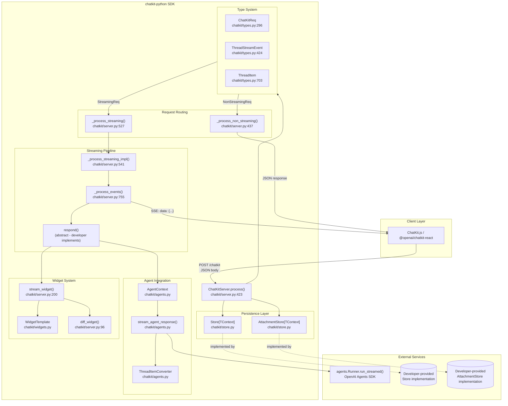
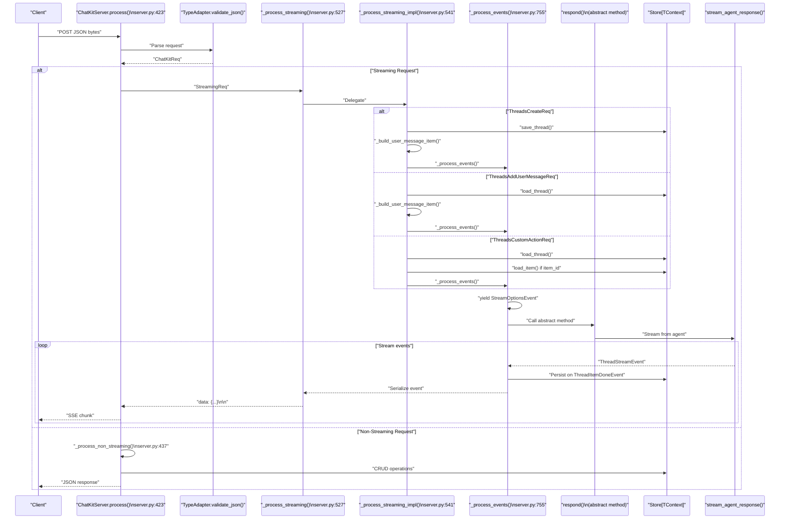
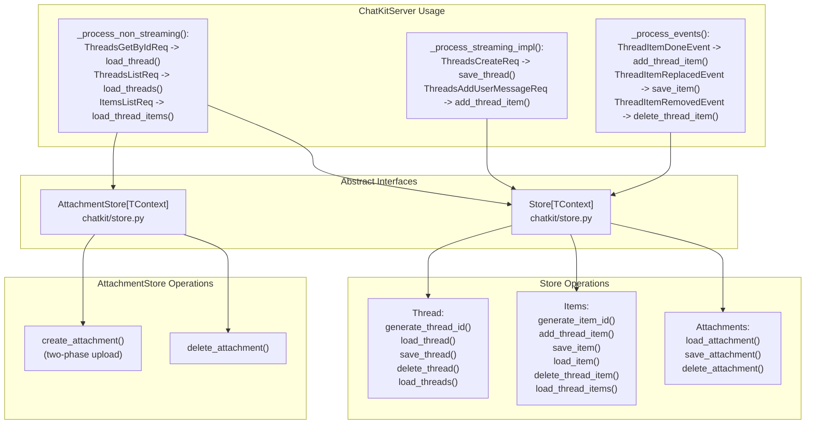

<!-- source: DeepWiki mcp.deepwiki.com · repo openai/chatkit-python · page 1 Overview · fetched 2026-10-26 -->

# Overview

Relevant source files

The following files were used as context for generating this wiki page:

- [README.md](README.md)
- [chatkit/__init__.py](chatkit/__init__.py)
- [docs/index.md](docs/index.md)
- [docs/quickstart.md](docs/quickstart.md)
- [docs/release.md](docs/release.md)
- [mkdocs.yml](mkdocs.yml)
- [pyproject.toml](pyproject.toml)
- [uv.lock](uv.lock)

The `chatkit-python` package (published as `openai-chatkit` on PyPI) is a backend framework for building conversational AI applications that integrate OpenAI's Agents SDK with chat interfaces. It provides server abstractions, type-safe request/response handling, agent integration helpers, and persistence interfaces that enable developers to build production-ready chat applications with streaming responses, rich UI components, and multi-turn conversations.

## What is ChatKit?

ChatKit consists of two complementary packages:

- **ChatKit.js** (`@openai/chatkit` and `@openai/chatkit-react`): Frontend library providing a React chat UI with support for streaming messages, widgets, entities, and custom actions.
- **chatkit-python** (this package): Backend SDK that processes client requests, integrates with OpenAI agents, manages conversation persistence, and streams real-time events to the client.

This SDK acts as middleware between chat clients and AI services, handling the complexity of request routing, agent orchestration, streaming event generation, and data persistence.

## Key Responsibilities

The SDK provides five core capabilities:

| Capability | Implementation | Description |
|-----------|---------------|-------------|
| **Request Processing** | `ChatKitServer.process()` [chatkit/server.py:423-435]() | Parses incoming requests, validates types, routes to streaming or non-streaming handlers. |
| **Agent Integration** | `stream_agent_response()` [chatkit/agents.py:1-400]() | Converts between ChatKit thread items and Agents SDK input/output formats, streams agent responses as events. |
| **Data Persistence** | `Store[TContext]` [chatkit/store.py:28-154]() | Abstract interface for thread and item CRUD operations, implemented by integrators with their database of choice. |
| **Widget Rendering** | `WidgetTemplate` [chatkit/widgets.py:382-446]() | Loads `.widget` files, hydrates with data, and validates against JSON schemas. |
| **Event Streaming** | `_process_streaming()` [chatkit/server.py:527-539]() | Wraps events in Server-Sent Events (SSE) format for real-time client updates. |

The SDK does **not** provide:
- Concrete production storage implementations (integrators implement `Store` with their database).
- Web server integration (integrators mount `process()` in FastAPI, Flask, etc.).
- Authentication/authorization logic (passed via generic `TContext` parameter).

**Sources**: [chatkit/server.py:423-435](), [chatkit/store.py:28-154](), [chatkit/widgets.py:382-446](), [pyproject.toml:1-8]()

## System Architecture

### High-Level Component Diagram

**Component map: chatkit-python modules and their roles**

**Sources**: [chatkit/server.py:96-250](), [chatkit/server.py:423-755](), [chatkit/types.py:271-438](), [chatkit/types.py:703-716]()

### Architectural Layers

The SDK is organized into cooperating layers:

| Layer | Key Components | Purpose |
|-------|---------------|---------|
| **Entry Point** | `ChatKitServer.process()` [chatkit/server.py:423]() | Single HTTP handler that parses, validates, and routes all client requests. |
| **Type System** | `ChatKitReq`, `ThreadStreamEvent`, `ThreadItem` [chatkit/types.py]() | Pydantic models with discriminated unions for type-safe request/response handling. |
| **Request Routing** | `_process_streaming()`, `_process_non_streaming()` [chatkit/server.py:527](), [chatkit/server.py:437]() | Splits execution path based on request type (streaming vs synchronous). |
| **Streaming Pipeline** | `_process_events()`, abstract `respond()` [chatkit/server.py:755]() | Orchestrates event generation, persistence, and client delivery. |
| **Agent Integration** | `AgentContext`, `stream_agent_response()` [chatkit/agents.py]() | Converts between ChatKit thread format and Agents SDK input/output. |
| **Persistence** | `Store[TContext]`, `AttachmentStore[TContext]` [chatkit/store.py]() | Abstract interfaces for thread/item storage and file handling. |
| **Widget System** | `WidgetTemplate`, `diff_widget()` [chatkit/widgets.py](), [chatkit/server.py:96]() | Loads widget templates, hydrates with data, and computes streaming deltas. |

The generic `TContext` type parameter threads through all layers, enabling developers to pass request-scoped data (authentication, tenant ID, database connections) without modifying the framework.

**Sources**: [chatkit/server.py:423-755](), [chatkit/types.py:1-999](), [chatkit/agents.py:1-400](), [chatkit/store.py:28-154](), [chatkit/widgets.py:382-446]()

## Type System Foundation

### Core Type Hierarchy

**Discriminated union types in `chatkit/types.py` and their relationships**

```mermaid
graph TB
    subgraph Requests["Request Types (chatkit/types.py:271-313)"]
        ChatKitReq["ChatKitReq\ntypes.py:296\ndiscriminator='type'"]

        StreamingReq["StreamingReq\ntypes.py:271\n(5 variants)"]
        NonStreamingReq["NonStreamingReq\ntypes.py:281\n(10 variants)"]

        ThreadsCreateReq["ThreadsCreateReq\ntype='threads.create'"]
        ThreadsAddUserMessageReq["ThreadsAddUserMessageReq\ntype='threads.add_user_message'"]
        ThreadsCustomActionReq["ThreadsCustomActionReq\ntype='threads.custom_action'"]

        ThreadsGetByIdReq["ThreadsGetByIdReq\ntype='threads.get_by_id'"]
        ThreadsListReq["ThreadsListReq\ntype='threads.list'"]
        ItemsListReq["ItemsListReq\ntype='items.list'"]
    end

    subgraph Events["Event Types (chatkit/types.py:319-438)"]
        ThreadStreamEvent["ThreadStreamEvent\ntypes.py:424\ndiscriminator='type'"]

        ItemEvents["Item Lifecycle"]
        MetaEvents["Thread Metadata"]
        UpdateEvents["Streaming Updates"]

        ThreadItemDoneEvent["ThreadItemDoneEvent\ntype='thread.item.done'"]
        ThreadItemAddedEvent["ThreadItemAddedEvent\ntype='thread.item.added'"]
        ThreadItemUpdatedEvent["ThreadItemUpdatedEvent\ntype='thread.item.updated'"]

        ThreadCreatedEvent["ThreadCreatedEvent\ntype='thread.created'"]
        ThreadUpdatedEvent["ThreadUpdatedEvent\ntype='thread.updated'"]

        ThreadItemUpdate["ThreadItemUpdate\ntypes.py:535\n(10 variants)"]
    end

    subgraph Data["Data Models (chatkit/types.py:558-716)"]
        Thread["Thread\ntypes.py:596"]
        ThreadMetadata["ThreadMetadata\ntypes.py:558"]

        ThreadItem["ThreadItem\ntypes.py:703\ndiscriminator='type'\n(9 variants)"]

        UserMessageItem["UserMessageItem\ntype='user_message'"]
        AssistantMessageItem["AssistantMessageItem\ntype='assistant_message'"]
        WidgetItem["WidgetItem\ntype='widget'"]
        WorkflowItem["WorkflowItem\ntype='workflow'"]
        ClientToolCallItem["ClientToolCallItem\ntype='client_tool_call'"]
        GeneratedImageItem["GeneratedImageItem\ntype='generated_image'"]
        HiddenContextItem["HiddenContextItem\ntype='hidden_context_item'"]
    end

    ChatKitReq --> StreamingReq
    ChatKitReq --> NonStreamingReq

    StreamingReq --> ThreadsCreateReq
    StreamingReq --> ThreadsAddUserMessageReq
    StreamingReq --> ThreadsCustomActionReq

    NonStreamingReq --> ThreadsGetByIdReq
    NonStreamingReq --> ThreadsListReq
    NonStreamingReq --> ItemsListReq

    ThreadStreamEvent --> ItemEvents
    ThreadStreamEvent --> MetaEvents
    ThreadStreamEvent --> UpdateEvents

    ItemEvents --> ThreadItemDoneEvent
    ItemEvents --> ThreadItemAddedEvent
    ItemEvents --> ThreadItemUpdatedEvent

    MetaEvents --> ThreadCreatedEvent
    MetaEvents --> ThreadUpdatedEvent

    ThreadItemUpdatedEvent --> ThreadItemUpdate

    Thread --> ThreadMetadata
    Thread --> ThreadItem

    ThreadItem --> UserMessageItem
    ThreadItem --> AssistantMessageItem
    ThreadItem --> WidgetItem
    ThreadItem --> WorkflowItem
    ThreadItem --> ClientToolCallItem
    ThreadItem --> GeneratedImageItem
    ThreadItem --> HiddenContextItem
```

### Type Categories

All SDK types are Pydantic models with discriminated unions for type-safe parsing:

| Type Category | Union Type | Variants | Discriminator Field |
|--------------|-----------|----------|-------------------|
| **Requests** | `ChatKitReq` [chatkit/types.py:296]() | 15 total (5 streaming, 10 non-streaming) | `type` |
| **Streaming Events** | `ThreadStreamEvent` [chatkit/types.py:424]() | 11 variants (item lifecycle, metadata, status) | `type` |
| **Item Updates** | `ThreadItemUpdate` [chatkit/types.py:535]() | 10 variants (text deltas, annotations, widgets) | `type` |
| **Thread Items** | `ThreadItem` [chatkit/types.py:703]() | 9 variants (messages, widgets, workflows, tools) | `type` |

**Sources**: [chatkit/types.py:271-716]()

## Request Processing Flow

**How `ChatKitServer.process()` routes requests to handlers**

The `ChatKitServer.process()` method [chatkit/server.py:423-435]() is the entry point for all requests:

1. **Validation**: `TypeAdapter[ChatKitReq].validate_json()` parses and validates the request [chatkit/server.py:427]().
2. **Routing**: `is_streaming_req()` determines streaming vs non-streaming path [chatkit/server.py:430-435]().
3. **Streaming Pipeline**:
   - `_process_streaming()` wraps events in SSE format [chatkit/server.py:527-539]().
   - `_process_streaming_impl()` routes to specific handlers [chatkit/server.py:541-689]().
   - `_process_events()` orchestrates event generation and persistence [chatkit/server.py:755-852]().
   - Abstract `respond()` method generates AI responses [chatkit/server.py:299-316]().
4. **Non-Streaming Pipeline**:
   - `_process_non_streaming()` handles CRUD operations directly [chatkit/server.py:437-525]().
   - Returns immediate JSON response serialized via `_serialize()` [chatkit/server.py:960-965]().

**Sources**: [chatkit/server.py:423-852]()

## Storage Abstraction

The SDK defines abstract storage interfaces that integrators must implement:

| Interface | Type Parameter | Purpose |
|-----------|---------------|---------|
| `Store[TContext]` [chatkit/store.py:28]() | Arbitrary context (auth, tenant, DB connection) | Thread and item persistence. |
| `AttachmentStore[TContext]` [chatkit/store.py:157]() | Same context type | File upload/download handling. |

**Sources**: [chatkit/store.py:28-154](), [chatkit/server.py:437-525](), [chatkit/server.py:755-852]()

## Major Component Systems

### Agent Integration Layer
The `chatkit/agents.py` module bridges ChatKit's thread-based conversation model with OpenAI's Agents SDK. It includes the `AgentContext` [chatkit/agents.py:53]() and `stream_agent_response()` [chatkit/agents.py:321]() helper.

### Widget System
The widget system (`chatkit/widgets.py`) enables declarative UI components built from templates using `WidgetTemplate` [chatkit/widgets.py:382]().

### Streaming Architecture
The streaming pipeline operates in three phases:
1. **Event Generation**: Abstract `respond()` [chatkit/server.py:299]() method yields `ThreadStreamEvent` instances.
2. **Event Processing**: `_process_events()` [chatkit/server.py:755]() intercepts events for persistence.
3. **Serialization**: `_process_streaming()` [chatkit/server.py:527]() wraps events in SSE format.

**Sources**: [chatkit/agents.py](), [chatkit/widgets.py](), [chatkit/server.py:527-852]()

## Package Information

### Core Dependencies
- `pydantic`: Type validation and serialization [pyproject.toml:7]().
- `openai-agents`: Agents SDK integration [pyproject.toml:7]().
- `jinja2`: Template rendering for widgets [pyproject.toml:7]().

### Development Tools
- `pytest`: Async test runner [pyproject.toml:82]().
- `pyright`: Static type checking [pyproject.toml:85]().
- `ruff`: Linting and formatting [pyproject.toml:19]().

**Sources**: [pyproject.toml:1-98]()

---

