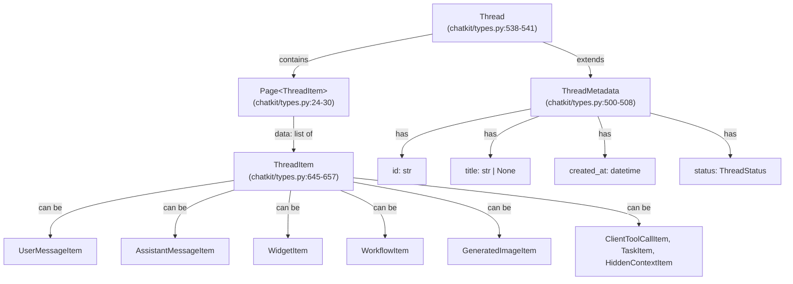
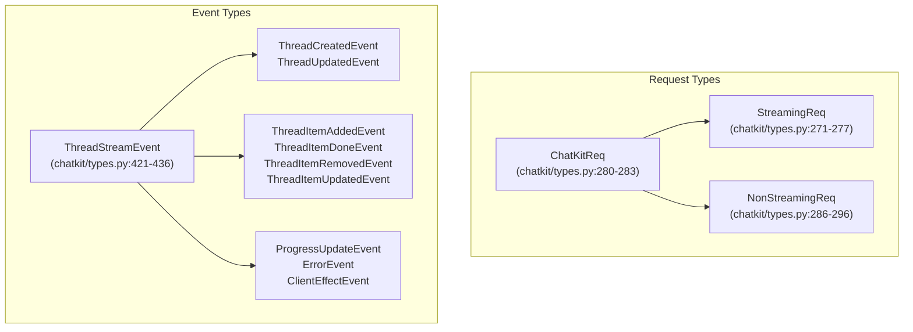

<!-- source: DeepWiki mcp.deepwiki.com · repo openai/chatkit-python · page 2 Core Concepts · fetched 2026-10-26 -->

# Core Concepts

Relevant source files

The following files were used as context for generating this wiki page:

- [chatkit/types.py](chatkit/types.py)
- [docs/concepts/thread-stream-events.md](docs/concepts/thread-stream-events.md)
- [docs/concepts/threads.md](docs/concepts/threads.md)

This page introduces the fundamental abstractions and mental models required to understand and use the ChatKit Python SDK. It provides a high-level overview of the thread-based conversation model, the type system, request/response patterns, and the streaming event architecture.

---

## Thread-Based Conversation Model

ChatKit organizes all interactions into **threads**, where each thread contains an ordered sequence of **thread items**. This model provides a structured way to manage multi-turn conversations between users and AI assistants.

### Thread Structure

A thread consists of metadata (ID, title, status) and a collection of items representing the history.

**Thread Definition:**

**Sources:** [chatkit/types.py:500-541](), [chatkit/types.py:645-657](), [chatkit/types.py:24-30]()

### Thread Items

Thread items are the individual records making up a thread. Each item represents one unit of history, such as a message, a UI widget, or a background signal.

| Item Type | Purpose | Defined At |
|-----------|---------|------------|
| `UserMessageItem` | User input (text, attachments, @-mentions) | [chatkit/types.py:555-563]() |
| `AssistantMessageItem` | Assistant output (Markdown, annotations) | [chatkit/types.py:566-570]() |
| `WidgetItem` | Interactive UI components (cards, charts, forms) | [chatkit/types.py:584-589]() |
| `WorkflowItem` | Multi-step reasoning or task progress visualization | [chatkit/types.py:613-617]() |
| `HiddenContextItem` | Internal signals not rendered in the UI | [chatkit/types.py:626-633]() |

For a deep dive into all item types and how they influence model input vs. UI rendering, see [Threads and Thread Items](#2.4).

**Sources:** [chatkit/types.py:547-657]()

---

## Type System and Data Models

ChatKit's architecture is built on a strongly-typed foundation using Pydantic models and discriminated unions. This ensures that every request and event has a validated schema.

### Discriminated Union Pattern

ChatKit uses the `type` field as a discriminator for polymorphic types, allowing for exhaustive pattern matching in server logic.

**Core Type Hierarchies:**

For details on all models, including actions and icons, see [Type System and Data Models](#2.1).

**Sources:** [chatkit/types.py:271-296](), [chatkit/types.py:421-436]()

---

## Request and Response Flow

ChatKit handles two main types of communication: **streaming** and **non-streaming**.

- **Streaming Requests**: (e.g., `threads.create`, `threads.add_user_message`) trigger AI logic and return a stream of Server-Sent Events (SSE).
- **Non-Streaming Requests**: (e.g., `threads.get_by_id`, `items.list`) return immediate JSON payloads for CRUD operations.

The `ChatKitServer.process()` method routes these requests to the appropriate handlers based on the `ChatKitReq` type. For details on the routing logic and SSE implementation, see [Request and Response Flow](#2.2).

**Sources:** [chatkit/types.py:271-296](), [chatkit/server.py:312-323]()

---

## Streaming Events

During a response, `ChatKitServer` emits `ThreadStreamEvent`s. These events serve two purposes:
1. **UI Synchronization**: Updating the client-side chat interface in real-time (e.g., streaming text deltas).
2. **Persistence**: Driving store operations. For example, a `ThreadItemDoneEvent` signals the server to call `store.add_thread_item()`.

| Event Category | Purpose |
|----------------|---------|
| **Lifecycle** | `ThreadCreatedEvent`, `ThreadUpdatedEvent` |
| **Item State** | `ThreadItemAddedEvent`, `ThreadItemDoneEvent`, `ThreadItemUpdatedEvent` |
| **Feedback** | `ProgressUpdateEvent`, `ErrorEvent`, `ClientEffectEvent` |

For documentation on when each event is emitted and how persistence is handled, see [Streaming Events](#2.3).

**Sources:** [docs/concepts/thread-stream-events.md:1-43](), [chatkit/types.py:371-386]()

---

## Entities and Annotations

To support advanced features like inline citations and rich user input, ChatKit uses entities and annotations:

- **Annotations**: Created via `ResponseStreamConverter` to turn model-emitted citations into interactive UI elements.
- **Entities**: Used in `UserMessageItem` to handle @-mentions and other tagged content.

For details on how these are processed and converted, see [Entities and Annotations](#2.5).

**Sources:** [docs/concepts/threads.md:66-73](), [chatkit/types.py:756-784]()

---

