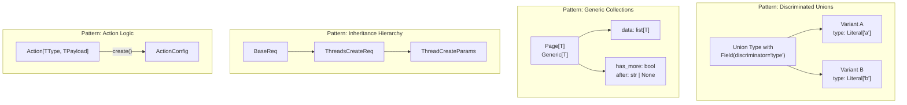
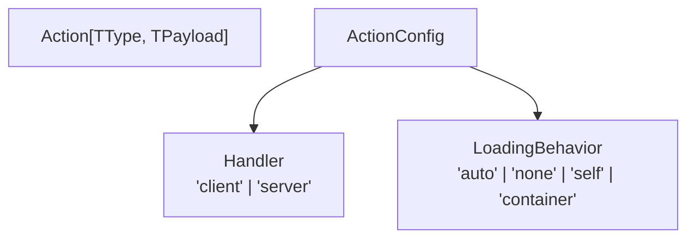
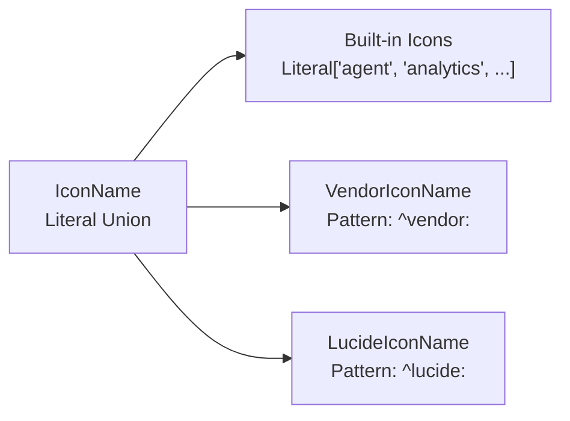

<!-- source: DeepWiki mcp.deepwiki.com · repo openai/chatkit-python · page 2.1 Type System and Data Models · fetched 2026-10-26 -->

# Type System and Data Models

Relevant source files

The following files were used as context for generating this wiki page:

- [chatkit/actions.py](chatkit/actions.py)
- [chatkit/icons.py](chatkit/icons.py)
- [chatkit/types.py](chatkit/types.py)
- [docs/concepts/actions.md](docs/concepts/actions.md)
- [tests/test_icons.py](tests/test_icons.py)

## Purpose and Scope

This document describes the core type system and data models defined in `chatkit/types.py`, `chatkit/actions.py`, and `chatkit/icons.py` that form the foundation of the ChatKit framework. These Pydantic models provide type-safe request/response contracts, thread structures, action definitions, and event streaming primitives.

For information about the widget-specific type system, see [Widgets and UI Components](#4.3). For details on how these types are used during request processing, see [Request and Response Flow](#2.2). For implementation guidance on working with these types in server code, see [ChatKitServer Class](#3.1).

**Sources:** [chatkit/types.py:1-913](), [chatkit/actions.py:1-57](), [chatkit/icons.py:1-79]()

---

## Type System Architecture

The ChatKit type system is built on Pydantic models and uses discriminated unions extensively for type-safe polymorphism. All models include a `type` field that enables runtime type discrimination and automatic routing.

### Core Design Patterns

**Sources:** [chatkit/types.py:24-30](), [chatkit/types.py:35-40](), [chatkit/actions.py:14-57]()

---

## Request Types

All client requests are represented by the `ChatKitReq` discriminated union, which splits into streaming and non-streaming categories based on whether they yield events over time or return immediate responses.

### Request Type Hierarchy

```mermaid
graph TB
    ChatKitReq["ChatKitReq<br/>Annotated Union"]
    
    StreamingReq["StreamingReq<br/>Union Type"]
    NonStreamingReq["NonStreamingReq<br/>Union Type"]
    
    ThreadsCreateReq["ThreadsCreateReq<br/>type: 'threads.create'"]
    ThreadsAddUserMessageReq["ThreadsAddUserMessageReq<br/>type: 'threads.add_user_message'"]
    ThreadsAddClientToolOutputReq["ThreadsAddClientToolOutputReq<br/>type: 'threads.add_client_tool_output'"]
    ThreadsRetryAfterItemReq["ThreadsRetryAfterItemReq<br/>type: 'threads.retry_after_item'"]
    ThreadsCustomActionReq["ThreadsCustomActionReq<br/>type: 'threads.custom_action'"]
    
    ThreadsGetByIdReq["ThreadsGetByIdReq<br/>type: 'threads.get_by_id'"]
    ThreadsListReq["ThreadsListReq<br/>type: 'threads.list'"]
    ItemsListReq["ItemsListReq<br/>type: 'items.list'"]
    ItemsFeedbackReq["ItemsFeedbackReq<br/>type: 'items.feedback'"]
    AttachmentsCreateReq["AttachmentsCreateReq<br/>type: 'attachments.create'"]
    AttachmentsDeleteReq["AttachmentsDeleteReq<br/>type: 'attachments.delete'"]
    ThreadsUpdateReq["ThreadsUpdateReq<br/>type: 'threads.update'"]
    ThreadsDeleteReq["ThreadsDeleteReq<br/>type: 'threads.delete'"]
    ThreadsSyncCustomActionReq["ThreadsSyncCustomActionReq<br/>type: 'threads.sync_custom_action'"]
    
    ChatKitReq --> StreamingReq
    ChatKitReq --> NonStreamingReq
    
    StreamingReq --> ThreadsCreateReq
    StreamingReq --> ThreadsAddUserMessageReq
    StreamingReq --> ThreadsAddClientToolOutputReq
    StreamingReq --> ThreadsRetryAfterItemReq
    StreamingReq --> ThreadsCustomActionReq
    
    NonStreamingReq --> ThreadsGetByIdReq
    NonStreamingReq --> ThreadsListReq
    NonStreamingReq --> ItemsListReq
    NonStreamingReq --> ItemsFeedbackReq
    NonStreamingReq --> AttachmentsCreateReq
    NonStreamingReq --> AttachmentsDeleteReq
    NonStreamingReq --> ThreadsUpdateReq
    NonStreamingReq --> ThreadsDeleteReq
    NonStreamingReq --> ThreadsSyncCustomActionReq
```

### Request Type Categories

| Category | Type Alias | Purpose | Line Reference |
|----------|-----------|---------|----------------|
| **All Requests** | `ChatKitReq` | Top-level discriminated union of all request types | [chatkit/types.py:313-316]() |
| **Streaming** | `StreamingReq` | Requests that yield `ThreadStreamEvent` streams | [chatkit/types.py:271-278]() |
| **Non-Streaming** | `NonStreamingReq` | Requests that return immediate JSON responses | [chatkit/types.py:281-310]() |

**Sources:** [chatkit/types.py:35-316]()

---

## Response Event Types

Streaming requests yield a stream of `ThreadStreamEvent` instances, which represent state changes, content updates, and status notifications.

### Event Type Hierarchy

```mermaid
graph TB
    ThreadStreamEvent["ThreadStreamEvent<br/>Annotated Union"]
    
    subgraph "Item Lifecycle Events"
        ThreadItemAddedEvent["ThreadItemAddedEvent<br/>type: 'thread.item.added'"]
        ThreadItemUpdatedEvent["ThreadItemUpdatedEvent<br/>type: 'thread.item.updated'"]
        ThreadItemDoneEvent["ThreadItemDoneEvent<br/>type: 'thread.item.done'"]
        ThreadItemRemovedEvent["ThreadItemRemovedEvent<br/>type: 'thread.item.removed'"]
        ThreadItemReplacedEvent["ThreadItemReplacedEvent<br/>type: 'thread.item.replaced'"]
    end
    
    subgraph "Thread Metadata Events"
        ThreadCreatedEvent["ThreadCreatedEvent<br/>type: 'thread.created'"]
        ThreadUpdatedEvent["ThreadUpdatedEvent<br/>type: 'thread.updated'"]
    end
    
    subgraph "Status Events"
        StreamOptionsEvent["StreamOptionsEvent<br/>type: 'stream_options'"]
        ProgressUpdateEvent["ProgressUpdateEvent<br/>type: 'progress_update'"]
        ClientEffectEvent["ClientEffectEvent<br/>type: 'client_effect'"]
        ErrorEvent["ErrorEvent<br/>type: 'error'"]
        NoticeEvent["NoticeEvent<br/>type: 'notice'"]
    end
    
    ThreadStreamEvent --> ThreadItemAddedEvent
    ThreadStreamEvent --> ThreadItemUpdatedEvent
    ThreadStreamEvent --> ThreadItemDoneEvent
    ThreadStreamEvent --> ThreadItemRemovedEvent
    ThreadStreamEvent --> ThreadItemReplacedEvent
    ThreadStreamEvent --> ThreadCreatedEvent
    ThreadStreamEvent --> ThreadUpdatedEvent
    ThreadStreamEvent --> StreamOptionsEvent
    ThreadStreamEvent --> ProgressUpdateEvent
    ThreadStreamEvent --> ClientEffectEvent
    ThreadStreamEvent --> ErrorEvent
    ThreadStreamEvent --> NoticeEvent
```

### Event Categories

| Event Type | Purpose | Key Fields |
|------------|---------|------------|
| **ThreadItemAddedEvent** | Item added to thread (not persisted yet) | `item: ThreadItem` |
| **ThreadItemUpdatedEvent** | Incremental update to existing item | `item_id: str`, `update: ThreadItemUpdate` |
| **ThreadItemDoneEvent** | Item finalized and persisted | `item: ThreadItem` |
| **ThreadItemRemovedEvent** | Item removed from thread | `item_id: str` |
| **ThreadItemReplacedEvent** | Item replaced with new version | `item: ThreadItem` |
| **ThreadCreatedEvent** | New thread initialized | `thread: Thread` |
| **ThreadUpdatedEvent** | Thread metadata changed | `thread: Thread` |
| **StreamOptionsEvent** | Configure stream behavior | `stream_options: StreamOptions` |
| **ProgressUpdateEvent** | Display progress message | `icon: IconName`, `text: str` |
| **ClientEffectEvent** | Trigger client-side effect | `name: str`, `data: dict` |
| **ErrorEvent** | Error occurred during processing | `code: ErrorCode`, `message: str`, `allow_retry: bool` |
| **NoticeEvent** | Display user-facing notice | `level: Literal['info', 'warning', 'danger']`, `message: str` |

**Sources:** [chatkit/types.py:321-460]()

---

## Actions and Handlers

Actions represent interaction events triggered by widgets or client code. They are defined in `chatkit.actions`.

### Action Data Model

| Class/Type | Purpose | Key Fields |
|------------|---------|------------|
| **Action** | Generic base for defining typed actions | `type: TType`, `payload: TPayload` |
| **ActionConfig** | Concrete configuration for an action instance | `type: str`, `payload: Any`, `handler: Handler`, `loadingBehavior: LoadingBehavior`, `streaming: bool` |
| **Handler** | Specifies where the action logic executes | `Literal["client", "server"]` |
| **LoadingBehavior** | Controls UI loading state during action | `Literal["auto", "none", "self", "container"]` |

### Action Creation

The `Action.create()` class method [chatkit/actions.py:31-56]() is used to generate an `ActionConfig` from a typed `Action` subclass. It performs type inference to extract the `type` literal from the class definition.

**Sources:** [chatkit/actions.py:1-57](), [docs/concepts/actions.md:1-28]()

---

## Thread Item Hierarchy

`ThreadItem` is a discriminated union representing all possible elements in a conversation thread.

### ThreadItem Variant Reference

| Type | Purpose | Key Fields | Line Reference |
|------|---------|------------|----------------|
| **UserMessageItem** | User's input message | `content: list[UserMessageContent]`, `attachments: list[Attachment]` | [chatkit/types.py:623-631]() |
| **AssistantMessageItem** | Assistant's response | `content: list[AssistantMessageContent]` | [chatkit/types.py:633-638]() |
| **WidgetItem** | Rich UI component | `widget: WidgetRoot`, `copy_text: str` | [chatkit/types.py:651-657]() |
| **WorkflowItem** | Multi-step workflow container | `workflow: Workflow` | [chatkit/types.py:680-685]() |
| **ClientToolCallItem** | Tool requiring client execution | `call_id: str`, `name: str`, `arguments: dict`, `status: str` | [chatkit/types.py:640-649]() |
| **GeneratedImageItem** | AI-generated image | `image: GeneratedImage` | [chatkit/types.py:666-671]() |
| **HiddenContextItem** | Integration-specific context | `content: Any` | [chatkit/types.py:693-701]() |
| **SDKHiddenContextItem** | SDK internal context | `content: str` | [chatkit/types.py:703-711]() |

**Sources:** [chatkit/types.py:612-726]()

---

## Icon System

The `IconName` type [chatkit/icons.py:8-77]() defines allowed icon identifiers used for visual elements in widgets and progress updates.

### Icon Type Definition

- **VendorIconName**: Annotated string requiring a `vendor:` prefix [chatkit/icons.py:5]().
- **LucideIconName**: Annotated string requiring a `lucide:` prefix [chatkit/icons.py:6]().
- **Literal Icons**: A set of approximately 70 predefined strings representing core ChatKit icons [chatkit/icons.py:9-74]().

**Sources:** [chatkit/icons.py:1-79](), [tests/test_icons.py:1-23]()

---

## Thread and Page Models

### Thread Structure
A `Thread` [chatkit/types.py:606-610]() represents a conversation container. It inherits from `ThreadMetadata` [chatkit/types.py:568-577]() and includes a `Page` of `ThreadItem` objects.

### Page Model
The `Page[T]` [chatkit/types.py:24-30]() model provides cursor-based pagination:
- **`data`**: `list[T]` - The records for the current page.
- **`has_more`**: `bool` - Indicates if more records are available.
- **`after`**: `str | None` - The cursor to use for the next page request.

**Sources:** [chatkit/types.py:24-30](), [chatkit/types.py:568-610]()

---

