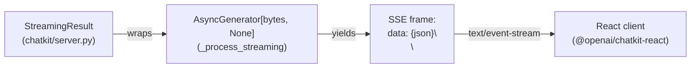
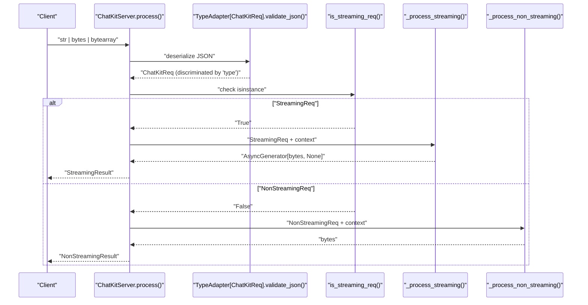
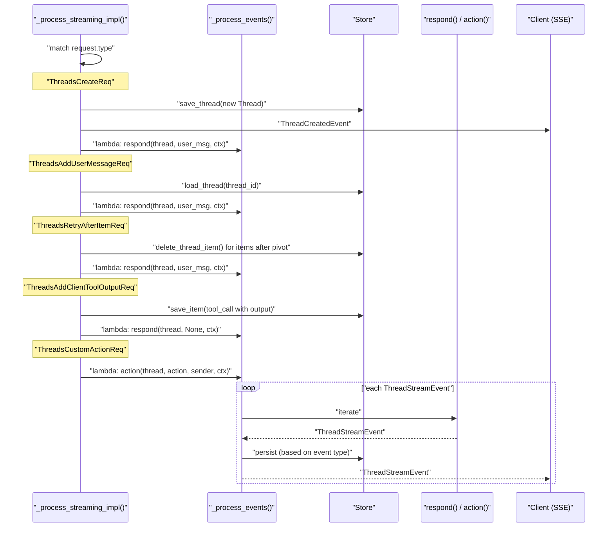
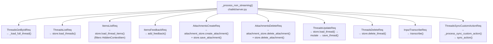

<!-- source: DeepWiki mcp.deepwiki.com · repo openai/chatkit-python · page 2.2 Request and Response Flow · fetched 2026-10-26 -->

# Request and Response Flow

<details>
<summary>Relevant source files</summary>

The following files were used as context for generating this wiki page:

- [chatkit/server.py](chatkit/server.py)
- [chatkit/types.py](chatkit/types.py)
- [docs/quickstart.md](docs/quickstart.md)
- [mkdocs.yml](mkdocs.yml)

</details>


## Purpose and Scope

This document explains the request/response model in the ChatKit Python SDK, covering how client requests are received, routed, processed, and responded to. It details the distinction between streaming and non-streaming requests, the processing pipeline, and how each request type maps to server operations.

For details on the type system and data models used in requests and responses, see section 2.1. For information on the streaming event types emitted during streaming responses, see section 2.3.

## Request Model

All ChatKit requests are sent as JSON payloads conforming to the `ChatKitReq` type, which is a discriminated union that routes to either streaming or non-streaming processing paths.

### ChatKitReq Discriminated Union

All request bodies are JSON-serialized Pydantic models. The `type` field acts as a discriminator to route each payload to the correct model class. The `is_streaming_req()` function determines which processing path to take.

**ChatKitReq discriminated union and its two processing paths**

```mermaid
graph TB
    CKR["ChatKitReq\n(discriminator: 'type')"]

    SR["StreamingReq\n→ StreamingResult (SSE)"]
    NSR["NonStreamingReq\n→ NonStreamingResult (JSON)"]

    CKR --> SR
    CKR --> NSR

    SR --> TCR["ThreadsCreateReq\n'threads.create'"]
    SR --> TAUMR["ThreadsAddUserMessageReq\n'threads.add_user_message'"]
    SR --> TACTOR["ThreadsAddClientToolOutputReq\n'threads.add_client_tool_output'"]
    SR --> TRAIR["ThreadsRetryAfterItemReq\n'threads.retry_after_item'"]
    SR --> TCAR["ThreadsCustomActionReq\n'threads.custom_action'"]

    NSR --> TGBIR["ThreadsGetByIdReq\n'threads.get_by_id'"]
    NSR --> TLR["ThreadsListReq\n'threads.list'"]
    NSR --> ILR["ItemsListReq\n'items.list'"]
    NSR --> IFR["ItemsFeedbackReq\n'items.feedback'"]
    NSR --> ACR["AttachmentsCreateReq\n'attachments.create'"]
    NSR --> ADR["AttachmentsDeleteReq\n'attachments.delete'"]
    NSR --> TUR["ThreadsUpdateReq\n'threads.update'"]
    NSR --> TDR["ThreadsDeleteReq\n'threads.delete'"]
    NSR --> ITR["InputTranscribeReq\n'input.transcribe'"]
    NSR --> TSCAR["ThreadsSyncCustomActionReq\n'threads.sync_custom_action'"]
```



Sources: [chatkit/types.py:271-313]()

The discriminator field is `type`, which determines which request class to deserialize into. The `is_streaming_req()` function at [chatkit/types.py:302-313]() determines the processing path.

### Request Type Reference

| Request Type | `type` field value | Category | Purpose | Returns |
|-------------|--------------------|----------|---------|---------|
| `ThreadsCreateReq` | `threads.create` | Streaming | Create new thread with user message | SSE stream |
| `ThreadsAddUserMessageReq` | `threads.add_user_message` | Streaming | Add user message to existing thread | SSE stream |
| `ThreadsAddClientToolOutputReq` | `threads.add_client_tool_output` | Streaming | Submit client-side tool execution result | SSE stream |
| `ThreadsRetryAfterItemReq` | `threads.retry_after_item` | Streaming | Retry generation after specific item | SSE stream |
| `ThreadsCustomActionReq` | `threads.custom_action` | Streaming | Execute custom action from widget | SSE stream |
| `ThreadsGetByIdReq` | `threads.get_by_id` | Non-streaming | Retrieve single thread by ID | `Thread` JSON |
| `ThreadsListReq` | `threads.list` | Non-streaming | List threads with pagination | `Page[Thread]` JSON |
| `ItemsListReq` | `items.list` | Non-streaming | List items in a thread | `Page[ThreadItem]` JSON |
| `ItemsFeedbackReq` | `items.feedback` | Non-streaming | Submit feedback on items | `{}` |
| `AttachmentsCreateReq` | `attachments.create` | Non-streaming | Create attachment metadata | `Attachment` JSON |
| `AttachmentsDeleteReq` | `attachments.delete` | Non-streaming | Delete an attachment | `{}` |
| `ThreadsUpdateReq` | `threads.update` | Non-streaming | Update thread metadata (title) | `Thread` JSON |
| `ThreadsDeleteReq` | `threads.delete` | Non-streaming | Delete a thread | `{}` |
| `InputTranscribeReq` | `input.transcribe` | Non-streaming | Transcribe base64-encoded audio to text | `TranscriptionResult` JSON |
| `ThreadsSyncCustomActionReq` | `threads.sync_custom_action` | Non-streaming | Execute synchronous custom action | `SyncCustomActionResponse` JSON |

Sources: [chatkit/types.py:42-293]()

## Response Model

ChatKit returns two distinct response types depending on whether the request is streaming or non-streaming.

### StreamingResult

`StreamingResult` wraps an `AsyncGenerator[bytes, None]` that yields SSE-formatted chunks. Each chunk is a JSON-encoded `ThreadStreamEvent` framed as:

```
data: {json}\n\n
```

**StreamingResult SSE encoding pipeline**



Sources: [chatkit/server.py:264-270](), [chatkit/server.py:527-539]()

### NonStreamingResult

`NonStreamingResult` wraps a single `bytes` payload containing a JSON-serialized Pydantic model. The caller is responsible for returning this with `Content-Type: application/json`.

Sources: [chatkit/server.py:273-275]()

## Request Processing Pipeline

The `ChatKitServer.process()` method is the entry point for all requests. It deserializes the incoming JSON, routes based on request type, and returns the appropriate result wrapper.

**`ChatKitServer.process()` dispatch logic**



Sources: [chatkit/server.py:423-435](), [chatkit/types.py:302-313]()

### Core Processing Methods

The processing pipeline consists of three key methods:

- **`process(request, context)`** [chatkit/server.py:423-435]() — Entry point: deserializes `ChatKitReq` from raw bytes and routes to the streaming or non-streaming path.
- **`_process_streaming(request, context)`** [chatkit/server.py:527-539]() — Iterates `_process_streaming_impl()`, serializes each `ThreadStreamEvent` into an SSE frame (`data: {json}\n\n`), and yields bytes.
- **`_process_non_streaming(request, context)`** [chatkit/server.py:437-525]() — Dispatches to the appropriate store operation and returns serialized JSON bytes.

## Streaming Request Flow

Streaming requests produce an async stream of `ThreadStreamEvent` instances. The server processes the request, generates events, persists state changes, and streams events to the client in real-time.

**Streaming request dispatch inside `_process_streaming_impl()`**



Sources: [chatkit/server.py:527-539](), [chatkit/server.py:541-689](), [chatkit/server.py:755-852]()

### Event Processing and Persistence

`_process_events()` at [chatkit/server.py:755-852]() is the inner loop that drives all streaming responses. It:

1. **Emits `StreamOptionsEvent`** — sends cancellation policy from `get_stream_options()` before any response events.
2. **Iterates the event stream** — calls the user-supplied `respond()` or `action()` async generator.
3. **Persists items automatically** based on event type:

   | Event | Store operation |
   |-------|----------------|
   | `ThreadItemDoneEvent` | `store.add_thread_item()` |
   | `ThreadItemRemovedEvent` | `store.delete_thread_item()` |
   | `ThreadItemReplacedEvent` | `store.save_item()` |
   | `ThreadItemUpdatedEvent` | updates in-memory pending copy only |

4. **Suppresses hidden items** — `HiddenContextItem` and `SDKHiddenContextItem` done events are persisted but not forwarded to the client.
5. **Detects thread metadata changes** — emits `ThreadUpdatedEvent` if the `ThreadMetadata` object was mutated during the stream.
6. **Error handling** — catches `CustomStreamError`, `StreamError`, and generic exceptions and emits `ErrorEvent` rather than crashing the stream.
7. **Cancellation** — on `asyncio.CancelledError`, calls `handle_stream_cancelled()` to persist any non-empty partial assistant messages and adds an `SDKHiddenContextItem` noting the cancellation.

Sources: [chatkit/server.py:755-852]()

## Non-Streaming Request Flow

Non-streaming requests perform CRUD operations on threads, items, and attachments, returning a single JSON response.

**`_process_non_streaming()` dispatch**



Sources: [chatkit/server.py:437-525]()

### Non-Streaming Request Handlers

Each non-streaming request type is handled by a dedicated `match` case inside `_process_non_streaming()`:

| Request Type | Operations | Line Reference |
|-------------|-----------|----------------|
| `ThreadsGetByIdReq` | Load thread metadata + first page of items, filter hidden items | [chatkit/server.py:441-445]() |
| `ThreadsListReq` | Load paginated thread list via `store.load_threads()` | [chatkit/server.py:446-462]() |
| `ItemsFeedbackReq` | Call `add_feedback()` hook, return `{}` | [chatkit/server.py:463-470]() |
| `AttachmentsCreateReq` | Create via `AttachmentStore`, persist with `store.save_attachment()` | [chatkit/server.py:471-477]() |
| `AttachmentsDeleteReq` | Delete from `AttachmentStore` and `Store` | [chatkit/server.py:478-486]() |
| `InputTranscribeReq` | Decode base64 audio, call `transcribe()`, return `TranscriptionResult` | [chatkit/server.py:487-493]() |
| `ItemsListReq` | Load paginated items, filter `HiddenContextItem`/`SDKHiddenContextItem` | [chatkit/server.py:494-509]() |
| `ThreadsUpdateReq` | Load thread, update `title`, call `store.save_thread()` | [chatkit/server.py:510-516]() |
| `ThreadsDeleteReq` | Call `store.delete_thread()`, return `{}` | [chatkit/server.py:517-521]() |
| `ThreadsSyncCustomActionReq` | Delegate to `_process_sync_custom_action()` → `sync_action()` | [chatkit/server.py:522-523]() |

## Request-to-Operation Mapping

### Streaming Operations

**ThreadsCreateReq** → Creates new thread, saves user message, invokes `respond()`
- Generates thread ID via `store.generate_thread_id()`
- Creates `Thread` with empty items page and calls `store.save_thread()`
- Builds `UserMessageItem` from `UserMessageInput` via `_build_user_message_item()`
- Yields `ThreadCreatedEvent`, then delegates to `_process_new_thread_item_respond()`

Sources: [chatkit/server.py:545-564]()

**ThreadsAddUserMessageReq** → Appends user message to existing thread, invokes `respond()`
- Loads existing thread via `store.load_thread()`
- Builds `UserMessageItem`, then delegates to `_process_new_thread_item_respond()`

Sources: [chatkit/server.py:566-578]()

**ThreadsAddClientToolOutputReq** → Records tool output, invokes `respond()` to continue
- Loads most recent pending `ClientToolCallItem` from the thread
- Updates its `output` and sets `status = "completed"`, then calls `store.save_item()`
- Cleans up any other dangling pending tool calls via `_cleanup_pending_client_tool_call()`
- Calls `respond(thread, None, context)` to continue the response stream

Sources: [chatkit/server.py:580-617]()

**ThreadsRetryAfterItemReq** → Removes items after specified item, re-invokes `respond()`
- Paginates backwards through the thread via `_paginate_thread_items_reverse()` to find the target `UserMessageItem`
- Calls `store.delete_thread_item()` for all items after the target
- Calls `respond()` with the original user message

Sources: [chatkit/server.py:619-654]()

**ThreadsCustomActionReq** → Executes custom action, invokes `action()` hook
- Loads thread and optionally loads the sender `WidgetItem` (if `item_id` is present)
- Calls user-implemented `action()` abstract method
- Streams resulting events via `_process_events()`

Sources: [chatkit/server.py:655-686]()

### Non-Streaming Operations

**ThreadsGetByIdReq** → Returns full thread with first page of items
- Calls `_load_full_thread()` helper at [chatkit/server.py:933-942]()
- Combines `ThreadMetadata` with one page of `ThreadItem`s
- `_to_thread_response()` filters out `HiddenContextItem` and `SDKHiddenContextItem` from the returned items

Sources: [chatkit/server.py:441-445](), [chatkit/server.py:933-942]()

**ThreadsListReq** → Returns paginated list of threads
- Forwards pagination params to `store.load_threads()`
- Default page size is 20 (`DEFAULT_PAGE_SIZE` at [chatkit/server.py:92]())
- Supports `after` cursor and `asc`/`desc` ordering

Sources: [chatkit/server.py:446-462]()

**ItemsListReq** → Returns paginated items in a thread
- Loads items via `store.load_thread_items()`
- Filters out `HiddenContextItem` and `SDKHiddenContextItem` instances before returning to the client

Sources: [chatkit/server.py:494-509]()

**InputTranscribeReq** → Transcribes audio to text
- Decodes the `audio_base64` field from the request params
- Calls the user-implemented `transcribe()` method with an `AudioInput` object
- Returns a `TranscriptionResult` with the transcribed text

Sources: [chatkit/server.py:487-493]()

**ThreadsSyncCustomActionReq** → Executes a synchronous custom action
- Loads thread and optional sender `WidgetItem`
- Calls user-implemented `sync_action()` method
- Returns a `SyncCustomActionResponse` (which may contain an `updated_item`)

Sources: [chatkit/server.py:691-716]()

## Serialization

All responses are serialized using Pydantic's `model_dump_json()` with specific options:

```python
def _serialize(self, obj: BaseModel) -> bytes:
    return obj.model_dump_json(by_alias=True, exclude_none=True).encode("utf-8")
```

- `by_alias=True` - Uses field aliases defined in models
- `exclude_none=True` - Omits fields with `None` values
- Returns UTF-8 encoded bytes

Sources: [chatkit/server.py:710-711]()

For streaming responses, each serialized event is wrapped in SSE format at [chatkit/server.py:410-411]():

```
data: {json}\n\n
```

---

