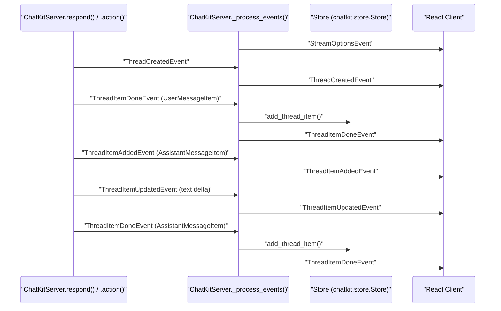
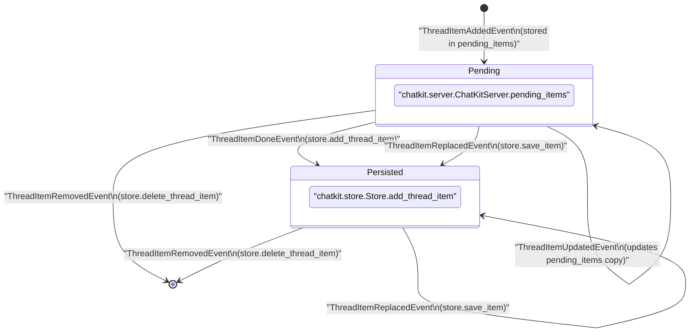
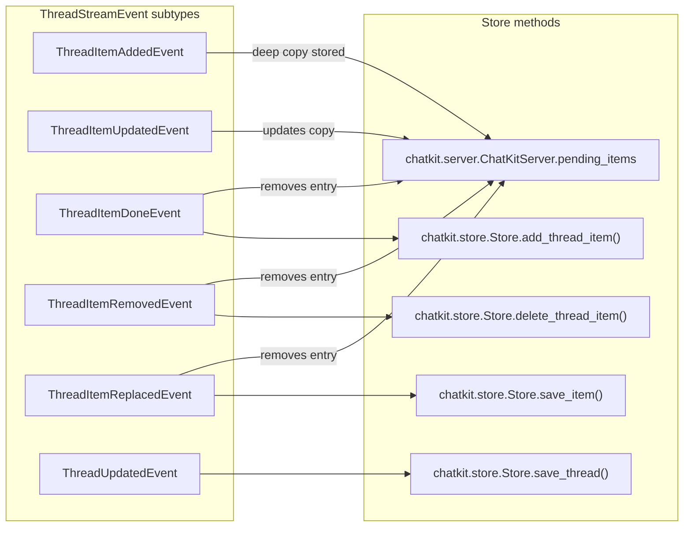

<!-- source: DeepWiki mcp.deepwiki.com · repo openai/chatkit-python · page 2.3 Streaming Events · fetched 2026-10-26 -->

# Streaming Events

<details>
<summary>Relevant source files</summary>

The following files were used as context for generating this wiki page:

- [chatkit/server.py](chatkit/server.py)
- [chatkit/types.py](chatkit/types.py)
- [docs/concepts/thread-stream-events.md](docs/concepts/thread-stream-events.md)

</details>


This page documents all `ThreadStreamEvent` subtypes defined in `chatkit/types.py`, when each is emitted during a streaming response, and how `ChatKitServer._process_events()` in `chatkit/server.py` handles persistence in response to them.

For the request types that trigger streaming and how routing works, see [Request and Response Flow](#2.2). For thread item data models that appear inside these events, see [Threads and Thread Items](#2.4). For how agent responses produce these events, see [Agent Integration](#4.1).

---

## Overview

When `ChatKitServer.process()` receives a streaming request, it returns a `StreamingResult` — an async iterable of `bytes` formatted as Server-Sent Events (SSE) [chatkit/server.py:465-470](). Each SSE chunk contains a single JSON-serialized `ThreadStreamEvent`.

`ThreadStreamEvent` is a Pydantic discriminated union keyed on the `type` field [chatkit/types.py:424-438](). The events flow from `ChatKitServer.respond()` (or `action()`) through `_process_events()`, which intercepts each event to handle persistence before forwarding it to the client [chatkit/server.py:755-853]().

**Diagram: Streaming Event Flow**



Sources: [chatkit/server.py:527-540](), [chatkit/server.py:755-853](), [chatkit/types.py:424-438]()

---

## The `ThreadStreamEvent` Union

`ThreadStreamEvent` is defined as an `Annotated` union with `Field(discriminator="type")` [chatkit/types.py:424-438]().

| Event Class | `type` Literal | Persisted by Server |
|---|---|---|
| `ThreadCreatedEvent` | `thread.created` | No (thread already saved before event) |
| `ThreadUpdatedEvent` | `thread.updated` | Yes — `store.save_thread()` |
| `ThreadItemAddedEvent` | `thread.item.added` | No (pending until Done/Replaced) |
| `ThreadItemUpdatedEvent` | `thread.item.updated` | No (tracked in `pending_items`) |
| `ThreadItemDoneEvent` | `thread.item.done` | Yes — `store.add_thread_item()` |
| `ThreadItemRemovedEvent` | `thread.item.removed` | Yes — `store.delete_thread_item()` |
| `ThreadItemReplacedEvent` | `thread.item.replaced` | Yes — `store.save_item()` |
| `StreamOptionsEvent` | `stream_options` | No |
| `ProgressUpdateEvent` | `progress_update` | No |
| `ClientEffectEvent` | `client_effect` | No |
| `ErrorEvent` | `error` | No |
| `NoticeEvent` | `notice` | No |

Sources: [chatkit/types.py:319-438](), [chatkit/server.py:782-812]()

---

## Thread Metadata Events

### `ThreadCreatedEvent`

Defined at [chatkit/types.py:319-323]().

```python
type: Literal["thread.created"]
thread: Thread
```

Emitted by `_process_streaming_impl()` immediately after a new `Thread` is saved to the store during a `ThreadsCreateReq` [chatkit/server.py:545-555](). The `Thread` object embedded in the event has its hidden context items stripped via `_to_thread_response()` [chatkit/server.py:553-554]().

### `ThreadUpdatedEvent`

Defined at [chatkit/types.py:326-330]().

```python
type: Literal["thread.updated"]
thread: Thread
```

Emitted by `_process_events()` when the `ThreadMetadata` object is mutated in-flight (e.g., title changed by the agent during streaming) [chatkit/server.py:814-825](). The server detects this by comparing the live `thread` reference against a deep copy `last_thread`. It calls `store.save_thread()` before emitting the event [chatkit/server.py:821-823]().

---

## Thread Item Lifecycle Events

These five events define the complete lifecycle of a thread item during a stream. The server's `_process_events()` method intercepts each one to manage store writes and a `pending_items` dictionary [chatkit/server.py:755-853]().

**Diagram: Thread Item Lifecycle State Machine**



Sources: [chatkit/server.py:776-812]()

### `ThreadItemAddedEvent`

Defined at [chatkit/types.py:333-337]().

```python
type: Literal["thread.item.added"]
item: ThreadItem
```

Signals that a new item has started streaming. The server does **not** persist the item at this point. Instead, it stores a deep copy in `pending_items[event.item.id]` for use during stream cancellation [chatkit/server.py:777-780]().

### `ThreadItemUpdatedEvent`

Defined at [chatkit/types.py:340-345]().

```python
type: Literal["thread.item.updated"]
item_id: str
update: ThreadItemUpdate
```

Carries an incremental mutation for an in-progress item. The server applies these updates to the `pending_items` copy (specifically for `AssistantMessageItem` and `WorkflowItem`) but does not write to the store [chatkit/server.py:798-803]().

The `update` field is itself a discriminated union `ThreadItemUpdate` [chatkit/types.py:535-547]():

| Update Class | `type` Literal | Applies To |
|---|---|---|
| `AssistantMessageContentPartAdded` | `assistant_message.content_part.added` | `AssistantMessageItem` |
| `AssistantMessageContentPartTextDelta` | `assistant_message.content_part.text_delta` | `AssistantMessageItem` |
| `AssistantMessageContentPartAnnotationAdded` | `assistant_message.content_part.annotation_added` | `AssistantMessageItem` |
| `AssistantMessageContentPartDone` | `assistant_message.content_part.done` | `AssistantMessageItem` |
| `WidgetStreamingTextValueDelta` | `widget.streaming_text.value_delta` | `WidgetItem` |
| `WidgetRootUpdated` | `widget.root.updated` | `WidgetItem` |
| `WidgetComponentUpdated` | `widget.component.updated` | `WidgetItem` |
| `WorkflowTaskAdded` | `workflow.task.added` | `WorkflowItem` |
| `WorkflowTaskUpdated` | `workflow.task.updated` | `WorkflowItem` |
| `GeneratedImageUpdated` | `generated_image.updated` | `GeneratedImageItem` |

Sources: [chatkit/types.py:535-547]()

### `ThreadItemDoneEvent`

Defined at [chatkit/types.py:352-356]().

```python
type: Literal["thread.item.done"]
item: ThreadItem
```

Marks a thread item as complete. The server calls `store.add_thread_item()` synchronously before forwarding the event to the client [chatkit/server.py:783-787](). The `item` field contains the final, fully-populated state of the item.

> **Note:** `HiddenContextItem` and `SDKHiddenContextItem` wrapped in `ThreadItemDoneEvent` are persisted to the store but **not** forwarded to the client [chatkit/server.py:804-812]().

### `ThreadItemRemovedEvent`

Defined at [chatkit/types.py:359-363]().

```python
type: Literal["thread.item.removed"]
item_id: str
```

Instructs the server to delete an item from the store by ID. The server calls `store.delete_thread_item()` and removes the item from `pending_items` [chatkit/server.py:788-792]().

### `ThreadItemReplacedEvent`

Defined at [chatkit/types.py:366-370]().

```python
type: Literal["thread.item.replaced"]
item: ThreadItem
```

Replaces an existing persisted item in-place. The server calls `store.save_item()` and clears the item from `pending_items` [chatkit/server.py:793-797](). Unlike `ThreadItemDoneEvent` which uses `add_thread_item`, `ThreadItemReplacedEvent` uses `save_item`, which overwrites an existing record.

---

## Stream Control Events

### `StreamOptionsEvent`

Defined at [chatkit/types.py:380-384]().

```python
type: Literal["stream_options"]
stream_options: StreamOptions
```

Emitted automatically by `_process_events()` at the start of every stream [chatkit/server.py:763-766]() — before any items from `respond()` are forwarded. The embedded `StreamOptions` model has one field:

```python
allow_cancel: bool   # whether the client may cancel mid-stream
```

The options are produced by `ChatKitServer.get_stream_options()`, which defaults to `StreamOptions(allow_cancel=True)` [chatkit/server.py:377-380](). Override `get_stream_options()` to change this behavior.

### `ProgressUpdateEvent`

Defined at [chatkit/types.py:387-391]().

```python
type: Literal["progress_update"]
icon: IconName | None
text: str
```

Displays a transient status message in the chat UI while the agent is working. This event is not persisted. It is useful for communicating intermediate steps such as "Searching the web…" or "Running analysis…".

### `ClientEffectEvent`

Defined at [chatkit/types.py:395-399]().

```python
type: Literal["client_effect"]
name: str
data: dict[str, Any]
```

Triggers a named side-effect on the React client. The `name` identifies which client handler to invoke; `data` carries an arbitrary payload. The client is expected to register handlers for the named effects. Nothing is persisted server-side.

---

## Error and Notice Events

### `ErrorEvent`

Defined at [chatkit/types.py:403-410]().

```python
type: Literal["error"]
code: ErrorCode | Literal["custom"]
message: str | None
allow_retry: bool
```

Signals that an unrecoverable error occurred during stream processing. `ChatKitServer._process_events()` catches exceptions and emits this event automatically [chatkit/server.py:831-847]():

| Exception Type | `code` | `allow_retry` |
|---|---|---|
| `CustomStreamError` | `"custom"` | from exception |
| `StreamError` | from exception | from exception |
| Any other `Exception` | `ErrorCode.STREAM_ERROR` | `True` |

You can also yield `ErrorEvent` directly from `respond()` or `action()` if you need to signal a known error condition without raising an exception.

### `NoticeEvent`

Defined at [chatkit/types.py:412-422]().

```python
type: Literal["notice"]
level: Literal["info", "warning", "danger"]
title: str | None
message: str   # supports Markdown
```

Displays a persistent user-facing notice in the chat UI. Unlike `ProgressUpdateEvent`, notices remain visible until dismissed. Useful for quota warnings or policy messages.

---

## Persistence Behavior Summary

The diagram below maps each event type to the exact store method called by `_process_events()`.

**Diagram: Event to Store Method Mapping**



Sources: [chatkit/server.py:776-825](), [chatkit/server.py:755-775]()

---

## Cancellation and Pending Items

When a client disconnects mid-stream, `asyncio.CancelledError` is raised inside `_process_events()` [chatkit/server.py:826-830](). The server calls `handle_stream_cancelled()` with the list of items in `pending_items` — i.e., items that received `ThreadItemAddedEvent` but not yet `ThreadItemDoneEvent`.

The default implementation of `handle_stream_cancelled()` [chatkit/server.py:382-421]():

1. Persists any non-empty `AssistantMessageItem` found in `pending_items` [chatkit/server.py:403-408]().
2. Adds an `SDKHiddenContextItem` to the thread with the message `"The user cancelled the stream."` — this prevents the next `respond()` call from attempting to continue the cancelled response [chatkit/server.py:413-421]().

Widget items and workflow items in `pending_items` are **not** auto-saved by the default implementation. Override `handle_stream_cancelled()` to customize this behavior.

Sources: [chatkit/server.py:382-421](), [chatkit/server.py:826-830]()

---

