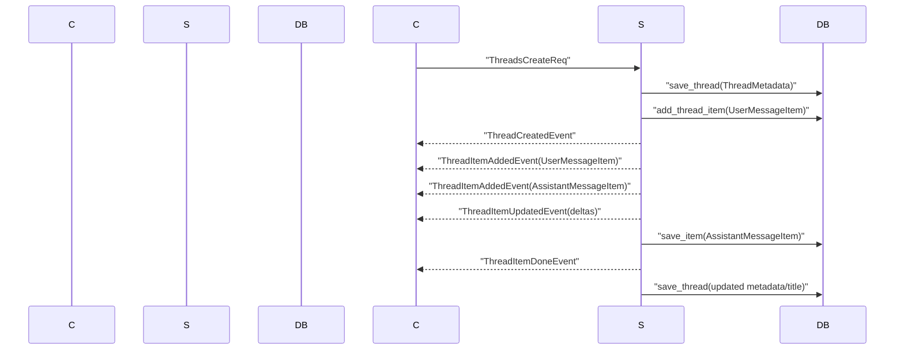
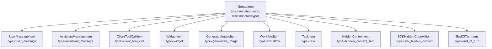
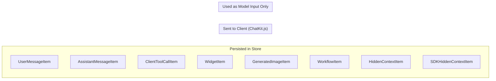
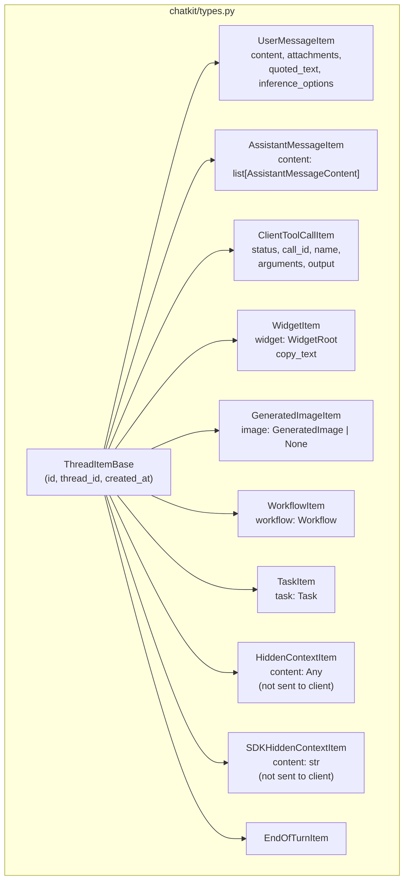

<!-- source: DeepWiki mcp.deepwiki.com · repo openai/chatkit-python · page 2.4 Threads and Thread Items · fetched 2026-10-26 -->

# Threads and Thread Items

<details>
<summary>Relevant source files</summary>

The following files were used as context for generating this wiki page:

- [chatkit/server.py](chatkit/server.py)
- [chatkit/types.py](chatkit/types.py)
- [docs/concepts/threads.md](docs/concepts/threads.md)

</details>


This page covers the `Thread` and `ThreadItem` data models: their fields, subtypes, lifecycle, and how hidden items are handled. For the request types that create and mutate threads, see [Request and Response Flow](). For the streaming events emitted as items are built, see [Streaming Events](). For the storage interface that persists these objects, see [Storage Interfaces]().

---

## What Is a Thread?

A **thread** is the top-level container for a single conversation. It holds ordered metadata and a paginated list of **thread items**. Two Pydantic classes in [chatkit/types.py]() represent it:

| Class | Purpose |
|---|---|
| `ThreadMetadata` | Scalar fields only — id, title, timestamps, status |
| `Thread` | Extends `ThreadMetadata` with `items: Page[ThreadItem]` |

`Thread` is what is returned to the client. `ThreadMetadata` is what the `Store` works with internally when listing threads or updating metadata without loading items.

**`ThreadMetadata` fields** ([chatkit/types.py:558-566]()):

| Field | Type | Description |
|---|---|---|
| `id` | `str` | Unique identifier |
| `title` | `str \| None` | Human-readable title, often set during `respond` |
| `created_at` | `datetime` | Creation timestamp |
| `status` | `ThreadStatus` | Lifecycle state (see below) |
| `metadata` | `dict[str, Any]` | Arbitrary integration metadata |

Sources: [chatkit/types.py:558-600](), [chatkit/store.py:81-99]()

---

## Thread Lifecycle and Status

`ThreadStatus` is a discriminated union on the `type` field:

**Thread status model:**

```mermaid
stateDiagram-v2
    [*] --> "ActiveStatus[type=active]"
    "ActiveStatus[type=active]" --> "LockedStatus[type=locked]"
    "ActiveStatus[type=active]" --> "ClosedStatus[type=closed]"
    "LockedStatus[type=locked]" --> "ActiveStatus[type=active]"
```

| Status Class | `type` Literal | Fields | Meaning |
|---|---|---|---|
| `ActiveStatus` | `"active"` | — | Thread accepts new messages |
| `LockedStatus` | `"locked"` | `reason: str \| None` | Thread is read-only temporarily |
| `ClosedStatus` | `"closed"` | `reason: str \| None` | Thread is permanently closed |

The default status at creation is `ActiveStatus` (see [chatkit/types.py:564]()).

Sources: [chatkit/types.py:569-593]()

---

## Thread Lifecycle



Key points:
- Items are persisted by `ChatKitServer` automatically in response to streaming events (`ThreadItemDoneEvent`, `ThreadItemAddedEvent`, etc.).
- Thread metadata (title, status) is written by calling `Store.save_thread`.
- Deleted items (e.g. on retry) are removed via `Store.delete_thread_item`.

Sources: [chatkit/store.py:82-162](), [docs/concepts/threads.md:29-35]()

---

## ThreadItem: The Discriminated Union

`ThreadItem` is a `typing_extensions.Annotated` discriminated union keyed on the `type` field:

[chatkit/types.py:703-716]()

**Diagram: ThreadItem subtypes and their `type` discriminators**



All subtypes inherit from `ThreadItemBase` ([chatkit/types.py:605-611]()), which provides:

| Field | Type |
|---|---|
| `id` | `str` |
| `thread_id` | `str` |
| `created_at` | `datetime` |

Sources: [chatkit/types.py:602-716]()

---

## ThreadItem Subtypes

### UserMessageItem

Represents a single user turn. Created by `ChatKitServer` when handling `ThreadsCreateReq` or `ThreadsAddUserMessageReq`.

[chatkit/types.py:613-620]()

| Field | Type | Notes |
|---|---|---|
| `content` | `list[UserMessageContent]` | Text and/or tag segments |
| `attachments` | `list[Attachment]` | File or image attachments |
| `quoted_text` | `str \| None` | Optional reply context |
| `inference_options` | `InferenceOptions` | Model and tool choice overrides |

`UserMessageContent` is itself a union of `UserMessageTextContent` (plain text) and `UserMessageTagContent` (@-mention tags). See [Entities and Annotations]() for tag details.

`InferenceOptions` allows per-message model selection and tool-choice overrides via `model: str | None` and `tool_choice: ToolChoice | None`.

---

### AssistantMessageItem

Represents assistant output. Content arrives incrementally during streaming and is finalized at `ThreadItemDoneEvent`.

[chatkit/types.py:623-628]()

| Field | Type | Notes |
|---|---|---|
| `content` | `list[AssistantMessageContent]` | One or more text parts with annotations |

Each `AssistantMessageContent` element ([chatkit/types.py:722-727]()) holds:

| Field | Type |
|---|---|
| `text` | `str` (Markdown) |
| `annotations` | `list[Annotation]` |
| `type` | `"output_text"` |

`Annotation` objects carry an `index` (character position) and a `source` which is one of `URLSource`, `FileSource`, or `EntitySource`. See [Entities and Annotations]() for the full annotation model.

---

### ClientToolCallItem

Represents an in-progress or completed call to a client-side tool (a tool whose implementation runs in the browser).

[chatkit/types.py:630-638]()

| Field | Type | Notes |
|---|---|---|
| `status` | `"pending" \| "completed"` | Updated when client submits output |
| `call_id` | `str` | Matches the model's tool call id |
| `name` | `str` | Tool name |
| `arguments` | `dict[str, Any]` | Parsed arguments |
| `output` | `Any \| None` | Populated after client responds |

The client submits output via `ThreadsAddClientToolOutputReq`, which updates the item's status and `output` field.

---

### WidgetItem

Holds structured UI widget content produced by the server via `stream_widget` or `diff_widget`.

[chatkit/types.py:641-647]()

| Field | Type | Notes |
|---|---|---|
| `widget` | `WidgetRoot` | The root widget component tree |
| `copy_text` | `str \| None` | Optional plain-text copy for clipboard |

For widget authoring details, see [Widgets and UI Components]().

---

### GeneratedImageItem

Created when the Agents SDK produces an `image_generation_call` event. The `image` field starts as `None` and is populated via `GeneratedImageUpdated` stream events.

[chatkit/types.py:656-661]()

| Field | Type |
|---|---|
| `image` | `GeneratedImage \| None` |

`GeneratedImage` contains an `id` and a `url` ([chatkit/types.py:649-653]()). See [Image Generation]() for the full conversion pipeline.

---

### WorkflowItem

Groups one or more `Task` objects into a collapsible workflow step display. Created and updated via the `AgentContext` workflow API.

[chatkit/types.py:670-675]()

| Field | Type |
|---|---|
| `workflow` | `Workflow` |

`Workflow` ([chatkit/types.py:852-858]()) contains:

| Field | Type |
|---|---|
| `type` | `"custom" \| "reasoning"` |
| `tasks` | `list[Task]` |
| `summary` | `WorkflowSummary \| None` |
| `expanded` | `bool` |

For the full workflow API, see [Workflows and Tasks]().

---

### TaskItem

A standalone wrapper around a single `Task`. Less common than `WorkflowItem`; the `workflow` container is typically preferred.

[chatkit/types.py:663-668]()

---

### Hidden Context Items

These items are **never sent to the React client**. They exist only in the server-side store and in model input construction.

**Diagram: Visibility of item types**



| Class | `type` | Owner | `content` type |
|---|---|---|---|
| `HiddenContextItem` | `"hidden_context_item"` | Your integration | `Any` |
| `SDKHiddenContextItem` | `"sdk_hidden_context"` | ChatKit SDK internals | `str` |

[chatkit/types.py:683-701]()

**`HiddenContextItem`** is for application-level hidden state: widget action results, selection state, system signals — anything the model needs to see but the user should not. Its `content` is arbitrary and your `ThreadItemConverter` is responsible for serializing it to model input.

**`SDKHiddenContextItem`** stores serialized state that the ChatKit Python SDK needs for its own operations (e.g. tracking tool call mappings). Its `content` is a JSON string managed internally by the SDK. Most integrations do not need to interact with it directly unless overriding `ThreadItemConverter`.

The `StoreItemType` literal in [chatkit/store.py:17-25]() includes `"sdk_hidden_context"` for ID generation, and the `_ID_PREFIXES` map assigns it the prefix `"shcx"`.

Sources: [chatkit/types.py:683-701](), [chatkit/store.py:17-25](), [docs/concepts/threads.md:89-98]()

---

### EndOfTurnItem

A lightweight marker item (`type = "end_of_turn"`) that signals the assistant has finished its turn. It has no payload fields beyond the base fields.

[chatkit/types.py:677-681]()

---

## Summary: ThreadItem Type Reference



| Type | `type` literal | Rendered in UI | Used in model input |
|---|---|---|---|
| `UserMessageItem` | `user_message` | ✓ | ✓ |
| `AssistantMessageItem` | `assistant_message` | ✓ | ✓ |
| `ClientToolCallItem` | `client_tool_call` | ✓ | ✓ |
| `WidgetItem` | `widget` | ✓ | ✓ (summarized) |
| `GeneratedImageItem` | `generated_image` | ✓ | ✓ |
| `WorkflowItem` | `workflow` | ✓ | ✓ (summarized) |
| `TaskItem` | `task` | ✓ | ✓ |
| `HiddenContextItem` | `hidden_context_item` | ✗ | ✓ |
| `SDKHiddenContextItem` | `sdk_hidden_context` | ✗ | ✓ |
| `EndOfTurnItem` | `end_of_turn` | ✗ | ✓ |

Sources: [chatkit/types.py:603-716](), [chatkit/store.py:17-36](), [docs/concepts/threads.md:52-115]()

---

## Pagination: `Page[T]`

Both `Thread.items` and `Store.load_thread_items` use the `Page` generic ([chatkit/types.py:24-29]()):

| Field | Type | Meaning |
|---|---|---|
| `data` | `list[T]` | Current page of records |
| `has_more` | `bool` | Whether another page exists |
| `after` | `str \| None` | Cursor id for the next page |

`Store.load_thread_items` accepts `after`, `limit`, and `order` parameters. The default sort order for `ItemsListReq` is `"desc"` (newest first).

Sources: [chatkit/types.py:24-29](), [chatkit/store.py:95-101]()

---

## Converting Thread Items to Model Input

The `ThreadItemConverter` class in `chatkit.agents` translates stored `ThreadItem` objects into the input format expected by the Agents SDK. The default implementation handles all built-in item types. Custom behavior can be added by subclassing it.

For the full conversion pipeline including attachment and tag handling, see [Agent Integration]().

Sources: [docs/concepts/threads.md:106-115]()

---

