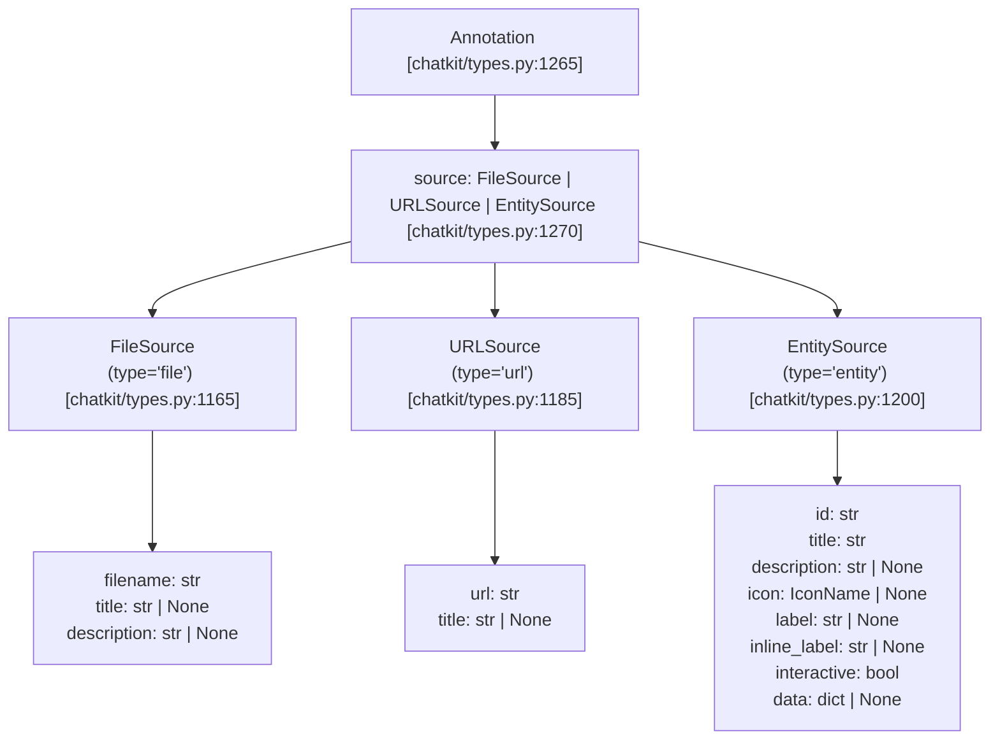
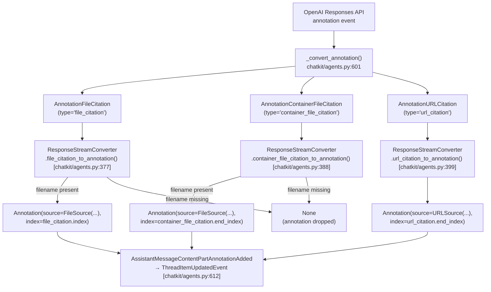
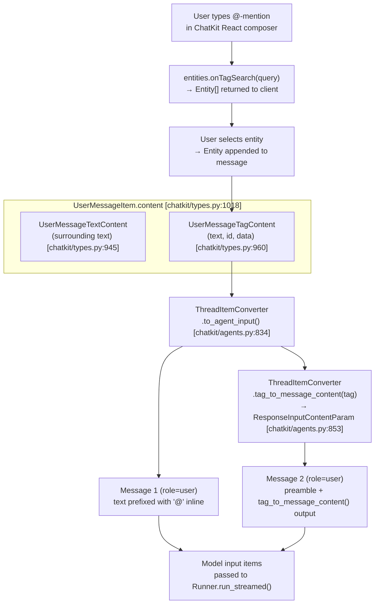
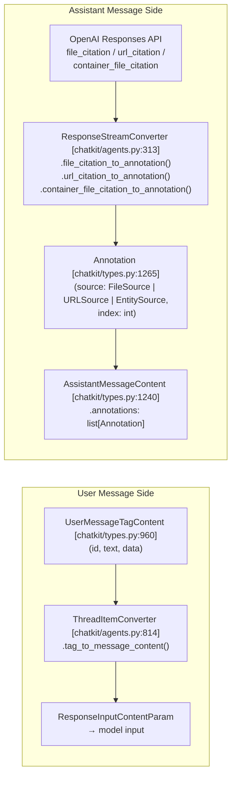

<!-- source: DeepWiki mcp.deepwiki.com · repo openai/chatkit-python · page 2.5 Entities and Annotations · fetched 2026-10-26 -->

# Entities and Annotations

<details>
<summary>Relevant source files</summary>

The following files were used as context for generating this wiki page:

- [chatkit/agents.py](chatkit/agents.py)
- [chatkit/types.py](chatkit/types.py)
- [docs/concepts/entities.md](docs/concepts/entities.md)
- [docs/guides/accept-rich-user-input.md](docs/guides/accept-rich-user-input.md)
- [docs/guides/add-annotations.md](docs/guides/add-annotations.md)
- [tests/test_agents.py](tests/test_agents.py)

</details>


This page covers the two ways structured entity information flows through the ChatKit type system:

1. **Annotations** — inline citation markers attached to `AssistantMessageItem` content, referencing files, URLs, or custom application entities.
2. **UserMessageTagContent** — structured @-mention tags embedded in user messages, resolved server-side into model input.

For the broader `AssistantMessageItem` and `UserMessageItem` data models, see [page 2.4](chatkit/types.py:1000-1100). For the streaming events that carry annotation updates to the client, see [page 2.3](chatkit/types.py:500-600). For the `ThreadItemConverter` and `ResponseStreamConverter` APIs in full, see [page 4.1](chatkit/agents.py:313-410).

---

## The Annotation Model

An `Annotation` attaches a citation to a character position within an `AssistantMessageContent` text block [chatkit/types.py:1260-1275](). Every `AssistantMessageContent` carries a list of annotations [chatkit/types.py:1240-1255]().

| Field    | Type                                          | Description |
|----------|-----------------------------------------------|-------------|
| `source` | `FileSource | URLSource | EntitySource`     | The citation target (discriminated union) [chatkit/types.py:1270-1272]() |
| `index`  | `int`                                         | Character offset in the text where the footnote marker is placed [chatkit/types.py:1274-1275]() |

Multiple annotations sharing the same `index` are grouped as a single numbered footnote in the UI [docs/guides/add-annotations.md:104-105]().

### Source Types

**Source type comparison:**

The following diagram maps conceptual citation kinds to their Python code types.

#### Annotation Source Union



Sources: [chatkit/types.py:1165-1235](), [chatkit/agents.py:51-88](), [docs/guides/add-annotations.md:1-162]()

| Source type   | Rendered as                                                              | When to use |
|---------------|--------------------------------------------------------------------------|-------------|
| `FileSource`  | File name with icon; optional title and description in popover           | Uploaded documents, file search results [chatkit/types.py:1165-1180]() |
| `URLSource`   | Link with title in popover                                               | Web search results, external URLs [chatkit/types.py:1185-1195]() |
| `EntitySource`| Custom icon or inline label; click/preview callbacks when `interactive=True` | Application domain objects (documents, tickets, customers, etc.) [chatkit/types.py:1200-1235]() |

---

## Annotations in Assistant Messages

### Attaching Annotations Statically

When building an `AssistantMessageItem` directly in `respond`, populate `annotations` on each `AssistantMessageContent` [docs/guides/add-annotations.md:66-102]():

```python
AssistantMessageContent(
    text="...",
    annotations=[
        Annotation(source=FileSource(filename="q1_report.pdf", title="Q1 Report"), index=42),
        Annotation(source=URLSource(url="https://example.com", title="Press release"), index=42),
    ]
)
```

The `index` is a character offset. Reuse the same `index` across multiple annotations to group them under one footnote number [docs/guides/add-annotations.md:104-105]().

Sources: [docs/guides/add-annotations.md:64-102]()

### Model-Emitted Citations via `ResponseStreamConverter`

When `stream_agent_response` processes a streaming Agents SDK run, it intercepts `response.output_text.annotation.added` events from the OpenAI Responses API and converts them into ChatKit `Annotation` objects [chatkit/agents.py:601-619]().

The conversion is handled by `ResponseStreamConverter` in [chatkit/agents.py:313-410]().

#### Citation Conversion Pipeline



Sources: [chatkit/agents.py:436-454](), [chatkit/agents.py:601-619](), [docs/guides/add-annotations.md:7-14]()

#### `ResponseStreamConverter` Overridable Methods

| Method | Input type | Default behavior |
|---|---|---|
| `file_citation_to_annotation` | `AnnotationFileCitation` | Returns `Annotation(source=FileSource(filename=..., title=filename))`, or `None` if `filename` is empty [chatkit/agents.py:377-386]() |
| `container_file_citation_to_annotation` | `AnnotationContainerFileCitation` | Same as above using `end_index` [chatkit/agents.py:388-397]() |
| `url_citation_to_annotation` | `AnnotationURLCitation` | Returns `Annotation(source=URLSource(url=..., title=...))` [chatkit/agents.py:399-410]() |

Override these methods on a `ResponseStreamConverter` subclass to enrich metadata (e.g., add descriptions from an internal file registry) or replace the source type (e.g., return an `EntitySource` with `interactive=True` to wire click callbacks) [docs/guides/add-annotations.md:16-59]().

### Annotation Index Tracking During Streaming

`stream_agent_response` maintains an internal `item_annotation_count` counter per `(item_id, content_index)` pair [chatkit/agents.py:485-487](). This ensures annotation indices remain correct even when some annotations are dropped (e.g., file citations with no filename). The count only increments when an `Annotation` object is successfully produced [chatkit/agents.py:604-618]().

---

## EntitySource: Custom Entity Annotations

`EntitySource` extends the annotation concept to first-class application domain objects [chatkit/types.py:1200-1235](). It is the server-side counterpart to the `Entity` type in the client SDK.

**Key UI fields on `EntitySource`:**

| Field          | Type           | Effect |
|----------------|----------------|--------|
| `icon`         | `IconName | None` | Icon shown in the inline citation and popover [chatkit/types.py:1216]() |
| `label`        | `str | None`  | Override the popover header label [chatkit/types.py:1218]() |
| `inline_label` | `str | None`  | Show a text label inline instead of an icon [chatkit/types.py:1220]() |
| `interactive`  | `bool`         | When `True`, wires `entities.onClick` and `entities.onRequestPreview` client callbacks [chatkit/types.py:1222]() |
| `data`         | `dict | None` | Free-form payload forwarded to client-side entity callbacks [chatkit/types.py:1224]() |

When `interactive=True`, the `data` field is passed verbatim to the `entities.onClick` and `entities.onRequestPreview` callbacks configured in `ChatKitOptions` on the React side [docs/guides/add-annotations.md:161-162]().

Sources: [chatkit/types.py:1200-1235](), [docs/guides/add-annotations.md:106-161](), [docs/concepts/entities.md:1-31]()

---

## UserMessageTagContent: @-Mention Tags in User Messages

`UserMessageTagContent` represents an @-mention the user selected from the composer's entity search dropdown [chatkit/types.py:960-975]().

### Tag Data Model

| Field  | Type     | Description |
|--------|----------|-------------|
| `type` | `str`    | Always `"input_tag"` [chatkit/types.py:961]() |
| `text` | `str`    | The display text of the entity as shown in the composer [chatkit/types.py:963]() |
| `id`   | `str`    | The entity identifier returned by `onTagSearch` [chatkit/types.py:965]() |
| `data` | `dict`   | Arbitrary entity metadata [chatkit/types.py:967]() |

### @-Mention Flow: Client to Model Input



Sources: [chatkit/agents.py:853-862](), [tests/test_agents.py:480-528](), [docs/guides/accept-rich-user-input.md:231-345]()

### How Tags Become Model Input

When `to_agent_input` (or `simple_to_agent_input`) processes a `UserMessageItem` containing `UserMessageTagContent` items:

1. **First message** (role `user`): The tag's `text` is rendered inline as `@{text}` within the user message content [chatkit/agents.py:843]().

2. **Second message** (role `user`): A separate message is emitted containing a system preamble and the output of `ThreadItemConverter.tag_to_message_content(tag)` for each tag [chatkit/agents.py:853-862]().

The default `ThreadItemConverter.tag_to_message_content` raises `NotImplementedError` [chatkit/agents.py:853](). Subclass `ThreadItemConverter` and override this method to resolve the tag to entity content.

### Typical `tag_to_message_content` Implementation Pattern

The method receives the full `UserMessageTagContent` and must return a `ResponseInputContentParam` [chatkit/agents.py:853](). A typical implementation looks up the entity in application storage and returns a `ResponseInputTextParam` wrapping the entity details in structured markup [docs/guides/accept-rich-user-input.md:149-166]().

---

## End-to-End Summary



Sources: [chatkit/agents.py:313-454](), [chatkit/agents.py:601-619](), [chatkit/agents.py:834-862](), [docs/guides/add-annotations.md:1-162](), [docs/guides/accept-rich-user-input.md:231-345](), [docs/concepts/entities.md:1-31]()

---

