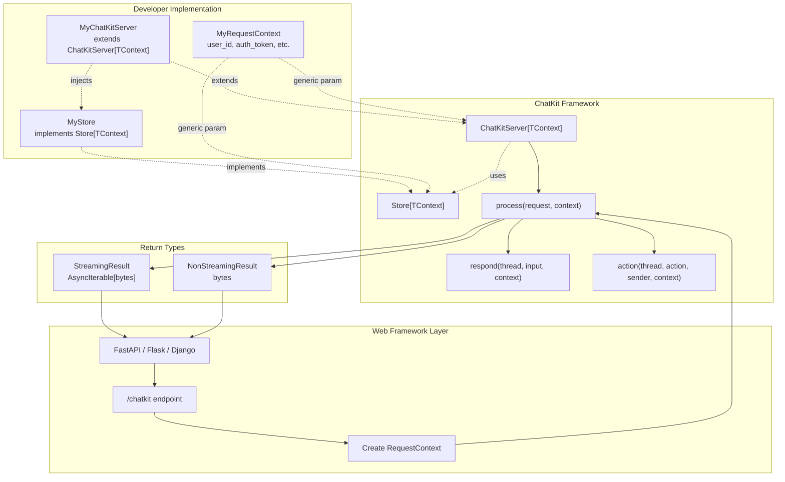
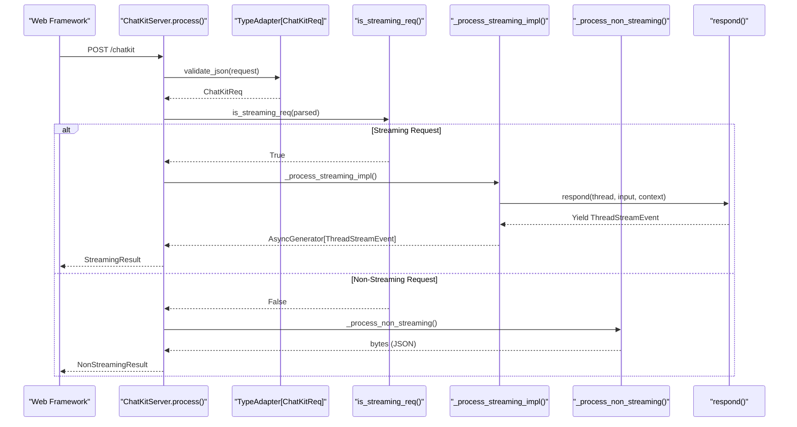

<!-- source: DeepWiki mcp.deepwiki.com · repo openai/chatkit-python · page 3 Server Integration · fetched 2026-10-26 -->

# Server Integration

Relevant source files

The following files were used as context for generating this wiki page:

- [chatkit/server.py](chatkit/server.py)
- [chatkit/store.py](chatkit/store.py)
- [docs/quickstart.md](docs/quickstart.md)
- [mkdocs.yml](mkdocs.yml)
- [tests/helpers/mock_store.py](tests/helpers/mock_store.py)

This page guides developers through implementing a ChatKit backend server by documenting the core abstractions and extension points required to handle conversational AI requests.

Server integration involves implementing two primary abstractions: `ChatKitServer` for request processing and response generation, and `Store` for thread and item persistence. These abstractions are generic over a custom context type, enabling request-scoped data flow, authorization, and multi-tenancy. 

For details on specific components, see:
- [ChatKitServer Class](#3.1) — Full reference for the `ChatKitServer` abstract base class: constructor parameters, all abstract methods (`respond`, `action`, `sync_action`, `add_feedback`, `transcribe`), concrete methods (`process`, `get_stream_options`, `handle_stream_cancelled`), and patterns for subclassing.
- [Storage Interfaces](#3.2) — Document the `Store` and `AttachmentStore` abstract base classes, all method signatures, `StoreItemType`, `NotFoundError`, ID generation utilities (`default_generate_id`, `_ID_PREFIXES`), and the `SQLiteStore` reference implementation used in tests.
- [Request Processing Pipeline](#3.3) — Detailed walkthrough of how `ChatKitServer.process()` deserializes raw bytes into `ChatKitReq`, dispatches to streaming or non-streaming handlers, and what each handler does for every supported request type.
- [Context Management](#3.4) — Explain the `TContext` generic pattern: how to define a custom per-request context dataclass, how it flows through `ChatKitServer`, `Store`, and `AgentContext` method signatures, and how to scope data access (e.g. by `user_id`) using it.

## Overview

A ChatKit server implementation consists of three components:

1.  **Server Class**: Extends `ChatKitServer[TContext]` [chatkit/server.py:275-275]() to define response generation logic.
2.  **Store Implementation**: Implements `Store[TContext]` [chatkit/store.py:68-68]() for thread and item persistence.
3.  **Context Type**: Custom type threaded through all operations for request-scoped data [chatkit/store.py:15-15]().

The server receives HTTP requests via the `process()` method [chatkit/server.py:385-385](), routes them to streaming or non-streaming handlers, delegates persistence to the store, and returns either `StreamingResult` or `NonStreamingResult` to the web framework.

**Server Integration Architecture**

**Sources**: [chatkit/server.py:275-291](), [chatkit/store.py:68-162]()

## Core Abstractions

### ChatKitServer Base Class

`ChatKitServer[TContext]` is an abstract base class that defines the server interface. It is generic over `TContext`, allowing custom request context to flow through all operations.

| Constructor Parameter | Type | Required | Description |
|----------------------|------|----------|-------------|
| `store` | `Store[TContext]` | Yes | Persistence layer for threads and items |
| `attachment_store` | `AttachmentStore[TContext]` | No | File storage layer for attachments |

**Key Methods**

| Method | Type | Required | Description |
|--------|------|----------|-------------|
| `respond()` | Abstract | Yes | Generate response events for user messages |
| `action()` | Virtual | No | Handle widget or client-dispatched actions |
| `sync_action()` | Virtual | No | Handle synchronous actions returning JSON |
| `add_feedback()` | Virtual | No | Process user feedback (thumbs up/down) |
| `transcribe()` | Virtual | No | Handle audio transcription requests |
| `process()` | Final | - | Entrypoint that routes requests to handlers |

**Sources**: [chatkit/server.py:275-384]()

### Store Interface

`Store[TContext]` [chatkit/store.py:68-68]() defines the persistence layer contract. Implementations must handle thread metadata, thread items, and attachments with pagination support via the `Page[T]` model.

**Thread Operations**

| Method | Returns | Description |
|--------|---------|-------------|
| `generate_thread_id(context)` | `str` | Generate new thread identifier |
| `load_thread(thread_id, context)` | `ThreadMetadata` | Load thread metadata by ID |
| `save_thread(thread, context)` | `None` | Persist thread metadata |
| `load_threads(limit, after, order, context)` | `Page[ThreadMetadata]` | Load paginated thread list |
| `delete_thread(thread_id, context)` | `None` | Delete thread and all items |

**Item Operations**

| Method | Returns | Description |
|--------|---------|-------------|
| `generate_item_id(type, thread, context)` | `str` | Generate new item identifier |
| `add_thread_item(thread_id, item, context)` | `None` | Persist new thread item |
| `save_item(thread_id, item, context)` | `None` | Upsert existing thread item |
| `load_item(thread_id, item_id, context)` | `ThreadItem` | Load item by ID |
| `load_thread_items(thread_id, after, limit, order, context)` | `Page[ThreadItem]` | Load paginated items |
| `delete_thread_item(thread_id, item_id, context)` | `None` | Delete item by ID |

**Sources**: [chatkit/store.py:68-163]()

### AttachmentStore Interface

`AttachmentStore[TContext]` [chatkit/store.py:48-48]() is an optional interface for managing file uploads. When configured, it handles physical file storage separate from metadata.

| Method | Returns | Description |
|--------|---------|-------------|
| `generate_attachment_id(mime_type, context)` | `str` | Generate new attachment identifier |
| `create_attachment(params, context)` | `Attachment` | Process file upload and return metadata |
| `delete_attachment(attachment_id, context)` | `None` | Delete physical file |

**Sources**: [chatkit/store.py:48-66](), [chatkit/server.py:285-291]()

## Implementation Pattern

**Implementation Steps**

1.  **Define Context Type**: Create a class or dataclass containing request-scoped data (user ID, authentication, database session, etc.).
2.  **Implement Store**: Subclass `Store[TContext]` [chatkit/store.py:68-68]() and implement all abstract methods. Use the context parameter to filter data by tenant or perform authorization.
3.  **Implement Server**: Subclass `ChatKitServer[TContext]` [chatkit/server.py:275-275]() and implement the required `respond()` method.
4.  **Wire to Web Framework**: Create an HTTP endpoint that calls `server.process(request_body, context)` [chatkit/server.py:385-385]() and returns the result as either SSE or JSON.

For a detailed walkthrough, see [Context Management](#3.4).

**Sources**: [docs/quickstart.md:71-106](), [chatkit/server.py:385-397]()

## Request Processing Flow

The `process()` method [chatkit/server.py:385-385]() is the entrypoint for all ChatKit requests. It parses the request body, determines if it is streaming or non-streaming via `is_streaming_req()` [chatkit/types.py:1022-1022](), and routes to the appropriate handler.

**Request Routing Flow**

**Sources**: [chatkit/server.py:385-477](), [chatkit/server.py:479-773]()

### Streaming vs Non-Streaming

Streaming requests yield `ThreadStreamEvent` [chatkit/types.py:848-848]() instances over time and are returned as Server-Sent Events. These include message creation and tool outputs. Non-streaming requests execute synchronous CRUD operations (like listing threads or adding feedback) and return JSON.

For a deep dive into the routing logic, see [Request Processing Pipeline](#3.3).

## Extension Points

`ChatKitServer` provides several extension points for custom behavior. Only `respond()` is required; all other methods are optional.

| Method | Purpose |
|--------|---------|
| `respond()` | Generates the server's response to a user message [chatkit/server.py:293-293](). |
| `action()` | Handles widget or custom client actions [chatkit/server.py:322-322](). |
| `sync_action()` | Handles synchronous actions returning a JSON payload [chatkit/server.py:344-344](). |
| `add_feedback()` | Processes user feedback (thumbs up/down) on items [chatkit/server.py:312-312](). |
| `transcribe()` | Handles audio transcription [chatkit/server.py:356-356](). |

For details on method signatures and patterns, see [ChatKitServer Class](#3.1).

## Helper Functions

### stream_widget()

Converts a `WidgetRoot` [chatkit/widgets.py:410-410]() or async generator of `WidgetRoot` into `ThreadStreamEvent` instances [chatkit/server.py:200-200](). It uses `diff_widget()` [chatkit/server.py:96-96]() to produce incremental updates.

**Sources**: [chatkit/server.py:194-243]()

### diff_widget()

Compares two `WidgetRoot` instances and returns a list of delta events [chatkit/server.py:96-96](). It generates `WidgetStreamingTextValueDelta` [chatkit/types.py:756-756]() for incremental text updates.

**Sources**: [chatkit/server.py:90-191]()

---

