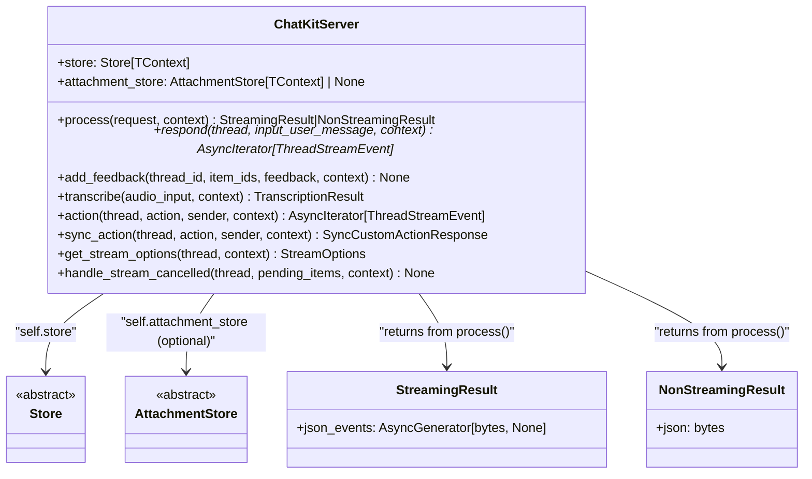
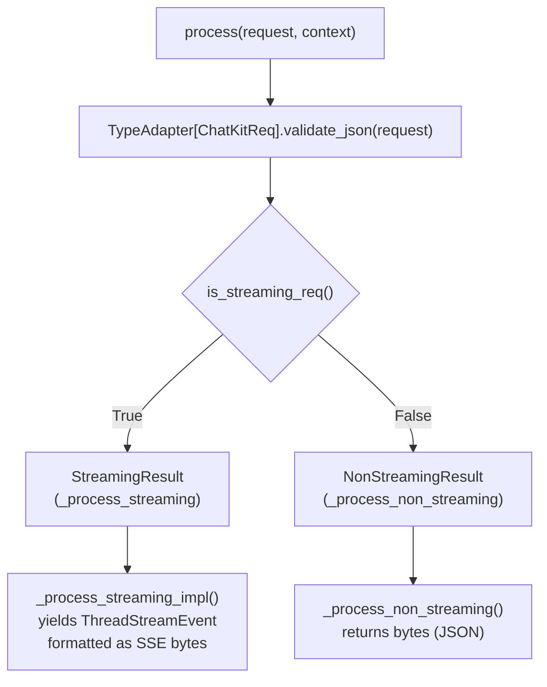
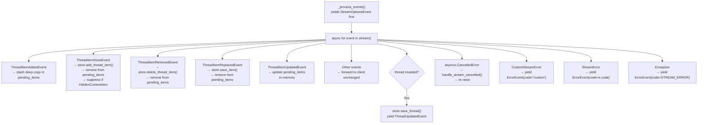
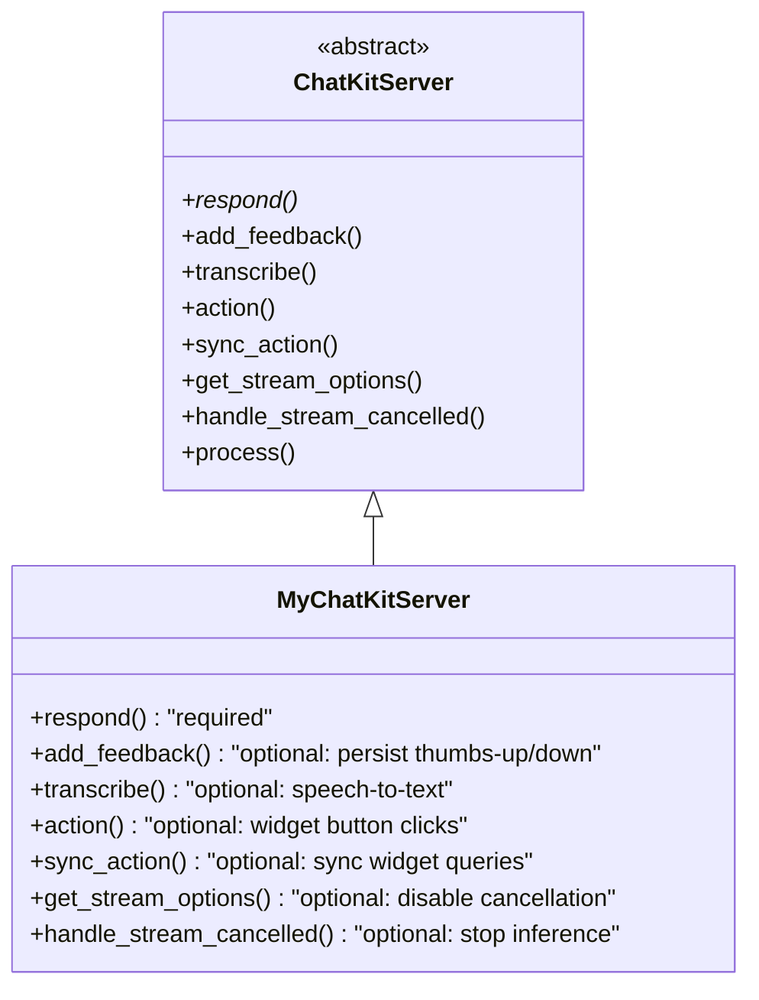

<!-- source: DeepWiki mcp.deepwiki.com · repo openai/chatkit-python · page 3.1 ChatKitServer Class · fetched 2026-10-26 -->

# ChatKitServer Class

<details>
<summary>Relevant source files</summary>

The following files were used as context for generating this wiki page:

- [chatkit/server.py](chatkit/server.py)
- [docs/guides/respond-to-user-message.md](docs/guides/respond-to-user-message.md)
- [docs/guides/stream-generated-images.md](docs/guides/stream-generated-images.md)
- [tests/test_chatkit_server.py](tests/test_chatkit_server.py)

</details>


This page is a full reference for the `ChatKitServer` abstract base class defined in [chatkit/server.py:281-289](). It covers the constructor, all overridable methods, the `process()` entry point, and patterns for subclassing. It does not cover the `Store` or `AttachmentStore` interfaces (see [3.2]()), the `TContext` generic pattern in depth (see [3.4]()), or the full request routing pipeline (see [3.3]()).

---

## Overview

`ChatKitServer` is the central class in `chatkit.server`. It is an abstract base class that:

- Receives raw HTTP request bodies from the client [chatkit/server.py:423-426]()
- Deserializes them into typed `ChatKitReq` instances [chatkit/server.py:427-428]()
- Dispatches to streaming or non-streaming internal handlers [chatkit/server.py:430-435]()
- Manages persistence of thread items via `Store` [chatkit/server.py:771-791]()
- Calls user-defined methods (`respond`, `action`, etc.) to generate responses [chatkit/server.py:299-316]()

You subclass `ChatKitServer`, implement at minimum `respond`, and expose a single HTTP endpoint that calls `process()`.

`ChatKitServer` is generic over `TContext` — a per-request context object you define. This context is threaded through every method call including `Store` operations [chatkit/server.py:281]().

---

## Class Hierarchy and Type Parameters

**Class declaration:** [chatkit/server.py:281-289]()

```python
ChatKitServer(ABC, Generic[TContext])
```

| Symbol | Description |
|---|---|
| `TContext` | TypeVar (default `Any`). Represents the per-request context type. |
| `Store[TContext]` | Required. Persists threads and items. |
| `AttachmentStore[TContext]` | Optional. Manages file uploads/deletions. |

**Class definition diagram:**



Sources: [chatkit/server.py:264-290]()

---

## Constructor

[chatkit/server.py:282-289]()

```python
ChatKitServer.__init__(
    store: Store[TContext],
    attachment_store: AttachmentStore[TContext] | None = None
)
```

| Parameter | Type | Required | Description |
|---|---|---|---|
| `store` | `Store[TContext]` | Yes | Persists threads, items, and attachments. |
| `attachment_store` | `AttachmentStore[TContext] \| None` | No | Handles file upload/delete operations. Required if clients send file attachments. |

`attachment_store` is only needed if you handle `AttachmentsCreateReq` or `AttachmentsDeleteReq` requests. Calling `process()` with those request types without a configured `attachment_store` raises a `RuntimeError` [chatkit/server.py:511-512]().

Sources: [chatkit/server.py:282-297]()

---

## Abstract Method: `respond`

[chatkit/server.py:299-316]()

This is the only method you **must** implement. It is called on every new user turn and must yield `ThreadStreamEvent` instances.

```python
respond(
    thread: ThreadMetadata,
    input_user_message: UserMessageItem | None,
    context: TContext,
) -> AsyncIterator[ThreadStreamEvent]
```

| Parameter | Type | Description |
|---|---|---|
| `thread` | `ThreadMetadata` | Metadata for the current thread. Mutating `thread.title` or `thread.metadata` during this call causes `ChatKitServer` to persist and emit a `ThreadUpdatedEvent` [chatkit/server.py:814-825](). |
| `input_user_message` | `UserMessageItem \| None` | The triggering user message. `None` when responding to a client tool output (`ThreadsAddClientToolOutputReq`) or a retry. |
| `context` | `TContext` | The per-request context passed to `process()`. |

**When `respond` is called:**

| Request Type | `input_user_message` value |
|---|---|
| `ThreadsCreateReq` | The new `UserMessageItem` [chatkit/server.py:441]() |
| `ThreadsAddUserMessageReq` | The new `UserMessageItem` [chatkit/server.py:447]() |
| `ThreadsAddClientToolOutputReq` | `None` [chatkit/server.py:453]() |
| `ThreadsRetryAfterItemReq` | The original `UserMessageItem` being retried [chatkit/server.py:461-464]() |

**Key behavior inside `_process_events`:**

The server iterates the `AsyncIterator[ThreadStreamEvent]` returned by `respond` and automatically:
- Persists `ThreadItemDoneEvent` items via `store.add_thread_item()` [chatkit/server.py:778-782]()
- Removes items on `ThreadItemRemovedEvent` via `store.delete_thread_item()` [chatkit/server.py:787-789]()
- Updates items on `ThreadItemReplacedEvent` via `store.save_item()` [chatkit/server.py:783-786]()
- Suppresses `HiddenContextItem` and `SDKHiddenContextItem` done events from reaching the client [chatkit/server.py:772-777]()
- Detects mutations to `thread` and emits a `ThreadUpdatedEvent` after the next event [chatkit/server.py:814-825]()

Sources: [chatkit/server.py:299-316](), [chatkit/server.py:755-852]()

---

## Overridable Methods

These methods have default implementations but are designed to be overridden.

### `add_feedback`

[chatkit/server.py:318-325]()

```python
async add_feedback(
    thread_id: str,
    item_ids: list[str],
    feedback: FeedbackKind,
    context: TContext,
) -> None
```

Called when the client submits feedback (thumbs up/down) on one or more items [chatkit/server.py:614-620](). The default implementation is a no-op. Override to persist feedback in your datastore.

`FeedbackKind` is a literal type: `"positive"` or `"negative"`.

Sources: [chatkit/server.py:318-325]()

---

### `transcribe`

[chatkit/server.py:328-345]()

```python
async transcribe(
    audio_input: AudioInput,
    context: TContext,
) -> TranscriptionResult
```

Called when the client sends an `InputTranscribeReq` [chatkit/server.py:644-645](). The default implementation raises `NotImplementedError`. Override to integrate with a speech-to-text service.

| Field on `AudioInput` | Description |
|---|---|
| `data` | Raw audio bytes |
| `mime_type` | Full MIME type (e.g. `audio/webm; codecs=opus`) |
| `media_type` | Base media type only (one of `audio/webm`, `audio/ogg`, `audio/mp4`) |

Return a `TranscriptionResult` whose `text` field is what appears in the composer.

Sources: [chatkit/server.py:328-345]()

---

### `action`

[chatkit/server.py:347-358]()

```python
action(
    thread: ThreadMetadata,
    action: Action[str, Any],
    sender: WidgetItem | None,
    context: TContext,
) -> AsyncIterator[ThreadStreamEvent]
```

Called when the client dispatches an async custom action (`ThreadsCustomActionReq`) [chatkit/server.py:469-472](). The default raises `NotImplementedError`. Override to handle widget button clicks and other client-side action triggers.

`sender` is the `WidgetItem` the action was dispatched from, or `None` if no sender item was identified.

The return value is streamed exactly like `respond` — events are persisted and forwarded to the client.

Sources: [chatkit/server.py:347-358]()

---

### `sync_action`

[chatkit/server.py:360-371]()

```python
async sync_action(
    thread: ThreadMetadata,
    action: Action[str, Any],
    sender: WidgetItem | None,
    context: TContext,
) -> SyncCustomActionResponse
```

Called when the client dispatches a synchronous custom action (`ThreadsSyncCustomActionReq`) [chatkit/server.py:633-636](). Unlike `action`, this is a regular `async` method that returns a `SyncCustomActionResponse` JSON blob instead of a stream. Used for low-latency query/response interactions with widget components.

Sources: [chatkit/server.py:360-371]()

---

### `get_stream_options`

[chatkit/server.py:373-380]()

```python
def get_stream_options(
    thread: ThreadMetadata,
    context: TContext,
) -> StreamOptions
```

Returns `StreamOptions` emitted to the client at the start of each streaming response [chatkit/server.py:756](). The default returns `StreamOptions(allow_cancel=True)`. Override to control whether the client is allowed to cancel the stream for a given thread.

Sources: [chatkit/server.py:373-380]()

---

### `handle_stream_cancelled`

[chatkit/server.py:382-421]()

```python
async handle_stream_cancelled(
    thread: ThreadMetadata,
    pending_items: list[ThreadItem],
    context: TContext,
) -> None
```

Called when the stream is cancelled (i.e., `asyncio.CancelledError` is raised inside `_process_events`) [chatkit/server.py:827-828](). `pending_items` contains all items that were yielded via `ThreadItemAddedEvent` but have not yet been finalized by a `ThreadItemDoneEvent`.

**Default behavior:**
1. For each `AssistantMessageItem` in `pending_items` that contains non-empty text, persist it via `store.add_thread_item()` [chatkit/server.py:393-408]().
2. Append an `SDKHiddenContextItem` to the thread with the text: `"The user cancelled the stream. Stop responding to the prior request."` — this prevents the model from continuing the cancelled response on the next turn [chatkit/server.py:410-421]().

Override to add custom cleanup logic (e.g., stopping a running inference process).

> **Note:** Any store writes made in `handle_stream_cancelled` will not be reflected in the UI until the user reloads, because the HTTP response has already been terminated.

Sources: [chatkit/server.py:382-421]()

---

## Entry Point: `process`

[chatkit/server.py:423-435]()

```python
async process(
    request: str | bytes | bytearray,
    context: TContext,
) -> StreamingResult | NonStreamingResult
```

The single public method called by your HTTP endpoint handler. It:

1. Deserializes `request` into a `ChatKitReq` using the discriminated union defined in `chatkit.types` [chatkit/server.py:427-428]().
2. Logs the request `type` [chatkit/server.py:429]().
3. Dispatches to `_process_streaming` or `_process_non_streaming` based on the request type [chatkit/server.py:430-435]().
4. Returns either a `StreamingResult` (for SSE) or a `NonStreamingResult` (for JSON).

**Dispatch diagram:**



Sources: [chatkit/server.py:423-435](), [chatkit/server.py:527-540]()

---

## Return Types

### `StreamingResult`

[chatkit/server.py:264-270]()

An `AsyncIterable[bytes]` wrapping an `AsyncGenerator[bytes, None]`. Each yielded item is a complete SSE frame: `b"data: " + json_bytes + b"\n\n"` [chatkit/server.py:539]().

Wire it into your web framework as a streaming response with `Content-Type: text/event-stream`.

### `NonStreamingResult`

[chatkit/server.py:273-275]()

A wrapper around a `bytes` field (`.json`). Return it as a normal `application/json` response.

**FastAPI example pattern** (from [docs/guides/respond-to-user-message.md:86-96]()):

```python
result = await server.process(await request.body(), context)
if isinstance(result, StreamingResult):
    return StreamingResponse(result, media_type="text/event-stream")
return Response(content=result.json, media_type="application/json")
```

Sources: [chatkit/server.py:264-275]()

---

## Request Type to Handler Mapping

The following table maps each `ChatKitReq` subtype to the internal handler and the user-overridable method it calls.

**Streaming requests** (return `StreamingResult`):

| `ChatKitReq` type | Internal dispatch | Calls user method |
|---|---|---|
| `ThreadsCreateReq` | `_process_streaming_impl` | `respond()` [chatkit/server.py:441]() |
| `ThreadsAddUserMessageReq` | `_process_streaming_impl` | `respond()` [chatkit/server.py:447]() |
| `ThreadsAddClientToolOutputReq` | `_process_streaming_impl` | `respond()` with `None` [chatkit/server.py:453]() |
| `ThreadsRetryAfterItemReq` | `_process_streaming_impl` | `respond()` [chatkit/server.py:461-464]() |
| `ThreadsCustomActionReq` | `_process_streaming_impl` | `action()` [chatkit/server.py:469-472]() |

**Non-streaming requests** (return `NonStreamingResult`):

| `ChatKitReq` type | Internal dispatch | Calls user method / store method |
|---|---|---|
| `ThreadsGetByIdReq` | `_process_non_streaming` | `store.load_thread()` [chatkit/server.py:545-546]() |
| `ThreadsListReq` | `_process_non_streaming` | `store.load_threads()` [chatkit/server.py:553-554]() |
| `ThreadsUpdateReq` | `_process_non_streaming` | `store.save_thread()` [chatkit/server.py:566-568]() |
| `ThreadsDeleteReq` | `_process_non_streaming` | `store.delete_thread()` [chatkit/server.py:575-576]() |
| `ItemsListReq` | `_process_non_streaming` | `store.load_thread_items()` [chatkit/server.py:586-593]() |
| `ItemsFeedbackReq` | `_process_non_streaming` | `add_feedback()` [chatkit/server.py:614-620]() |
| `AttachmentsCreateReq` | `_process_non_streaming` | `attachment_store.create_attachment()` [chatkit/server.py:656-658]() |
| `AttachmentsDeleteReq` | `_process_non_streaming` | `attachment_store.delete_attachment()` [chatkit/server.py:665-667]() |
| `InputTranscribeReq` | `_process_non_streaming` | `transcribe()` [chatkit/server.py:644-645]() |
| `ThreadsSyncCustomActionReq` | `_process_sync_custom_action` | `sync_action()` [chatkit/server.py:633-636]() |

Sources: [chatkit/server.py:437-716]()

---

## Streaming Event Lifecycle Inside `_process_events`

When `respond()` or `action()` is called, `ChatKitServer` wraps the generator in `_process_events`, which manages persistence and cancellation. The diagram below shows what happens for each event type yielded by your method.

**Event handling flowchart:**



Sources: [chatkit/server.py:755-852]()

---

## Thread Mutation During Streaming

The `thread: ThreadMetadata` parameter passed to `respond()` is a mutable object. If you mutate it during the stream (e.g., set `thread.title = "..."` or update `thread.metadata`), `ChatKitServer` detects the change after each event and automatically:

1. Calls `store.save_thread(thread, context)` [chatkit/server.py:821]()
2. Yields a `ThreadUpdatedEvent` to the client [chatkit/server.py:822-824]()

This is the standard mechanism for updating thread titles and metadata mid-stream, as demonstrated in [tests/test_chatkit_server.py:550-579]().

Sources: [chatkit/server.py:814-825](), [tests/test_chatkit_server.py:550-579]()

---

## Module-Level Helpers

Two module-level functions in `chatkit/server.py` are part of the public API of this module:

### `stream_widget`

[chatkit/server.py:200-249]()

```python
async stream_widget(
    thread: ThreadMetadata,
    widget: WidgetRoot | AsyncGenerator[WidgetRoot, None],
    copy_text: str | None = None,
    generate_id: Callable[[StoreItemType], str] = default_generate_id,
) -> AsyncIterator[ThreadStreamEvent]
```

A helper that wraps a `WidgetRoot` (static) or `AsyncGenerator[WidgetRoot, None]` (streaming) as a sequence of `ThreadStreamEvent` instances suitable for yielding inside `respond()` or `action()`. For streaming generators, it emits `ThreadItemAddedEvent` → one or more `ThreadItemUpdatedEvent` → `ThreadItemDoneEvent`.

### `diff_widget`

[chatkit/server.py:96-197]()

```python
diff_widget(
    before: WidgetRoot,
    after: WidgetRoot,
) -> list[WidgetStreamingTextValueDelta | WidgetRootUpdated | WidgetComponentUpdated]
```

Computes the minimal set of updates between two `WidgetRoot` snapshots [chatkit/server.py:96-101](). Used internally by `stream_widget`. Raises `ValueError` if a node with an ID that existed in `before` is missing from `after` [chatkit/server.py:175-178](), or if a streaming text value in `after` is not a prefix of the value in `before` [chatkit/server.py:185-187]().

Sources: [chatkit/server.py:96-249]()

---

## Subclassing Pattern

The minimal subclass only overrides `respond`. Additional methods are opt-in.

**Structure of a full subclass:**



**Example from the test suite** (`TestChatKitServer` pattern in [tests/test_chatkit_server.py:182-258]()):

```python
class TestChatKitServer(ChatKitServer):
    def __init__(self):
        super().__init__(SQLiteStore(db_path), file_store)

    def respond(self, thread, input_user_message, context):
        return responder(thread, input_user_message, context)

    def action(self, thread, action, sender, context):
        return action_callback(thread, action, sender, context)

    async def sync_action(self, thread, action, sender, context):
        return sync_action_callback(thread, action, sender, context)

    async def add_feedback(self, thread_id, item_ids, feedback, context):
        handle_feedback(thread_id, item_ids, feedback, context)

    async def transcribe(self, audio_input, context):
        return transcribe_callback(audio_input, context)
```

Sources: [tests/test_chatkit_server.py:182-258](), [docs/guides/respond-to-user-message.md:38-68]()

---

## Error Handling

Errors raised inside `respond()` or `action()` are caught by `_process_events` and translated into `ErrorEvent` instances emitted to the client [chatkit/server.py:831-847](). The server does **not** re-raise these exceptions (except `asyncio.CancelledError`).

| Exception type | `ErrorEvent.code` | `allow_retry` |
|---|---|---|
| `CustomStreamError` | `"custom"` | `e.allow_retry` [chatkit/server.py:832-835]() |
| `StreamError` | `e.code` | `e.allow_retry` [chatkit/server.py:836-839]() |
| Any other `Exception` | `ErrorCode.STREAM_ERROR` | `True` [chatkit/server.py:841-846]() |
| `asyncio.CancelledError` | (not emitted) | — |

`CustomStreamError` and `StreamError` are defined in `chatkit.errors`. Use `CustomStreamError` to surface a human-readable message to the client UI.

Sources: [chatkit/server.py:831-847]()

---

