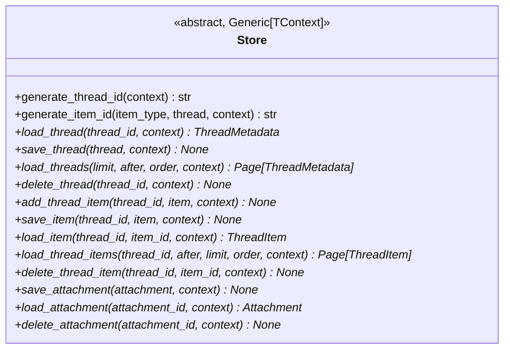
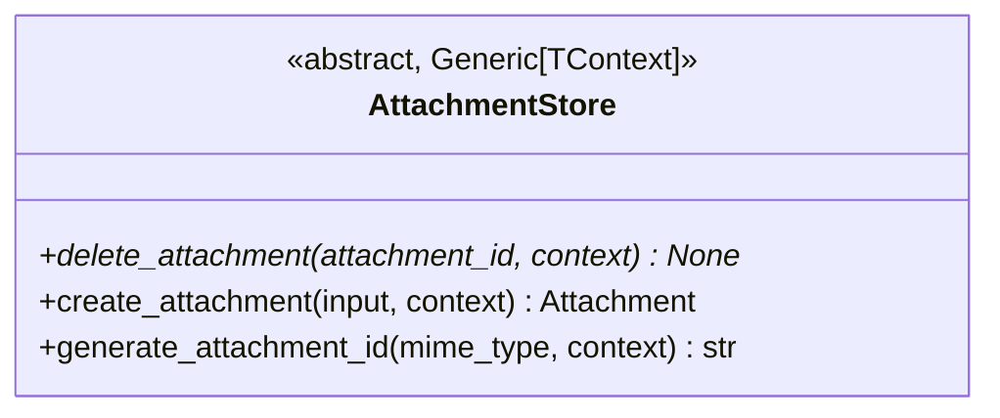
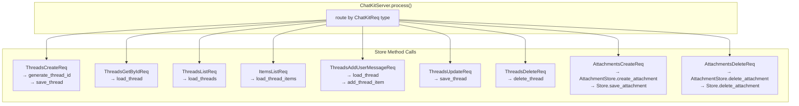
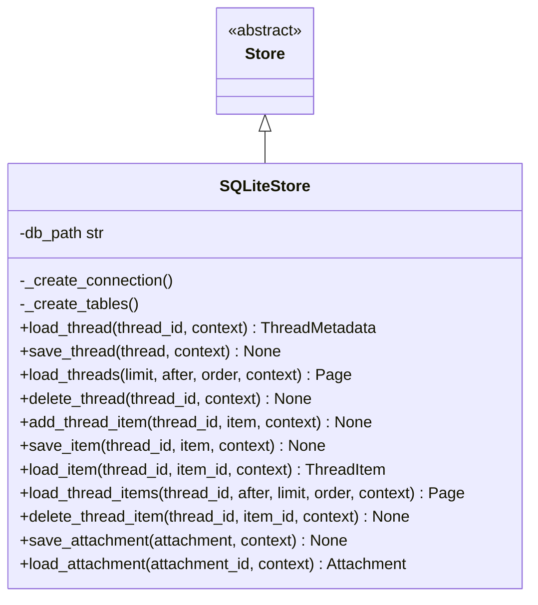

<!-- source: DeepWiki mcp.deepwiki.com · repo openai/chatkit-python · page 3.2 Storage Interfaces · fetched 2026-10-26 -->

# Storage Interfaces

<details>
<summary>Relevant source files</summary>

The following files were used as context for generating this wiki page:

- [chatkit/server.py](chatkit/server.py)
- [chatkit/store.py](chatkit/store.py)
- [tests/helpers/mock_store.py](tests/helpers/mock_store.py)
- [tests/test_store.py](tests/test_store.py)

</details>


This page documents the `chatkit.store` module: the `Store` and `AttachmentStore` abstract base classes, the `NotFoundError` exception, the `StoreItemType` literal, the `_ID_PREFIXES` map, and the `default_generate_id` utility. It also covers the `SQLiteStore` reference implementation used in tests.

For how the server is wired to a store instance, see the `ChatKitServer` class page ([3.1]()). For the context type (`TContext`) that flows into every store method, see [3.4]().

---

## Overview

`ChatKitServer` delegates all persistence to a `Store` instance passed at construction time. The store is responsible for threads, thread items, and attachment metadata. File content itself is handled by the separate `AttachmentStore` interface.

Both classes are generic over a `TContext` type parameter, which is the per-request context your application defines (see [3.4]()). Every method receives the context so you can enforce data isolation (e.g., by `user_id`).

**Module:** [chatkit/store.py]()

---

## `StoreItemType` and ID Prefixes

`StoreItemType` is a `Literal` type that enumerates every kind of object that can be assigned an ID by the store.

[chatkit/store.py:17-36]()

| `StoreItemType` value | Default prefix | Example ID |
|---|---|---|
| `"thread"` | `thr` | `thr_a1b2c3d4` |
| `"message"` | `msg` | `msg_a1b2c3d4` |
| `"tool_call"` | `tc` | `tc_a1b2c3d4` |
| `"workflow"` | `wf` | `wf_a1b2c3d4` |
| `"task"` | `tsk` | `tsk_a1b2c3d4` |
| `"attachment"` | `atc` | `atc_a1b2c3d4` |
| `"sdk_hidden_context"` | `shcx` | `shcx_a1b2c3d4` |

The `_ID_PREFIXES` dict at [chatkit/store.py:28-36]() maps each `StoreItemType` to its prefix string.

### `default_generate_id`

[chatkit/store.py:39-41]()

```python
def default_generate_id(item_type: StoreItemType) -> str:
    prefix = _ID_PREFIXES[item_type]
    return f"{prefix}_{uuid.uuid4().hex[:8]}"
```

Generates an ID using the format `{prefix}_{uuid4().hex[:8]}`. This function is also importable directly and used in tests to generate IDs outside a store instance (e.g., when overriding `generate_item_id` selectively).

Sources: [chatkit/store.py:17-41](), [chatkit/server.py:204-207]()

---

## `NotFoundError`

[chatkit/store.py:44-45]()

A plain exception subclass. Store implementations must raise `NotFoundError` when a requested entity does not exist or is not visible to the provided context. `ChatKitServer` catches it in certain paths to return appropriate error responses to the client.

Sources: [chatkit/store.py:44-45](), [tests/helpers/mock_store.py:92-93](), [tests/test_store.py:109-113]()

---

## `Store` Abstract Base Class

[chatkit/store.py:68-163]()

`Store[TContext]` is the main persistence interface. Subclass it and implement all abstract methods to connect ChatKit to your database.

### Class Diagram

**`Store` class interface**



Methods marked with `*` are abstract and must be implemented. Methods without `*` have default implementations that call `default_generate_id`.

Sources: [chatkit/store.py:68-163]()

### Method Reference

#### ID Generation (concrete, overridable)

| Method | Signature | Description |
|---|---|---|
| `generate_thread_id` | `(context) -> str` | Returns a new thread ID. Default uses `default_generate_id("thread")`. |
| `generate_item_id` | `(item_type, thread, context) -> str` | Returns a new item ID for the given type. Default uses `default_generate_id(item_type)`. |

Override these when you need external IDs, deterministic IDs, or IDs that encode context (e.g., sharding keys).

#### Thread Operations (abstract)

| Method | Signature | Description |
|---|---|---|
| `load_thread` | `(thread_id, context) -> ThreadMetadata` | Load thread metadata. Raise `NotFoundError` if not found. |
| `save_thread` | `(thread, context) -> None` | Upsert thread metadata. Called on create and any time `ThreadMetadata` fields change. |
| `load_threads` | `(limit, after, order, context) -> Page[ThreadMetadata]` | Paginated list of threads. `after` is the ID of the last item on the previous page; `order` is `"asc"` or `"desc"`. |
| `delete_thread` | `(thread_id, context) -> None` | Delete the thread and all its items. |

#### Item Operations (abstract)

| Method | Signature | Description |
|---|---|---|
| `add_thread_item` | `(thread_id, item, context) -> None` | Insert a new item. Called when a `ThreadItemAddedEvent` or `ThreadItemDoneEvent` is first processed. |
| `save_item` | `(thread_id, item, context) -> None` | Upsert an existing item by ID. Called when a `ThreadItemDoneEvent` finalizes a previously added item. |
| `load_item` | `(thread_id, item_id, context) -> ThreadItem` | Load a single item. Raise `NotFoundError` if not found. |
| `load_thread_items` | `(thread_id, after, limit, order, context) -> Page[ThreadItem]` | Paginated list of items within a thread. Cursor (`after`) is an item ID. |
| `delete_thread_item` | `(thread_id, item_id, context) -> None` | Delete a single item. |

#### Attachment Metadata Operations (abstract)

| Method | Signature | Description |
|---|---|---|
| `save_attachment` | `(attachment, context) -> None` | Upsert attachment metadata (type, MIME type, name, URL). Does not store file bytes. |
| `load_attachment` | `(attachment_id, context) -> Attachment` | Load attachment metadata by ID. |
| `delete_attachment` | `(attachment_id, context) -> None` | Delete attachment metadata. |

Sources: [chatkit/store.py:68-163]()

### Pagination Contract

`load_threads` and `load_thread_items` return `Page[T]`, which carries:

- `data: list[T]` — the items for this page
- `has_more: bool` — whether more pages exist
- `after: str | None` — the cursor for fetching the next page (typically the ID of the last item in `data`)

The `after` parameter passed in is an item or thread ID. Your implementation must resolve it to a position (e.g., `created_at` timestamp) and return items after that position in the specified order.

Sources: [chatkit/store.py:9-12](), [tests/helpers/mock_store.py:117-159](), [tests/test_store.py:187-213]()

---

## `AttachmentStore` Abstract Base Class

[chatkit/store.py:48-65]()

`AttachmentStore[TContext]` handles file upload orchestration. It is separate from `Store` because attachment upload flows (e.g., two-phase upload to S3) are distinct from thread/item persistence.



| Method | Abstract? | Description |
|---|---|---|
| `delete_attachment` | Yes | Delete an attachment by ID. |
| `create_attachment` | No (raises `NotImplementedError`) | Create an `Attachment` record from upload metadata. Override to support two-phase upload. |
| `generate_attachment_id` | No | Returns a new attachment ID. Default uses `default_generate_id("attachment")`. |

Sources: [chatkit/store.py:48-65]()

---

## Request Flow Through the Store

**How `ChatKitServer` interacts with `Store` and `AttachmentStore`**



Sources: [chatkit/server.py:29-88](), [chatkit/store.py:68-163]()

---

## `SQLiteStore` Reference Implementation

The test suite includes a complete `Store` implementation backed by SQLite: `SQLiteStore` in [tests/helpers/mock_store.py]().

It is not part of the production package — it exists to run the test suite and to serve as a concrete reference when building your own store.

### Schema

Four tables are created by `_create_tables` [tests/helpers/mock_store.py:47-82]():

| Table | Columns | Purpose |
|---|---|---|
| `threads` | `id, user_id, created_at, data` | Thread metadata, serialized as JSON |
| `items` | `id, thread_id, user_id, created_at, data` | Thread items, serialized as JSON |
| `files` | `id, user_id, data` | Attachment metadata, serialized as JSON |
| `sample_widgets` | `id, user_id, data` | Example for widget persistence |

### Serialization Strategy

`SQLiteStore` wraps each object in a thin Pydantic envelope model before serializing to JSON:

- `ThreadData(thread: ThreadMetadata)` [tests/helpers/mock_store.py:21-22]()
- `ItemData(item: ThreadItem)` [tests/helpers/mock_store.py:25-26]()
- `AttachmentData(attachment: Attachment)` [tests/helpers/mock_store.py:29-30]()

This approach (serialize the full Pydantic model as JSON) handles schema evolution gracefully.

Sources: [tests/helpers/mock_store.py:18-35](), [tests/helpers/mock_store.py:84-160]()

### User Isolation

Every query filters on `user_id`, which comes from the `RequestContext` passed as `context`. A thread or item owned by one user is invisible to another — `load_thread`, `load_item`, etc. raise `NotFoundError` if the row exists but the `user_id` does not match.

Sources: [tests/helpers/mock_store.py:89-91](), [tests/helpers/mock_store.py:138-140]()

### `SQLiteStore` Class Diagram

**`SQLiteStore` concrete implementation mapping to `Store` abstract methods**



Sources: [tests/helpers/mock_store.py:37-160]()

---

