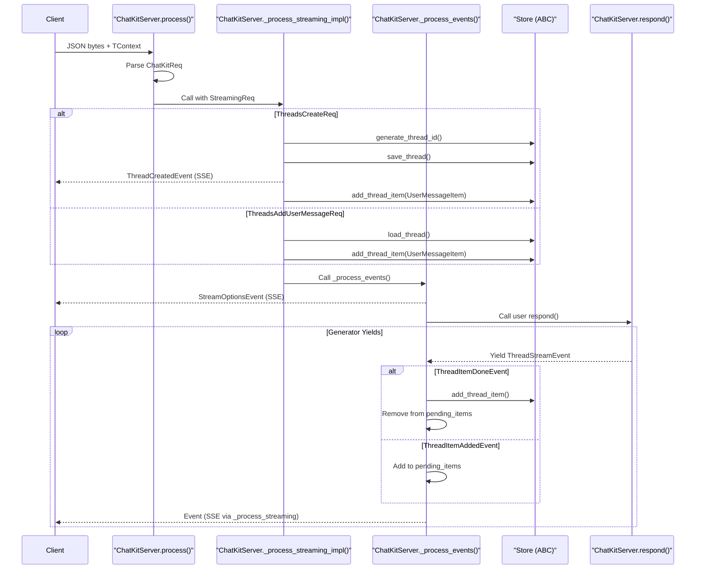
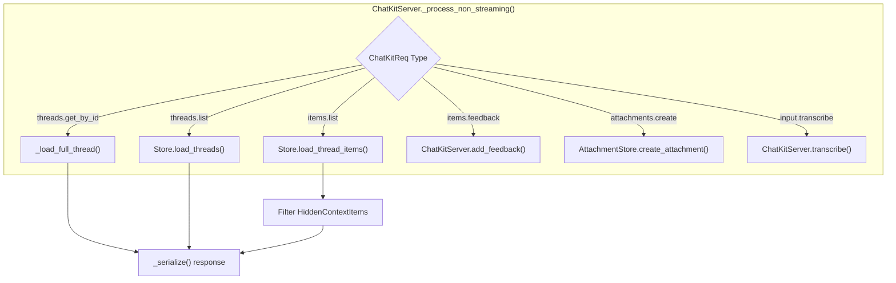

<!-- source: DeepWiki mcp.deepwiki.com · repo openai/chatkit-python · page 3.3 Request Processing Pipeline · fetched 2026-10-26 -->

# Request Processing Pipeline

<details>
<summary>Relevant source files</summary>

The following files were used as context for generating this wiki page:

- [chatkit/server.py](chatkit/server.py)
- [chatkit/types.py](chatkit/types.py)
- [tests/test_chatkit_server.py](tests/test_chatkit_server.py)

</details>


This document explains the internal request processing pipeline within `ChatKitServer`, focusing on how the `process()` method routes incoming requests, the distinction between streaming and non-streaming execution paths, event persistence with `pending_items` tracking, and error/cancellation handling.

---

## Process Entry Point

The `ChatKitServer.process()` method serves as the main entry point for all ChatKit requests. It accepts a serialized JSON request body and a generic context object, returning either a `StreamingResult` or `NonStreamingResult`.

```python
ChatKitServer.process(request: str | bytes | bytearray, context: TContext)
    -> StreamingResult | NonStreamingResult
```

The method performs the following steps:

1.  **Parse Request**: Deserializes the request body into a `ChatKitReq` discriminated union using Pydantic's `TypeAdapter` [[chatkit/server.py:389-391]]().
2.  **Route Request**: Calls `is_streaming_req()` to determine the execution path [[chatkit/server.py:392-393]]().
3.  **Execute**: Delegates to either `_process_streaming()` [[chatkit/server.py:394-395]]() or `_process_non_streaming()` [[chatkit/server.py:396-397]]().

**Sources**: [chatkit/server.py:385-397]()

---

## Request Parsing and Routing

The routing decision is based on request type. The `is_streaming_req()` function checks if the request is an instance of `StreamingReq`, which includes:

| Streaming Request Type | Purpose |
| :--- | :--- |
| `ThreadsCreateReq` | Create new thread and generate response [[chatkit/types.py:55-58]]() |
| `ThreadsAddUserMessageReq` | Add user message to existing thread [[chatkit/types.py:83-86]]() |
| `ThreadsAddClientToolOutputReq` | Provide tool call output and continue [[chatkit/types.py:97-100]]() |
| `ThreadsRetryAfterItemReq` | Retry generation from a specific message [[chatkit/types.py:133-136]]() |
| `ThreadsCustomActionReq` | Handle custom action from widget [[chatkit/types.py:111-114]]() |

Non-streaming requests handle CRUD and utility operations:

| Non-Streaming Request Type | Purpose |
| :--- | :--- |
| `ThreadsGetByIdReq` | Load full thread with items [[chatkit/types.py:42-45]]() |
| `ThreadsListReq` | List threads with pagination [[chatkit/types.py:76-79]]() |
| `ThreadsUpdateReq` | Update thread metadata [[chatkit/types.py:244-247]]() |
| `ThreadsDeleteReq` | Delete thread [[chatkit/types.py:258-261]]() |
| `ItemsListReq` | List thread items with pagination [[chatkit/types.py:228-231]]() |
| `ItemsFeedbackReq` | Record user feedback [[chatkit/types.py:147-150]]() |
| `AttachmentsCreateReq` | Create attachment metadata [[chatkit/types.py:175-178]]() |
| `AttachmentsDeleteReq` | Delete attachment [[chatkit/types.py:162-165]]() |
| `InputTranscribeReq` | Transcribe audio payload [[chatkit/types.py:190-193]]() |

**Sources**: [chatkit/server.py:389-397](), [chatkit/types.py:271-285]()

---

## Streaming Request Pipeline

### Pipeline Overview

The following diagram shows the complete streaming request lifecycle, bridging the "Natural Language Space" (e.g., Client Request) to the "Code Entity Space" (e.g., `_process_events`).

**Title: Streaming Request Data Flow**

**Sources**: [chatkit/server.py:479-641](), [chatkit/server.py:677-773]()

### Request Type Handling

The `_process_streaming_impl()` method handles specific streaming logic [[chatkit/server.py:493]]():

*   **ThreadsCreateReq**: Generates a new thread ID, saves the thread, creates a `UserMessageItem`, persists it to the `Store`, and then yields to `_process_events()` [[chatkit/server.py:497-516]]().
*   **ThreadsAddUserMessageReq**: Loads the thread, validates its status, creates and persists a `UserMessageItem`, then proceeds to `_process_events()` [[chatkit/server.py:518-530]]().
*   **ThreadsAddClientToolOutputReq**: Locates the `ClientToolCallItem` in the thread, updates it with the tool result, saves it, and invokes `respond()` [[chatkit/server.py:532-569]]().
*   **ThreadsRetryAfterItemReq**: Performs a "rewind" by finding the target item, deleting all subsequent items in the `Store`, and re-triggering `respond()` [[chatkit/server.py:571-606]]().
*   **ThreadsCustomActionReq**: Routes to the `action()` method instead of `respond()` to handle widget-triggered logic [[chatkit/server.py:607-638]]().

**Sources**: [chatkit/server.py:493-641]()

### Pending Items Tracking

The `pending_items` dictionary tracks items that have been emitted via `ThreadItemAddedEvent` but not yet finalized. This state is critical for handling incremental updates and stream cancellations [[chatkit/server.py:690]]().

| Event Type | Logic in `_process_events` |
| :--- | :--- |
| `ThreadItemAddedEvent` | Adds item to `pending_items` [[chatkit/server.py:699-700]]() |
| `ThreadItemUpdatedEvent` | Updates the item in `pending_items` via `_update_pending_items` [[chatkit/server.py:718-723]]() |
| `ThreadItemDoneEvent` | Removes from `pending_items` and persists to `Store.add_thread_item` [[chatkit/server.py:703-707]]() |
| `ThreadItemRemovedEvent` | Removes from `pending_items` and calls `Store.delete_thread_item` [[chatkit/server.py:708-712]]() |
| `ThreadItemReplacedEvent` | Replaces in `pending_items` and calls `Store.save_item` [[chatkit/server.py:713-717]]() |

**Sources**: [chatkit/server.py:690-723](), [chatkit/server.py:775-836]()

### Cancellation Handling

If the client disconnects, `asyncio.CancelledError` is caught in `_process_events()` [[chatkit/server.py:746]](). This triggers `handle_stream_cancelled()`, which:

1.  Iterates through `pending_items`.
2.  Persists any non-empty `AssistantMessageItem` to the `Store` so the partial response isn't lost [[chatkit/server.py:355-368]]().
3.  Appends an `SDKHiddenContextItem` to the thread to inform future model calls that the previous stream was interrupted [[chatkit/server.py:370-380]]().

**Sources**: [chatkit/server.py:344-383](), [chatkit/server.py:746-750]()

---

## Non-Streaming Request Pipeline

Non-streaming requests are handled by `_process_non_streaming()` and typically return a single JSON object wrapped in a `NonStreamingResult` [[chatkit/server.py:399]]().

**Title: Non-Streaming Logic Routing**

**Sources**: [chatkit/server.py:399-477]()

### Audio Transcription
The `InputTranscribeReq` is a unique non-streaming request that processes base64 audio. It decodes the payload into an `AudioInput` object and calls the abstract `transcribe()` method, which typically integrates with a model like Whisper [[chatkit/server.py:412-424]]().

**Sources**: [chatkit/server.py:412-424](), [chatkit/types.py:190-206]()

### Hidden Context Filtering
To ensure internal system prompts and agent metadata do not leak to the UI, the `ItemsListReq` handler explicitly filters out `HiddenContextItem` and `SDKHiddenContextItem` before returning the `Page[ThreadItem]` to the client [[chatkit/server.py:459-462]]().

**Sources**: [chatkit/server.py:448-463]()

---

