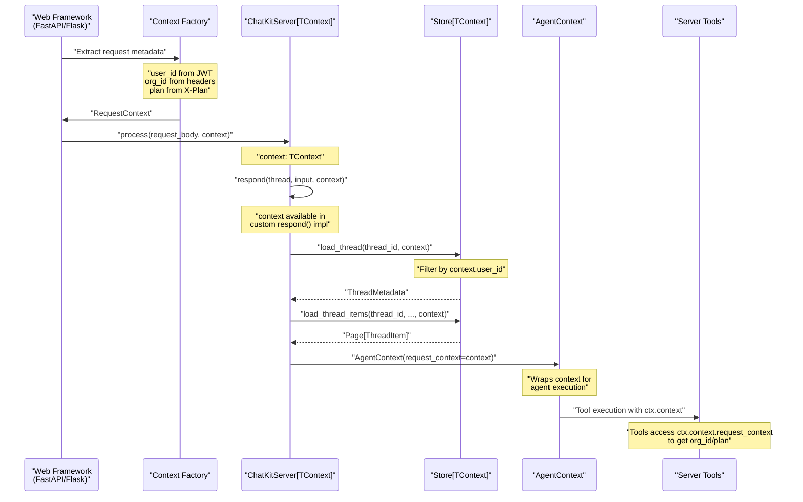
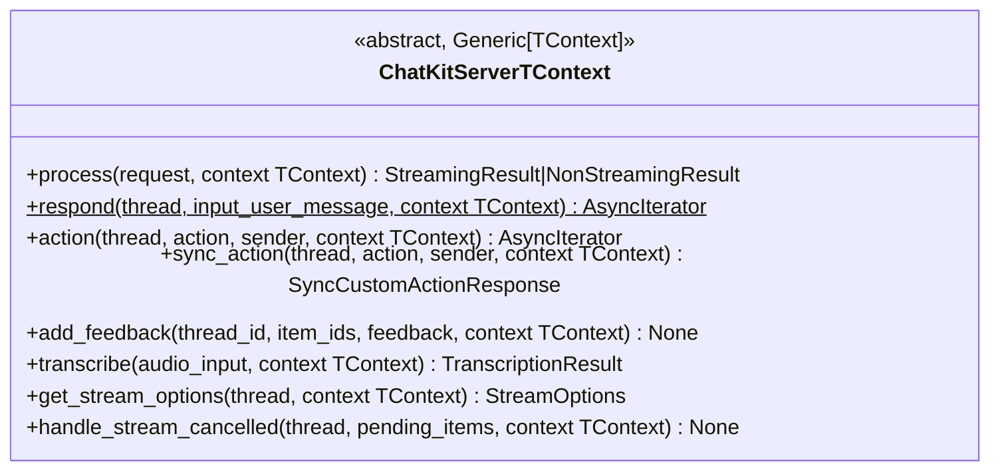
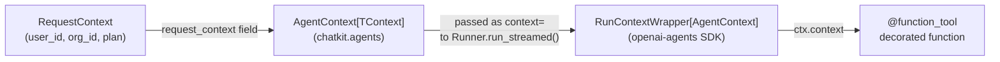

<!-- source: DeepWiki mcp.deepwiki.com · repo openai/chatkit-python · page 3.4 Context Management · fetched 2026-10-26 -->

# Context Management

<details>
<summary>Relevant source files</summary>

The following files were used as context for generating this wiki page:

- [chatkit/server.py](chatkit/server.py)
- [chatkit/store.py](chatkit/store.py)
- [docs/guides/pass-extra-app-context-to-your-model.md](docs/guides/pass-extra-app-context-to-your-model.md)
- [tests/helpers/mock_store.py](tests/helpers/mock_store.py)

</details>


## Purpose and Scope

This document explains the generic context pattern in ChatKit that enables request-scoped data to flow through all system operations. The `TContext` type parameter allows developers to define custom context types that carry per-request information (user identity, authorization scopes, feature flags, tracing metadata) through the server, storage layer, and agent execution pipeline.

For information about implementing the storage layer that receives this context, see [Storage Interfaces](3.2). For information about how context is used within agent execution, see [Agent Integration](4.1).

---

## The Generic Type Parameter Pattern

ChatKit uses a generic type parameter `TContext` throughout its core abstractions to enable type-safe threading of request-scoped context.

### Type Variable Definition

`TContext` is defined independently in the server and store modules:

[chatkit/server.py:278-278]()
```python
TContext = TypeVar("TContext", default=Any)
```

[chatkit/store.py:15-15]()
```python
TContext = TypeVar("TContext", default=Any)
```

The agents module also defines its own `TContext` variable, which is unified with the server's via the class hierarchy.

### Generic Base Classes

All core abstractions are generic over `TContext`:

| Class | Module | Purpose |
|-------|--------|---------|
| `ChatKitServer[TContext]` | [chatkit/server.py:281]() | Main server orchestration |
| `Store[TContext]` | [chatkit/store.py:68]() | Thread and item persistence |
| `AttachmentStore[TContext]` | [chatkit/store.py:48]() | File attachment management |
| `AgentContext[TContext]` | `chatkit.agents` | Wraps context for agent tool execution |

This pattern ensures that the same context type flows consistently through all layers without loss of type information.

**Sources:** [chatkit/server.py:278-281](), [chatkit/store.py:15-68]()

---

## Defining a Custom Context Type

Developers define a context type specific to their application needs. The context should be lightweight and contain only per-request data, not shared application state.

### Example Context Definition

[docs/guides/pass-extra-app-context-to-your-model.md:41-46]()
```python
from dataclasses import dataclass

@dataclass
class RequestContext:
    user_id: str
    org_id: str
    plan: str
```

Common fields include:
- **Identity**: `user_id`, `org_id`, `session_id`
- **Authorization**: `auth_scopes`, `permissions`, `roles`
- **Feature Control**: `feature_flags`, `experiment_assignments`
- **Observability**: `trace_id`, `request_id`, `client_version`

**Sources:** [docs/guides/pass-extra-app-context-to-your-model.md:37-48]()

---

## Context Flow Through the System

The context originates at the HTTP request boundary and flows through all ChatKit operations.

### Request Lifecycle Flow



**Sources:** [chatkit/server.py:423-435](), [docs/guides/pass-extra-app-context-to-your-model.md:35-66]()

### Context Creation at Request Boundary

The web framework handler creates the context before calling `ChatKitServer.process()`. Often, this involves piping headers from the client.

[docs/guides/pass-extra-app-context-to-your-model.md:15-33]()
```tsx
// Client-side header attachment
const chatkit = useChatKit({
  api: {
    fetch: (input, init) =>
      fetch(input, {
        ...init,
        headers: {
          ...(init?.headers || {}),
          "X-Org-Id": currentOrgId,
          "X-Plan": currentPlan,
        },
      }),
  },
});
```

**Sources:** [docs/guides/pass-extra-app-context-to-your-model.md:13-33]()

---

## Context Propagation Through Server Methods

All `ChatKitServer` methods that process requests receive the context parameter.

### Server Method Signatures

**`ChatKitServer[TContext]` — methods that receive `context: TContext`**



| Method | Location | Context Usage |
|--------|----------|---------------|
| `process` | [chatkit/server.py:423-435]() | Entry point; routes to streaming or non-streaming handlers |
| `respond` | [chatkit/server.py:299-316]() | Abstract; user-implemented response generator |
| `action` | [chatkit/server.py:347-358]() | Handle widget or client-dispatched actions |
| `sync_action` | [chatkit/server.py:360-371]() | Handle synchronous widget actions |
| `add_feedback` | [chatkit/server.py:318-325]() | Persist user feedback |
| `transcribe` | [chatkit/server.py:328-345]() | Transcribe audio input |
| `get_stream_options` | [chatkit/server.py:373-380]() | Configure streaming options per-request |
| `handle_stream_cancelled` | [chatkit/server.py:382-421]() | Cleanup when a stream is cancelled |

**Sources:** [chatkit/server.py:299-435]()

---

## Context Propagation Through Store Methods

All `Store` and `AttachmentStore` methods receive the context parameter, enabling data isolation and authorization checks.

### Store Method Context Flow

```mermaid
graph TB
    Server["ChatKitServer[TContext]"]
    Store["Store[TContext]"]
    AttachStore["AttachmentStore[TContext]"]
    
    subgraph "Thread Operations"
        GenThreadID["generate_thread_id(context)"]
        LoadThread["load_thread(thread_id, context)"]
        SaveThread["save_thread(thread, context)"]
        LoadThreads["load_threads(limit, after, order, context)"]
        DeleteThread["delete_thread(thread_id, context)"]
    end
    
    subgraph "Item Operations"
        GenItemID["generate_item_id(item_type, thread, context)"]
        AddItem["add_thread_item(thread_id, item, context)"]
        SaveItem["save_item(thread_id, item, context)"]
        LoadItem["load_item(thread_id, item_id, context)"]
        LoadItems["load_thread_items(thread_id, after, limit, order, context)"]
        DeleteItem["delete_thread_item(thread_id, item_id, context)"]
    end
    
    subgraph "Attachment Operations"
        GenAttachID["generate_attachment_id(mime_type, context)"]
        CreateAttach["create_attachment(input, context)"]
        SaveAttach["save_attachment(attachment, context)"]
        LoadAttach["load_attachment(attachment_id, context)"]
        DeleteAttach["delete_attachment(attachment_id, context)"]
    end
    
    Server --> GenThreadID
    Server --> LoadThread
    Server --> SaveThread
    Server --> LoadThreads
    Server --> DeleteThread
    
    Server --> GenItemID
    Server --> AddItem
    Server --> SaveItem
    Server --> LoadItem
    Server --> LoadItems
    Server --> DeleteItem
    
    Server --> GenAttachID
    Server --> CreateAttach
    Server --> SaveAttach
    Server --> LoadAttach
    Server --> DeleteAttach
    
    GenThreadID --> Store
    LoadThread --> Store
    SaveThread --> Store
    LoadThreads --> Store
    DeleteThread --> Store
    
    GenItemID --> Store
    AddItem --> Store
    SaveItem --> Store
    LoadItem --> Store
    LoadItems --> Store
    DeleteItem --> Store
    
    GenAttachID --> AttachStore
    CreateAttach --> AttachStore
    SaveAttach --> Store
    LoadAttach --> Store
    DeleteAttach --> Store
    DeleteAttach --> AttachStore
```



**Sources:** [chatkit/store.py:48-162]()

### Example Store Implementation with Context

A typical store implementation uses the context for data isolation. The `SQLiteStore` reference implementation demonstrates this by filtering queries using `context.user_id`.

[tests/helpers/mock_store.py:84-96]()
```python
async def load_thread(
    self, thread_id: str, context: RequestContext
) -> ThreadMetadata:
    with self._create_connection() as conn:
        thread_cursor = conn.execute(
            "SELECT data, created_at FROM threads WHERE id = ? AND user_id = ?",
            (thread_id, context.user_id),
        ).fetchone()
        if thread_cursor is None:
            raise NotFoundError(f"Thread {thread_id} not found")

        return ThreadData.model_validate_json(thread_cursor[0]).thread
```

The `WHERE user_id = ?` clause ensures that users can only access their own threads, implementing multi-tenancy at the database level.

**Sources:** [tests/helpers/mock_store.py:84-115]()

---

## Context in Agent Execution

The context flows into agent execution through `AgentContext`, making it available to server tools.

### AgentContext Structure

`AgentContext` holds the custom context alongside other agent-execution state. Tools access this via the `RunContextWrapper`.

**Context access path in tools**



### Accessing Context in Server Tools

Server tools access the context via `ctx.context.request_context`:

[docs/guides/pass-extra-app-context-to-your-model.md:59-66]()
```python
@function_tool(description_override="Fetch the user's workspace context.")
async def get_workspace_context(ctx: RunContextWrapper[AgentContext]):
    # Access custom context field 'org_id'
    workspace = await load_workspace(ctx.context.request_context.org_id)
    return {
        "workspace_id": workspace.id,
        "features": workspace.feature_flags,
    }
```

**Sources:** [docs/guides/pass-extra-app-context-to-your-model.md:54-68]()

---

## Summary

The `TContext` generic pattern is the mechanism for threading request-scoped data through ChatKit operations. Key points:

1. **Type Safety**: Generic type parameter `TContext` preserves type information across all layers [chatkit/server.py:278-281]().
2. **Consistency**: Same context flows through `ChatKitServer`, `Store`, and `AgentContext` [chatkit/store.py:68-162]().
3. **Multi-Tenancy**: Include user/org identifiers and filter all queries (e.g., `WHERE user_id = ?`) [tests/helpers/mock_store.py:84-96]().
4. **Observability**: Carry trace IDs and metadata for logging/debugging.
5. **Per-Request**: Create fresh context for each request at the web boundary and discard when complete [docs/guides/pass-extra-app-context-to-your-model.md:35-48]().

**Sources:** [chatkit/server.py:278-435](), [chatkit/store.py:15-162](), [tests/helpers/mock_store.py:84-115](), [docs/guides/pass-extra-app-context-to-your-model.md:13-68]()

---

