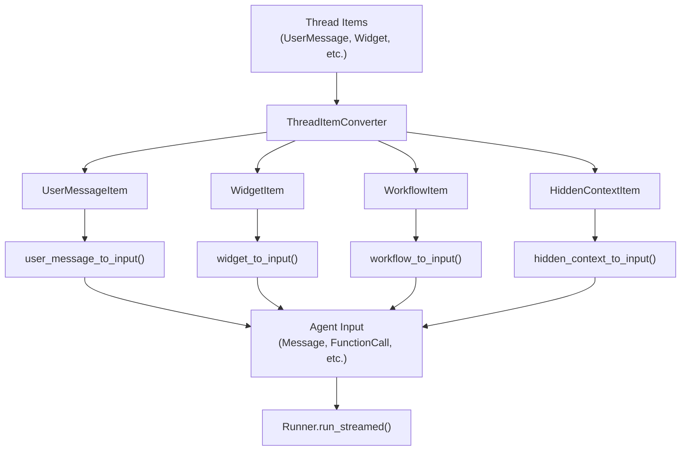
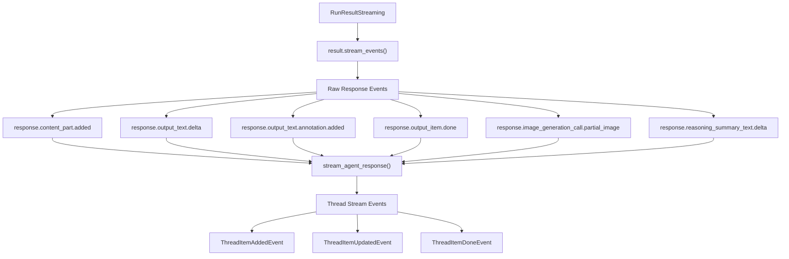

<!-- source: DeepWiki mcp.deepwiki.com · repo openai/chatkit-python · page 4 Advanced Features · fetched 2026-10-26 -->

# Advanced Features

<details>
<summary>Relevant source files</summary>

The following files were used as context for generating this wiki page:

- [chatkit/actions.py](chatkit/actions.py)
- [chatkit/agents.py](chatkit/agents.py)
- [chatkit/widgets.py](chatkit/widgets.py)
- [tests/test_agents.py](tests/test_agents.py)

</details>


This page documents specialized features in chatkit-python for building rich conversational experiences beyond basic message exchange. These features enable integration with OpenAI's Agents SDK, rich UI components, workflow tracking, and multimedia content generation.

For basic server setup and request processing, see [Server Integration](#3). For the core data model, see [Threads and Thread Items](#2.4).

---

## Agent Integration

The agent integration layer bridges ChatKit's type system with OpenAI's Agents SDK, converting between `ThreadItem` representations and the Agents SDK's input/output formats. This conversion happens bidirectionally through dedicated converter classes.

### Core Components

| Component | Purpose | Key Methods |
|-----------|---------|-------------|
| `AgentContext` | Execution context for agent operations | `generate_id()`, `stream_widget()`, `start_workflow()`, `end_workflow()` |
| `ThreadItemConverter` | Converts ChatKit items to agent inputs | `to_agent_input()`, `user_message_to_input()`, `tag_to_message_content()` |
| `ResponseStreamConverter` | Adapts agent outputs to ChatKit format | `base64_image_to_url()`, `partial_image_index_to_progress()` |
| `stream_agent_response()` | Main conversion pipeline | Consumes `RunResultStreaming`, yields `ThreadStreamEvent` |

### AgentContext

The `AgentContext` class ([chatkit/agents.py:108-221]()) provides the execution environment for agent operations within a thread. It maintains state across the streaming response lifecycle and offers helper methods for emitting events.

**Key Properties:**

```python
thread: ThreadMetadata              # Current conversation metadata
store: Store[TContext]              # Persistence interface
request_context: TContext           # Per-request context (auth, user_id, etc.)
previous_response_id: str | None    # For continuations
workflow_item: WorkflowItem | None  # Active workflow tracking
generated_image_item: GeneratedImageItem | None # Active image generation
```

**Event Emission:**

The `stream()` method ([chatkit/agents.py:215-217]()) enqueues events into an internal queue that merges with the agent's output stream.

**ID Generation:**

Use `generate_id()` ([chatkit/agents.py:120-128]()) to create store-backed IDs for new items:

```python
widget_id = context.generate_id("widget")
```

**Sources:** [chatkit/agents.py:108-221]()

### Input Conversion Flow



**Sources:** [chatkit/agents.py:803-1182]()

### ThreadItemConverter

The `ThreadItemConverter` class ([chatkit/agents.py:803-1182]()) defines conversion logic from `ThreadItem` types to Agents SDK input items. Override methods to customize how different item types are represented to the model.

**Required Overrides (when features are used):**

| Method | Required When | Purpose |
|--------|---------------|---------|
| `attachment_to_message_content()` | User messages include attachments | Convert file attachments to model input |
| `tag_to_message_content()` | User messages include @-mentions | Resolve entity references to context |

**Optional Overrides:**

| Method | Default Behavior |
|--------|------------------|
| `widget_to_input()` | JSON representation with description |
| `workflow_to_input()` | Custom tasks as text descriptions |
| `hidden_context_to_input()` | Wrapped in XML tags for string content |
| `generated_image_to_input()` | Image URL with description |

**Tag Resolution:** The `user_message_to_input()` method ([chatkit/agents.py:987-1068]()) automatically handles @-mention tags by preserving `@key` syntax and calling `tag_to_message_content()` for each unique tag.

**Sources:** [chatkit/agents.py:803-1182]()

### Output Conversion Flow



**Sources:** [chatkit/agents.py:432-784]()

### stream_agent_response()

The `stream_agent_response()` function ([chatkit/agents.py:432-784]()) is the core conversion pipeline that consumes a streaming agent run and yields `ThreadStreamEvent` objects. It handles message streaming, image generation updates, and workflow tracking.

**Workflow Continuation:** The function checks the last items in the store ([chatkit/agents.py:468-482]()) to detect incomplete workflows from previous turns:

```python
items = await context.store.load_thread_items(
    thread.id, None, 2, "desc", context.request_context
)
# Detect if last_item is a workflow to continue it
```

**Sources:** [chatkit/agents.py:432-784]()

### ResponseStreamConverter

The `ResponseStreamConverter` class ([chatkit/agents.py:364-427]()) provides hooks for customizing how streaming agent outputs are converted to ChatKit formats.

**Method: `base64_image_to_url()`**

Converts base64-encoded images to URLs ([chatkit/agents.py:390-410]()). Override to upload images to persistent storage.

**Method: `partial_image_index_to_progress()`**

Normalizes partial image indices to progress values ([chatkit/agents.py:412-426]()) based on the `partial_images` constructor parameter.

**Sources:** [chatkit/agents.py:364-427]()

---

## Actions System

The actions system enables user interactions with widgets and custom client-initiated requests.

### Action Configuration

Actions are defined using `ActionConfig` objects ([chatkit/actions.py:14-20]()):

| Property | Type | Purpose |
|----------|------|---------|
| `type` | `str` | Action identifier |
| `payload` | `Any` | Data sent with action |
| `handler` | `"server" \| "client"` | Routing destination ([chatkit/actions.py:7]()) |
| `loadingBehavior`| `"auto" \| "none" \| ...` | UI loading state ([chatkit/actions.py:8]()) |

**Action.create():** The `Action.create()` class method ([chatkit/actions.py:31-56]()) uses type inference from `Literal` annotations to automatically populate the `type` field in `ActionConfig`.

**Sources:** [chatkit/actions.py:1-57]()

### Server-Side Actions

Override `ChatKitServer.action()` or `ChatKitServer.sync_action()` ([chatkit/server.py:200-220]()) to handle server-routed actions.

---

## Widgets and UI Components

Widgets provide rich, interactive UI components. The system supports a wide range of components including `Card`, `ListView`, `Button`, `Text`, `Form`, and `Chart`.

### Streaming Widgets

Use `AgentContext.stream_widget()` ([chatkit/agents.py:130-144]()) which calls `chatkit.server.stream_widget` ([chatkit/server.py:150-200]()) to stream updates. It uses `diff_widget` to produce incremental `WidgetStreamingTextValueDelta` or full `WidgetRootUpdated` events.

**Sources:** [chatkit/widgets.py:1-800](), [chatkit/server.py:150-200]()

---

## Widget Templates

Widget templates enable declarative widget definitions using Jinja2 templating with JSON schemas.

### Loading and Building Templates

**Loading Templates:**

```python
from chatkit.widgets import WidgetTemplate
template = WidgetTemplate.from_file("path/to/file.widget")
```

**Building Widgets:**

The `build()` method ([chatkit/widgets.py:1000-1050]()) renders the Jinja2 template with data and validates the result against the template's JSON schema to return a `DynamicWidgetRoot`.

**Sources:** [chatkit/widgets.py:900-1100]()

---

## Workflows and Tasks

Workflows track multi-step operations. They consist of `WorkflowItem` containing a list of `Task` subtypes like `CustomTask`, `SearchTask`, `ThoughtTask`, `FileTask`, or `ImageTask`.

### Workflow Management

Use `AgentContext` methods to manage state:
- `start_workflow(workflow)` ([chatkit/agents.py:165-179]())
- `add_workflow_task(task)` ([chatkit/agents.py:196-213]())
- `update_workflow_task(task, index)` ([chatkit/agents.py:180-194]())
- `end_workflow(summary)` ([chatkit/agents.py:146-163]())

**Sources:** [chatkit/agents.py:141-213]()

---

## Image Generation

Image generation from the Agents SDK is converted into `GeneratedImageItem` thread items.

### Generation Lifecycle

1. **Item Added:** `response.output_item.added` creates a `GeneratedImageItem` ([chatkit/agents.py:620-628]()).
2. **Partial Progress:** `response.image_generation_call.partial_image` updates the item with progress and partial URLs ([chatkit/agents.py:629-651]()).
3. **Completion:** `response.output_item.done` finalizes the image ([chatkit/agents.py:729-742]()).

**Sources:** [chatkit/agents.py:620-742]()

---

## Rich User Input

ChatKit supports complex user inputs including file attachments and entity tags.

### Attachments and Transcription

- **Attachments:** Handled via `AttachmentStore`. The `ThreadItemConverter.attachment_to_message_content` method must be implemented to provide these to the agent.
- **Transcription:** `ChatKitServer.transcribe()` ([chatkit/server.py:228-232]()) allows processing audio input into text.

### Entity Tags

User messages can contain @-mentions. The `ThreadItemConverter.tag_to_message_content` ([chatkit/agents.py:1044-1048]()) method resolves these tags into context that the model can understand.

**Sources:** [chatkit/agents.py:803-1182](), [chatkit/server.py:228-232]()

---

