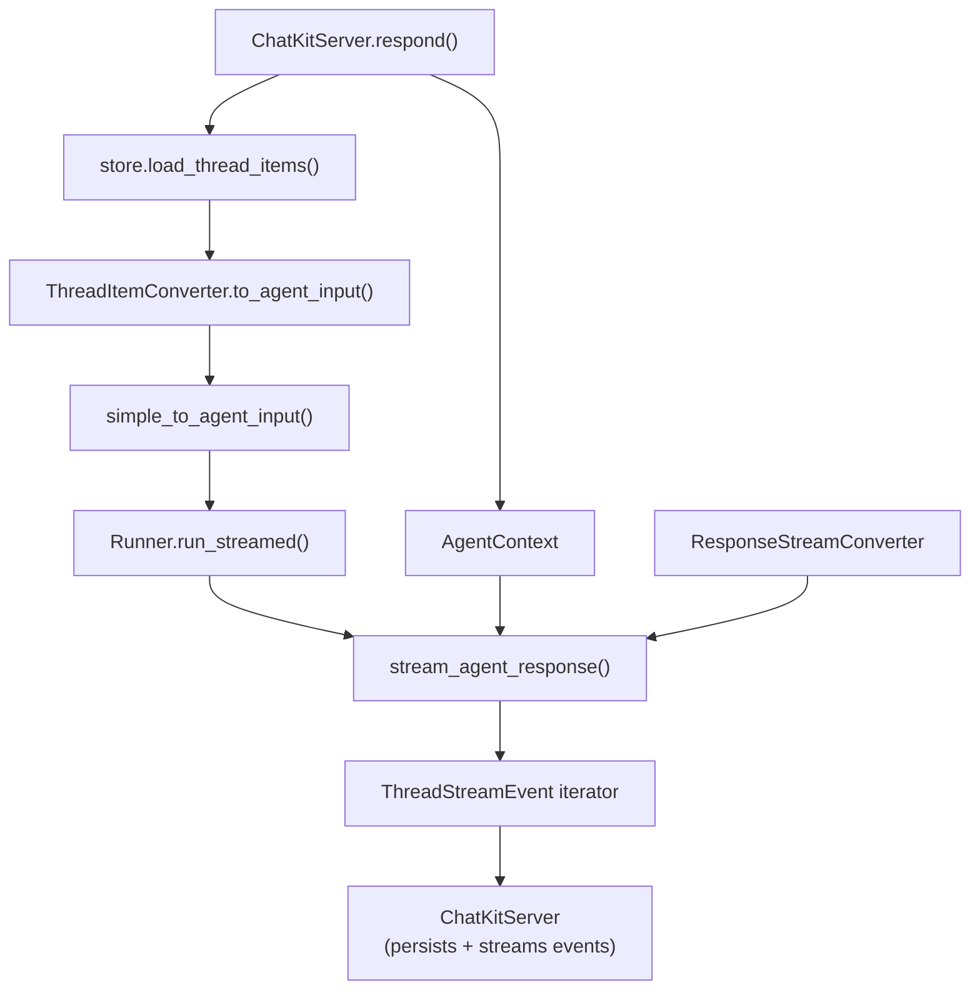
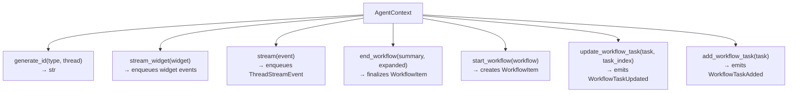
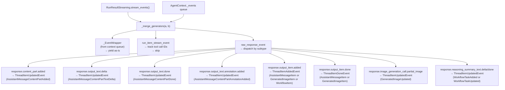
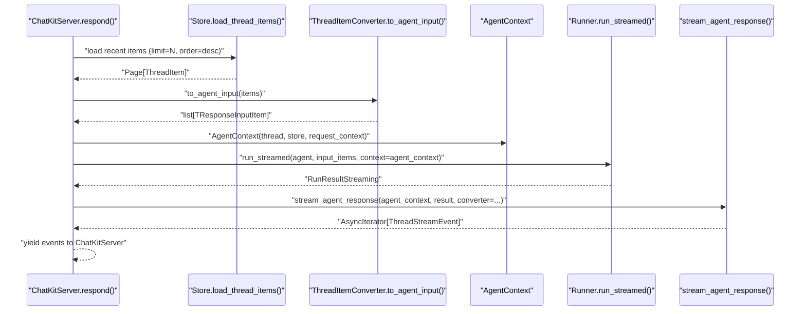

<!-- source: DeepWiki mcp.deepwiki.com · repo openai/chatkit-python · page 4.1 Agent Integration · fetched 2026-10-26 -->

# Agent Integration

<details>
<summary>Relevant source files</summary>

The following files were used as context for generating this wiki page:

- [chatkit/agents.py](chatkit/agents.py)
- [docs/guides/let-users-pick-tools-and-models.md](docs/guides/let-users-pick-tools-and-models.md)
- [docs/guides/respond-to-user-message.md](docs/guides/respond-to-user-message.md)
- [docs/guides/stream-generated-images.md](docs/guides/stream-generated-images.md)
- [tests/test_agents.py](tests/test_agents.py)

</details>


This page documents the `chatkit.agents` module, which bridges the [openai-agents](https://github.com/openai/openai-agents-python) SDK with ChatKit's thread and streaming model. It covers how to convert thread history into model input, run a streaming agent, and surface the results as `ThreadStreamEvent` objects that `ChatKitServer` persists and streams to the client.

For the abstract `ChatKitServer` interface that calls into this module (specifically the `respond` method), see [3.1](). For the storage layer that `AgentContext` calls during a run, see [3.2](). For workflow and task management, see [4.4](). For image generation, see [4.5](). For rich user input (attachments and tags), see [4.6]().

---

## Overview

The agent integration layer sits between the `ChatKitServer.respond` method and the openai-agents `Runner`. It consists of four main pieces:

| Class / Function | Role |
|---|---|
| `AgentContext` | Per-run state container passed as the agent's run context; exposes helpers to emit events |
| `stream_agent_response` | Consumes a `RunResultStreaming` and yields `ThreadStreamEvent` objects |
| `ResponseStreamConverter` | Translates Responses API annotations and image outputs into ChatKit types |
| `ThreadItemConverter` | Translates stored `ThreadItem` objects into Agents SDK input items |
| `simple_to_agent_input` | Convenience wrapper over `ThreadItemConverter().to_agent_input(items)` |

**Module:** `chatkit/agents.py`

---

## End-to-End Data Flow

**Diagram: Agent Integration Data Flow**



Sources: [chatkit/agents.py:457-815]()

---

## `AgentContext`

`AgentContext` is a Pydantic `BaseModel` parameterized over `TContext` (your application's per-request context type). It is passed as the `context` argument to `Runner.run_streamed(...)` and is accessible inside agent tools via `RunContextWrapper[AgentContext].context`.

**Definition:** [chatkit/agents.py:108-226]()

### Fields

| Field | Type | Description |
|---|---|---|
| `thread` | `ThreadMetadata` | Metadata for the current thread |
| `store` | `Store[TContext]` | The store instance for ID generation and persistence |
| `request_context` | `TContext` | Application-level per-request context (e.g. user ID) |
| `previous_response_id` | `str \| None` | Responses API chaining ID from the previous turn |
| `client_tool_call` | `ClientToolCall \| None` | Set when the current turn is resuming a client-side tool call |
| `workflow_item` | `WorkflowItem \| None` | Tracks the currently active workflow item |
| `generated_image_item` | `GeneratedImageItem \| None` | Tracks the current image generation item |

### Methods

**Diagram: AgentContext method responsibilities**



Sources: [chatkit/agents.py:120-226]()

#### `generate_id`

[chatkit/agents.py:120-128]()

Calls `store.generate_thread_id` or `store.generate_item_id` depending on the `StoreItemType` passed. Used internally when creating new `WorkflowItem` or `GeneratedImageItem` IDs.

#### `stream_widget`

[chatkit/agents.py:130-144]()

Accepts a fully-built `WidgetRoot` or an `AsyncGenerator[WidgetRoot, None]`. Delegates to the module-level `stream_widget` function from `chatkit.server`, collecting the resulting events into `_events`. Call this from inside an agent tool to emit a widget during the run.

#### `stream`

[chatkit/agents.py:220-222]()

Enqueues any `ThreadStreamEvent` directly. Useful for emitting `ProgressUpdateEvent` or `ClientEffectEvent` from inside tools.

#### Workflow helpers

- `start_workflow(workflow)` — [chatkit/agents.py:165-178](): Creates a `WorkflowItem` and emits `ThreadItemAddedEvent`. For `reasoning` workflows or workflows with tasks, the item is sent immediately; others wait until the first task arrives.
- `add_workflow_task(task)` — [chatkit/agents.py:196-218](): Appends a `Task` to the current (or newly created) workflow and emits `WorkflowTaskAdded`.
- `update_workflow_task(task, task_index)` — [chatkit/agents.py:180-194](): Updates a task in-place and emits `WorkflowTaskUpdated`.
- `end_workflow(summary, expanded)` — [chatkit/agents.py:146-163](): Finalizes the workflow by setting a `WorkflowSummary` (or generating a `DurationSummary` from elapsed time) and emitting `ThreadItemDoneEvent`.

---

## `stream_agent_response`

[chatkit/agents.py:457-815]()

```python
async def stream_agent_response(
    context: AgentContext,
    result: RunResultStreaming,
    *,
    converter: ResponseStreamConverter = _DEFAULT_RESPONSE_STREAM_CONVERTER,
) -> AsyncIterator[ThreadStreamEvent]:
```

This is the core translation function. It merges two concurrent async streams:

1. `result.stream_events()` — raw events from the Agents SDK runner
2. `context._events` — events enqueued via `AgentContext.stream(...)` / `AgentContext.stream_widget(...)`

It processes Responses API events and converts them to `ThreadStreamEvent` objects.

**Diagram: stream_agent_response event translation**



Sources: [chatkit/agents.py:522-797]()

### Workflow continuation

At the start of each run, `stream_agent_response` loads the two most recent thread items to determine whether a workflow was already in progress:

[chatkit/agents.py:493-507]()

- If the last item is a `WorkflowItem`, it sets `ctx.workflow_item` to resume it.
- If the last item is a `ClientToolCallItem` and the item before it is a `WorkflowItem`, the workflow is also resumed.

### Guardrail handling

[chatkit/agents.py:775-783]()

If `InputGuardrailTripwireTriggered` or `OutputGuardrailTripwireTriggered` is raised during the run, `stream_agent_response` emits `ThreadItemRemovedEvent` for every item produced during the run, drains the context queue without processing, and re-raises the exception for the caller to catch.

### Client tool call finalization

[chatkit/agents.py:798-814]()

If `context.client_tool_call` is set (the turn was a tool output resumption), a `ClientToolCallItem` `ThreadItemDoneEvent` is emitted at the end of the run to record the tool call in the thread.

---

## `ResponseStreamConverter`

[chatkit/agents.py:313-411]()

`ResponseStreamConverter` translates Responses API-specific output types into ChatKit types. Pass a subclass instance to `stream_agent_response` via the `converter` argument to customize behavior.

### Overridable methods

| Method | Default behavior | Override when |
|---|---|---|
| `base64_image_to_url(image_id, base64_image, partial_image_index)` | Returns a `data:image/png;base64,...` URL | Storing images in object storage; see [4.5]() |
| `partial_image_index_to_progress(partial_image_index)` | Divides index by `self.partial_images`; returns 0.0 if unset | Adjusting progress normalization |
| `file_citation_to_annotation(file_citation)` | Creates `Annotation(source=FileSource(filename=...))` | Enriching file citations with metadata |
| `container_file_citation_to_annotation(container_file_citation)` | Creates `Annotation(source=FileSource(filename=...))` | Same as above |
| `url_citation_to_annotation(url_citation)` | Creates `Annotation(source=URLSource(url=..., title=...))` | Custom URL annotation logic |

### `partial_images` constructor parameter

[chatkit/agents.py:320-337]()

Pass `partial_images=N` to `ResponseStreamConverter(partial_images=N)` where `N` matches the `partial_images` value in your `ImageGenerationTool` config. This is used by `partial_image_index_to_progress` to normalize partial image indices into the `[0, 1]` range.

### Annotation conversion internals

[chatkit/agents.py:436-454]()

The internal `_convert_annotation` function re-validates raw annotation objects via `TypeAdapter[ResponsesAnnotation]` before dispatching to the appropriate converter method. This handles a known bug in the OpenAI client where annotation delta events can arrive as untyped dicts.

Sources: [chatkit/agents.py:313-454]()

---

## `ThreadItemConverter`

[chatkit/agents.py:834-920]()

`ThreadItemConverter` converts stored `ThreadItem` objects into Agents SDK input items (`TResponseInputItem`). Its main entry point is `to_agent_input(items)`, which iterates the list of thread items and applies the appropriate conversion for each type.

### Conversion table

| `ThreadItem` subtype | Default conversion | Requires override? |
|---|---|---|
| `UserMessageItem` (text) | `EasyInputMessageParam` with `role="user"` | No |
| `UserMessageItem` (with `Attachment`) | Calls `attachment_to_message_content` | **Yes** |
| `UserMessageItem` (with `UserMessageTagContent`) | Calls `tag_to_message_content` | **Yes** |
| `UserMessageItem` (with `quoted_text`) | Appends a second message with `"The user is referring to this in particular: \n{text}"` | No |
| `AssistantMessageItem` | `EasyInputMessageParam` with `role="assistant"` | No |
| `ClientToolCallItem` (pending) | `ResponseFunctionToolCallParam` | No |
| `ClientToolCallItem` (completed) | `FunctionCallOutput` | No |
| `GeneratedImageItem` | Calls `generated_image_to_input` | Sometimes (see [4.5]()) |
| `HiddenContextItem` (str content) | Wraps in `<HiddenContext>` system message | No |
| `HiddenContextItem` (non-str content) | Raises `NotImplementedError` | **Yes** |
| `SDKHiddenContextItem` | Wraps in `<HiddenContext>` system message | Rarely |
| `TaskItem` | Text message describing the task | No |
| `WorkflowItem` | Text messages for each custom task | No |
| `WidgetItem` | JSON-serialized widget description as user message | No |

Sources: [chatkit/agents.py:834-920]()

### Methods requiring implementation

#### `attachment_to_message_content`

[chatkit/agents.py:843-851]()

```python
async def attachment_to_message_content(
    self, attachment: Attachment
) -> ResponseInputContentParam:
```

Called for each `Attachment` in a `UserMessageItem`. Must return a `ResponseInputContentParam` (e.g. `ResponseInputImageParam`, `ResponseInputFileParam`). Raises `NotImplementedError` by default.

#### `tag_to_message_content`

[chatkit/agents.py:853-862]()

```python
async def tag_to_message_content(
    self, tag: UserMessageTagContent
) -> ResponseInputContentParam:
```

Called for each `UserMessageTagContent` (i.e. an @-mention) in a `UserMessageItem`. Must return a `ResponseInputContentParam` describing the tagged entity to the model. Raises `NotImplementedError` by default.

Tags also generate a shared context header message:

```
# User-provided context for @-mentions
- When referencing resolved entities, use their canonical names **without** '@'.
- The '@' form appears only in user text and should not be echoed.
```

This header is prepended once to all resolved tag content parts. [tests/test_agents.py:515-528]()

#### `generated_image_to_input`

[chatkit/agents.py:864-889]()

```python
async def generated_image_to_input(
    self, item: GeneratedImageItem
) -> TResponseInputItem | list[TResponseInputItem] | None:
```

Default implementation sends the image as an `input_image` content part using `item.image.url`. Override if the stored URL is not publicly reachable by the model runtime.

#### `hidden_context_to_input`

[chatkit/agents.py:891-916]()

Default handles `str` content by wrapping it in `<HiddenContext>` tags. Raises `NotImplementedError` for non-string content. Override to handle arbitrary content types.

---

## `simple_to_agent_input`

[chatkit/agents.py:923-928]()

```python
async def simple_to_agent_input(
    items: Sequence[ThreadItem],
) -> list[TResponseInputItem]:
```

A convenience wrapper that calls `ThreadItemConverter().to_agent_input(items)` with the default converter. Use this when your thread does not contain attachments, tags, or non-string hidden context. If those item types are present, instantiate and subclass `ThreadItemConverter` directly.

Sources: [chatkit/agents.py:923-928](), [docs/guides/respond-to-user-message.md:206-219]()

---

## Typical Usage Pattern

The following describes the typical call sequence inside `ChatKitServer.respond`, referencing the code entities involved:

**Diagram: respond() to agent call sequence**



Sources: [docs/guides/respond-to-user-message.md:186-298](), [chatkit/agents.py:457-478]()

### `previous_response_id` chaining

For OpenAI Responses API users, you can pass `previous_response_id` into `AgentContext` and pass it on to `Runner.run_streamed`. When the provider can retrieve prior context server-side, this avoids rebuilding the full conversation from thread items.

Store the value under `thread.metadata["last_response_id"]` and persist via `store.save_thread` after each run. Restrictions:

- **Responses API only.** Other model providers require full input reconstruction.
- **Only includes model-visible history.** Widget and workflow items emitted directly from tools won't appear in provider-side context.
- **Depends on response retrievability.** The referenced response must be stored (`store=True` / `ModelSettings(store=True)`).

Sources: [docs/guides/respond-to-user-message.md:231-266]()

---

## Guardrail Integration

`stream_agent_response` catches both `InputGuardrailTripwireTriggered` and `OutputGuardrailTripwireTriggered`. When either fires:

1. `ThreadItemRemovedEvent` is emitted for every item produced so far in the run (tracked via `produced_items`).
2. The context queue and iterator are drained synchronously without further processing.
3. The exception is re-raised for the caller.

The caller (typically `ChatKitServer.respond`) is responsible for yielding a `ErrorEvent` in its `except` block.

Sources: [chatkit/agents.py:775-783](), [docs/guides/respond-to-user-message.md:285-298]()

---

## `accumulate_text`

[chatkit/agents.py:820-831]()

```python
async def accumulate_text(
    events: AsyncIterator[StreamEvent],
    base_widget: TWidget,
) -> AsyncIterator[TWidget]:
```

A helper for building streaming text widgets from Agents SDK event streams. Yields successive copies of `base_widget` (a `Markdown` or `Text` component) with accumulated text, followed by a final copy with `streaming=False`. Useful when you want to stream agent text directly into a widget component rather than a standard `AssistantMessageItem`.

Sources: [chatkit/agents.py:820-831](), [tests/test_agents.py:291-326]()

---

