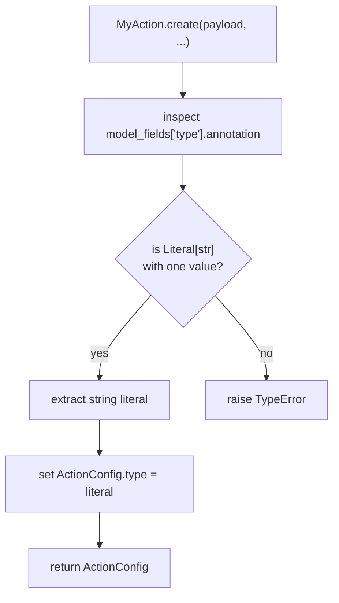
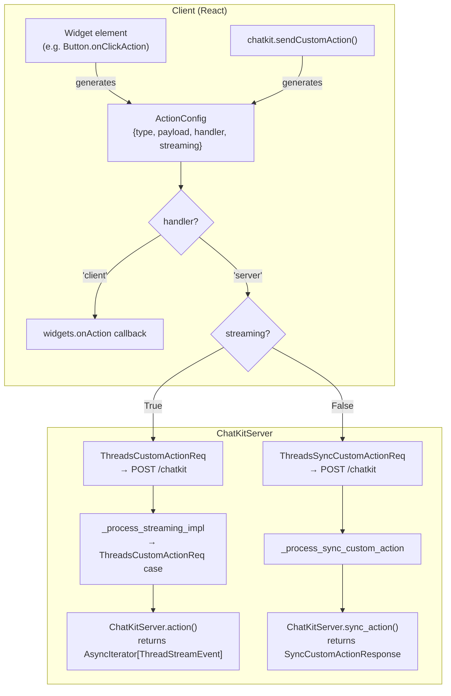
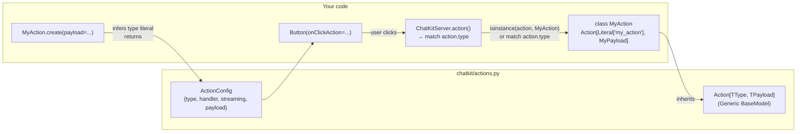

<!-- source: DeepWiki mcp.deepwiki.com · repo openai/chatkit-python · page 4.2 Actions System · fetched 2026-10-26 -->

# Actions System

<details>
<summary>Relevant source files</summary>

The following files were used as context for generating this wiki page:

- [chatkit/actions.py](chatkit/actions.py)
- [chatkit/server.py](chatkit/server.py)
- [docs/concepts/actions.md](docs/concepts/actions.md)

</details>


This page documents the actions system in `chatkit-python`: the data models that define actions, how the server routes them, and how widgets and client code dispatch them. For the widget components that attach actions to UI elements (e.g., `Button.onClickAction`), see [Widgets and UI Components](#4.3). For the full server-side integration overview, see [ChatKitServer Class](#3.1).

---

## Overview

An **action** is an interaction event that is triggered either by a widget element in the UI or by client code calling `chatkit.sendCustomAction()`. Actions carry a typed string discriminator (`type`) and an optional `payload`. On receipt, `ChatKitServer` routes them to one of three handlers depending on how the action was configured:

| Handler | Config value | Server method invoked |
|---|---|---|
| Streaming server | `handler="server"`, `streaming=True` | `ChatKitServer.action()` |
| Synchronous server | `handler="server"`, `streaming=False` | `ChatKitServer.sync_action()` |
| Client only | `handler="client"` | `widgets.onAction` callback in the browser |

---

## Core Data Models

All action-related types are defined in [chatkit/actions.py]().

### `Handler` and `LoadingBehavior`

```python
Handler = Literal["client", "server"]
LoadingBehavior = Literal["auto", "none", "self", "container"]
```

[chatkit/actions.py:7-8]()

`Handler` determines where the action is processed. `LoadingBehavior` controls what the React client shows as a loading indicator while the action is in flight:

| Value | Behavior |
|---|---|
| `"auto"` | Default; the framework decides what to show |
| `"none"` | No loading indicator |
| `"self"` | The widget item that fired the action shows a loader |
| `"container"` | The containing widget card shows a loader |

### `ActionConfig`

`ActionConfig` is the serialized form that gets embedded in a widget definition or sent by the client.

[chatkit/actions.py:14-19]()

| Field | Type | Default | Purpose |
|---|---|---|---|
| `type` | `str` | — | String discriminator for the action |
| `payload` | `Any` | `None` | Arbitrary data sent with the action |
| `handler` | `Handler` | `"server"` | Where the action is handled |
| `loadingBehavior` | `LoadingBehavior` | `"auto"` | Loading indicator behavior |
| `streaming` | `bool` | `True` | If `False`, uses `sync_action` instead of `action` |

### `Action`

`Action` is a generic Pydantic model parameterized on the action type string (`TType`) and payload type (`TPayload`). It is the deserialized form received by the server.

[chatkit/actions.py:26-28]()

```python
class Action(BaseModel, Generic[TType, TPayload]):
    type: TType = Field(default=TType, frozen=True)
    payload: TPayload = None
```

Subclass `Action` with a `Literal` type string to define a specific action type:

```python
class ConfirmAction(Action[Literal["confirm"], ConfirmPayload]):
    pass
```

This pattern is used by the server to distinguish between action types in a `match` statement inside `ChatKitServer.action()` or `ChatKitServer.sync_action()`.

### `Action.create()`

The `create()` classmethod is a convenience factory that produces an `ActionConfig` from a typed `Action` subclass, inferring the `type` string from the class's `Literal` annotation.

[chatkit/actions.py:31-56]()

It inspects `cls.model_fields["type"].annotation` at call time. If the annotation is a single-value `Literal[str]`, it extracts that string as the `type` field of the returned `ActionConfig`. If the type cannot be inferred (e.g., you call `.create()` on the raw generic `Action` rather than a concrete subclass), it raises `TypeError`.

**Type inference flow:**



Sources: [chatkit/actions.py:31-56]()

---

## Action Routing

**Diagram: Action dispatch from client to server handler**



Sources: [chatkit/server.py:655-686](), [chatkit/server.py:691-716](), [docs/concepts/actions.md:1-26]()

---

## Server-Side Handling

### Streaming Actions — `ChatKitServer.action()`

When `handler="server"` and `streaming=True` (the defaults), the client sends a `ThreadsCustomActionReq`. The server routes it through `_process_streaming_impl` into `_process_events`, which invokes `self.action()`.

[chatkit/server.py:655-686]()

The `action()` signature is:

```python
def action(
    self,
    thread: ThreadMetadata,
    action: Action[str, Any],
    sender: WidgetItem | None,
    context: TContext,
) -> AsyncIterator[ThreadStreamEvent]:
```

[chatkit/server.py:347-358]()

- `thread` — metadata for the thread the action originated from.
- `action` — the deserialized `Action` carrying `type` and `payload`.
- `sender` — the `WidgetItem` that fired the action, if the request included an `item_id`; `None` for actions dispatched via `chatkit.sendCustomAction()` without an item reference.
- `context` — the generic per-request context (see [Context Management](#3.4)).

The method must be overridden; the default raises `NotImplementedError`. The events yielded by `action()` are persisted and forwarded to the client using the same `_process_events` pipeline used by `respond()`. This means you can yield `ThreadItemDoneEvent`, `ThreadItemUpdatedEvent`, `ThreadItemRemovedEvent`, etc., just as in a normal response.

### Synchronous Actions — `ChatKitServer.sync_action()`

When `streaming=False`, the client sends a `ThreadsSyncCustomActionReq` (a non-streaming request). The server calls `_process_sync_custom_action`, which invokes `self.sync_action()`.

[chatkit/server.py:691-716]()

The `sync_action()` signature is:

```python
async def sync_action(
    self,
    thread: ThreadMetadata,
    action: Action[str, Any],
    sender: WidgetItem | None,
    context: TContext,
) -> SyncCustomActionResponse:
```

[chatkit/server.py:360-371]()

This is appropriate when:
- A thread may be actively streaming and you do not want to block on it.
- The action only needs to return data or trigger a side effect, not stream new thread items.

`SyncCustomActionResponse` is a plain JSON result returned directly to the client.

### Client-Handled Actions

When `handler="client"`, the action **never reaches the server**. The React client intercepts it in the `widgets.onAction` callback. After local handling, client code can optionally forward a follow-up action to the server using `chatkit.sendCustomAction(action, itemId?)`, which produces a `ThreadsCustomActionReq` or `ThreadsSyncCustomActionReq` as normal.

Sources: [docs/concepts/actions.md:13-15](), [chatkit/server.py:347-371]()

---

## Request Type Mapping

The table below maps action configurations to the concrete request types and server methods involved.

| `handler` | `streaming` | Client sends | Server method |
|---|---|---|---|
| `"server"` | `True` | `ThreadsCustomActionReq` | `ChatKitServer.action()` |
| `"server"` | `False` | `ThreadsSyncCustomActionReq` | `ChatKitServer.sync_action()` |
| `"client"` | any | nothing sent to server | `widgets.onAction` callback |

The `ThreadsCustomActionReq` and `ThreadsSyncCustomActionReq` are part of the `ChatKitReq` discriminated union and are parsed in `ChatKitServer.process()`. See [Request and Response Flow](#2.2) for the full parsing pipeline.

Sources: [chatkit/server.py:422-435](), [chatkit/server.py:655-716]()

---

## Defining a Typed Action

**Diagram: Relationship between user-defined Action subclass and runtime routing**



Sources: [chatkit/actions.py](), [chatkit/server.py:347-358]()

A concrete example of the pattern:

1. **Define an action subclass** with a fixed `Literal` type and a typed payload model.
2. **Attach the action** to a widget component using `MyAction.create(payload=...)` which returns an `ActionConfig`.
3. **Handle the action** in `ChatKitServer.action()` by checking `action.type` or using `isinstance`.

> **Security note:** `action.payload` is client-supplied data. Always validate and authorize the payload before using it to mutate state or invoke external services.

Sources: [docs/concepts/actions.md:11](), [chatkit/actions.py:31-56]()

---

## `chatkit.sendCustomAction()`

The React client exposes `chatkit.sendCustomAction(action, itemId?)` to allow client code to initiate an action outside of a widget element interaction. The optional `itemId` associates the action with a specific `WidgetItem`, which is then passed to the server as `sender`. Without `itemId`, `sender` will be `None` in the server handler.

This is useful for flows that begin client-side (e.g., after a `handler="client"` action finishes) but need the server to persist results or involve the model.

Sources: [docs/concepts/actions.md:21-23]()

---

