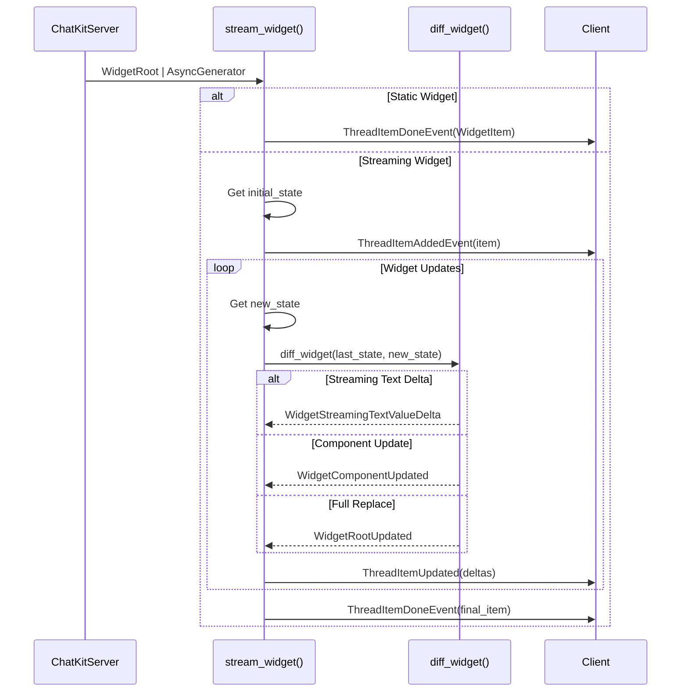
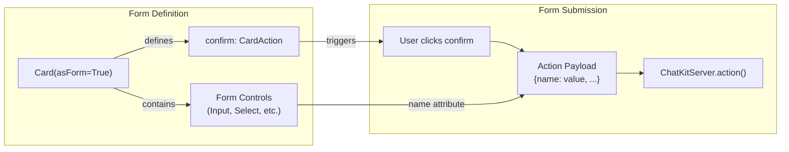

<!-- source: DeepWiki mcp.deepwiki.com · repo openai/chatkit-python · page 4.3 Widgets and UI Components · fetched 2026-10-26 -->

# Widgets and UI Components

Relevant source files

The following files were used as context for generating this wiki page:

- [chatkit/widgets.py](chatkit/widgets.py)
- [docs/concepts/tools.md](docs/concepts/tools.md)
- [docs/concepts/widgets.md](docs/concepts/widgets.md)
- [docs/guides/build-interactive-responses-with-widgets.md](docs/guides/build-interactive-responses-with-widgets.md)
- [docs/guides/keep-your-app-in-sync-with-chatkit.md](docs/guides/keep-your-app-in-sync-with-chatkit.md)
- [tests/assets/widgets/basic_root.json](tests/assets/widgets/basic_root.json)
- [tests/assets/widgets/basic_root.widget](tests/assets/widgets/basic_root.widget)
- [tests/test_widgets.py](tests/test_widgets.py)

This page provides a comprehensive guide to ChatKit's widget system, which enables rich, interactive UI components in chat threads. Widgets are Pydantic-based component definitions that render as structured UI elements within chat messages. They support streaming updates, form inputs, actions, and complex layouts.

For information about how widgets integrate with the agent system, see [Agent Integration](#4.1). For details on the Actions system that widgets use to trigger server-side operations, see [Actions System](#4.2). For the broader ThreadItem type hierarchy, see [Threads and Thread Items](#2.4).

---

## Widget Architecture

All widgets are defined as Pydantic models in [chatkit/widgets.py](). The architecture consists of three primary layers:

**Base Layer**: `WidgetComponentBase` [chatkit/widgets.py:173-195]() provides common functionality for all widgets, including:
- `type` field for discriminated union dispatch [chatkit/widgets.py:180]()
- `key` and `id` fields for component identity [chatkit/widgets.py:178-179]()
- Custom serialization that drops `None` values via `_drop_none` [chatkit/widgets.py:162-170]()
- Pydantic model configuration with alias serialization [chatkit/widgets.py:176]()

**Root Layer**: `WidgetRoot` [chatkit/widgets.py:1260-1263]() defines top-level containers that can be rendered as thread items:
- `Card` - versatile container with form support [chatkit/widgets.py:348-384]()
- `ListView` - collection renderer with pagination [chatkit/widgets.py:321-335]()
- `Basic` - minimal container for entity previews [chatkit/widgets.py:313-319]()

**Component Layer**: `WidgetComponent` [chatkit/widgets.py:1265-1298]() is a union of all renderable widgets, including layout containers, text elements, form controls, and display components.

```mermaid
graph TB
    subgraph "Base Class"
        Base["WidgetComponentBase<br/>(type, key, id)"]
    end
    
    subgraph "Root Containers"
        Card["Card<br/>(children, confirm, cancel)"]
        ListView["ListView<br/>(children: ListViewItem[])"]
        Basic["Basic<br/>(minimal container)"]
    end
    
    subgraph "Layout Components"
        Box["Box (direction)"]
        Row["Row"]
        Col["Col"]
        Form["Form (onSubmitAction)"]
        Divider["Divider"]
        Spacer["Spacer"]
    end
    
    subgraph "Text Components"
        Text["Text (value, streaming)"]
        Markdown["Markdown (value, streaming)"]
        Title["Title (value)"]
        Caption["Caption (value)"]
    end
    
    subgraph "Form Controls"
        Input["Input (name)"]
        Textarea["Textarea (name)"]
        Select["Select (name, options)"]
        DatePicker["DatePicker (name)"]
        Checkbox["Checkbox (name)"]
        RadioGroup["RadioGroup (name, options)"]
        Button["Button (onClickAction)"]
    end
    
    subgraph "Display Components"
        Image["Image (src)"]
        Icon["Icon (name)"]
        Badge["Badge (label)"]
        Chart["Chart (data, series)"]
    end
    
    Base --> Card
    Base --> ListView
    Base --> Basic
    Base --> Box
    Base --> Row
    Base --> Col
    Base --> Form
    Base --> Text
    Base --> Markdown
    Base --> Input
    Base --> Button
    Base --> Image
    Base --> Chart
    
    Card -->|contains| WidgetComponent["WidgetComponent Union"]
    ListView -->|contains| ListViewItem["ListViewItem"]
    Box -->|contains| WidgetComponent
    Row -->|contains| WidgetComponent
    Col -->|contains| WidgetComponent
    Form -->|contains| WidgetComponent
    ListViewItem -->|contains| WidgetComponent
```

**Sources**: [chatkit/widgets.py:173-195](), [chatkit/widgets.py:1260-1298](), [docs/concepts/widgets.md:24-30]()

---

## Widget Templates

The modern way to author widgets is using the [ChatKit Studio](https://widgets.chatkit.studio/). These are exported as `.widget` files which can be loaded and hydrated dynamically.

**WidgetTemplate**: The `WidgetTemplate` class [chatkit/widgets.py:1174-1249]() handles loading these files and rendering them with Jinja2.
- `from_file(path)`: Loads a `.widget` JSON blob from disk [chatkit/widgets.py:1181-1188]().
- `build(data)`: Hydrates the template with real data and returns a `DynamicWidgetRoot` [chatkit/widgets.py:1200-1234]().

For details, see [Widget Templates](#4.3.1).

**Sources**: [chatkit/widgets.py:1174-1249](), [docs/concepts/widgets.md:32-35](), [docs/guides/build-interactive-responses-with-widgets.md:18-39]()

---

## Widget Type System

### Layout Components

**Box, Row, Col**: Flex containers for layout control. All three inherit from `BoxBase` [chatkit/widgets.py:530-580]() which provides comprehensive layout properties:
- Flexbox alignment: `align`, `justify`, `wrap`, `flex`
- Sizing: `height`, `width`, `size`, `minHeight`, `maxHeight`, `minWidth`, `maxWidth`
- Spacing: `gap`, `padding`, `margin`
- Visual: `border`, `radius`, `background`, `aspectRatio`

`Box` [chatkit/widgets.py:582-588]() accepts a `direction` prop (`row` or `col`). `Row` [chatkit/widgets.py:590-594]() and `Col` [chatkit/widgets.py:596-599]() are specialized variants.

**Form**: A layout container that captures form data [chatkit/widgets.py:602-610](). Includes `onSubmitAction` which receives form field values as payload.

**Divider**: Visual separator [chatkit/widgets.py:612-629]().

**Spacer**: Flexible space pusher [chatkit/widgets.py:759-765]().

### Text Components

**Text**: Plain text with typography controls [chatkit/widgets.py:422-458]().
- Content: `value` (string content)
- Streaming: `streaming=True` enables incremental text updates [chatkit/widgets.py:446]()
- Interaction: `editable` supports inline editing [chatkit/widgets.py:447]()

**Markdown**: Markdown rendering [chatkit/widgets.py:412-420]() with `value` and `streaming` properties.

**Title**: Prominent headline text [chatkit/widgets.py:460-484]() with large size tokens.

**Caption**: Supporting text [chatkit/widgets.py:486-510]() with smaller size tokens.

**Sources**: [chatkit/widgets.py:412-629](), [chatkit/widgets.py:759-765]()

### Form Controls

Form controls share common patterns: a `name` field for form submission and optional `onChangeAction`.

**Input**: Single-line text input [chatkit/widgets.py:860-894]().
**Textarea**: Multi-line text with `autoResize` [chatkit/widgets.py:953-987]().
**Select**: Dropdown selector [chatkit/widgets.py:780-806]().
**DatePicker**: Date selection with `min`/`max` bounds [chatkit/widgets.py:808-840]().
**Checkbox**: Boolean input [chatkit/widgets.py:842-858]().
**RadioGroup**: Exclusive selection [chatkit/widgets.py:931-951]().
**Button**: Action trigger with `onClickAction` [chatkit/widgets.py:713-757]().

**Sources**: [chatkit/widgets.py:713-987]()

### Display Components

**Image**: Image rendering with `src`, `fit`, and `aspectRatio` [chatkit/widgets.py:649-711]().
**Icon**: Built-in icon from the `IconName` library [chatkit/widgets.py:631-647]().
**Badge**: Status indicator with semantic colors [chatkit/widgets.py:512-528]().
**Chart**: Data visualization using `BarSeries`, `AreaSeries`, or `LineSeries` [chatkit/widgets.py:997-1039]().

**Sources**: [chatkit/widgets.py:512-528](), [chatkit/widgets.py:631-711](), [chatkit/widgets.py:997-1039]()

---

## Widget Streaming

Widgets support incremental updates through `stream_widget()` [chatkit/server.py:175-224](). This enables real-time UI updates as content is generated.

**Sources**: [chatkit/server.py:175-224](), [chatkit/server.py:79-172]()

### Diffing Mechanism

The `diff_widget()` function [chatkit/server.py:79-172]() compares two widget states. For `Text` and `Markdown` components with `id` fields, it calculates `WidgetStreamingTextValueDelta` [chatkit/server.py:133-146](). If the structural changes are too significant, it falls back to a full `WidgetRootUpdated` [chatkit/server.py:168-172]().

**Sources**: [chatkit/server.py:79-172](), [tests/test_widgets.py:20-132]()

---

## Form Handling

Forms in ChatKit capture and submit user input without requiring free-text prompts.

**Sources**: [chatkit/widgets.py:348-384](), [docs/guides/build-interactive-responses-with-widgets.md:126-160]()

### Form Submission
When `Card.asForm` is `True` [chatkit/widgets.py:352](), clicking the `confirm` button [chatkit/widgets.py:365]() gathers all values from child components with a `name` attribute and sends them as the `payload` to the `ChatKitServer.action` handler [chatkit/server.py:300-310]().

**Sources**: [chatkit/widgets.py:348-384](), [chatkit/server.py:300-310]()

---

## Styling and Tokens

ChatKit uses a token-based styling system for consistency.

| Category | Token Types | Examples |
|----------|-------------|----------|
| **Color** | `ThemeColor` [chatkit/widgets.py:31-38]() | `{ "light": "blue-600", "dark": "blue-300" }` |
| **Radius** | `RadiusValue` [chatkit/widgets.py:129-132]() | `xs`, `md`, `lg`, `full`, `none` |
| **Size** | `TextSize`, `TitleSize`, `IconSize` [chatkit/widgets.py:137-147]() | `sm`, `md`, `xl`, `5xl` |
| **Flex** | `Alignment`, `Justification` [chatkit/widgets.py:149-154]() | `center`, `between`, `stretch` |
| **Variant** | `ControlVariant` [chatkit/widgets.py:156-157]() | `solid`, `soft`, `outline`, `ghost` |

**Sources**: [chatkit/widgets.py:31-160]()

---

