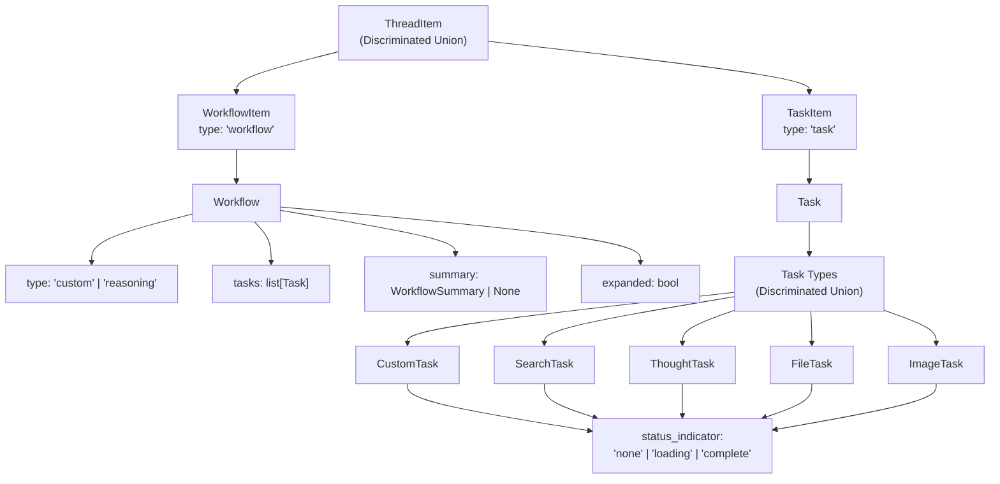
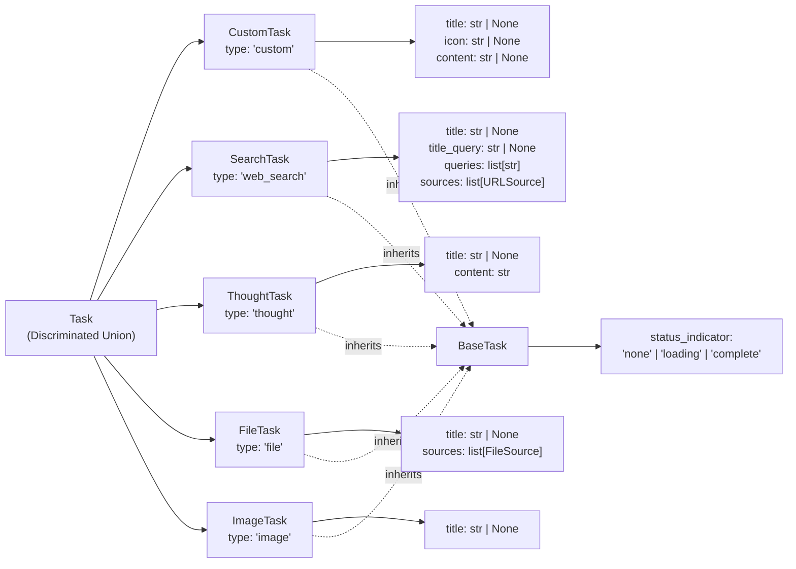
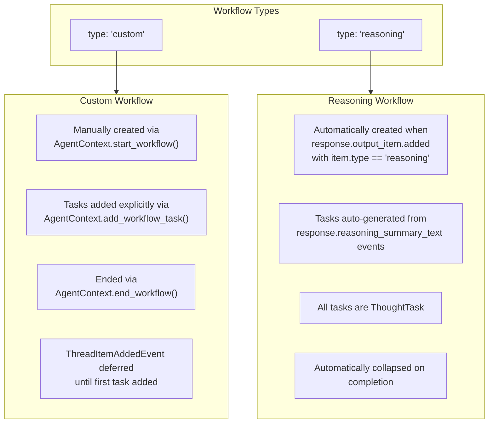
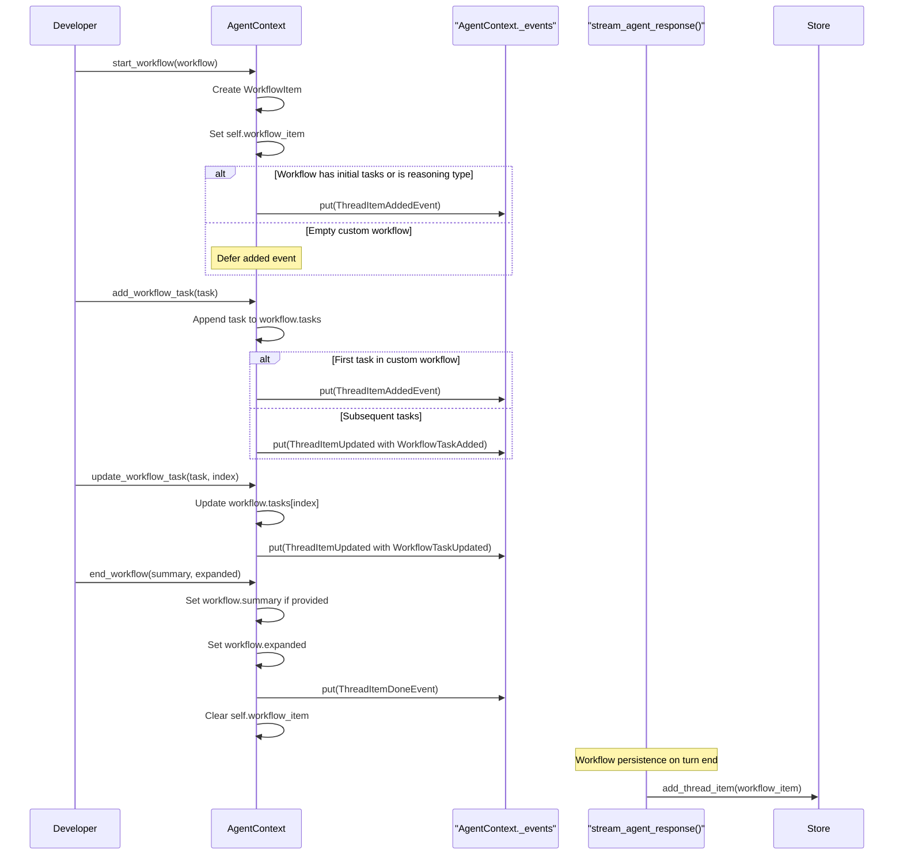
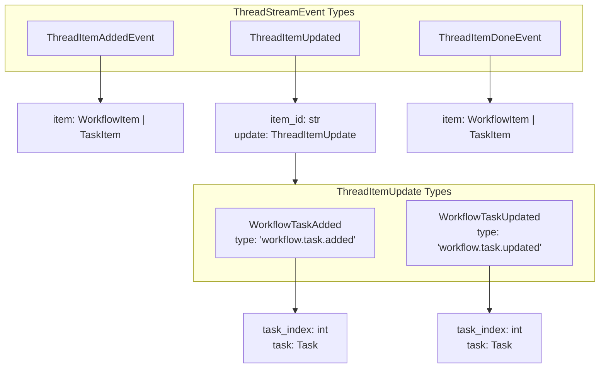
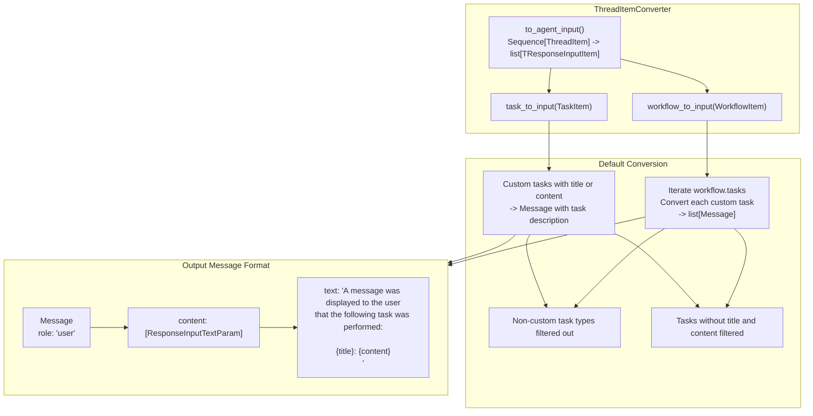

<!-- source: DeepWiki mcp.deepwiki.com · repo openai/chatkit-python · page 4.4 Workflows and Tasks · fetched 2026-10-26 -->

# Workflows and Tasks

<details>
<summary>Relevant source files</summary>

The following files were used as context for generating this wiki page:

- [chatkit/agents.py](chatkit/agents.py)
- [chatkit/types.py](chatkit/types.py)
- [tests/test_agents.py](tests/test_agents.py)
- [tests/test_chatkit_server.py](tests/test_chatkit_server.py)

</details>


This document explains the workflow and task system in ChatKit, which enables displaying multi-step reasoning processes and structured operations in the chat UI. Workflows organize related tasks into expandable/collapsible groups, while tasks represent individual steps or operations. Both can be displayed as thread items and streamed incrementally during agent responses.

For information about other thread item types, see [Threads and Thread Items](#2.4). For details on streaming events and updates, see [Streaming Events](#2.3). For agent integration patterns, see [Agent Integration](#4.1).

## Core Type System

ChatKit provides two thread item types for representing structured processes: `WorkflowItem` and `TaskItem`. Workflows contain multiple tasks and display as collapsible groups, while standalone tasks display as individual items.

Title: Workflow and Task Data Model


**WorkflowItem Structure**

A `WorkflowItem` wraps a `Workflow` object containing tasks and metadata:

| Field | Type | Description |
|-------|------|-------------|
| `id` | `str` | Unique identifier |
| `thread_id` | `str` | Parent thread ID |
| `created_at` | `datetime` | Creation timestamp |
| `type` | `Literal["workflow"]` | Discriminator |
| `workflow` | `Workflow` | Workflow data |

**Workflow Structure**

| Field | Type | Description |
|-------|------|-------------|
| `type` | `Literal["custom", "reasoning"]` | Workflow category |
| `tasks` | `list[Task]` | Ordered list of tasks |
| `summary` | `WorkflowSummary \| None` | Optional summary display |
| `expanded` | `bool` | Whether to show expanded by default |

**TaskItem Structure**

A `TaskItem` contains a single task outside a workflow context:

| Field | Type | Description |
|-------|------|-------------|
| `id` | `str` | Unique identifier |
| `thread_id` | `str` | Parent thread ID |
| `created_at` | `datetime` | Creation timestamp |
| `type` | `Literal["task"]` | Discriminator |
| `task` | `Task` | Task data |

Sources: [chatkit/types.py:553-564](), [chatkit/types.py:697-710](), [chatkit/types.py:713-720]()

## Task Types

ChatKit defines five task types, each optimized for different display patterns. All tasks share a `status_indicator` field for workflow progress visualization.

Title: Task Subtypes Hierarchy


### CustomTask

Generic task type for arbitrary operations. Supports optional title, icon, and content.

| Field | Type | Description |
|-------|------|-------------|
| `type` | `Literal["custom"]` | Discriminator |
| `title` | `str \| None` | Display title |
| `icon` | `str \| None` | Icon name |
| `content` | `str \| None` | Task description or result |
| `status_indicator` | `Literal["none", "loading", "complete"]` | Progress indicator |

### SearchTask

Specialized for web search operations, displaying queries and result sources.

| Field | Type | Description |
|-------|------|-------------|
| `type` | `Literal["web_search"]` | Discriminator |
| `title` | `str \| None` | Display title |
| `title_query` | `str \| None` | Query shown in title |
| `queries` | `list[str]` | Search queries executed |
| `sources` | `list[URLSource]` | Retrieved sources |
| `status_indicator` | `Literal["none", "loading", "complete"]` | Progress indicator |

### ThoughtTask

Captures reasoning or internal thought processes. Primary task type for `reasoning` workflows.

| Field | Type | Description |
|-------|------|-------------|
| `type` | `Literal["thought"]` | Discriminator |
| `title` | `str \| None` | Optional title |
| `content` | `str` | Reasoning content (required) |
| `status_indicator` | `Literal["none", "loading", "complete"]` | Progress indicator |

### FileTask

Displays file references and sources.

| Field | Type | Description |
|-------|------|-------------|
| `type` | `Literal["file"]` | Discriminator |
| `title` | `str \| None` | Display title |
| `sources` | `list[FileSource]` | Referenced files |
| `status_indicator` | `Literal["none", "loading", "complete"]` | Progress indicator |

### ImageTask

Represents image generation or processing tasks.

| Field | Type | Description |
|-------|------|-------------|
| `type` | `Literal["image"]` | Discriminator |
| `title` | `str \| None` | Display title |
| `status_indicator` | `Literal["none", "loading", "complete"]` | Progress indicator |

Sources: [chatkit/types.py:723-789](), [chatkit/types.py:726-730]()

## Workflow Types and Behavior

ChatKit supports two workflow categories with distinct creation and lifecycle patterns.

Title: Workflow Behavior Comparison


### Custom Workflows

Developer-controlled workflows for any multi-step process. The workflow is created by calling `AgentContext.start_workflow()` and tasks are added explicitly.

**Key Behaviors:**
- `ThreadItemAddedEvent` is deferred until the first task is added (unless workflow has initial tasks) [chatkit/agents.py:174-178]()
- Summary defaults to `DurationSummary` if not set before ending [chatkit/agents.py:156-160]()
- `expanded` defaults to `False` unless explicitly set [chatkit/agents.py:147-148]()
- Workflow can be resumed across multiple turns by storing the `WorkflowItem` [chatkit/agents.py:586-590]()

### Reasoning Workflows

Automatically generated workflows for OpenAI reasoning model responses. The SDK detects reasoning output and creates workflows transparently.

**Key Behaviors:**
- Created automatically when `response.output_item.added` event has `item.type == "reasoning"` [chatkit/agents.py:469-477]()
- All tasks are `ThoughtTask` instances generated from `response.reasoning_summary_text` events [chatkit/agents.py:491-532]()
- First task is streamed incrementally via `response.reasoning_summary_text.delta` events [chatkit/agents.py:503-528]()
- Automatically collapsed (`expanded = False`) on completion [chatkit/agents.py:381-383]()
- Summary defaults to `DurationSummary` based on workflow creation to completion time [chatkit/agents.py:158-160]()

Sources: [chatkit/types.py:700](), [chatkit/agents.py:146-180](), [chatkit/agents.py:469-532]()

## Workflow Lifecycle Management

The `AgentContext` class provides methods for creating and managing workflows during streaming responses.

Title: AgentContext Workflow Management API


### AgentContext.start_workflow()

Creates a new workflow and sets it as the active workflow in the context.

```python
async def start_workflow(self, workflow: Workflow) -> None
```

**Behavior:**
- Creates `WorkflowItem` with generated ID and current timestamp [chatkit/agents.py:167-172]()
- Sets `AgentContext.workflow_item` to track active workflow [chatkit/agents.py:167]()
- Emits `ThreadItemAddedEvent` immediately if the workflow type is `"reasoning"` or if it has initial tasks [chatkit/agents.py:174-178]()

### AgentContext.add_workflow_task()

Adds a task to the active workflow (or creates workflow if none exists).

```python
async def add_workflow_task(self, task: Task) -> None
```

**Behavior:**
- Creates new custom workflow if `workflow_item` is `None` [chatkit/agents.py:198-203]()
- Appends task to `workflow.tasks` list [chatkit/agents.py:205]()
- Emits `ThreadItemAddedEvent` if this is the first task in a custom workflow [chatkit/agents.py:207-208]()
- Otherwise emits `ThreadItemUpdated` with `WorkflowTaskAdded` update [chatkit/agents.py:210-217]()

### AgentContext.update_workflow_task()

Updates an existing task at a specific index.

```python
async def update_workflow_task(self, task: Task, task_index: int) -> None
```

**Behavior:**
- Updates `workflow.tasks[task_index]` reference [chatkit/agents.py:185]()
- Emits `ThreadItemUpdated` with `WorkflowTaskUpdated` containing updated task and index [chatkit/agents.py:186-194]()
- Raises `ValueError` if no workflow is active [chatkit/agents.py:183]()

### AgentContext.end_workflow()

Completes the active workflow and emits done event.

```python
async def end_workflow(
    self, summary: WorkflowSummary | None = None, expanded: bool = False
) -> None
```

**Behavior:**
- Returns early if no workflow is active [chatkit/agents.py:150-152]()
- Sets `workflow.summary` to provided value or generates `DurationSummary` if `None` [chatkit/agents.py:154-160]()
- Sets `workflow.expanded` to provided value [chatkit/agents.py:161]()
- Emits `ThreadItemDoneEvent` with final workflow state [chatkit/agents.py:162]()
- Clears `AgentContext.workflow_item` [chatkit/agents.py:163]()

Sources: [chatkit/agents.py:146-218](), [chatkit/agents.py:586-590]()

## Streaming Updates and Events

Workflows and tasks generate specific update events that enable incremental UI rendering.

Title: Workflow Streaming Event Types


### WorkflowTaskAdded

Emitted when a task is added to a workflow after the workflow's initial `ThreadItemAddedEvent`.

| Field | Type | Description |
|-------|------|-------------|
| `type` | `Literal["workflow.task.added"]` | Discriminator |
| `task_index` | `int` | Index where task was added |
| `task` | `Task` | The added task |

**When Emitted:**
- Adding tasks to non-empty custom workflows [chatkit/agents.py:210-217]()
- Adding tasks to reasoning workflows [chatkit/agents.py:530-532]()

### WorkflowTaskUpdated

Emitted when an existing task in a workflow is modified.

| Field | Type | Description |
|-------|------|-------------|
| `type` | `Literal["workflow.task.updated"]` | Discriminator |
| `task_index` | `int` | Index of updated task |
| `task` | `Task` | Updated task |

**When Emitted:**
- Calling `AgentContext.update_workflow_task()` [chatkit/agents.py:186-194]()
- Streaming updates to reasoning tasks via `response.reasoning_summary_text.delta` [chatkit/agents.py:516-523]()

Sources: [chatkit/types.py:429-442](), [chatkit/agents.py:180-218](), [chatkit/agents.py:491-532]()

## Integration with Agent Responses

The `stream_agent_response()` function automatically manages workflows during agent streaming, handling both manual and automatic reasoning workflows.

Title: stream_agent_response Workflow Logic

```mermaid
graph TB
    subgraph Input["stream_agent_response() Inputs"]
        Context["AgentContext"]
        Result["RunResultStreaming"]
    end
    
    subgraph Processing["Event Processing"]
        MergeGen["_merge_generators()\nresult.stream_events()\ncontext._events"]
        
        EventWrapper["_EventWrapper\n(from context._events)"]
        StreamEvent["StreamEvent\n(from result.stream_events())"]
        
        MergeGen --> EventWrapper
        MergeGen --> StreamEvent
    end
    
    subgraph ReasoningDetection["Automatic Reasoning Detection"]
        OutputItemAdded["response.output_item.added\nitem.type == 'reasoning'"]
        CreateReasoning["Create WorkflowItem\ntype: 'reasoning'"]
        EmitAdded["Emit ThreadItemAddedEvent"]
        
        OutputItemAdded --> CreateReasoning
        CreateReasoning --> EmitAdded
    end
    
    subgraph ThoughtStreaming["Thought Task Streaming"]
        SummaryDelta["response.reasoning_summary_text.delta"]
        FirstThought{"First task\nin workflow?"}
        CreateThought["Create ThoughtTask with delta"]
        EmitTaskAdded["Emit WorkflowTaskAdded"]
        UpdateThought["Update ThoughtTask.content"]
        EmitTaskUpdated["Emit WorkflowTaskUpdated"]
        
        SummaryDelta --> FirstThought
        FirstThought -->|Yes| CreateThought
        CreateThought --> EmitTaskAdded
        FirstThought -->|No, matches streaming| UpdateThought
        UpdateThought --> EmitTaskUpdated
    end
    
    subgraph Completion["Workflow Completion"]
        SummaryDone["response.reasoning_summary_text.done"]
        CheckStreaming{"Matches\nstreaming task?"}
        FinalizeTask["Finalize ThoughtTask content"]
        AddNewTask["Add new ThoughtTask"]
        
        SummaryDone --> CheckStreaming
        CheckStreaming -->|Yes| FinalizeTask
        CheckStreaming -->|No| AddNewTask
    end
    
    subgraph AutoEnd["Automatic Workflow Ending"]
        OutputItemDone["response.output_item.done\nitem.type == 'message'"]
        EndActive{"Active\nworkflow?"}
        SetDuration["Set DurationSummary"]
        SetCollapsed["Set expanded = False"]
        EmitDone["Emit ThreadItemDoneEvent"]
        
        OutputItemDone --> EndActive
        EndActive -->|Yes| SetDuration
        SetDuration --> SetCollapsed
        SetCollapsed --> EmitDone
    end
    
    Context --> MergeGen
    Result --> MergeGen
    
    StreamEvent --> ReasoningDetection
    StreamEvent --> ThoughtStreaming
    StreamEvent --> Completion
    StreamEvent --> AutoEnd
```


### Automatic Reasoning Workflow Creation

When the OpenAI Responses API indicates reasoning output, `stream_agent_response()` automatically creates and manages a reasoning workflow.

**Detection Logic:** [chatkit/agents.py:469-477]()
- Detected via `response.output_item.added` where `item.type == "reasoning"`.
- Creates a `WorkflowItem` with `type="reasoning"`.

### Thought Task Streaming

The first reasoning task is streamed incrementally to display thinking process in real-time. Subsequent tasks are only added after completion.

**Delta Processing:** [chatkit/agents.py:491-532]()
- First task: Create `ThoughtTask`, emit `WorkflowTaskAdded`, stream content deltas via `WorkflowTaskUpdated`.
- Subsequent deltas: Update content of the active streaming task if indices match.

### Automatic Workflow Ending

Workflows are automatically ended when a visual item (like a message) is added after them, or when the agent response completes.

**Auto-End Conditions:** [chatkit/agents.py:372-383](), [chatkit/agents.py:394-401]()
- Triggered by `response.output_item.done` for a message.
- Automatically collapses reasoning workflows (`expanded = False`).
- Generates a `DurationSummary` based on time elapsed since workflow start.

Sources: [chatkit/agents.py:342-609](), [chatkit/agents.py:469-532](), [chatkit/agents.py:372-401]()

## Conversion to Agent Input

The `ThreadItemConverter` class defines how workflows and tasks are converted to model input when building context for agent responses.

Title: Workflow to Agent Input Conversion


### TaskItem Conversion

**Method:** `ThreadItemConverter.task_to_input(item: TaskItem)` [chatkit/agents.py:669-692]()

**Default Behavior:**
- Returns `None` for non-custom task types (search, thought, file, image).
- Returns `None` if custom task has no title and no content.
- Returns `Message` with formatted text describing task performed.

### WorkflowItem Conversion

**Method:** `ThreadItemConverter.workflow_to_input(item: WorkflowItem)` [chatkit/agents.py:694-722]()

**Default Behavior:**
- Iterates through `workflow.tasks`.
- Converts each custom task with title or content using same format as `task_to_input()`.
- Filters out non-custom task types and empty tasks.

Sources: [chatkit/agents.py:669-722](), [chatkit/agents.py:875-906]()

---

