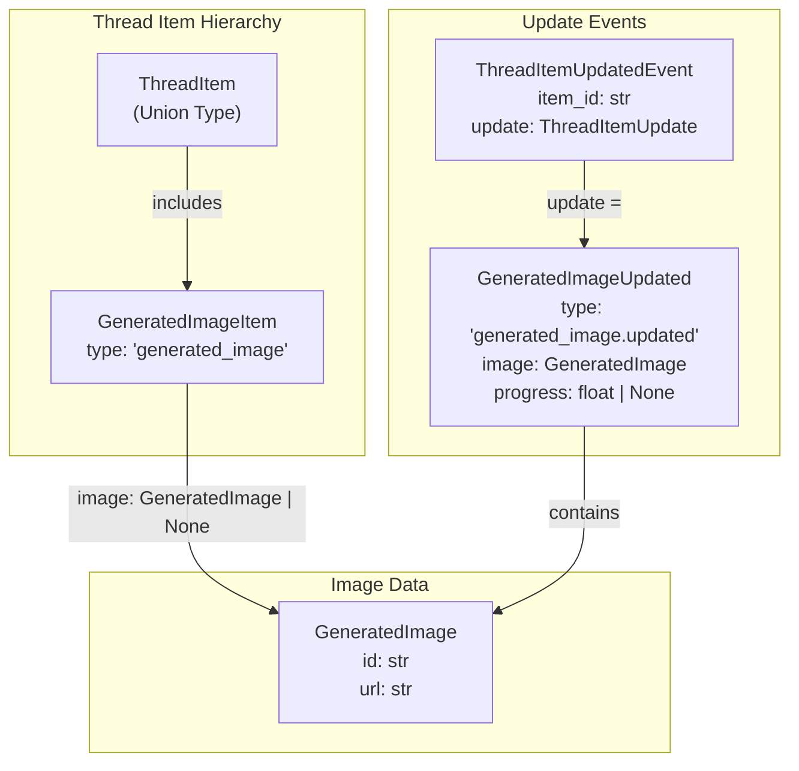
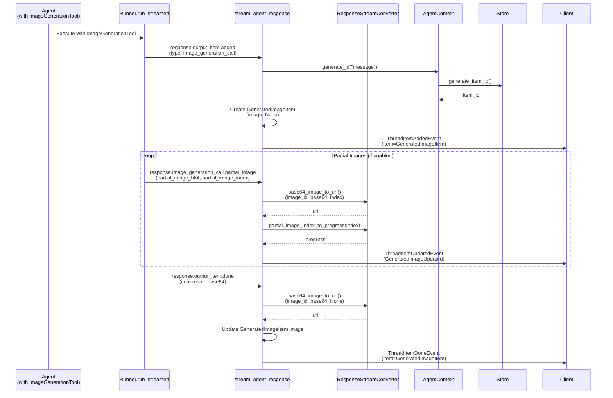
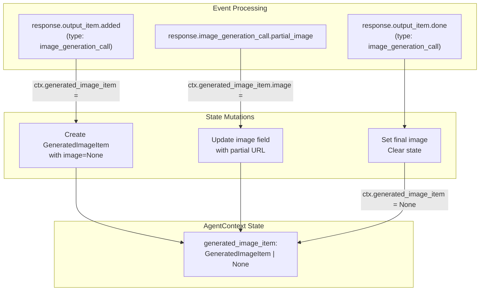
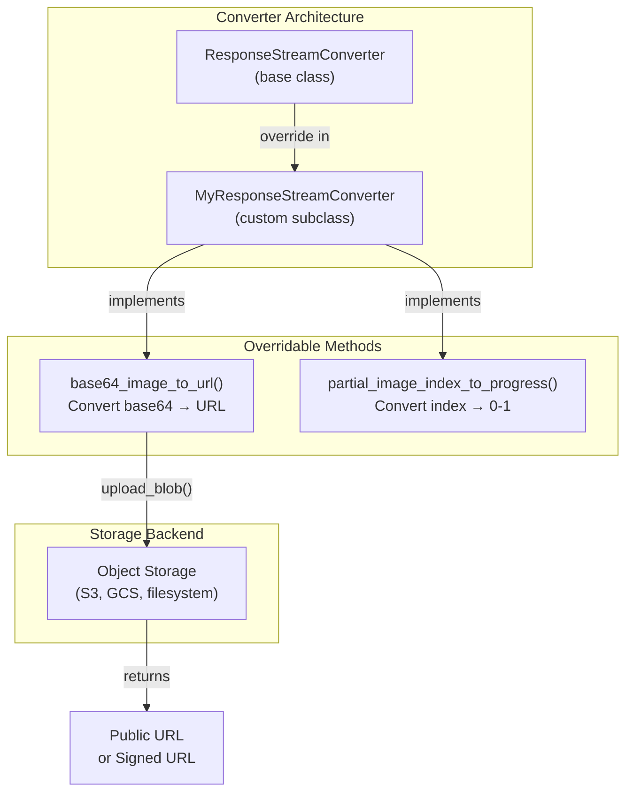
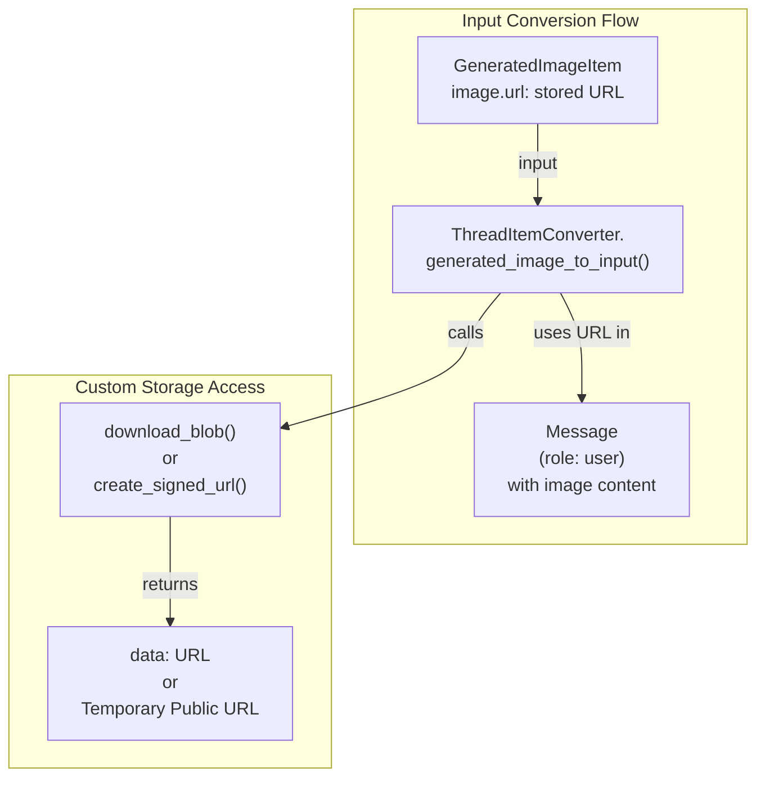

<!-- source: DeepWiki mcp.deepwiki.com · repo openai/chatkit-python · page 4.5 Image Generation · fetched 2026-10-26 -->

# Image Generation

Relevant source files

The following files were used as context for generating this wiki page:

- [chatkit/agents.py](chatkit/agents.py)
- [docs/guides/respond-to-user-message.md](docs/guides/respond-to-user-message.md)
- [docs/guides/stream-generated-images.md](docs/guides/stream-generated-images.md)
- [tests/test_agents.py](tests/test_agents.py)

## Purpose and Scope

This page documents ChatKit's image generation capabilities, including the `GeneratedImageItem` thread item type, integration with the Agents SDK `ImageGenerationTool`, streaming partial image updates with progress tracking, and customization of image storage through `ResponseStreamConverter`. 

For broader agent integration concepts, see [Agent Integration](4.1). For other thread item types, see [Threads and Thread Items](2.4).

---

## Overview

ChatKit supports streaming generated images from AI models to clients as thread items. The system handles:

- **Image generation lifecycle**: From tool invocation through partial updates to final completion [chatkit/agents.py:648-679]().
- **Storage abstraction**: Converting base64-encoded images to URLs suitable for persistence [chatkit/agents.py:339-359]().
- **Progress tracking**: Normalizing partial image indices to progress percentages [chatkit/agents.py:361-375]().
- **Model context**: Converting generated images back to model input for multi-turn conversations [chatkit/agents.py:864-889]().

The core data type is `GeneratedImageItem` [chatkit/types.py:591-603](), which appears in threads alongside messages, widgets, and other items. The integration layer in `stream_agent_response` translates Agents SDK image generation events into ChatKit events, while `ResponseStreamConverter` provides customization hooks for storage.

**Sources**: [chatkit/types.py:591-603](), [chatkit/agents.py:313-411]()

---

## Data Model

### Core Types

**Type Definitions**

| Type | Purpose | Key Fields |
|------|---------|------------|
| `GeneratedImage` | Represents a generated image with URL | `id`, `url` [chatkit/types.py:151-155]() |
| `GeneratedImageItem` | Thread item containing generated image | `id`, `thread_id`, `created_at`, `image` [chatkit/types.py:591-603]() |
| `GeneratedImageUpdated` | Event indicating image update | `image`, `progress` (0-1 or None) [chatkit/types.py:606-611]() |

The `GeneratedImageItem.image` field is `None` when generation starts, then populated with a `GeneratedImage` containing the URL. The `progress` field on `GeneratedImageUpdated` events ranges from 0.0 to 1.0 when partial images are enabled, or remains `None` if progress tracking is disabled [chatkit/agents.py:374-375]().

**Sources**: [chatkit/types.py:151-155](), [chatkit/types.py:591-611](), [chatkit/agents.py:374-375]()

---

## Image Generation Flow

**Flow Description**

1. **Initialization**: When the Agents SDK emits `response.output_item.added` with `type: "image_generation_call"`, `stream_agent_response` creates a `GeneratedImageItem` with `image=None` and generates an item ID via `AgentContext.generate_id("message")` [chatkit/agents.py:648-664]().

2. **Partial Updates**: For each `response.image_generation_call.partial_image` event [chatkit/agents.py:666-679]():
   - Calls `ResponseStreamConverter.base64_image_to_url()` to convert base64 to URL.
   - Calls `partial_image_index_to_progress()` to compute progress (0-1).
   - Emits `ThreadItemUpdatedEvent` with `GeneratedImageUpdated`.

3. **Finalization**: On `response.output_item.done`, converts the final base64 result to URL and emits `ThreadItemDoneEvent` [chatkit/agents.py:760-773]().

4. **Persistence**: The server persists the `GeneratedImageItem` when it receives `ThreadItemDoneEvent`.

**Sources**: [chatkit/agents.py:648-679](), [chatkit/agents.py:760-773]()

---

## Integration with ImageGenerationTool

The Agents SDK provides `ImageGenerationTool` which must be added to the agent's tool list to enable image generation capabilities.

Add `ImageGenerationTool` from the Agents SDK to an agent's `tools` list. The `tool_config` field accepts `"type": "image_generation"`, and optionally `"partial_images": N` to enable streaming of N intermediate previews [docs/guides/stream-generated-images.md:14-26]().

When the agent invokes this tool during a run, the Agents SDK streams image generation events that `stream_agent_response` translates into ChatKit events. The `partial_images` configuration controls how many intermediate previews are streamed before the final image.

**Sources**: [docs/guides/stream-generated-images.md:12-28]()

---

## Stream Processing

The `stream_agent_response` function in [chatkit/agents.py:457-789]() processes Agents SDK events and maintains state for active image generation:

**State Management**

| Event Type | State Action | Output Event |
|------------|-------------|--------------|
| `output_item.added` (image_generation_call) | Create `GeneratedImageItem`, store in `ctx.generated_image_item` | `ThreadItemAddedEvent` [chatkit/agents.py:657-664]() |
| `image_generation_call.partial_image` | Update `ctx.generated_image_item.image` with URL | `ThreadItemUpdatedEvent` with `GeneratedImageUpdated` [chatkit/agents.py:671-679]() |
| `output_item.done` (image_generation_call) | Set final image, clear `ctx.generated_image_item` | `ThreadItemDoneEvent` [chatkit/agents.py:766-773]() |

The `AgentContext.generated_image_item` field tracks the active image being generated [chatkit/agents.py:117](). This allows the stream processor to associate partial image updates with the correct item and update the same item instance across multiple events.

**Sources**: [chatkit/agents.py:117](), [chatkit/agents.py:648-679](), [chatkit/agents.py:760-773]()

---

## Storage Customization with ResponseStreamConverter

### Default Behavior

By default, `ResponseStreamConverter.base64_image_to_url` [chatkit/agents.py:339-359]() returns a `data:image/png;base64,...` data URL directly from the base64-encoded image data. This is convenient for demos but will bloat persisted thread items in a database.

### Custom Storage Implementation

Subclass `ResponseStreamConverter` to upload images to object storage and return public URLs:

**Custom Implementation**

Subclass `ResponseStreamConverter` and override `base64_image_to_url`. The `image_id` parameter is stable across partial updates for the same generation call; use `partial_image_index` to derive distinct blob IDs per partial image [docs/guides/stream-generated-images.md:51-78]().

**Passing the Converter**

Pass a custom converter instance to `stream_agent_response` via its `converter` parameter [chatkit/agents.py:457-462](). The URL returned by `base64_image_to_url` is stored in `GeneratedImage.url` and persisted when the server handles `ThreadItemDoneEvent` [docs/guides/stream-generated-images.md:79-104]().

**Sources**: [chatkit/agents.py:330-375](), [chatkit/agents.py:457-462](), [docs/guides/stream-generated-images.md:33-104]()

---

## Partial Image Streaming

### Configuration

Partial images enable progressive previews during generation. Configure both the tool and converter:

| Component | Configuration | Purpose |
|-----------|--------------|---------|
| `ImageGenerationTool` | `tool_config={"partial_images": N}` | Controls how many partial images SDK streams [docs/guides/stream-generated-images.md:182-187]() |
| `ResponseStreamConverter` | `__init__(partial_images=N)` | Used to compute progress percentage [chatkit/agents.py:334-337]() |

### Progress Calculation

`ResponseStreamConverter.partial_image_index_to_progress` [chatkit/agents.py:361-375]() normalizes partial image indices to a 0-1 progress value. Returns `0.0` when `partial_images` is `None` or `<= 0`; otherwise returns `min(1.0, index / partial_images)`.

**Progress Mapping Example**

With `partial_images=3`:

| Partial Index | Progress Value | Interpretation |
|---------------|----------------|----------------|
| 0 | 0.0 | First preview |
| 1 | 0.333 | Second preview |
| 2 | 0.667 | Third preview |
| Final | 1.0 | Complete image (in `ThreadItemDoneEvent`) |

**Sources**: [chatkit/agents.py:334-337](), [chatkit/agents.py:361-375](), [chatkit/agents.py:657-679]()

---

## Converting Images to Model Input

### Default Behavior

On subsequent turns, `ThreadItemConverter.generated_image_to_input` [chatkit/agents.py:864-889]() converts a `GeneratedImageItem` back to model input. It returns a user-role `Message` with two content parts: an `input_text` part explaining the image was generated by the agent, and an `input_image` part with `image_url=item.image.url` and `detail="auto"`.

### Handling Private URLs

If `item.image.url` points to private storage not accessible by the model API, override this method:

**Custom Implementation**

Override `generated_image_to_input` on a `ThreadItemConverter` subclass to convert `item.image.id` into a URL the model API can access — either by re-fetching the bytes to produce a data URL, or by generating a temporary signed URL [docs/guides/stream-generated-images.md:122-165]().

**Sources**: [chatkit/agents.py:864-889](), [docs/guides/stream-generated-images.md:106-172]()

---

## Summary

| Component | Purpose | Key Methods |
|-----------|---------|-------------|
| `GeneratedImageItem` | Thread item type for generated images | `image: GeneratedImage \| None` [chatkit/types.py:591-603]() |
| `ResponseStreamConverter` | Converts base64 images to URLs | `base64_image_to_url()`, `partial_image_index_to_progress()` [chatkit/agents.py:330-375]() |
| `ThreadItemConverter` | Converts items to model input | `generated_image_to_input()` [chatkit/agents.py:864-889]() |
| `stream_agent_response` | Processes Agents SDK events | Maintains `ctx.generated_image_item` state [chatkit/agents.py:457-789]() |

**Sources**: [chatkit/agents.py:330-889](), [chatkit/types.py:591-611](), [docs/guides/stream-generated-images.md:1-207]()

---

