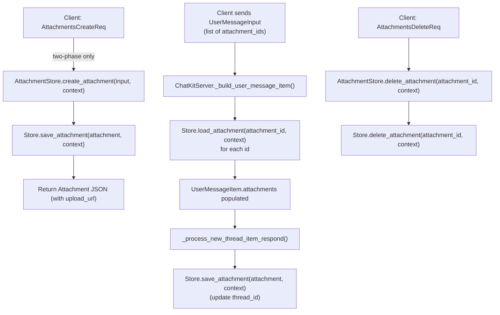
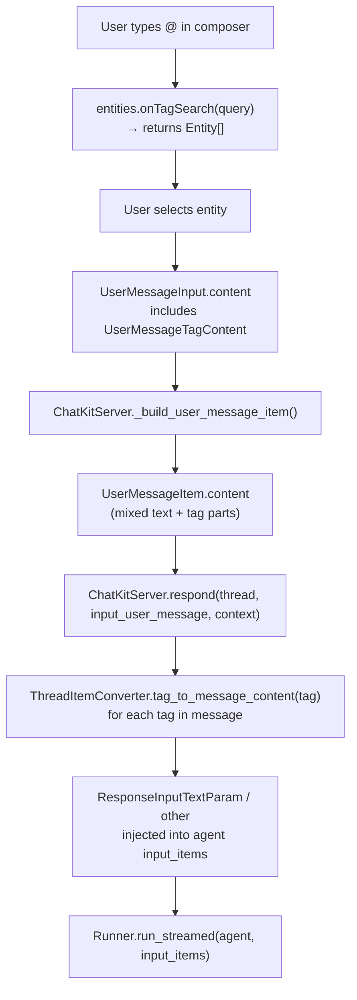

<!-- source: DeepWiki mcp.deepwiki.com · repo openai/chatkit-python · page 4.6 Rich User Input · fetched 2026-10-26 -->

# Rich User Input

<details>
<summary>Relevant source files</summary>

The following files were used as context for generating this wiki page:

- [chatkit/agents.py](chatkit/agents.py)
- [chatkit/server.py](chatkit/server.py)
- [docs/concepts/entities.md](docs/concepts/entities.md)
- [docs/guides/accept-rich-user-input.md](docs/guides/accept-rich-user-input.md)
- [docs/guides/add-annotations.md](docs/guides/add-annotations.md)
- [tests/test_agents.py](tests/test_agents.py)

</details>


This page covers how ChatKit accepts user input beyond plain text: **file attachments**, **audio dictation** (speech-to-text), and **@-mention entity tags**. It explains the server-side abstractions, upload strategies, and conversion hooks that make each feature work.

For the overall server request lifecycle, see **2.2 Request and Response Flow**. For how `ThreadItemConverter` feeds attachments and tags into model input, see **4.1 Agent Integration**. For the `Store` and `AttachmentStore` interface signatures, see **3.2 Storage Interfaces**.

---

## Overview

The three rich input types and where they are handled:

| Input type | Client gesture | Server hook | Conversion to model input |
|---|---|---|---|
| File attachment | File picker in composer | `AttachmentStore.create_attachment` / direct upload endpoint | `ThreadItemConverter.attachment_to_message_content` |
| Audio dictation | Record button in composer | `ChatKitServer.transcribe` | Returns `TranscriptionResult`; text appears in composer before send |
| @-mention entity tag | `@` search in composer | — (arrives inside `UserMessageItem`) | `ThreadItemConverter.tag_to_message_content` |

All three features require opt-in on the React client (`composer.attachments`, `composer.dictation`, `entities.onTagSearch`) and corresponding server-side implementation.

---

## File Attachments

### Concepts

An `Attachment` object carries file metadata (id, MIME type, name, optional `upload_url`, optional `preview_url`) [chatkit/agents.py:59](). Attachment metadata lives in the `Store` (via `Store.save_attachment` / `Store.load_attachment`) [chatkit/server.py:28](). The raw file bytes live wherever your application stores blobs; ChatKit does not manage bytes directly.

`AttachmentStore` is an abstract class in `chatkit/store.py` that bridges between ChatKit's attachment lifecycle events and your blob storage [chatkit/store.py:48-65](). It has two methods:

| Method | Required | Purpose |
|---|---|---|
| `delete_attachment(attachment_id, context)` | **Yes** (abstract) | Delete blob when the user removes an attachment [chatkit/store.py:64-65]() |
| `create_attachment(input, context)` | No (raises `NotImplementedError`) | Create attachment record and `upload_url` for two-phase upload [chatkit/store.py:54-62]() |

Sources: [chatkit/store.py:48-65](), [chatkit/agents.py:59](), [chatkit/server.py:28]()

### Upload Strategies

**Diagram: Attachment Upload Strategies**

```mermaid
sequenceDiagram
    participant C as "React Client"
    participant E as "Custom Upload Endpoint (direct)"
    participant S as "ChatKitServer.process (two-phase)"
    participant AS as "AttachmentStore"
    participant BS as "Blob Storage"

    note over C,BS "Direct Upload"
    C->>E: "multipart/form-data (file bytes)"
    E->>BS: "store bytes"
    E->>AS: "Store.save_attachment(attachment)"
    E-->>C: "Attachment JSON"

    note over C,BS "Two-Phase Upload"
    C->>S: "AttachmentsCreateReq"
    S->>AS: "AttachmentStore.create_attachment(input)"
    AS->>BS: "issue presigned upload_url"
    AS-->>S: "Attachment (with upload_url)"
    S->>AS: "Store.save_attachment(attachment)"
    S-->>C: "Attachment JSON (with upload_url)"
    C->>BS: "multipart/form-data → upload_url"
```

Sources: [docs/guides/accept-rich-user-input.md:36-127](), [chatkit/server.py:471-486]()

#### Direct Upload

The client posts file bytes directly to a custom endpoint you control (e.g. `/files`). That endpoint:
1. Writes bytes to your blob store.
2. Constructs an `Attachment` model.
3. Calls `Store.save_attachment` to persist the metadata record.
4. Returns the `Attachment` JSON to the client.

`AttachmentStore.delete_attachment` must be implemented; `ChatKitServer` calls `Store.delete_attachment` (metadata) after the attachment store deletes the blob. The corresponding `ChatKitReq` type for deletion is `AttachmentsDeleteReq`, handled in `ChatKitServer._process_non_streaming` [chatkit/server.py:478-486]().

Sources: [docs/guides/accept-rich-user-input.md:46-77](), [chatkit/server.py:478-486]()

#### Two-Phase Upload

The client sends an `AttachmentsCreateReq` to the server. `ChatKitServer._process_non_streaming` forwards it to `AttachmentStore.create_attachment` [chatkit/server.py:471-477](), which must:
1. Generate an attachment ID.
2. Create a presigned/temporary `upload_url` pointing to your blob store.
3. Build and return an `Attachment` model (with `upload_url` set).

The server then calls `Store.save_attachment` to persist the metadata, and returns the `Attachment` (including the `upload_url`) to the client. The client uploads bytes to `upload_url` in a second HTTP request.

Sources: [docs/guides/accept-rich-user-input.md:79-127](), [chatkit/store.py:54-65](), [chatkit/server.py:471-477]()

### Attachment Lifecycle in `ChatKitServer`

**Diagram: Attachment Data Flow through ChatKitServer**



Sources: [chatkit/server.py:471-486](), [chatkit/server.py:915-931](), [chatkit/server.py:735-753]()

When a user sends a message, attachment IDs are sent as part of `UserMessageInput`. `_build_user_message_item` resolves each ID by calling `Store.load_attachment`, populates `UserMessageItem.attachments` [chatkit/server.py:915-931](), then `_process_new_thread_item_respond` re-saves each attachment to associate it with the thread ID [chatkit/server.py:740-743]().

### Converting Attachments to Model Input

Attachments arrive in `ChatKitServer.respond` on `input_user_message.attachments`. The default `ThreadItemConverter` does not convert them; you must subclass and implement `attachment_to_message_content` [chatkit/agents.py:483-485]():

```python
# chatkit/agents.py - ThreadItemConverter
async def attachment_to_message_content(
    self, attachment: Attachment
) -> ResponseInputContentParam:
    # Override to return a ResponseInputContentParam
    ...
```

The method receives an `Attachment` subtype (e.g. `ImageAttachment`) and should return a `ResponseInputImageParam`, `ResponseInputFileParam`, or similar from `openai.types.responses`.

Sources: [docs/guides/accept-rich-user-input.md:129-165](), [chatkit/agents.py:483-485]()

---

## Audio Dictation (Transcription)

### Concept

When dictation is enabled on the client, the user records audio in the composer. The client sends an `InputTranscribeReq` to the server containing base64-encoded audio bytes and a MIME type [chatkit/server.py:46](). `ChatKitServer` decodes the bytes and calls `ChatKitServer.transcribe`, which must return a `TranscriptionResult` [chatkit/server.py:328-345](). The transcribed text is inserted into the composer; the user can edit it before sending.

### Request Dispatch

`_process_non_streaming` handles `InputTranscribeReq` [chatkit/server.py:487-493]():

```
InputTranscribeReq
  → base64.b64decode(request.params.audio_base64)
  → ChatKitServer.transcribe(AudioInput(data=..., mime_type=...), context)
  → TranscriptionResult JSON
```

### `ChatKitServer.transcribe` Signature

```python
# chatkit/server.py:328-345
async def transcribe(
    self, audio_input: AudioInput, context: TContext
) -> TranscriptionResult:
    """Transcribe audio input to text."""
    raise NotImplementedError("Audio transcription is not implemented.")
```

The default implementation raises `NotImplementedError`. Override it to add transcription support. `AudioInput` provides the raw `bytes` and `mime_type` [chatkit/server.py:39]().

Sources: [chatkit/server.py:328-345](), [chatkit/server.py:487-493](), [docs/guides/accept-rich-user-input.md:175-229]()

---

## @-Mention Entity Tags

### Concept

Users type `@` in the composer to search and select named entities. Selected entities are serialized into the `UserMessageItem` as `UserMessageTagContent` objects [chatkit/agents.py:81](). On the server, `ThreadItemConverter.tag_to_message_content` converts each tag into model-readable content before the agent is invoked.

### Data Model

A `UserMessageItem` has a `content` field that is a list of content parts [chatkit/agents.py:79-82](). Text parts and tag parts can be interleaved. A tag content part is a `UserMessageTagContent` with:

| Field | Description |
|---|---|
| `id` | The entity ID returned from the client search [chatkit/agents.py:81]() |
| `text` | The display label shown in the composer |
| `data` | Arbitrary JSON object provided when the entity was returned |

### Flow: Client to Model

**Diagram: @-Mention Tag Flow from Composer to Agent**



Sources: [docs/guides/accept-rich-user-input.md:232-345](), [chatkit/agents.py:487-489]()

### Implementing `tag_to_message_content`

Subclass `ThreadItemConverter` and override `tag_to_message_content` [chatkit/agents.py:487-489](). It receives a `UserMessageTagContent` and returns a `ResponseInputContentParam` (typically a `ResponseInputTextParam`):

```python
# chatkit/agents.py - ThreadItemConverter
async def tag_to_message_content(
    self, tag: UserMessageTagContent
) -> ResponseInputContentParam:
    # Default implementation returns text param with tag.text
    return ResponseInputTextParam(type="text", text=tag.text)
```

The returned content is inserted into the model input alongside the rest of the user message.

Sources: [docs/guides/accept-rich-user-input.md:272-300](), [chatkit/agents.py:487-489]()

---

## Summary: Key Code Entities

| Feature | Python class/method | Module |
|---|---|---|
| Attachment create (two-phase) | `AttachmentStore.create_attachment` | `chatkit/store.py` |
| Attachment delete | `AttachmentStore.delete_attachment` | `chatkit/store.py` |
| Attachment metadata persistence | `Store.save_attachment`, `Store.load_attachment` | `chatkit/store.py` |
| Attachment → model content | `ThreadItemConverter.attachment_to_message_content` | `chatkit/agents.py` |
| Audio transcription | `ChatKitServer.transcribe` | `chatkit/server.py` |
| Audio input model | `AudioInput` | `chatkit/server.py` |
| Tag → model content | `ThreadItemConverter.tag_to_message_content` | `chatkit/agents.py` |
| Tag data model | `UserMessageTagContent` | `chatkit/agents.py` |

Sources: [chatkit/server.py:471-493](), [chatkit/store.py:48-65](), [chatkit/agents.py:483-489]()

---

