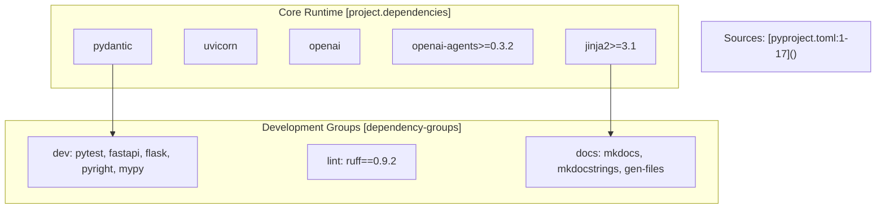
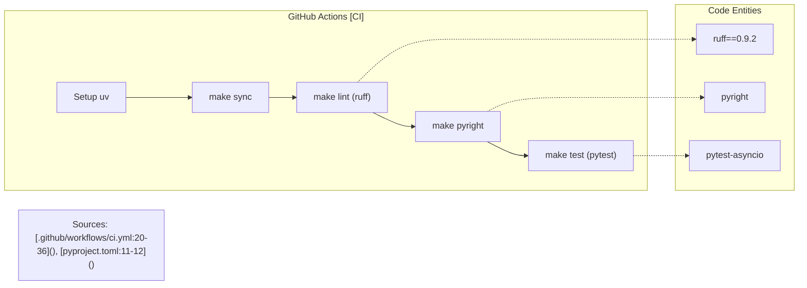

<!-- source: DeepWiki mcp.deepwiki.com · repo openai/chatkit-python · page 5 Development Guide · fetched 2026-10-26 -->

# Development Guide

Relevant source files

The following files were used as context for generating this wiki page:

- [.github/workflows/ci.yml](.github/workflows/ci.yml)
- [Makefile](Makefile)
- [docs/release.md](docs/release.md)
- [pyproject.toml](pyproject.toml)

This page provides a navigational overview of the development workflow for the `openai-chatkit` Python SDK. It covers project setup, testing strategies, documentation generation, and the release process.

For a hands-on walkthrough of building your first server, see [Quickstart and Project Setup](#5.1).

---

## Development Environment and Tooling

The project uses `uv` for dependency management and environment isolation. The development lifecycle is managed through a `Makefile` that wraps common tasks like linting, testing, and documentation builds.

### Dependency Management

The dependency structure is defined in [pyproject.toml:1-98](). It categorizes requirements into core dependencies and specialized development groups.

### Makefile Commands

| Command | Action | Description |
|:---|:---|:---|
| `make install` | `uv sync --all-extras` | Sets up the virtual environment and all dependencies [Makefile:3-4](). |
| `make lint` | `uv run ruff check` | Runs the Ruff linter [Makefile:13-14](). |
| `make pyright` | `uv run pyright` | Performs static type checking [Makefile:19-20](). |
| `make test` | `uv run pytest` | Executes the test suite [Makefile:22-23](). |
| `make check` | `format + lint + pyright + test` | Full quality assurance suite [Makefile:34](). |

**Sources:** [Makefile:1-34]()

---

## Documentation System

The documentation is built using **MkDocs** with the **Material** theme. It leverages `mkdocstrings` to pull documentation directly from Python source code and `mkdocs-gen-files` to automate the creation of the API reference.

### Documentation Workflow
1. **Source**: Markdown files in `docs/` and Google-style docstrings in `chatkit/`.
2. **Build**: `uv run mkdocs build` generates a static site.
3. **Preview**: `make serve-docs` starts a local development server with live-reloading [Makefile:28-29]().
4. **Deploy**: The GitHub Actions workflow automates publishing to GitHub Pages via `make deploy-docs` [Makefile:31-32]().

For details, see [Documentation System](#5.2).

**Sources:** [pyproject.toml:13-14](), [Makefile:28-32]()

---

## Testing and Quality Assurance

The project maintains high code quality through rigorous automated testing and static analysis.

### CI/CD Pipeline
The CI pipeline, defined in [.github/workflows/ci.yml:1-36](), runs on every pull request. It ensures that code is formatted, linted, type-checked, and passes all tests before merging.

### Test Suite Structure
Tests are located in the `tests/` directory and use `pytest` with `asyncio_mode = "auto"` [pyproject.toml:81-82]().
- **Server Tests**: Validate `ChatKitServer.process` and streaming logic.
- **Store Tests**: Ensure `SQLiteStore` (test helper) and `Store` interfaces function correctly.
- **Widget Tests**: Verify `WidgetTemplate` rendering and `jinja2` integration.

For details, see [Testing and Quality Assurance](#5.3).

**Sources:** [pyproject.toml:81-83](), [.github/workflows/ci.yml:1-36]()

---

## Release Process and Versioning

### Versioning Policy
The project follows semantic versioning. 
- **Minor versions** (e.g., `1.5.0` to `1.6.0`) are used for **breaking changes** to public interfaces [docs/release.md:7-11]().
- **Patch versions** (e.g., `1.6.2` to `1.6.3`) are used for bug fixes and new non-breaking features [docs/release.md:13-19]().

### Release Steps
1. **Update Version**: Increment the version in `pyproject.toml` [pyproject.toml:3]().
2. **Changelog**: Document changes in `docs/release.md` [docs/release.md:21-51]().
3. **GitHub Release**: Creating a new release on GitHub triggers an automated workflow to publish the package to PyPI.

For details, see [Release Process and Versioning](#5.4).

**Sources:** [docs/release.md:1-51](), [pyproject.toml:1-7]()

---

