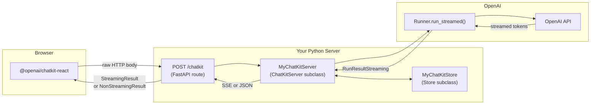
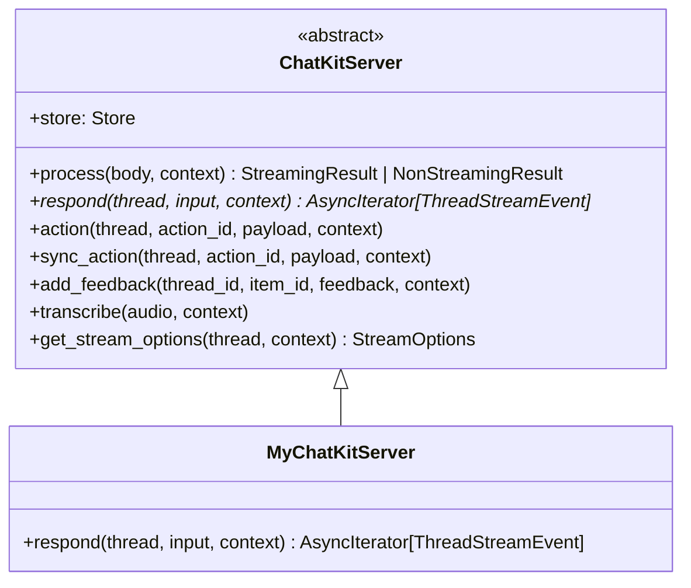
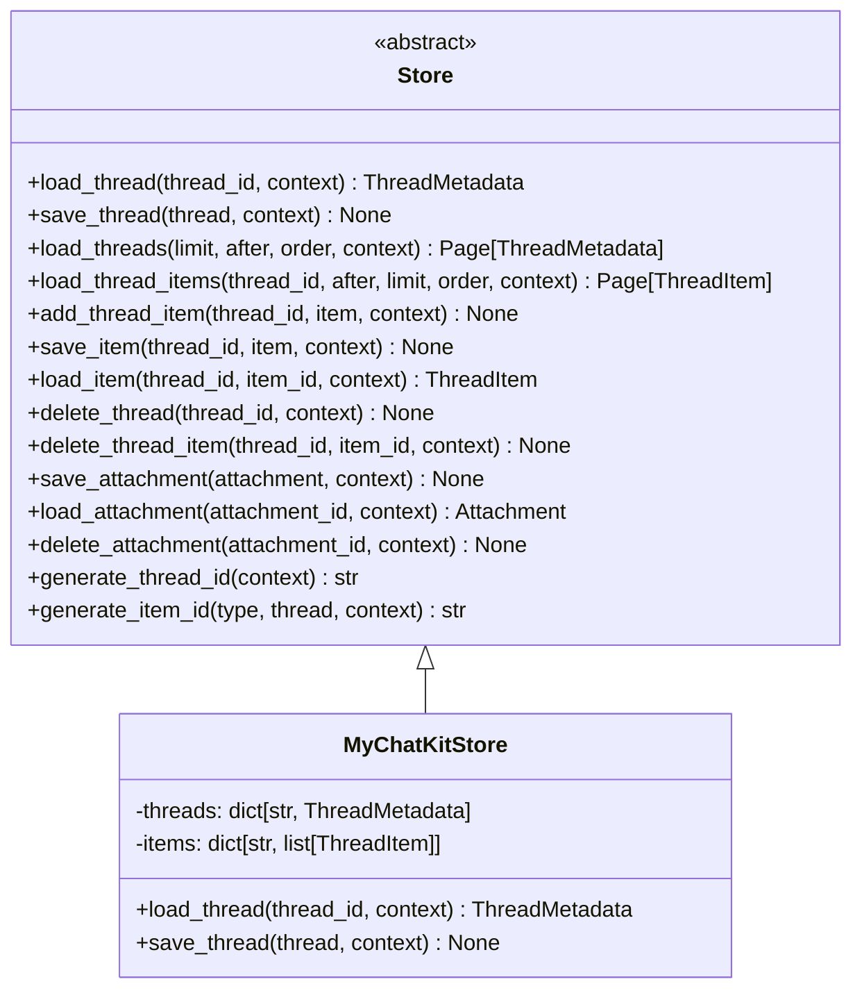
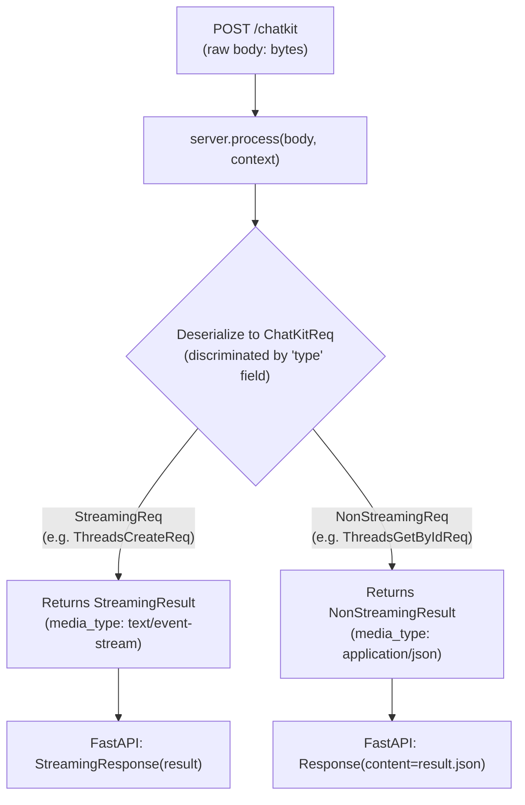
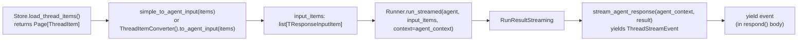

<!-- source: DeepWiki mcp.deepwiki.com · repo openai/chatkit-python · page 5.1 Quickstart and Project Setup · fetched 2026-10-26 -->

# Quickstart and Project Setup

<details>
<summary>Relevant source files</summary>

The following files were used as context for generating this wiki page:

- [docs/guides/prepare-your-app-for-production.md](docs/guides/prepare-your-app-for-production.md)
- [docs/guides/respond-to-user-message.md](docs/guides/respond-to-user-message.md)
- [docs/guides/stream-generated-images.md](docs/guides/stream-generated-images.md)
- [docs/quickstart.md](docs/quickstart.md)
- [docs/release.md](docs/release.md)
- [mkdocs.yml](mkdocs.yml)
- [pyproject.toml](pyproject.toml)

</details>


This page is a step-by-step guide to standing up a functional ChatKit Python server from scratch. It covers installation, implementing the required `ChatKitServer` subclass and `Store`, wiring the server to FastAPI, and making a first real agent call.

This page does not cover the React/JavaScript side of the stack (the `@openai/chatkit-react` package), advanced store backends, production deployment, or the internals of request processing. For production concerns, see the server internals in **ChatKitServer Class (3.1)** and **Storage Interfaces (3.2)**. For an explanation of how requests are routed internally, see **Request Processing Pipeline (3.3)**.

---

## Overview of What You're Building

A minimal ChatKit server has four moving parts:

**System Architecture: Minimal ChatKit Server**



Sources: [docs/quickstart.md:1-30](), [docs/guides/respond-to-user-message.md:1-30]()

---

## Prerequisites

| Requirement | Minimum Version | Notes |
|---|---|---|
| Python | 3.10 | Set in `requires-python` in `pyproject.toml` [pyproject.toml:6-6]() |
| `openai-chatkit` | 1.6.3 | Current version [pyproject.toml:3-3]() |
| `openai-agents` | ≥ 0.3.2 | Direct dependency [pyproject.toml:7-7]() |
| `jinja2` | ≥ 3.1 | Required for widgets [pyproject.toml:7-7]() |
| `fastapi` | any recent | Recommended for the HTTP layer [pyproject.toml:11-11]() |
| `OPENAI_API_KEY` | — | Required for model calls |

Sources: [pyproject.toml:1-14]()

---

## Step 1: Install the Package

### Using pip

```bash
pip install openai-chatkit
```

### Using uv (recommended for development)

```bash
uv add openai-chatkit
```

For development work on the SDK itself, install the dev dependency group from the repo root:

```bash
uv sync --group dev
```

The dev group adds `fastapi`, `pytest`, `pytest-asyncio`, `ruff`, `pyright`, `mypy`, and the MkDocs toolchain. See `[pyproject.toml:9-14]()` for the complete list.

Sources: [pyproject.toml:1-14](), [docs/quickstart.md:63-65]()

---

## Step 2: Define a Request Context

Every ChatKit server is generic over a context type — a per-request dataclass you define that carries request-scoped state like user identity, auth scopes, or feature flags. The context object flows through `ChatKitServer`, `Store`, and agent helpers.

```python
from dataclasses import dataclass

@dataclass
class MyRequestContext:
    user_id: str
```

This type becomes the type parameter `TContext` used throughout `ChatKitServer[TContext]` and `Store[TContext]`.

Sources: [docs/guides/respond-to-user-message.md:22-33](), [docs/quickstart.md:76-105]()

---

## Step 3: Implement `ChatKitServer`

`ChatKitServer` is an abstract base class. You must subclass it and implement the `respond` method, which is called once per user turn to yield response events.

**Class and Method Map: ChatKitServer Subclass**



A minimal implementation that returns a hard-coded reply:

```python
from collections.abc import AsyncIterator
from datetime import datetime
from chatkit.server import ChatKitServer
from chatkit.types import (
    AssistantMessageContent,
    AssistantMessageItem,
    ThreadItemDoneEvent,
    ThreadMetadata,
    ThreadStreamEvent,
    UserMessageItem,
)

class MyChatKitServer(ChatKitServer[MyRequestContext]):
    async def respond(
        self,
        thread: ThreadMetadata,
        input: UserMessageItem | None,
        context: MyRequestContext,
    ) -> AsyncIterator[ThreadStreamEvent]:
        # Minimal response yielding a single message
        yield ThreadItemDoneEvent(
            item=AssistantMessageItem(
                thread_id=thread.id,
                id=self.store.generate_item_id("message", thread, context),
                created_at=datetime.now(),
                content=[AssistantMessageContent(text="Hi there!")],
            )
        )
```

Sources: [docs/quickstart.md:71-106](), [docs/guides/respond-to-user-message.md:35-69]()

---

## Step 4: Implement the `Store`

`Store` is an abstract base class in `chatkit.store`. It controls persistence of threads and items. You must subclass it and implement all abstract methods.

**Store Method Signatures**



For local development, an in-memory store is sufficient as shown in `[docs/quickstart.md:118-215]()`. For production, implement a database-backed store (e.g., Postgres) as described in `[docs/guides/respond-to-user-message.md:112-176]()`.

**Critical:** `load_thread` must raise `NotFoundError` (from `chatkit.store`) when the thread does not exist, allowing `ChatKitServer` to initialize a new thread on the first request.

Sources: [docs/quickstart.md:112-218](), [docs/guides/respond-to-user-message.md:109-176]()

---

## Step 5: Wire to FastAPI

Expose a single `POST /chatkit` endpoint. `ChatKitServer.process()` deserializes the request body and routes it to the appropriate handler.

```python
from fastapi import FastAPI, Request, Response
from fastapi.responses import StreamingResponse
from chatkit.server import StreamingResult

app = FastAPI()
store = MyChatKitStore()
server = MyChatKitServer(store)

@app.post("/chatkit")
async def chatkit_endpoint(request: Request):
    context = MyRequestContext(user_id="abc123")
    result = await server.process(await request.body(), context)
    
    if isinstance(result, StreamingResult):
        return StreamingResponse(result, media_type="text/event-stream")
    return Response(content=result.json, media_type="application/json")
```

**Request Routing: What `process()` Does**



Sources: [docs/quickstart.md:100-108](), [docs/guides/respond-to-user-message.md:74-96]()

---

## Step 6: Agent Integration

Once the server is running, replace the stub `respond` with a call to the OpenAI Agents SDK using `stream_agent_response`.

**Agent Integration Data Flow**



```python
from agents import Agent, Runner
from chatkit.agents import AgentContext, simple_to_agent_input, stream_agent_response

agent = Agent(name="assistant", instructions="You are helpful.", model="gpt-4o")

class MyChatKitServer(ChatKitServer[MyRequestContext]):
    async def respond(self, thread, input, context):
        # 1. Load history
        items_page = await self.store.load_thread_items(thread.id, limit=20, context=context)
        items = list(reversed(items_page.data))
        
        # 2. Prepare input
        input_items = await simple_to_agent_input(items)
        agent_context = AgentContext(thread=thread, store=self.store, request_context=context)
        
        # 3. Run and stream
        result = Runner.run_streamed(agent, input_items, context=agent_context)
        async for event in stream_agent_response(agent_context, result):
            yield event
```

Sources: [docs/quickstart.md:222-261](), [docs/guides/respond-to-user-message.md:181-297]()

---

