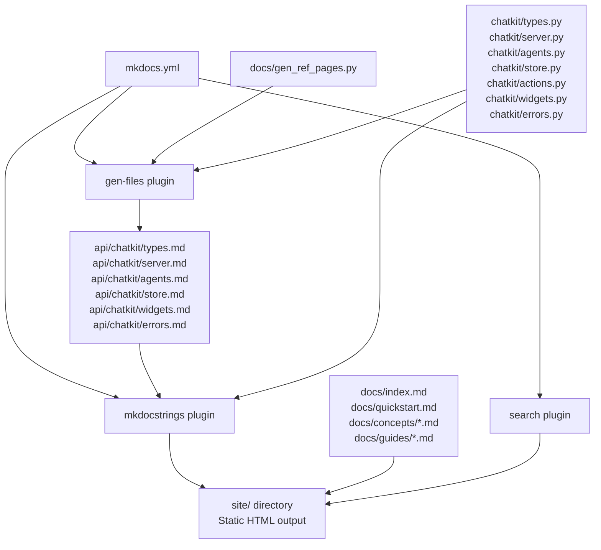
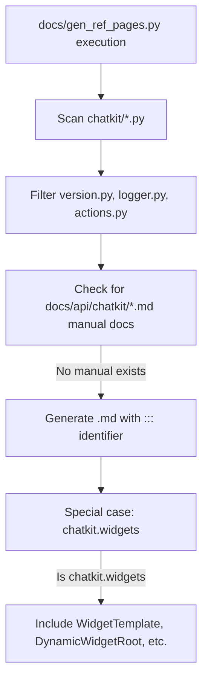

<!-- source: DeepWiki mcp.deepwiki.com · repo openai/chatkit-python · page 5.2 Documentation System · fetched 2026-10-26 -->

# Documentation System

Relevant source files

The following files were used as context for generating this wiki page:

- [.github/workflows/docs.yml](.github/workflows/docs.yml)
- [docs/api/chatkit/index.md](docs/api/chatkit/index.md)
- [docs/gen_ref_pages.py](docs/gen_ref_pages.py)
- [docs/quickstart.md](docs/quickstart.md)
- [mkdocs.yml](mkdocs.yml)

## Overview

The ChatKit Python SDK documentation system uses MkDocs with the Material theme to generate static HTML documentation. The system combines manually written guides with automatically generated API reference documentation extracted from Python docstrings.

Configuration is located in [mkdocs.yml:1-87]() and uses three primary plugins:
- `search`: Provides documentation search functionality.
- `mkdocstrings`: Extracts API documentation from Python source files.
- `gen-files`: Executes [docs/gen_ref_pages.py:1-59]() to generate API reference pages.

## Documentation Architecture

The documentation build process involves source collection, page generation via scripts, and HTML rendering using the Material theme.

### Documentation Build Flow

**Sources:** [mkdocs.yml:1-38](), [docs/gen_ref_pages.py:1-59]()

## Configuration File Structure

### mkdocs.yml Settings

The [mkdocs.yml:1-87]() file defines the documentation build configuration:

| Configuration Key | Value | Effect |
|------------------|-------|--------|
| `site_name` | "Chatkit Python SDK" | HTML `<title>` element content [mkdocs.yml:1]() |
| `repo_name` | "chatkit-python" | Repository link text [mkdocs.yml:15]() |
| `repo_url` | `https://github.com/openai/chatkit-python` | Repository URL for edit links [mkdocs.yml:16]() |
| `theme.name` | `material` | Applies mkdocs-material theme [mkdocs.yml:3]() |
| `theme.palette.primary` | `black` | Navigation bar background color [mkdocs.yml:11]() |
| `theme.logo` | `assets/logo.svg` | Logo file path [mkdocs.yml:12]() |
| `theme.favicon` | `images/favicon-platform.svg` | Favicon file path [mkdocs.yml:13]() |

**Sources:** [mkdocs.yml:1-16]()

### Theme Features

Material theme features enabled in [mkdocs.yml:4-9]():

| Feature Flag | Functionality |
|-------------|---------------|
| `content.code.copy` | Adds copy button to code blocks |
| `content.code.select` | Enables text selection in code blocks |
| `navigation.sections` | Groups navigation items into collapsible sections |
| `navigation.path` | Displays breadcrumb trail above page content |
| `content.code.annotate` | Enables numbered inline code annotations |

**Sources:** [mkdocs.yml:4-9]()

## Plugin Configuration

### mkdocstrings Configuration

The `mkdocstrings` plugin configuration in [mkdocs.yml:20-34]():

| Configuration Path | Value | Effect |
|-------------------|-------|--------|
| `handlers.python.paths` | `["."]` | Module search path for import resolution |
| `selection.docstring_style` | `google` | Docstring parser format |
| `options.signature_crossrefs` | `true` | Generate hyperlinks for type annotations |
| `options.members_order` | `source` | Order by appearance in source file |
| `options.separate_signature` | `true` | Render function signatures separately |
| `options.show_signature_annotations` | `true` | Display type hints in signatures |
| `options.heading_level` | `3` | HTML heading level for members (h3) |
| `options.inherited_members` | `false` | Exclude inherited class members |
| `options.filters` | `["!^_"]` | Regex filter for private members |

**Sources:** [mkdocs.yml:20-34]()

### gen-files Configuration

The `gen-files` plugin executes [docs/gen_ref_pages.py:1-59]() to dynamically create API reference markdown files before the main build. This script:

1. Scans the `chatkit` directory for `.py` files [docs/gen_ref_pages.py:26]().
2. Excludes private files (starting with `_`) and specific modules like `version.py`, `logger.py`, and `actions.py` [docs/gen_ref_pages.py:27-30]().
3. Checks for manual overrides in `docs/api/chatkit/` [docs/gen_ref_pages.py:10-15]().
4. Generates a markdown file for each module containing a `::: <identifier>` directive for `mkdocstrings` [docs/gen_ref_pages.py:41-58]().
5. For `chatkit.widgets`, it applies custom options to include specific symbols like `WidgetTemplate` and `DynamicWidgetRoot` [docs/gen_ref_pages.py:46-56]().

**Sources:** [mkdocs.yml:35-38](), [docs/gen_ref_pages.py:1-59]()

## API Reference Generation

### API Reference File Mapping

The script [docs/gen_ref_pages.py:1-59]() maps source files to documentation paths:

| Source File | Module Identifier | Generated Doc Path |
|------------|-------------------|-------------------|
| `chatkit/server.py` | `chatkit.server` | `api/chatkit/server.md` |
| `chatkit/types.py` | `chatkit.types` | `api/chatkit/types.md` |
| `chatkit/agents.py` | `chatkit.agents` | `api/chatkit/agents.md` |
| `chatkit/store.py` | `chatkit.store` | `api/chatkit/store.md` |
| `chatkit/widgets.py` | `chatkit.widgets` | `api/chatkit/widgets.md` |

**Sources:** [docs/gen_ref_pages.py:5-34](), [mkdocs.yml:63-72]()

### API Generation Logic

**Sources:** [docs/gen_ref_pages.py:10-56]()

## Local Development and Build

### Build and Preview

Users can preview the documentation locally using the standard MkDocs workflow. The `mkdocs.yml` is configured to watch the `chatkit` directory for changes [mkdocs.yml:85-87]().

1. **Install dependencies**: `make sync` (installs `uv` managed dependencies).
2. **Local Preview**: `mkdocs serve`.
3. **Static Build**: `mkdocs build`.

### GitHub Actions Deployment

The documentation is published to GitHub Pages via a GitHub Actions workflow in [.github/workflows/docs.yml:1-30]().

- **Trigger**: Runs on every push to the `main` branch [ .github/workflows/docs.yml:3-6]().
- **Environment**: Uses `ubuntu-latest` and `astral-sh/setup-uv` for dependency management [.github/workflows/docs.yml:15-21]().
- **Deployment**: Executes `make deploy-docs` to publish the site [.github/workflows/docs.yml:29]().

**Sources:** [.github/workflows/docs.yml:1-30](), [mkdocs.yml:85-87]()

## Navigation Structure

The navigation is explicitly defined in [mkdocs.yml:39-74](), organizing the site into:
- **Overview & Quick Start**: Entry points [mkdocs.yml:40-41]().
- **Concepts**: Fundamental models like Threads, Events, and Widgets [mkdocs.yml:42-48]().
- **Guides**: Task-oriented instructions (e.g., "Respond to a user message") [mkdocs.yml:49-62]().
- **API Reference**: Automated module documentation [mkdocs.yml:63-72]().
- **Release process**: The `release.md` file [mkdocs.yml:73]().

**Sources:** [mkdocs.yml:39-74]()

---

