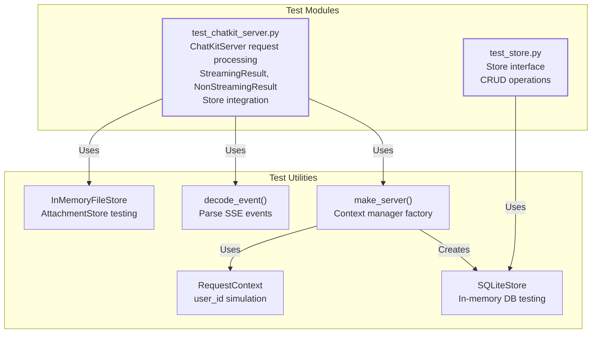
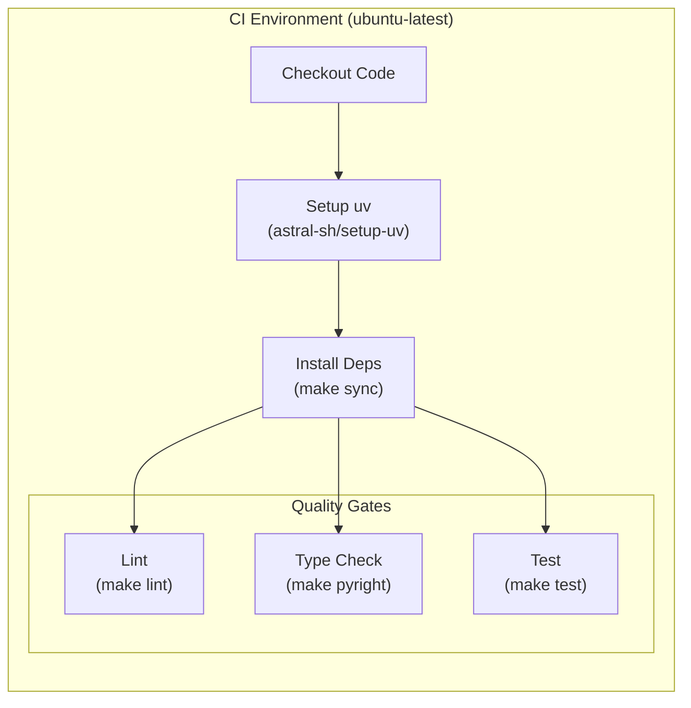

<!-- source: DeepWiki mcp.deepwiki.com · repo openai/chatkit-python · page 5.3 Testing and Quality Assurance · fetched 2026-10-26 -->

# Testing and Quality Assurance

<details>
<summary>Relevant source files</summary>

The following files were used as context for generating this wiki page:

- [.github/workflows/ci.yml](.github/workflows/ci.yml)
- [Makefile](Makefile)
- [chatkit/store.py](chatkit/store.py)
- [tests/_types.py](tests/_types.py)
- [tests/helpers/mock_store.py](tests/helpers/mock_store.py)
- [tests/test_chatkit_server.py](tests/test_chatkit_server.py)
- [tests/test_store.py](tests/test_store.py)

</details>


## Purpose and Scope

This document covers the testing strategy, code quality tools, and continuous integration practices used in the ChatKit Python SDK. It explains how to run tests, perform linting and type checking, and how quality gates are enforced in the CI pipeline.

For information about project dependencies and development environment setup, see [Quickstart and Project Setup](). For release processes and versioning, see [Release Process and Versioning]().

---

## Testing Framework

The ChatKit Python SDK uses `pytest` as its primary testing framework, with `pytest-asyncio` for async test support. The test configuration enables automatic asyncio mode for seamless testing of asynchronous code.

### Pytest Configuration

The pytest configuration is defined in the project configuration:

| Configuration Key | Value | Purpose |
|------------------|-------|---------|
| `asyncio_mode` | `"auto"` | Automatically detects and runs async tests |
| `asyncio_default_fixture_loop_scope` | `"function"` | Creates a new event loop for each test function |

### Test Suite Structure

Tests are organized in the `tests/` directory with modules covering different system components.



#### Test Helpers and Fixtures

**RequestContext Model** [tests/_types.py:4-6]():
The `RequestContext` model simulates authentication context in tests, providing a `user_id` to scope data access.

**make_server() Context Manager** [tests/test_chatkit_server.py:157-236]():
Creates a `TestChatKitServer` instance (a concrete subclass of `ChatKitServer`) with isolated SQLite in-memory storage for each test. It allows wiring up custom callbacks for `respond`, `action`, and `sync_action` methods to verify server logic.

**SQLiteStore** [tests/helpers/mock_store.py:37-42]():
A reference implementation of the `Store` interface used for testing. It uses `sqlite3` to persist `ThreadMetadata`, `ThreadItem`, and `Attachment` objects [tests/helpers/mock_store.py:47-82]().

**InMemoryFileStore** [tests/test_chatkit_server.py:105-145]():
Mock implementation of `AttachmentStore` for testing file operations without external storage dependencies.

**decode_event() Helper** [tests/test_chatkit_server.py:147-148]():
Parses Server-Sent Events from streaming results:
```python
def decode_event(event: bytes) -> ThreadStreamEvent:
    return TypeAdapter(ThreadStreamEvent).validate_json(event.split(b"data: ")[1])
```

### Running Tests

Tests are executed using the `make test` command, which sets the `PYTHONPATH` and runs pytest via `uv` [Makefile:22-23]().

**Sources:** [tests/test_chatkit_server.py:105-236](), [tests/helpers/mock_store.py:37-82](), [tests/_types.py:4-6](), [Makefile:22-23]()

---

## Storage Integration Testing

The `test_store.py` module defines an abstract `TestStore` class that ensures any `Store` implementation adheres to the required persistence contracts.

### CRUD Verification

Tests verify that metadata and items are correctly serialized and retrieved:

| Test Case | Method Verified | Logic |
|-----------|-----------------|-------|
| `test_save_and_load_thread_metadata` | `save_thread`, `load_thread` | Ensures thread title and metadata are preserved [tests/test_store.py:106-113]() |
| `test_save_and_load_thread_items` | `add_thread_item`, `load_thread_items` | Verifies chronological ordering and data integrity [tests/test_store.py:138-150]() |
| `test_load_threads` | `load_threads` | Verifies pagination with `limit` and `after` cursors [tests/test_store.py:187-213]() |
| `test_save_and_load_file` | `save_attachment`, `load_attachment` | Verifies metadata persistence for file attachments [tests/test_store.py:161-171]() |

### SQLiteStore Implementation

The `SQLiteStore` used in tests handles JSON serialization of complex Pydantic models (like `ThreadItem` subtypes) into a `data` column [tests/helpers/mock_store.py:100-116](). It also implements user-based multi-tenancy by including `user_id` from the `RequestContext` in all queries [tests/helpers/mock_store.py:89-91]().

**Sources:** [tests/test_store.py:106-213](), [tests/helpers/mock_store.py:37-160]()

---

## Code Quality Tools

The project enforces code quality through linting and type checking tools, centralized via `Makefile` targets.

### Linting and Formatting

The project uses **Ruff** for both linting and formatting. Ruff is configured to replace multiple tools (isort, flake8, etc.) with high performance.

| Command | Action | Underlying Tool |
|---------|--------|-----------------|
| `make format` | Reformat code and apply safe fixes | `ruff format`, `ruff check --fix` [Makefile:6-8]() |
| `make format-check` | Verify code is formatted | `ruff format --check` [Makefile:10-11]() |
| `make lint` | Run static analysis checks | `ruff check` [Makefile:13-14]() |

### Type Checking

Static type safety is enforced using **Pyright** (primary) and **Mypy**.

*   **Pyright**: Used in the CI pipeline for fast, standard-compliant type checking [Makefile:19-20]().
*   **Mypy**: Available as an alternative checker to ensure broad compatibility [Makefile:16-17]().

**Sources:** [Makefile:6-20]()

---

## CI/CD Pipeline

The continuous integration pipeline, defined in GitHub Actions, ensures every change meets quality standards before merging.

### GitHub Actions Workflow

The CI workflow [.github/workflows/ci.yml:1-36]() triggers on pull requests and manual dispatches.



### Quality Gates

The pipeline executes the following sequence:
1.  **Dependency Sync**: Uses `uv sync` to ensure a deterministic environment [Makefile:3-4]().
2.  **Linting**: Runs `ruff` to catch style issues and common bugs [.github/workflows/ci.yml:28-29]().
3.  **Type Checking**: Runs `pyright` to verify type safety [.github/workflows/ci.yml:31-32]().
4.  **Testing**: Runs the `pytest` suite [.github/workflows/ci.yml:34-35]().

**Sources:** [.github/workflows/ci.yml:1-36](), [Makefile:1-36]()

---

