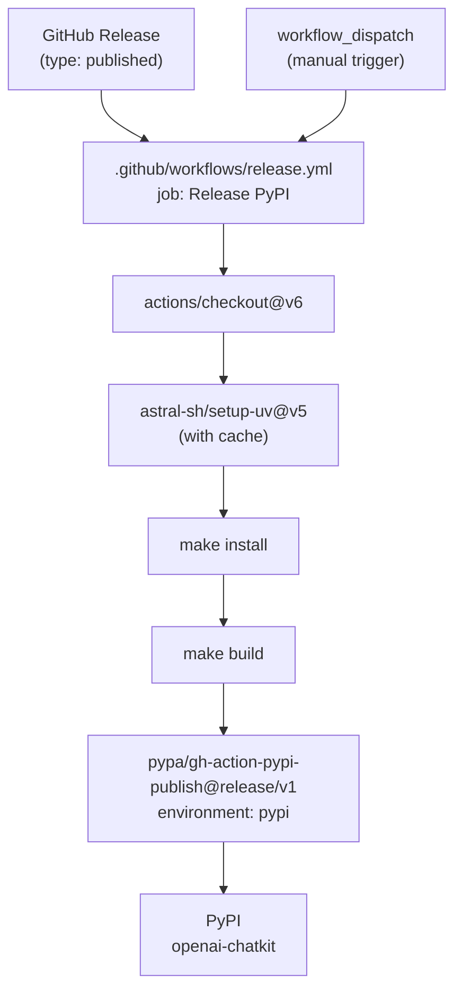
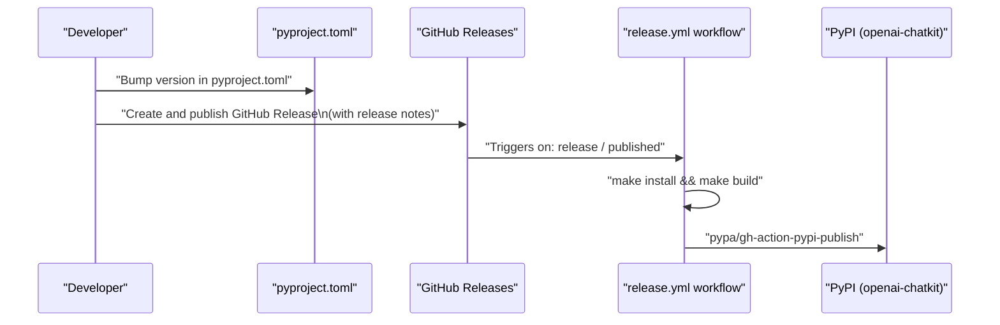

<!-- source: DeepWiki mcp.deepwiki.com · repo openai/chatkit-python · page 5.4 Release Process and Versioning · fetched 2026-10-26 -->

# Release Process and Versioning

<details>
<summary>Relevant source files</summary>

The following files were used as context for generating this wiki page:

- [.github/workflows/release.yml](.github/workflows/release.yml)
- [chatkit/version.py](chatkit/version.py)
- [docs/release.md](docs/release.md)
- [pyproject.toml](pyproject.toml)

</details>


This page covers the versioning scheme, the automated publish pipeline, and the breaking-change history for the `openai-chatkit` Python package. For information about the development workflow (testing, linting, CI), see page [5.3](). For documentation deployment, see page [5.2]().

---

## Package Identity

The package is published to PyPI under the name **`openai-chatkit`**. The canonical version string is declared in `pyproject.toml`:

| Field | Value |
|---|---|
| PyPI package name | `openai-chatkit` |
| Version source | [pyproject.toml:3]() |
| Python requirement | `>=3.10` |
| Runtime version attribute | `chatkit.version.__version__` |

Sources: [pyproject.toml:1-6]()

---

## Version Resolution at Runtime

The `__version__` string is resolved at import time using `importlib.metadata`, which reads the installed package metadata. This means the version reflects what was actually installed from PyPI (or a local build), not a hard-coded string in source.

**`chatkit/version.py`** — implementation:

```python
import importlib.metadata

try:
    __version__ = importlib.metadata.version("openai-chatkit")
except importlib.metadata.PackageNotFoundError:
    # Fallback if running from source without being installed
    __version__ = "0.0.0"
```

**Behavior summary:**

| Scenario | `__version__` value |
|---|---|
| Installed from PyPI or local build | Version string from package metadata (e.g. `"1.6.3"`) |
| Running from source without install | `"0.0.0"` |

Sources: [chatkit/version.py:1-8]()

---

## Versioning Policy

The project follows a **modified semantic versioning** scheme defined in `docs/release.md`. The key deviation from standard semver is that **minor version bumps may include breaking changes** while the SDK is still evolving.

**Version component semantics:**

| Component | Triggers | May include breaking changes? |
|---|---|---|
| Major (`X.*.*`) | Significant API overhaul | Yes |
| Minor (`*.Y.*`) | Breaking changes to public interfaces | **Yes** |
| Patch (`*.*.Z`) | Bug fixes, new features, private interface changes | No |

**Recommendation:** Pin to `X.Y.*` (e.g. `openai-chatkit~=1.6.0`) in production to avoid unexpected breaking changes on minor version upgrades.

Sources: [docs/release.md:1-20]()

---

## Release Pipeline

Releases are published to PyPI automatically via a GitHub Actions workflow triggered by a published GitHub Release event.

**Workflow trigger diagram:**



Sources: [.github/workflows/release.yml:1-37]()

**Required permissions:**

| Permission | Scope | Purpose |
|---|---|---|
| `contents` | `read` | Checkout repository |
| `id-token` | `write` | OIDC token for trusted PyPI publishing |

**Steps in order:**

1. `actions/checkout@de0fac2e4500dabe0009e67214ff5f5447ce83dd` — checks out the repository.
2. `astral-sh/setup-uv@e58605a9b6da7c637471fab8847a5e5a6b8df081` — installs `uv` with caching.
3. `make install` — installs all project dependencies including dev groups.
4. `make build` — builds the distribution artifacts (wheels/sdist).
5. `pypa/gh-action-pypi-publish@ed0c53931b1dc9bd32cbe73a98c7f6766f8a527e` — uploads artifacts to PyPI using OIDC.

Sources: [.github/workflows/release.yml:9-37](), [pyproject.toml:9-17]()

---

## Release Steps (Manual Process)

The automated workflow handles PyPI publishing, but a release must first be created on GitHub. The expected sequence is:



Sources: [pyproject.toml:3](), [.github/workflows/release.yml:3-7]()

---

## Breaking Change Changelog

The following table summarizes all **breaking changes** by minor version, as documented in `docs/release.md`. Each entry describes what public interface changed and what action integrators must take.

| Version | Changed Interface | Description |
|---|---|---|
| **1.6.0** | `Store.save_attachment` | Now called with updates to existing attachments (upsert semantics), not only on insert. |
| **1.5.0** | `FileAttachment`, `ImageAttachment` | `upload_url` field removed; replaced by `upload_descriptor`. |
| **1.5.0** | `AttachmentStore.create_attachment` | `ChatKitServer` now saves attachment metadata to the store during `attachments.create` handling; remove the explicit store-write step from `create_attachment`. |
| **1.4.0** | Widget/action classes | Marked deprecated in favor of `WidgetTemplate` and `.widget` files. `jinja2>=3.1,<4` added as a required dependency. |
| **1.4.0** | `ChatKitServer.get_stream_options` | A stop button is now shown by default during streaming; override `get_stream_options` to change. |
| **1.3.0** | `Checkbox.defaultChecked` | Type changed from `string` to `bool`. |
| **1.2.0** | `agents.stream_agent_response` | Annotation parts are now added incrementally as received, not all at once after the response completes. `container_file_citation` rendering added. |
| **1.1.0** | `CustomSummary`, `CustomTask`, `EntitySource` | The `icon` field is now restricted to `IconName` (was previously an unrestricted string). |
| **1.1.0** | `ThreadItemConverter` methods | All methods are now `async`. |

Sources: [docs/release.md:22-53]()

---

## Affected Modules by Version

The diagram below maps each breaking-change version to the specific modules and classes it affects, using the actual module paths in the codebase.

```mermaid
graph TD
    v16["1.6.0"]
    v15["1.5.0"]
    v14["1.4.0"]
    v13["1.3.0"]
    v12["1.2.0"]
    v11["1.1.0"]

    v16 --> SaveAttachment["chatkit.store\nStore.save_attachment"]
    v15 --> UploadDescriptor["chatkit.types\nFileAttachment.upload_descriptor\nImageAttachment.upload_descriptor"]
    v15 --> CreateAttachment["chatkit.store\nAttachmentStore.create_attachment"]
    v14 --> WidgetTemplate["chatkit.widgets\nWidgetTemplate (new preferred API)"]
    v14 --> GetStreamOptions["chatkit.server\nChatKitServer.get_stream_options"]
    v13 --> Checkbox["chatkit.widgets\nCheckbox.defaultChecked"]
    v12 --> StreamAgentResponse["chatkit.agents\nstream_agent_response"]
    v11 --> IconName["chatkit.icons\nIconName (restricted type)"]
    v11 --> ThreadItemConverter["chatkit.agents\nThreadItemConverter (all methods async)"]
```



Sources: [docs/release.md:22-53]()

---

## Dependency Version Constraints

The `pyproject.toml` records the minimum version bounds for runtime dependencies, which is relevant when assessing compatibility with new releases:

| Dependency | Constraint |
|---|---|
| `pydantic` | (any) |
| `uvicorn` | (any) |
| `openai` | (any) |
| `openai-agents` | `>=0.3.2` |
| `jinja2` | `>=3.1,<4` |

Sources: [pyproject.toml:7]()

---

