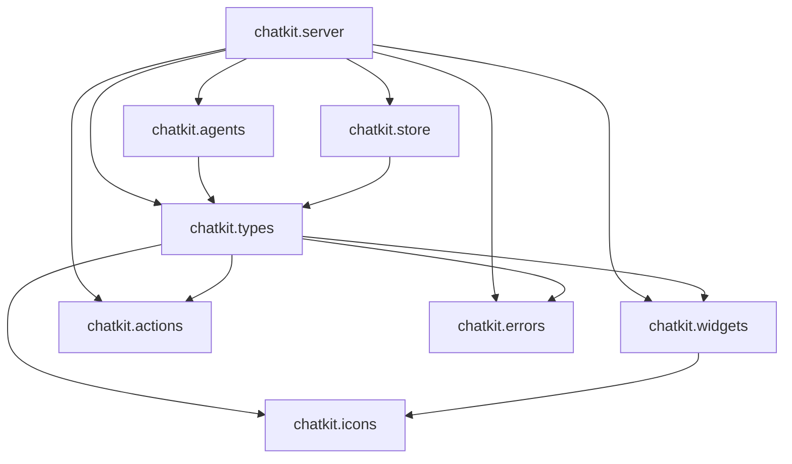
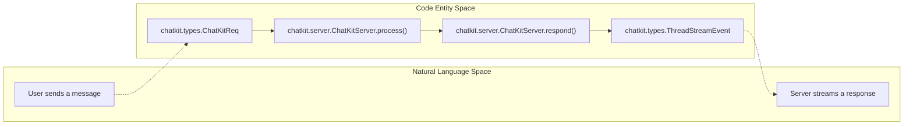
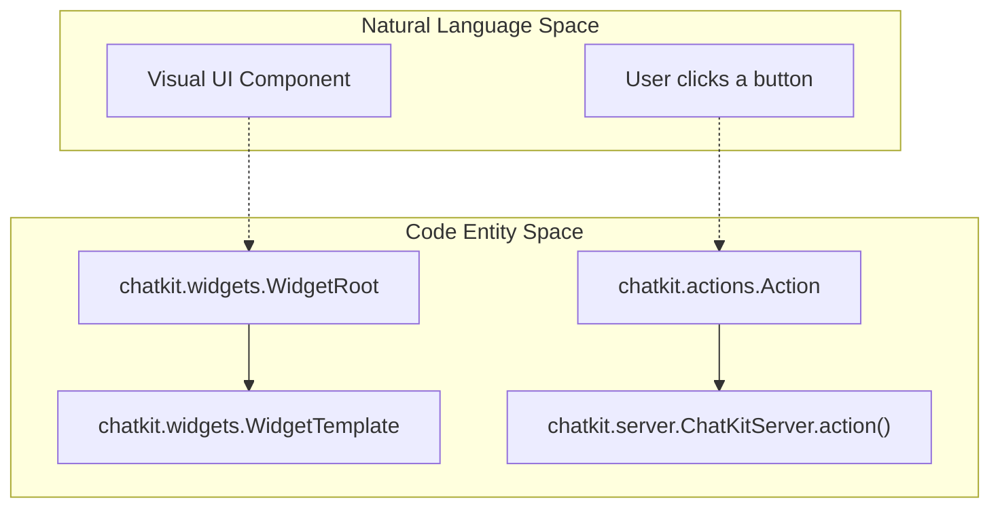

<!-- source: DeepWiki mcp.deepwiki.com · repo openai/chatkit-python · page 6 API Reference · fetched 2026-10-26 -->

# API Reference

Relevant source files

The following files were used as context for generating this wiki page:

- [chatkit/__init__.py](chatkit/__init__.py)
- [docs/api/chatkit/index.md](docs/api/chatkit/index.md)
- [docs/gen_ref_pages.py](docs/gen_ref_pages.py)

This section provides comprehensive API documentation for all public modules, classes, and functions in the ChatKit Python SDK. The API is organized into focused modules that handle type definitions, server processing, storage interfaces, agent integration, widgets, actions, and error handling.

For conceptual explanations of how these components work together, see [Core Concepts](#2). For implementation guidance, see [Server Integration](#3) and [Advanced Features](#4).

## API Organization

The ChatKit Python SDK exposes its functionality through eight primary modules:

| Module | Purpose | Subsection |
|--------|---------|------------|
| `chatkit.types` | Core type system defining requests, responses, events, and data models | [chatkit.types](#6.1) |
| `chatkit.server` | `ChatKitServer` base class and request processing pipeline | [chatkit.server](#6.2) |
| `chatkit.agents` | Integration utilities for openai-agents SDK | [chatkit.agents](#6.3) |
| `chatkit.store` | Abstract storage interfaces for persistence | [chatkit.store](#6.4) |
| `chatkit.actions` | Action system for UI-triggered operations | [chatkit.actions](#6.5) |
| `chatkit.widgets` | Widget components for rich UI rendering | [chatkit.widgets](#6.6) |
| `chatkit.errors` | Error types and exception classes | [chatkit.errors](#6.7) |
| `chatkit.icons` | Standardized icon naming system | [chatkit.icons](#6.8) |

**Sources:** [docs/api/chatkit/index.md:5-10](), [docs/gen_ref_pages.py:26-58]()

## Module Dependency Structure

The type system serves as the foundation, with all other modules depending on its definitions. The server module orchestrates request processing and depends on almost all other modules to handle storage, UI, and logic.

**Sources:** [docs/gen_ref_pages.py:32-34](), [docs/api/chatkit/index.md:5-10]()

## Core Design Patterns

### Natural Language to Code Entity Mapping

The following diagrams bridge the gap between high-level system concepts and the specific code entities that implement them.

#### Request Handling Pipeline
This diagram maps the lifecycle of a user interaction from a network request to the specific Python classes and methods in the `chatkit` package.

**Sources:** [docs/api/chatkit/index.md:5-8]()

#### UI and Logic Bridge
This diagram maps how visual UI elements (Widgets) and logical triggers (Actions) are represented in the codebase.

**Sources:** [docs/api/chatkit/index.md:5-10](), [docs/gen_ref_pages.py:46-56]()

### Type-Driven Architecture

The API is built on Pydantic models with extensive use of discriminated unions for polymorphic types. All request types are validated using Pydantic's discriminated union with the `type` field as the discriminator.

### Generic Context Propagation

The API uses generic typing to allow arbitrary context objects (often denoted as `TContext`) to flow through the entire request pipeline. This allows implementations to pass request-scoped data like user authentication or database connections through all API layers.

### Abstract Base Classes for Extensibility

The SDK provides abstract base classes that users must implement to define their application's behavior. This includes `ChatKitServer` for response logic and `Store` for persistence.

## Module Reference

### [chatkit.types](#6.1)
API reference for all Pydantic models and type aliases. This includes the core `ChatKitReq` and `ThreadStreamEvent` discriminated unions, as well as `Thread`, `ThreadItem`, and `Page` models. For details, see [chatkit.types](#6.1).

### [chatkit.server](#6.2)
API reference for the `ChatKitServer` class. This module contains the logic for processing requests, streaming widgets via `stream_widget`, and calculating UI updates with `diff_widget`. For details, see [chatkit.server](#6.2).

### [chatkit.agents](#6.3)
API reference for integrating with the `openai-agents` SDK. It includes the `AgentContext` class, `stream_agent_response` function, and converters for translating between agent outputs and ChatKit thread items. For details, see [chatkit.agents](#6.3).

### [chatkit.store](#6.4)
API reference for the persistence layer. This includes the `Store` and `AttachmentStore` abstract classes, as well as utility functions for ID generation like `default_generate_id`. For details, see [chatkit.store](#6.4).

### [chatkit.actions](#6.5)
API reference for the actions system. It covers the `Action` class, `ActionConfig`, and how to define client-side or server-side handlers for UI interactions. For details, see [chatkit.actions](#6.5).

### [chatkit.widgets](#6.6)
API reference for the rich UI component library. It documents `WidgetTemplate`, `WidgetRoot`, and all available components like `Card`, `Button`, `ListView`, and `Chart`. For details, see [chatkit.widgets](#6.6).

### [chatkit.errors](#6.7)
API reference for the exception hierarchy. It covers `NotFoundError` and other structured error types that ensure the server emits consistent `ErrorEvent`s to the client. For details, see [chatkit.errors](#6.7).

### [chatkit.icons](#6.8)
API reference for the icon system. It defines the `IconName` union and provides the full list of supported Lucide and vendor-specific icons. For details, see [chatkit.icons](#6.8).

**Sources:** [docs/api/chatkit/index.md:1-11](), [docs/gen_ref_pages.py:46-56]()

---

