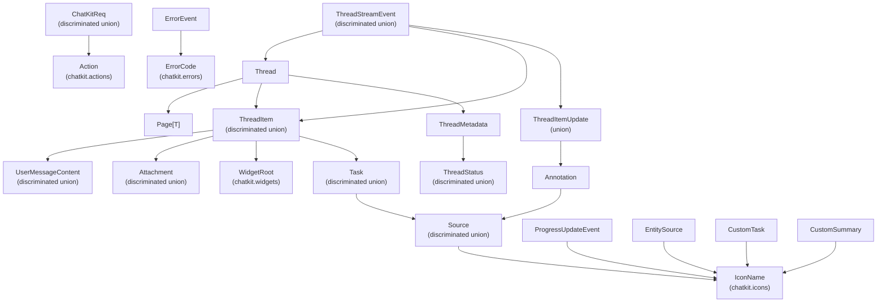
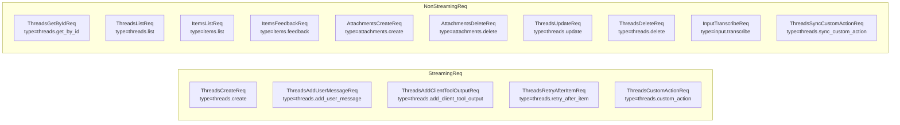
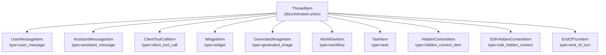
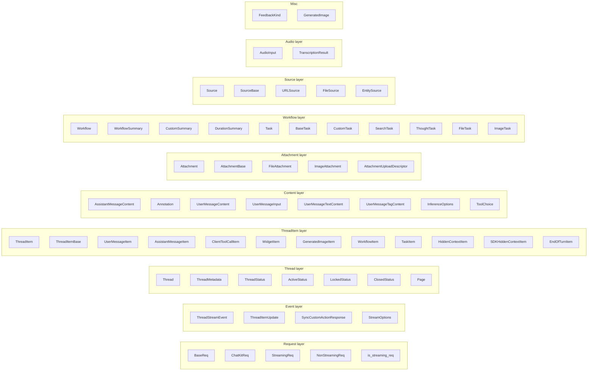

<!-- source: DeepWiki mcp.deepwiki.com · repo openai/chatkit-python · page 6.1 chatkit.types · fetched 2026-10-26 -->

# chatkit.types

<details>
<summary>Relevant source files</summary>

The following files were used as context for generating this wiki page:

- [chatkit/types.py](chatkit/types.py)

</details>


This page is the API reference for [chatkit/types.py](). It documents every Pydantic model, discriminated union, and type alias defined in the module. These types form the foundational schema layer that all other modules depend on: request parsing, response serialization, streaming events, store persistence, and widget integration all operate on the models defined here.

For higher-level explanations of how these types are *used at runtime*, see:
- **Type System and Data Models** — conceptual overview
- **Request and Response Flow** — how `ChatKitReq` is parsed and dispatched
- **Streaming Events** — when each `ThreadStreamEvent` is emitted
- **Threads and Thread Items** — thread lifecycle and item semantics

---

## Module-Level Type Graph

**Diagram: Top-level type dependencies in `chatkit/types.py`**



Sources: [chatkit/types.py:1-20]()

---

## Page

[chatkit/types.py:24-30]()

```python
class Page(BaseModel, Generic[T]):
    data: list[T] = []
    has_more: bool = False
    after: str | None = None
```

A generic paginated wrapper returned from list endpoints.

| Field | Type | Default | Description |
|---|---|---|---|
| `data` | `list[T]` | `[]` | Records in the current page |
| `has_more` | `bool` | `False` | Whether additional records exist |
| `after` | `str | None` | `None` | Cursor for the next page |

`Thread.items` is typed as `Page[ThreadItem]`.

Sources: [chatkit/types.py:24-30]()

---

## Request Types

### ChatKitReq

[chatkit/types.py:296-299]()

`ChatKitReq` is the top-level discriminated union covering every request the client can send. It is discriminated on the `"type"` field.

```python
ChatKitReq = Annotated[StreamingReq | NonStreamingReq, Field(discriminator="type")]
```

All request models inherit from `BaseReq` [chatkit/types.py:35-40](), which provides a `metadata: dict[str, Any]` field for integration-specific pass-through data.

### StreamingReq vs. NonStreamingReq

[chatkit/types.py:271-293]()

| Union | Members | Response format |
|---|---|---|
| `StreamingReq` | `ThreadsCreateReq`, `ThreadsAddUserMessageReq`, `ThreadsAddClientToolOutputReq`, `ThreadsRetryAfterItemReq`, `ThreadsCustomActionReq` | `text/event-stream` |
| `NonStreamingReq` | `ThreadsGetByIdReq`, `ThreadsListReq`, `ItemsListReq`, `ItemsFeedbackReq`, `AttachmentsCreateReq`, `AttachmentsDeleteReq`, `ThreadsUpdateReq`, `ThreadsDeleteReq`, `InputTranscribeReq`, `ThreadsSyncCustomActionReq` | JSON |

The helper function `is_streaming_req(request: ChatKitReq) -> TypeIs[StreamingReq]` at [chatkit/types.py:302-313]() performs the runtime check used by `ChatKitServer.process()`.

### Request Type Reference

**Diagram: Request types and their `type` discriminator values**



Sources: [chatkit/types.py:271-299]()

#### Per-request params models

Each request type carries a `params` field typed to a dedicated params model:

| Request type | Params model | Key fields |
|---|---|---|
| `ThreadsCreateReq` | `ThreadCreateParams` | `input: UserMessageInput` |
| `ThreadsAddUserMessageReq` | `ThreadAddUserMessageParams` | `thread_id`, `input: UserMessageInput` |
| `ThreadsAddClientToolOutputReq` | `ThreadAddClientToolOutputParams` | `thread_id`, `result: Any` |
| `ThreadsRetryAfterItemReq` | `ThreadRetryAfterItemParams` | `thread_id`, `item_id` |
| `ThreadsCustomActionReq` | `ThreadCustomActionParams` | `thread_id`, `item_id?`, `action: Action[str, Any]` |
| `ThreadsSyncCustomActionReq` | `ThreadCustomActionParams` | same as above |
| `ThreadsGetByIdReq` | `ThreadGetByIdParams` | `thread_id` |
| `ThreadsListReq` | `ThreadListParams` | `limit?`, `order`, `after?` |
| `ItemsListReq` | `ItemsListParams` | `thread_id`, `limit?`, `order`, `after?` |
| `ItemsFeedbackReq` | `ItemFeedbackParams` | `thread_id`, `item_ids`, `kind: FeedbackKind` |
| `AttachmentsCreateReq` | `AttachmentCreateParams` | `name`, `size`, `mime_type` |
| `AttachmentsDeleteReq` | `AttachmentDeleteParams` | `attachment_id` |
| `ThreadsUpdateReq` | `ThreadUpdateParams` | `thread_id`, `title` |
| `ThreadsDeleteReq` | `ThreadDeleteParams` | `thread_id` |
| `InputTranscribeReq` | `InputTranscribeParams` | `audio_base64`, `mime_type` |

Sources: [chatkit/types.py:42-270]()

#### Audio models

Two supplemental types support transcription beyond the request/response boundary:

- **`AudioInput`** [chatkit/types.py:207-219]() — holds decoded `bytes` and `mime_type`; the `.media_type` property strips codec suffixes (e.g. `"audio/webm;codecs=opus"` → `"audio/webm"`).
- **`TranscriptionResult`** [chatkit/types.py:222-225]() — single-field model with `text: str`.

---

## ThreadStreamEvent

[chatkit/types.py:424-439]()

`ThreadStreamEvent` is the discriminated union of all events emitted over a streaming response. It is discriminated on the `"type"` field.

**Diagram: `ThreadStreamEvent` subtypes and their discriminator values**

```mermaid
graph TD
    TSE["ThreadStreamEvent\n(discriminated union)"]
    TSE --> TCE["ThreadCreatedEvent\ntype=thread.created\ncarries: thread: Thread"]
    TSE --> TUE["ThreadUpdatedEvent\ntype=thread.updated\ncarries: thread: Thread"]
    TSE --> TIAD["ThreadItemAddedEvent\ntype=thread.item.added\ncarries: item: ThreadItem"]
    TSE --> TIUD["ThreadItemUpdatedEvent\ntype=thread.item.updated\ncarries: item_id, update: ThreadItemUpdate"]
    TSE --> TIDD["ThreadItemDoneEvent\ntype=thread.item.done\ncarries: item: ThreadItem"]
    TSE --> TIRED["ThreadItemRemovedEvent\ntype=thread.item.removed\ncarries: item_id"]
    TSE --> TIRED2["ThreadItemReplacedEvent\ntype=thread.item.replaced\ncarries: item: ThreadItem"]
    TSE --> SOE["StreamOptionsEvent\ntype=stream_options\ncarries: stream_options: StreamOptions"]
    TSE --> PUE["ProgressUpdateEvent\ntype=progress_update\ncarries: text, icon?"]
    TSE --> CEE["ClientEffectEvent\ntype=client_effect\ncarries: name, data"]
    TSE --> EE["ErrorEvent\ntype=error\ncarries: code, message?, allow_retry"]
    TSE --> NE["NoticeEvent\ntype=notice\ncarries: level, message, title?"]
```



Sources: [chatkit/types.py:319-439]()

| Event type | `type` discriminator | Key fields |
|---|---|---|
| `ThreadCreatedEvent` | `thread.created` | `thread: Thread` |
| `ThreadUpdatedEvent` | `thread.updated` | `thread: Thread` |
| `ThreadItemAddedEvent` | `thread.item.added` | `item: ThreadItem` |
| `ThreadItemUpdatedEvent` | `thread.item.updated` | `item_id: str`, `update: ThreadItemUpdate` |
| `ThreadItemDoneEvent` | `thread.item.done` | `item: ThreadItem` |
| `ThreadItemRemovedEvent` | `thread.item.removed` | `item_id: str` |
| `ThreadItemReplacedEvent` | `thread.item.replaced` | `item: ThreadItem` |
| `StreamOptionsEvent` | `stream_options` | `stream_options: StreamOptions` |
| `ProgressUpdateEvent` | `progress_update` | `text: str`, `icon: IconName | None` |
| `ClientEffectEvent` | `client_effect` | `name: str`, `data: dict` |
| `ErrorEvent` | `error` | `code: ErrorCode | "custom"`, `message?`, `allow_retry` |
| `NoticeEvent` | `notice` | `level`, `message`, `title?` |

`ThreadItemUpdated` is a backwards-compatible alias for `ThreadItemUpdatedEvent` [chatkit/types.py:349]().

#### StreamOptions

[chatkit/types.py:373-384]()

`StreamOptions` has a single boolean field: `allow_cancel`. When `True`, the client may cancel an in-progress stream. Sent to the client via `StreamOptionsEvent`.

---

## ThreadItemUpdate

[chatkit/types.py:535-547]()

`ThreadItemUpdate` is a plain union (not annotated with a discriminator at the type alias level) used as the payload of `ThreadItemUpdatedEvent`. It covers fine-grained in-flight mutations to items during streaming.

| Update type | `type` value | Key fields |
|---|---|---|
| `AssistantMessageContentPartAdded` | `assistant_message.content_part.added` | `content_index`, `content: AssistantMessageContent` |
| `AssistantMessageContentPartTextDelta` | `assistant_message.content_part.text_delta` | `content_index`, `delta: str` |
| `AssistantMessageContentPartAnnotationAdded` | `assistant_message.content_part.annotation_added` | `content_index`, `annotation_index`, `annotation: Annotation` |
| `AssistantMessageContentPartDone` | `assistant_message.content_part.done` | `content_index`, `content: AssistantMessageContent` |
| `WidgetStreamingTextValueDelta` | `widget.streaming_text.value_delta` | `component_id`, `delta: str`, `done: bool` |
| `WidgetComponentUpdated` | `widget.component.updated` | `component_id`, `component: WidgetComponent` |
| `WidgetRootUpdated` | `widget.root.updated` | `widget: WidgetRoot` |
| `WorkflowTaskAdded` | `workflow.task.added` | `task_index`, `task: Task` |
| `WorkflowTaskUpdated` | `workflow.task.updated` | `task_index`, `task: Task` |
| `GeneratedImageUpdated` | `generated_image.updated` | `image: GeneratedImage`, `progress: float | None` |

Sources: [chatkit/types.py:444-547]()

#### SyncCustomActionResponse

[chatkit/types.py:550-552]()

Returned from `threads.sync_custom_action` requests. Contains a single field `updated_item: ThreadItem | None`.

---

## Thread

### ThreadMetadata and Thread

[chatkit/types.py:558-600]()

`Thread` extends `ThreadMetadata` by adding a paginated items field.

| Model | Fields |
|---|---|
| `ThreadMetadata` | `id: str`, `title: str | None`, `created_at: datetime`, `status: ThreadStatus`, `metadata: dict` |
| `Thread` | all of `ThreadMetadata` + `items: Page[ThreadItem]` |

### ThreadStatus

[chatkit/types.py:569-593]()

`ThreadStatus` is a discriminated union on `"type"`:

| Subtype | `type` | Extra fields |
|---|---|---|
| `ActiveStatus` | `"active"` | — |
| `LockedStatus` | `"locked"` | `reason: str | None` |
| `ClosedStatus` | `"closed"` | `reason: str | None` |

Both `type` fields on `LockedStatus` and `ClosedStatus` are declared `frozen=True`, preventing mutation after construction.

Sources: [chatkit/types.py:558-600]()

---

## ThreadItem

[chatkit/types.py:703-716]()

`ThreadItem` is a discriminated union on `"type"`. All members extend `ThreadItemBase`, which provides `id: str`, `thread_id: str`, and `created_at: datetime`.

**Diagram: `ThreadItem` subtypes and their `type` discriminator values**



Sources: [chatkit/types.py:703-716]()

### ThreadItem subtype reference

| Type | Key fields | Notes |
|---|---|---|
| `UserMessageItem` | `content: list[UserMessageContent]`, `attachments: list[Attachment]`, `quoted_text?`, `inference_options` | User-submitted input |
| `AssistantMessageItem` | `content: list[AssistantMessageContent]` | Markdown with annotations |
| `ClientToolCallItem` | `call_id`, `name`, `arguments`, `output?`, `status` | `status` is `"pending"` or `"completed"` |
| `WidgetItem` | `widget: WidgetRoot`, `copy_text?` | Rendered UI widget |
| `GeneratedImageItem` | `image: GeneratedImage | None` | Image may arrive via incremental updates |
| `WorkflowItem` | `workflow: Workflow` | Multi-task workflow display |
| `TaskItem` | `task: Task` | Single task display |
| `HiddenContextItem` | `content: Any` | Never sent to client; used for custom server-side context |
| `SDKHiddenContextItem` | `content: str` | Internal SDK state; never sent to client |
| `EndOfTurnItem` | — | Marker indicating assistant turn end |

Sources: [chatkit/types.py:605-716]()

---

## Assistant Message Types

[chatkit/types.py:722-735]()

`AssistantMessageItem.content` is `list[AssistantMessageContent]`. Each `AssistantMessageContent` has:

| Field | Type | Description |
|---|---|---|
| `type` | `Literal["output_text"]` | Fixed discriminator |
| `text` | `str` | Markdown body |
| `annotations` | `list[Annotation]` | Inline citations |

`Annotation` [chatkit/types.py:730-735]() wraps a `source: URLSource | FileSource | EntitySource` and an optional `index: int`.

---

## User Message Types

[chatkit/types.py:741-785]()

`UserMessageInput` is the payload structure sent from the client for new messages:

| Field | Type | Description |
|---|---|---|
| `content` | `list[UserMessageContent]` | Ordered content parts |
| `attachments` | `list[str]` | Attachment IDs |
| `quoted_text` | `str | None` | Quoted reply text |
| `inference_options` | `InferenceOptions` | Model/tool config |

`UserMessageContent` is a discriminated union on `"type"`:

| Subtype | `type` | Extra fields |
|---|---|---|
| `UserMessageTextContent` | `"input_text"` | `text: str` |
| `UserMessageTagContent` | `"input_tag"` | `id`, `text`, `data`, `group?`, `interactive` |

`InferenceOptions` [chatkit/types.py:778-782]() carries optional `tool_choice: ToolChoice | None` and `model: str | None`. `ToolChoice` [chatkit/types.py:773-775]() contains a single `id: str`.

Sources: [chatkit/types.py:741-785]()

---

## Attachment Types

[chatkit/types.py:787-846]()

`Attachment` is a discriminated union on `"type"`:

| Subtype | `type` | Extra fields |
|---|---|---|
| `FileAttachment` | `"file"` | — |
| `ImageAttachment` | `"image"` | `preview_url: AnyUrl` |

Both extend `AttachmentBase`, which provides:

| Field | Type | Notes |
|---|---|---|
| `id` | `str` | |
| `name` | `str` | |
| `mime_type` | `str` | |
| `upload_descriptor` | `AttachmentUploadDescriptor | None` | Two-phase upload; set to `None` after upload or for direct upload |
| `thread_id` | `str | None` | Populated when the containing user message is saved |
| `metadata` | `dict | None` | Integration-only; omitted from responses when `context={"exclude_metadata": True}` is passed to the serializer |

`AttachmentUploadDescriptor` [chatkit/types.py:787-794]() describes the target for two-phase uploads: `url: AnyUrl`, `method: Literal["POST", "PUT"]`, and optional `headers: dict[str, str]`.

The `AttachmentBase._serialize` method [chatkit/types.py:821-826]() is a Pydantic `model_serializer` that strips `metadata` when `SerializationInfo.context` contains `{"exclude_metadata": True}`.

Sources: [chatkit/types.py:787-846]()

---

## Workflow and Task Types

[chatkit/types.py:852-934]()

`WorkflowItem.workflow` is typed as `Workflow`:

| Field | Type | Description |
|---|---|---|
| `type` | `Literal["custom", "reasoning"]` | Workflow category |
| `tasks` | `list[Task]` | Ordered task list |
| `summary` | `WorkflowSummary | None` | Post-completion summary |
| `expanded` | `bool` | Initial expansion state |

`WorkflowSummary = CustomSummary | DurationSummary`:

| Subtype | Fields |
|---|---|
| `CustomSummary` | `title: str`, `icon: IconName | None` |
| `DurationSummary` | `duration: int` (seconds) |

`Task` is a discriminated union on `"type"`. All task subtypes extend `BaseTask`, which provides `status_indicator: Literal["none", "loading", "complete"]`.

| Subtype | `type` | Key fields |
|---|---|---|
| `CustomTask` | `"custom"` | `title?`, `icon?`, `content?` |
| `SearchTask` | `"web_search"` | `title?`, `title_query?`, `queries`, `sources: list[URLSource]` |
| `ThoughtTask` | `"thought"` | `title?`, `content: str` |
| `FileTask` | `"file"` | `title?`, `sources: list[FileSource]` |
| `ImageTask` | `"image"` | `title?` |

Sources: [chatkit/types.py:852-934]()

---

## Source Types

[chatkit/types.py:940-992]()

Sources appear in `Annotation`, `SearchTask.sources`, `FileTask.sources`, and `EntitySource` in inline citations. All extend `SourceBase`:

| Field | Type |
|---|---|
| `title` | `str` |
| `description` | `str | None` |
| `timestamp` | `str | None` |
| `group` | `str | None` |

`Source = Annotated[URLSource | FileSource | EntitySource, Field(discriminator="type")]`:

| Subtype | `type` | Extra fields |
|---|---|---|
| `URLSource` | `"url"` | `url: str`, `attribution: str | None` |
| `FileSource` | `"file"` | `filename: str` |
| `EntitySource` | `"entity"` | `id`, `icon?`, `label?`, `inline_label?`, `interactive`, `data` |

`EntitySource.preview` is deprecated [chatkit/types.py:981-985]() and has no effect; use the `entities.onRequestPreview` option in ChatKit.js instead.

Sources: [chatkit/types.py:940-992]()

---

## Miscellaneous Types

[chatkit/types.py:997-999]()

| Name | Definition | Description |
|---|---|---|
| `FeedbackKind` | `Literal["positive", "negative"]` | Sentiment for `ItemsFeedbackReq` |
| `GeneratedImage` | `BaseModel` with `id: str`, `url: str` | Image payload in `GeneratedImageItem` |

Sources: [chatkit/types.py:649-654](), [chatkit/types.py:997-999]()

---

## Full Type Map

**Diagram: All named types in `chatkit/types.py` grouped by category**



Sources: [chatkit/types.py:1-999]()

---

