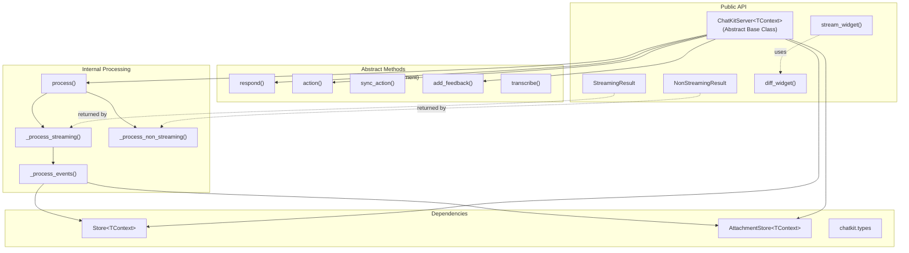
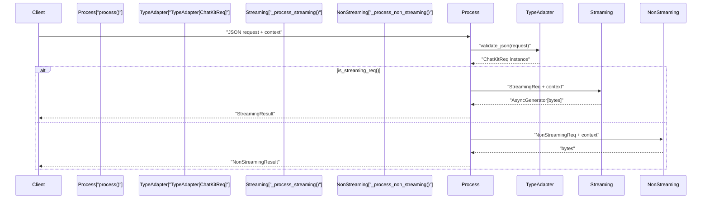
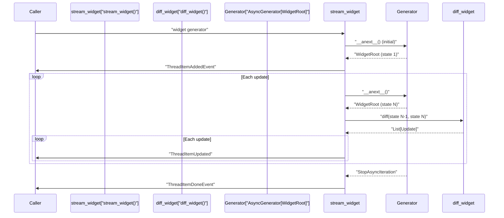
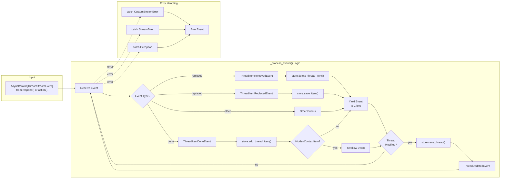

<!-- source: DeepWiki mcp.deepwiki.com · repo openai/chatkit-python · page 6.2 chatkit.server · fetched 2026-10-26 -->

# chatkit.server

<details>
<summary>Relevant source files</summary>

The following files were used as context for generating this wiki page:

- [chatkit/server.py](chatkit/server.py)

</details>


This page provides API reference documentation for the `chatkit.server` module, which contains the core request processing infrastructure for ChatKit servers.

**Scope**: This page documents the classes, functions, and utilities in [chatkit/server.py](). For conceptual explanations of how to implement a ChatKit server, see [ChatKitServer Class](#chatkitserver). For understanding the request processing pipeline, see [Request Processing Pipeline](#request-processing-pipeline).

**Purpose**: The `server` module provides:
- `ChatKitServer` - abstract base class for implementing custom ChatKit servers.
- Result wrapper classes for streaming and non-streaming responses.
- Widget streaming and diffing utilities.
- Internal request routing and event processing logic.

---

## Module Overview



**Sources**: [chatkit/server.py:1-733]()

---

## Classes

### ChatKitServer

**Location**: [chatkit/server.py:255-733]()

Abstract base class that defines the server-side request processing logic. Users must subclass this and implement the abstract methods.

#### Type Parameters

| Parameter | Default | Description |
|-----------|---------|-------------|
| `TContext` | `Any` | Arbitrary context type passed through request processing chain |

#### Constructor

```python
def __init__(
    self,
    store: Store[TContext],
    attachment_store: AttachmentStore[TContext] | None = None,
)
```

**Parameters**:
- `store` - Required storage backend implementing `Store` interface [chatkit/server.py:258-258]().
- `attachment_store` - Optional attachment storage backend implementing `AttachmentStore` interface [chatkit/server.py:259-259]().

**Sources**: [chatkit/server.py:256-262]()

---

#### Abstract Methods

##### respond()

```python
@abstractmethod
def respond(
    self,
    thread: ThreadMetadata,
    input_user_message: UserMessageItem | None,
    context: TContext,
) -> AsyncIterator[ThreadStreamEvent]
```

Stream response events for a new user message. This is the primary method users implement to generate AI responses [chatkit/server.py:272-289]().

**Parameters**:
- `thread` - Metadata for the thread being processed.
- `input_user_message` - The incoming message to respond to, or `None` for retry/tool output scenarios.
- `context` - Per-request context provided by caller.

**Returns**: Async iterator yielding `ThreadStreamEvent` instances.

**Sources**: [chatkit/server.py:272-289]()

---

##### action()

```python
def action(
    self,
    thread: ThreadMetadata,
    action: Action[str, Any],
    sender: WidgetItem | None,
    context: TContext,
) -> AsyncIterator[ThreadStreamEvent]
```

Handle custom actions triggered from widgets. Raises `NotImplementedError` by default [chatkit/server.py:300-310]().

**Parameters**:
- `thread` - Metadata for the thread where action was triggered.
- `action` - The action that was triggered, with name and payload.
- `sender` - The widget item that sent the action, if any.
- `context` - Per-request context.

**Returns**: Async iterator yielding `ThreadStreamEvent` instances.

**Sources**: [chatkit/server.py:300-310]()

---

##### sync_action()

```python
async def sync_action(
    self,
    thread: ThreadMetadata,
    action: Action[str, Any],
    sender: WidgetItem | None,
    context: TContext,
) -> SyncCustomActionResponse
```

Handle synchronous custom actions. These return a direct response rather than a stream of events [chatkit/server.py:312-322]().

**Sources**: [chatkit/server.py:312-322]()

---

##### add_feedback()

```python
async def add_feedback(
    self,
    thread_id: str,
    item_ids: list[str],
    feedback: FeedbackKind,
    context: TContext,
) -> None
```

Handle feedback submission for thread items. Default implementation does nothing [chatkit/server.py:291-298]().

**Sources**: [chatkit/server.py:291-298]()

---

##### transcribe()

```python
async def transcribe(
    self,
    audio: AudioInput,
    context: TContext,
) -> TranscriptionResult
```

Handle audio transcription requests. Default implementation raises `NotImplementedError` [chatkit/server.py:324-331]().

**Sources**: [chatkit/server.py:324-331]()

---

#### Public Methods

##### process()

```python
async def process(
    self, 
    request: str | bytes | bytearray, 
    context: TContext
) -> StreamingResult | NonStreamingResult
```

Entry point for processing ChatKit requests. Parses the incoming JSON request and routes to streaming or non-streaming handlers [chatkit/server.py:333-344]().

**Parameters**:
- `request` - JSON-encoded `ChatKitReq` as string or bytes.
- `context` - Per-request context to pass through processing chain.

**Returns**: 
- `StreamingResult` for streaming requests (creates, messages, actions, etc.).
- `NonStreamingResult` for non-streaming requests (get, list, update, delete).

**Processing Flow**:



**Sources**: [chatkit/server.py:333-344]()

---

#### Internal Methods

| Method | Purpose | Location |
|--------|---------|----------|
| `_get_attachment_store()` | Returns configured attachment store or raises error | [chatkit/server.py:264-270]() |
| `_process_non_streaming()` | Handles non-streaming requests (get, list, update, delete, sync_action, transcribe) | [chatkit/server.py:346-430]() |
| `_process_streaming()` | Wraps streaming events in SSE format | [chatkit/server.py:432-441]() |
| `_process_streaming_impl()` | Routes streaming requests to appropriate handlers | [chatkit/server.py:443-588]() |
| `_process_events()` | Processes event stream, handles persistence and errors | [chatkit/server.py:624-692]() |
| `_process_new_thread_item_respond()` | Saves user message and initiates response | [chatkit/server.py:607-622]() |
| `_cleanup_pending_client_tool_call()` | Removes dangling pending tool calls | [chatkit/server.py:590-605]() |
| `_build_user_message_item()` | Constructs `UserMessageItem` from input | [chatkit/server.py:694-708]() |
| `_load_full_thread()` | Loads thread with first page of items | [chatkit/server.py:710-719]() |
| `_paginate_thread_items_reverse()` | Iterates thread items in reverse order | [chatkit/server.py:721-735]() |
| `_serialize()` | Serializes Pydantic models to JSON bytes | [chatkit/server.py:737-738]() |
| `_to_thread_response()` | Filters hidden items from thread | [chatkit/server.py:740-753]() |

**Sources**: [chatkit/server.py:264-753]()

---

### Request Processing Pipeline

The following diagram shows how different request types are routed through the `ChatKitServer`:

```mermaid
graph TB
    Request["ChatKitReq<br/>(JSON)"]
    
    subgraph "Streaming Requests"
        ThreadsCreateReq["ThreadsCreateReq"]
        ThreadsAddUserMessageReq["ThreadsAddUserMessageReq"]
        ThreadsAddClientToolOutputReq["ThreadsAddClientToolOutputReq"]
        ThreadsRetryAfterItemReq["ThreadsRetryAfterItemReq"]
        ThreadsCustomActionReq["ThreadsCustomActionReq"]
    end
    
    subgraph "Non-Streaming Requests"
        ThreadsGetByIdReq["ThreadsGetByIdReq"]
        ThreadsListReq["ThreadsListReq"]
        ItemsListReq["ItemsListReq"]
        ItemsFeedbackReq["ItemsFeedbackReq"]
        ThreadsUpdateReq["ThreadsUpdateReq"]
        ThreadsDeleteReq["ThreadsDeleteReq"]
        AttachmentsCreateReq["AttachmentsCreateReq"]
        AttachmentsDeleteReq["AttachmentsDeleteReq"]
        ThreadsSyncCustomActionReq["ThreadsSyncCustomActionReq"]
        InputTranscribeReq["InputTranscribeReq"]
    end
    
    Request --> ThreadsCreateReq
    Request --> ThreadsAddUserMessageReq
    Request --> ThreadsAddClientToolOutputReq
    Request --> ThreadsRetryAfterItemReq
    Request --> ThreadsCustomActionReq
    Request --> ThreadsGetByIdReq
    Request --> ThreadsListReq
    Request --> ItemsListReq
    Request --> ItemsFeedbackReq
    Request --> ThreadsUpdateReq
    Request --> ThreadsDeleteReq
    Request --> AttachmentsCreateReq
    Request --> AttachmentsDeleteReq
    Request --> ThreadsSyncCustomActionReq
    Request --> InputTranscribeReq
    
    ThreadsCreateReq --> ProcessEventsCreate["_process_events()<br/>with respond()"]
    ThreadsAddUserMessageReq --> ProcessEventsMsg["_process_events()<br/>with respond()"]
    ThreadsAddClientToolOutputReq --> ProcessEventsTool["_process_events()<br/>with respond()"]
    ThreadsRetryAfterItemReq --> ProcessEventsRetry["_process_events()<br/>with respond()"]
    ThreadsCustomActionReq --> ProcessEventsAction["_process_events()<br/>with action()"]
    
    ThreadsGetByIdReq --> LoadThread["load_thread()<br/>load_thread_items()"]
    ThreadsListReq --> LoadThreads["load_threads()"]
    ItemsListReq --> LoadItems["load_thread_items()"]
    ItemsFeedbackReq --> AddFeedback["add_feedback()"]
    ThreadsUpdateReq --> UpdateThread["load_thread()<br/>save_thread()"]
    ThreadsDeleteReq --> DeleteThread["delete_thread()"]
    AttachmentsCreateReq --> CreateAttachment["create_attachment()"]
    AttachmentsDeleteReq --> DeleteAttachment["delete_attachment()"]
    ThreadsSyncCustomActionReq --> SyncAction["sync_action()"]
    InputTranscribeReq --> Transcribe["transcribe()"]
```



**Sources**: [chatkit/server.py:443-588](), [chatkit/server.py:346-430]()

---

### StreamingResult

**Location**: [chatkit/server.py:238-244]()

Wrapper class for streaming responses. Implements `AsyncIterable[bytes]` to support async iteration.

```python
class StreamingResult(AsyncIterable[bytes]):
    def __init__(self, stream: AsyncGenerator[bytes, None]):
        self.json_events = stream
    
    async def __aiter__(self):
        async for event in self.json_events:
            yield event
```

**Attributes**:
- `json_events` - The underlying async generator of SSE-formatted event bytes [chatkit/server.py:240-240]().

**Usage**: Returned by `process()` for streaming requests. Each yielded byte string is formatted as:
```
data: {JSON_EVENT}\n\n
```

**Sources**: [chatkit/server.py:238-244]()

---

### NonStreamingResult

**Location**: [chatkit/server.py:247-249]()

Wrapper class for non-streaming responses.

```python
class NonStreamingResult:
    def __init__(self, result: bytes):
        self.json = result
```

**Attributes**:
- `json` - The complete JSON response as UTF-8 encoded bytes [chatkit/server.py:249-249]().

**Usage**: Returned by `process()` for non-streaming requests like get, list, update, delete.

**Sources**: [chatkit/server.py:247-249]()

---

## Utility Functions

### stream_widget()

**Location**: [chatkit/server.py:200-252]()

```python
async def stream_widget(
    thread: ThreadMetadata,
    widget: WidgetRoot | AsyncGenerator[WidgetRoot, None],
    copy_text: str | None = None,
    generate_id: Callable[[StoreItemType], str] = default_generate_id,
) -> AsyncIterator[ThreadStreamEvent]
```

Utility function to stream widget updates as `ThreadStreamEvent` instances. Handles both static and streaming widgets [chatkit/server.py:200-252]().

**Parameters**:
- `thread` - Thread metadata for the widget.
- `widget` - Either a static `WidgetRoot` or async generator of `WidgetRoot` updates.
- `copy_text` - Optional text to display in copy-to-clipboard UI.
- `generate_id` - Function to generate item ID (defaults to `default_generate_id`).

**Returns**: Async iterator of events:
- For static widgets: Single `ThreadItemDoneEvent` with complete widget.
- For streaming widgets: `ThreadItemAddedEvent`, multiple `ThreadItemUpdated` events, then `ThreadItemDoneEvent`.

**Streaming Widget Flow**:



**Sources**: [chatkit/server.py:200-252]()

---

### diff_widget()

**Location**: [chatkit/server.py:96-197]()

```python
def diff_widget(
    before: WidgetRoot, 
    after: WidgetRoot
) -> list[WidgetStreamingTextValueDelta | WidgetRootUpdated | WidgetComponentUpdated]
```

Computes incremental updates between two widget states. Used internally by `stream_widget()` [chatkit/server.py:96-197]().

**Parameters**:
- `before` - Previous widget state.
- `after` - New widget state.

**Returns**: List of update events:
- `WidgetRootUpdated` - If root-level properties changed [chatkit/server.py:147-147]().
- `WidgetStreamingTextValueDelta` - For incremental text updates in `Markdown` or `Text` components with IDs [chatkit/server.py:190-195]().
- `WidgetComponentUpdated` - For other component updates.

**Behavior**:

| Condition | Result |
|-----------|--------|
| Root type/id/key changed | `[WidgetRootUpdated]` [chatkit/server.py:146-147]() |
| Any field changed (except streaming text) | `[WidgetRootUpdated]` [chatkit/server.py:146-147]() |
| Text component value appended | `[WidgetStreamingTextValueDelta]` [chatkit/server.py:190-195]() |
| Text value not a prefix | Raises `ValueError` [chatkit/server.py:185-187]() |
| Component ID not persistent | Raises `ValueError` [chatkit/server.py:176-178]() |

**Text Streaming Rules**:
- Only `Markdown` and `Text` components with `id` set support streaming [chatkit/server.py:103-105]().
- New value must start with old value (append-only) [chatkit/server.py:184-187]().
- All components with IDs must persist across updates [chatkit/server.py:176-178]().
- Set `streaming=False` on final update to mark completion [chatkit/server.py:188-188]().

**Sources**: [chatkit/server.py:96-197]()

---

## Event Processing Architecture

The `_process_events()` method is the core event processing engine. It handles:



**Key Behaviors**:
1. **Persistence**: `ThreadItemDoneEvent`, `ThreadItemRemovedEvent`, and `ThreadItemReplacedEvent` trigger immediate storage operations [chatkit/server.py:646-663]().
2. **Filtering**: `HiddenContextItem` and `SDKHiddenContextItem` instances are persisted but not sent to clients [chatkit/server.py:651-653]().
3. **Thread Updates**: If `thread` metadata is modified during streaming, `ThreadUpdatedEvent` is emitted [chatkit/server.py:673-682]().
4. **Error Handling**: All exceptions are caught and converted to `ErrorEvent` with appropriate error codes [chatkit/server.py:684-692]().
5. **User-Agent**: Wrapped in `agents_sdk_user_agent_override()` context [chatkit/server.py:633-633]().

**Sources**: [chatkit/server.py:624-692]()

---

## Integration with Storage

The `ChatKitServer` delegates all persistence to the `Store` and `AttachmentStore` interfaces:

```mermaid
graph TB
    subgraph "ChatKitServer Methods"
        ProcessEvents["_process_events()"]
        ProcessNonStreaming["_process_non_streaming()"]
        BuildUserMessage["_build_user_message_item()"]
    end
    
    subgraph "Store[TContext] Interface"
        GenerateThreadId["generate_thread_id()"]
        GenerateItemId["generate_item_id()"]
        SaveThread["save_thread()"]
        LoadThread["load_thread()"]
        LoadThreads["load_threads()"]
        DeleteThread["delete_thread()"]
        AddThreadItem["add_thread_item()"]
        SaveItem["save_item()"]
        LoadItem["load_item()"]
        LoadThreadItems["load_thread_items()"]
        DeleteThreadItem["delete_thread_item()"]
        LoadAttachment["load_attachment()"]
        DeleteAttachment["delete_attachment()"]
    end
    
    subgraph "AttachmentStore[TContext] Interface"
        CreateAttachment["create_attachment()"]
        DeleteAttachmentBlob["delete_attachment()"]
    end
    
    ProcessEvents --> AddThreadItem
    ProcessEvents --> SaveItem
    ProcessEvents --> DeleteThreadItem
    ProcessEvents --> SaveThread
    
    ProcessNonStreaming --> LoadThread
    ProcessNonStreaming --> LoadThreads
    ProcessNonStreaming --> LoadThreadItems
    ProcessNonStreaming --> SaveThread
    ProcessNonStreaming --> DeleteThread
    ProcessNonStreaming --> DeleteAttachment
    ProcessNonStreaming --> CreateAttachment
    ProcessNonStreaming --> DeleteAttachmentBlob
    
    BuildUserMessage --> GenerateItemId
    BuildUserMessage --> LoadAttachment
    
    style Store fill:#f9f9f9
    style AttachmentStore fill:#f9f9f9
```



**Sources**: [chatkit/server.py:255-753](), [chatkit/store.py:1-125]()

---

## Usage Example

Here's how the pieces fit together in a typical web framework integration:

```mermaid
sequenceDiagram
    participant WebFramework["ASGI Framework<br/>(FastAPI/Flask)"]
    participant CustomServer["CustomChatKitServer"]
    participant Process["process()"]
    participant Store["PostgresStore"]
    participant OpenAI["OpenAI API"]
    
    WebFramework->>CustomServer: "POST /chatkit"
    CustomServer->>Process: "request JSON + context"
    Process->>Store: "load_thread()"
    Store-->>Process: "ThreadMetadata"
    
    Process->>CustomServer: "respond(thread, message, ctx)"
    Note over CustomServer: "User implements respond()<br/>to call OpenAI/Agents SDK"
    CustomServer->>OpenAI: "Create completion"
    
    loop Stream events
        OpenAI-->>CustomServer: "Chunk"
        CustomServer->>Process: "ThreadStreamEvent"
        Process->>Store: "add_thread_item() / save_item()"
        Process-->>WebFramework: "SSE: data: {event}\n\n"
    end
    
    WebFramework-->>WebFramework: "Stream to client"
```

**Sources**: [chatkit/server.py:333-344](), [chatkit/server.py:624-692]()

---

