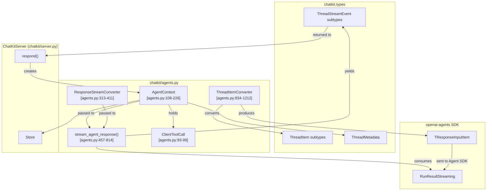
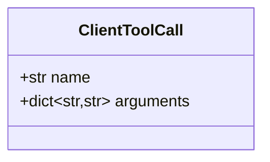
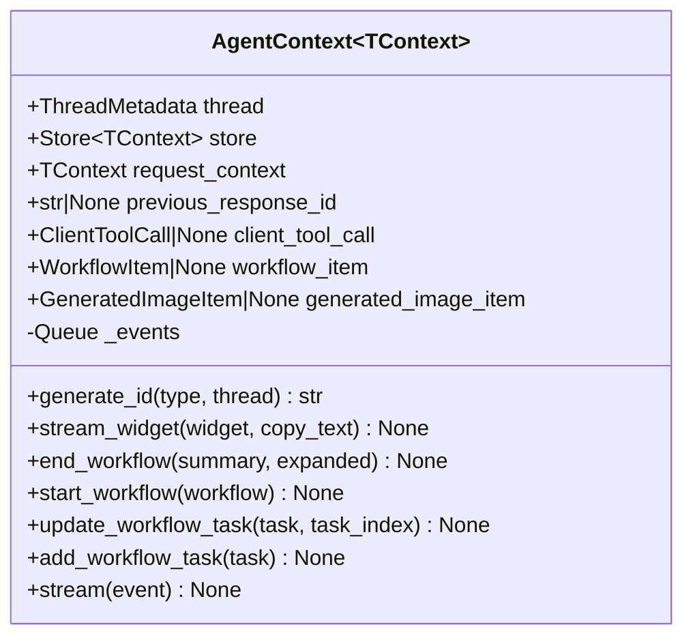
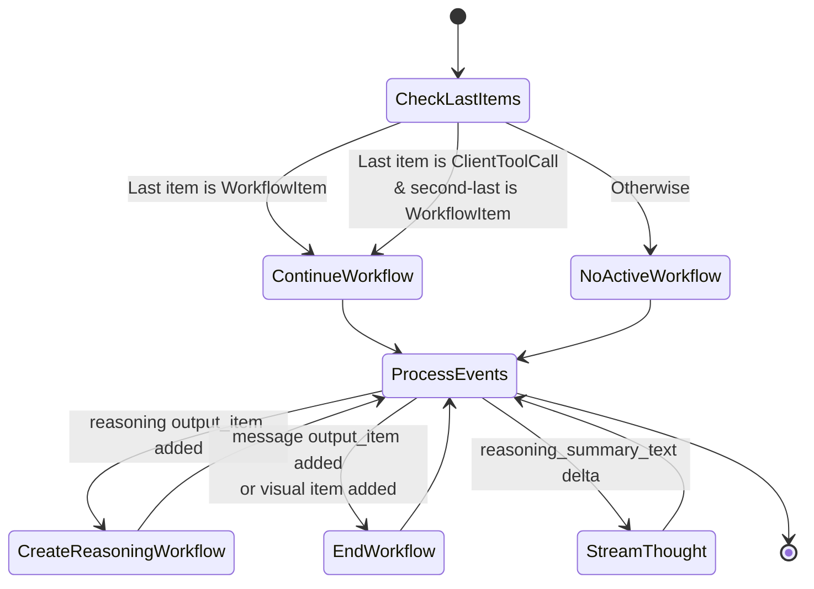
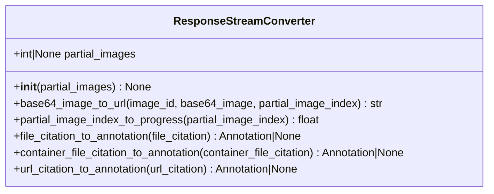
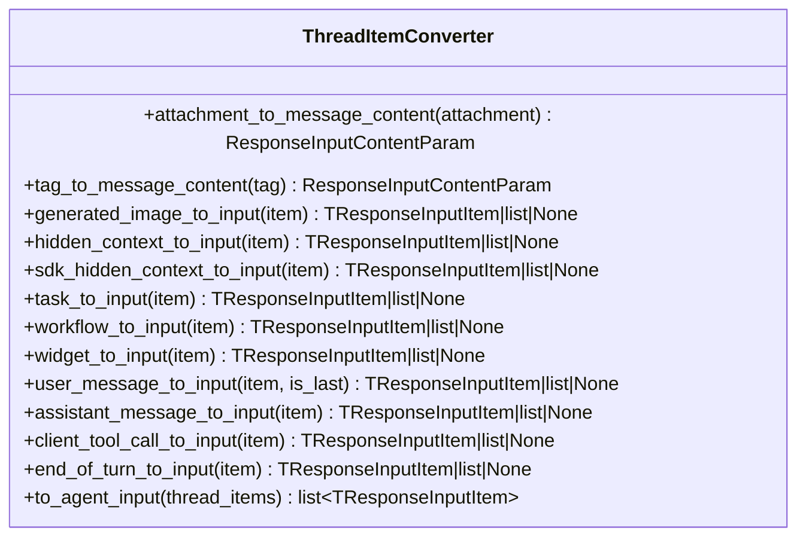

<!-- source: DeepWiki mcp.deepwiki.com · repo openai/chatkit-python · page 6.3 chatkit.agents · fetched 2026-10-26 -->

# chatkit.agents

<details>
<summary>Relevant source files</summary>

The following files were used as context for generating this wiki page:

- [chatkit/agents.py](chatkit/agents.py)
- [tests/test_agents.py](tests/test_agents.py)

</details>


API reference for the `chatkit.agents` module, which provides integration utilities between ChatKit and the OpenAI Agents SDK. This module handles conversion between ChatKit thread items and Agent SDK formats, streams agent responses, and manages workflow lifecycles.

**Related Documentation:**
- Conceptual overview: [Agent Integration (4.1)]()
- Type system: [chatkit.types (6.1)]()
- Server integration: [chatkit.server (6.2)]()

---

## Overview

The `chatkit.agents` module integrates ChatKit with the `openai-agents` SDK (version ≥0.3.2), providing:

- **Type Conversion**: `ThreadItemConverter` converts `ThreadItem` to Agent SDK `TResponseInputItem` format.
- **Response Streaming**: `stream_agent_response()` converts Agent SDK streaming output to `ThreadStreamEvent` objects.
- **Workflow Management**: Automatic lifecycle tracking for reasoning workflows and custom task workflows.
- **Context Management**: `AgentContext` maintains state during agent execution (widgets, workflows, tool calls).
- **Client Tool Integration**: `ClientToolCall` enables server-initiated client-side tool execution.

Designed for use within `ChatKitServer.respond()` implementations that delegate to AI agents.

**Sources:** [chatkit/agents.py:1-89]()

---

## Module Components

| Component | Type | Purpose |
|-----------|------|---------|
| `ClientToolCall` | Model | Represents a client-side tool call request |
| `AgentContext[TContext]` | Generic Model | Manages agent execution state and provides streaming helpers |
| `stream_agent_response()` | Async Function | Converts Agent SDK `RunResultStreaming` to `ThreadStreamEvent` objects |
| `ResponseStreamConverter` | Base Class | Adapts streamed Agent SDK output (citations, images) into ChatKit types |
| `ThreadItemConverter` | Base Class | Converts `ThreadItem` objects into Agent SDK `TResponseInputItem` format |
| `accumulate_text()` | Async Function | Accumulates text deltas into `Markdown`/`Text` widget updates |
| `simple_to_agent_input()` | Function | Convenience wrapper using the default `ThreadItemConverter` instance |

**Sources:** [chatkit/agents.py:93-1212]()

---

## Module Architecture

**Module component relationships and data flow**



**Sources:** [chatkit/agents.py:93-1212]()

---

## Core Classes and Functions

### ClientToolCall

A simple model representing a client-side tool call that needs to be executed by the client application.



**Definition:** [chatkit/agents.py:93-99]()

| Field | Type | Description |
|-------|------|-------------|
| `name` | `str` | The name of the tool to call on the client |
| `arguments` | `dict[str, Any]` | Arguments to pass to the client tool |

Returned from server-side tool methods to signal that a client-side operation must be performed. Stored in `AgentContext.client_tool_call` during execution and converted to a `ClientToolCallItem` at stream completion by `stream_agent_response()`.

**Sources:** [chatkit/agents.py:93-99](), [chatkit/agents.py:115-115]()

---

### AgentContext

A context object that tracks state during agent execution and provides helper methods for streaming content back to the client.

**`AgentContext` class structure**



**Definition:** [chatkit/agents.py:108-226]()

#### Fields

| Field | Type | Description |
|-------|------|-------------|
| `thread` | `ThreadMetadata` | Metadata about the current thread being processed |
| `store` | `Store[TContext]` | Storage interface for persisting thread items |
| `request_context` | `TContext` | Application-specific request context (passed to store methods) |
| `previous_response_id` | `str \| None` | ID of previous assistant response (enables Agent SDK continuations) |
| `client_tool_call` | `ClientToolCall \| None` | Pending client tool call to be returned at stream end |
| `workflow_item` | `WorkflowItem \| None` | Currently active workflow being tracked |
| `generated_image_item` | `GeneratedImageItem \| None` | Currently active generated image item being tracked |
| `_events` | `asyncio.Queue` | Internal queue for custom events merged with agent stream |

#### Methods

**`generate_id(type: StoreItemType, thread: ThreadMetadata | None = None) -> str`**

Generate a new ID for a thread or thread item using the configured store.

- **Parameters:**
  - `type`: Item type (`"thread"`, `"message"`, `"workflow"`, `"tool_call"`, `"task"`, `"attachment"`, `"widget"`, `"sdk_hidden_context"`, `"hidden_context"`)
  - `thread`: Thread metadata (defaults to `self.thread`)
- **Returns:** Newly generated ID string
- **Implementation:** [chatkit/agents.py:120-128]()

**`async stream_widget(widget: WidgetRoot | AsyncGenerator[WidgetRoot, None], copy_text: str | None = None) -> None`**

Stream a widget to the client. Supports both static widgets and incremental streaming updates.

- **Parameters:**
  - `widget`: A `WidgetRoot` instance or async generator yielding updates
  - `copy_text`: Optional text for clipboard when user copies the widget
- **Implementation:** [chatkit/agents.py:130-144]()

See [chatkit.server.stream_widget()](6.2) for the underlying streaming logic.

**`async end_workflow(summary: WorkflowSummary | None = None, expanded: bool = False) -> None`**

End the currently active workflow and emit a `ThreadItemDoneEvent`.

- **Parameters:**
  - `summary`: Workflow summary (defaults to `DurationSummary` based on elapsed time)
  - `expanded`: Whether to keep workflow expanded in UI (defaults to `False`)
- **Implementation:** [chatkit/agents.py:146-163]()

If no workflow is active (`workflow_item` is `None`), this method does nothing.

**`async start_workflow(workflow: Workflow) -> None`**

Start a new workflow and emit a `ThreadItemAddedEvent`.

- **Parameters:**
  - `workflow`: The workflow definition to start
- **Implementation:** [chatkit/agents.py:165-178]()

Creates a `WorkflowItem` with generated ID. For non-reasoning workflows with no tasks, defers emitting the added event until tasks are present.

**`async update_workflow_task(task: Task, task_index: int) -> None`**

Update a task within the active workflow and emit a `ThreadItemUpdatedEvent`.

- **Parameters:**
  - `task`: The updated task
  - `task_index`: Index of the task in the workflow's task list
- **Raises:** `ValueError` if no workflow is active
- **Implementation:** [chatkit/agents.py:180-194]()

**`async add_workflow_task(task: Task) -> None`**

Add a new task to the active workflow. Creates a workflow if one doesn't exist.

- **Parameters:**
  - `task`: The task to add
- **Implementation:** [chatkit/agents.py:196-218]()

Emits `ThreadItemAddedEvent` if this is the first task in a new custom workflow, otherwise emits `ThreadItemUpdatedEvent` with `WorkflowTaskAdded`.

**`async stream(event: ThreadStreamEvent) -> None`**

Queue a custom event to be merged into the agent response stream.

- **Parameters:**
  - `event`: The event to stream to the client
- **Implementation:** [chatkit/agents.py:220-222]()

Events are merged with Agent SDK events by `stream_agent_response()` using the internal `_merge_generators()` utility.

**Sources:** [chatkit/agents.py:108-226]()

---

### stream_agent_response

The primary function for converting a streaming agent run result into ChatKit `ThreadStreamEvent` objects.

```python
async def stream_agent_response(
    context: AgentContext,
    result: RunResultStreaming,
    *,
    converter: ResponseStreamConverter = ResponseStreamConverter(),
) -> AsyncIterator[ThreadStreamEvent]
```

**Definition:** [chatkit/agents.py:457-814]()

This function:
1. Merges agent SDK stream events with custom events from `AgentContext`.
2. Converts agent output items to ChatKit thread items.
3. Manages workflow lifecycle (continuation, creation, completion).
4. Handles reasoning workflows with streaming thoughts.
5. Processes guardrail tripwires by removing produced items.
6. Converts client tool calls to `ClientToolCallItem`.

#### Workflow Management Logic



#### Event Conversion Flow

| Agent SDK Event | ChatKit Event | Notes |
|-----------------|---------------|-------|
| `response.content_part.added` | `ThreadItemUpdatedEvent` (`AssistantMessageContentPartAdded`) | Ignores `reasoning_text` parts |
| `response.output_text.delta` | `ThreadItemUpdatedEvent` (`AssistantMessageContentPartTextDelta`) | Text streaming delta |
| `response.output_text.done` | `ThreadItemUpdatedEvent` (`AssistantMessageContentPartDone`) | Finalize text part |
| `response.output_text.annotation.added` | `ThreadItemUpdatedEvent` (`AssistantMessageContentPartAnnotationAdded`) | Annotations with empty filename are dropped |
| `response.output_item.added` (message) | `ThreadItemAddedEvent` (`AssistantMessageItem`) | New assistant message |
| `response.output_item.added` (reasoning) | `ThreadItemAddedEvent` (`WorkflowItem`) | Creates a reasoning-type workflow |
| `response.output_item.added` (image_generation_call) | `ThreadItemAddedEvent` (`GeneratedImageItem`) | Image generation started |
| `response.image_generation_call.partial_image` | `ThreadItemUpdatedEvent` (`GeneratedImageUpdated`) | Partial image progress update |
| `response.reasoning_summary_text.delta` | `ThreadItemUpdatedEvent` (`WorkflowTaskUpdated`) | Streams first thought incrementally |
| `response.reasoning_summary_text.done` | `ThreadItemUpdatedEvent` (`WorkflowTaskAdded` or `WorkflowTaskUpdated`) | Finalizes thought content |
| `response.output_item.done` (message) | `ThreadItemDoneEvent` (`AssistantMessageItem`) | Complete message with all content |
| `response.output_item.done` (image_generation_call) | `ThreadItemDoneEvent` (`GeneratedImageItem`) | Final image result |

**Parameters:**
- `context`: The `AgentContext` for the current execution.
- `result`: The streaming result from an agent SDK run (`RunResultStreaming`).
- `converter`: A `ResponseStreamConverter` instance for adapting citations and images.

**Returns:** An async iterator of `ThreadStreamEvent` objects.

**Raises:**
- `InputGuardrailTripwireTriggered`: If input guardrails are violated (emits `ThreadItemRemovedEvent` for all produced items, then re-raises).
- `OutputGuardrailTripwireTriggered`: If output guardrails are violated (emits `ThreadItemRemovedEvent` for all produced items, then re-raises).

**Special Handling:**
- Continues existing workflows: on startup, loads the last 2 thread items and resumes a `WorkflowItem` if one is present (or second-last if last is a `ClientToolCallItem`).
- Persists an active workflow at stream end so it can be continued in the next turn.
- Automatically ends workflow when visual items (messages, widgets) are added after it.
- Filters out `file_citation` annotations with empty filenames to prevent rendering errors.

**Sources:** [chatkit/agents.py:457-814]()

---

### ResponseStreamConverter

Controls how streamed data from the Agent SDK is adapted into ChatKit types. Passed as the `converter` parameter to `stream_agent_response()`.

**`ResponseStreamConverter` method summary**



**Definition:** [chatkit/agents.py:313-411]()

#### Constructor

**`__init__(*, partial_images: int | None = None)`**

- `partial_images`: Expected number of partial image updates for image generation calls. Used by `partial_image_index_to_progress()` to normalize progress to `[0, 1]`.

**Implementation:** [chatkit/agents.py:330-337]()

#### Overridable Methods

| Method | Default Behavior | When to Override |
|--------|-----------------|-----------------|
| `base64_image_to_url` | Returns `data:image/png;base64,{data}` | Store image to persistent storage and return a URL |
| `partial_image_index_to_progress` | Divides index by `partial_images`; returns `0.0` if unset | Change progress normalization formula |
| `file_citation_to_annotation` | Creates `Annotation(source=FileSource(...))` from filename; returns `None` if filename is empty | Enrich file citations with metadata |
| `container_file_citation_to_annotation` | Creates `Annotation(source=FileSource(...))` from filename; returns `None` if filename is empty | Enrich container file citations |
| `url_citation_to_annotation` | Creates `Annotation(source=URLSource(...))` with URL and title | Customize URL citation format |

**Sources:** [chatkit/agents.py:313-411]()

---

### ThreadItemConverter

A converter class that transforms ChatKit `ThreadItem` objects into Agent SDK `TResponseInputItem` objects.

**`ThreadItemConverter` method summary**



**Definition:** [chatkit/agents.py:834-1212]()

#### Conversion Methods

The converter provides methods for each `ThreadItem` type. Methods that require custom implementation raise `NotImplementedError` by default:

**Required Implementations (raise NotImplementedError):**

| Method | Purpose | Signature |
|--------|---------|-----------|
| `attachment_to_message_content` | Convert attachments to message content | `(Attachment) -> Awaitable[ResponseInputContentParam]` |
| `tag_to_message_content` | Convert tags to context content | `(UserMessageTagContent) -> ResponseInputContentParam` |
| `hidden_context_to_input` | Convert hidden context items (non-string content) | `(HiddenContextItem) -> TResponseInputItem \| list \| None` |

**Default Implementations (can be overridden):**

| Method | Default Behavior |
|--------|------------------|
| `sdk_hidden_context_to_input` | Converts SDK internal context to user message with XML format |
| `task_to_input` | Converts custom tasks to user message with XML format |
| `workflow_to_input` | Converts custom workflow tasks to user messages |
| `widget_to_input` | Converts widget to JSON representation in user message |
| `user_message_to_input` | Converts user message with attachments, tags, and quoted text |
| `assistant_message_to_input` | Converts to assistant message (without annotations) |
| `client_tool_call_to_input` | Converts to function call + output pair |
| `end_of_turn_to_input` | Returns `None` (UI-only hint) |

#### Primary Conversion Method

**`async to_agent_input(thread_items: Sequence[ThreadItem] | ThreadItem) -> list[TResponseInputItem]`**

Convert one or more thread items to Agent SDK input items.

- **Parameters:**
  - `thread_items`: A single thread item or sequence of thread items to convert.
- **Returns:** List of agent input items ready to send to the model.
- **Implementation:** [chatkit/agents.py:1187-1204]()

**Sources:** [chatkit/agents.py:834-1212]()

---

### Helper Functions

#### accumulate_text

```python
async def accumulate_text(
    events: AsyncIterator[StreamEvent],
    base_widget: TWidget,
) -> AsyncIterator[TWidget]
```

**Definition:** [chatkit/agents.py:817-831]()

Accumulates text deltas from agent streaming events and yields updated widget instances. Useful for streaming text content into `Markdown` or `Text` widgets.

**Parameters:**
- `events`: Stream of agent SDK events.
- `base_widget`: Base widget instance (Markdown or Text).

**Returns:** Async iterator of updated widget instances with accumulated text.

**Sources:** [chatkit/agents.py:817-831]()

---

#### simple_to_agent_input

```python
async def simple_to_agent_input(
    thread_items: Sequence[ThreadItem] | ThreadItem
) -> list[TResponseInputItem]
```

**Definition:** [chatkit/agents.py:1210-1212]()

A convenience wrapper around the default `ThreadItemConverter` instance. Use this when you don't need custom conversion logic.

**Parameters:**
- `thread_items`: Thread items to convert.

**Returns:** List of agent input items.

**Note:** This uses the default converter instance at [chatkit/agents.py:1207](), which will raise `NotImplementedError` for attachments, tags, or non-string hidden context.

**Sources:** [chatkit/agents.py:1207-1212]()

---

