<!-- source: DeepWiki mcp.deepwiki.com · repo openai/chatkit-python · page 6.4 chatkit.store · fetched 2026-10-26 -->

# chatkit.store

<details>
<summary>Relevant source files</summary>

The following files were used as context for generating this wiki page:

- [chatkit/store.py](chatkit/store.py)
- [tests/helpers/mock_store.py](tests/helpers/mock_store.py)

</details>


`chatkit.store` defines the persistence layer for ChatKit. It contains two abstract base classes — `Store` and `AttachmentStore` — that server implementations must subclass to provide thread, item, and attachment storage. It also defines `NotFoundError`, the `StoreItemType` literal, and the `default_generate_id` utility.

This page covers the public API of `chatkit/store.py`. For how `Store` integrates with `ChatKitServer` at the request-routing level, see [3.2](). For context on how `TContext` flows through the system, see [3.4](). For the `AttachmentStore` use-cases (two-phase uploads, direct uploads), see [4.6]().

---

## Module Overview

**Source:** [chatkit/store.py:1-163]()

| Symbol | Kind | Description |
|---|---|---|
| `StoreItemType` | `Literal` | Discriminator for the seven storable item kinds |
| `_ID_PREFIXES` | `dict` | Maps each `StoreItemType` to a short string prefix |
| `default_generate_id` | function | Generates a prefixed random ID for a given item type |
| `NotFoundError` | exception | Raised when a requested record does not exist |
| `AttachmentStore` | abstract class | Manages file attachment lifecycle |
| `Store` | abstract class | Manages threads, thread items, and attachment metadata |

---

## `StoreItemType`

[chatkit/store.py:17-25]()

```python
StoreItemType = Literal[
    "thread",
    "message",
    "tool_call",
    "task",
    "workflow",
    "attachment",
    "sdk_hidden_context",
]
```

A string literal union that identifies what kind of entity is being stored. Used as the argument to `default_generate_id` and `generate_item_id`.

---

## `default_generate_id`

[chatkit/store.py:39-41]()

Generates a new string ID in the form `{prefix}_{8-char hex}`. The prefix is derived from `_ID_PREFIXES`.

**Prefix table:**

| `StoreItemType` | Prefix | Example |
|---|---|---|
| `"thread"` | `thr` | `thr_a1b2c3d4` |
| `"message"` | `msg` | `msg_a1b2c3d4` |
| `"tool_call"` | `tc` | `tc_a1b2c3d4` |
| `"workflow"` | `wf` | `wf_a1b2c3d4` |
| `"task"` | `tsk` | `tsk_a1b2c3d4` |
| `"attachment"` | `atc` | `atc_a1b2c3d4` |
| `"sdk_hidden_context"` | `shcx` | `shcx_a1b2c3d4` |

Sources: [chatkit/store.py:28-41]()

---

## `NotFoundError`

[chatkit/store.py:44-45]()

A plain `Exception` subclass. `Store` implementations must raise `NotFoundError` when a thread, item, or attachment is not found. `ChatKitServer` catches this exception and translates it into an appropriate error response.

```python
class NotFoundError(Exception):
    pass
```

Sources: [chatkit/store.py:44-45](), [tests/helpers/mock_store.py:92-93]()

---

## `AttachmentStore`

[chatkit/store.py:48-66]()

An abstract generic base class `AttachmentStore[TContext]` responsible solely for creating and deleting file attachments. It is separate from `Store` so that implementations needing only basic file management do not have to implement thread storage, and vice versa.

### Class diagram

**`AttachmentStore` class structure**

```mermaid
classDiagram
    class "AttachmentStore[TContext]" {
        <<abstract>>
        +delete_attachment(attachment_id: str, context: TContext) None*
        +create_attachment(input: AttachmentCreateParams, context: TContext) Attachment
        +generate_attachment_id(mime_type: str, context: TContext) str
    }
```

### Methods

| Method | Abstract? | Description |
|---|---|---|
| `delete_attachment(attachment_id, context)` | **Yes** | Delete an attachment by ID |
| `create_attachment(input, context)` | No (raises `NotImplementedError`) | Create an attachment record from upload metadata. Must be overridden to support two-phase upload |
| `generate_attachment_id(mime_type, context)` | No | Returns a new attachment ID. Default delegates to `default_generate_id("attachment")`. Override to customize |

**`create_attachment` default behavior:** raises `NotImplementedError` with a message indicating that the subclass must override it to support two-phase file upload. If you only need direct-upload (where the file is already present on your server), you do not need to override `create_attachment`.

Sources: [chatkit/store.py:48-66]()

---

## `Store`

[chatkit/store.py:68-163]()

An abstract generic base class `Store[TContext]` that covers all persistence for threads, thread items, and attachment metadata. All methods are `async`.

### Class diagram

**`Store` class structure**

```mermaid
classDiagram
    class "Store[TContext]" {
        <<abstract>>
        +generate_thread_id(context: TContext) str
        +generate_item_id(item_type: StoreItemType, thread: ThreadMetadata, context: TContext) str
        +load_thread(thread_id: str, context: TContext) ThreadMetadata*
        +save_thread(thread: ThreadMetadata, context: TContext) None*
        +delete_thread(thread_id: str, context: TContext) None*
        +load_threads(limit: int, after: str|None, order: str, context: TContext) Page[ThreadMetadata]*
        +load_thread_items(thread_id: str, after: str|None, limit: int, order: str, context: TContext) Page[ThreadItem]*
        +add_thread_item(thread_id: str, item: ThreadItem, context: TContext) None*
        +save_item(thread_id: str, item: ThreadItem, context: TContext) None*
        +load_item(thread_id: str, item_id: str, context: TContext) ThreadItem*
        +delete_thread_item(thread_id: str, item_id: str, context: TContext) None*
        +save_attachment(attachment: Attachment, context: TContext) None*
        +load_attachment(attachment_id: str, context: TContext) Attachment*
        +delete_attachment(attachment_id: str, context: TContext) None*
    }
```

Sources: [chatkit/store.py:68-163]()

### Method Reference

#### ID generation (concrete, overridable)

| Method | Signature | Description |
|---|---|---|
| `generate_thread_id` | `(context) -> str` | Default calls `default_generate_id("thread")` |
| `generate_item_id` | `(item_type, thread, context) -> str` | Default calls `default_generate_id(item_type)` |

Override these to plug in your own ID scheme (e.g. database auto-increment, UUIDs in a specific format, ULIDs).

#### Thread methods (abstract)

| Method | Signature | Description |
|---|---|---|
| `load_thread` | `(thread_id, context) -> ThreadMetadata` | Load thread metadata by ID. Raise `NotFoundError` if absent |
| `save_thread` | `(thread, context) -> None` | Persist (upsert) thread metadata |
| `delete_thread` | `(thread_id, context) -> None` | Delete a thread and all its items |
| `load_threads` | `(limit, after, order, context) -> Page[ThreadMetadata]` | Paginated list of threads |

#### Thread item methods (abstract)

| Method | Signature | Description |
|---|---|---|
| `load_thread_items` | `(thread_id, after, limit, order, context) -> Page[ThreadItem]` | Paginated list of items within a thread |
| `add_thread_item` | `(thread_id, item, context) -> None` | Insert a new thread item (does not upsert) |
| `save_item` | `(thread_id, item, context) -> None` | Upsert a thread item by ID |
| `load_item` | `(thread_id, item_id, context) -> ThreadItem` | Load a single item. Raise `NotFoundError` if absent |
| `delete_thread_item` | `(thread_id, item_id, context) -> None` | Delete a single item by ID |

#### Attachment metadata methods (abstract)

| Method | Signature | Description |
|---|---|---|
| `save_attachment` | `(attachment, context) -> None` | Upsert attachment metadata |
| `load_attachment` | `(attachment_id, context) -> Attachment` | Load attachment metadata. Raise `NotFoundError` if absent |
| `delete_attachment` | `(attachment_id, context) -> None` | Delete attachment metadata |

Sources: [chatkit/store.py:68-163]()

---

## Pagination: `Page[T]`

Both `load_threads` and `load_thread_items` return `Page[T]`, a generic Pydantic model defined in `chatkit.types`. Its fields are:

| Field | Type | Description |
|---|---|---|
| `data` | `list[T]` | The items in this page |
| `has_more` | `bool` | Whether more pages exist |
| `after` | `str \| None` | Cursor pointing to the last item, used as `after` in the next request |

Pagination is cursor-based. Pass `after=None` for the first page; pass the returned `after` value to fetch the next page.

Sources: [chatkit/store.py:92-129](), [tests/helpers/mock_store.py:117-159]()

---

## Data flow: `Store` in the request pipeline

The following diagram shows which `ChatKitServer` request types trigger specific `Store` methods.

**`ChatKitServer` → `Store` method dispatch**

```mermaid
flowchart TD
    subgraph "Request Types"
        R1["ThreadsGetByIdReq"]
        R2["ThreadsListReq"]
        R3["ItemsListReq"]
        R4["ThreadsUpdateReq"]
        R5["ThreadsDeleteReq"]
        R6["AttachmentsCreateReq"]
        R7["AttachmentsDeleteReq"]
        R8["ThreadsCreateReq"]
        R9["ThreadsAddUserMessageReq"]
        R10["ThreadsAddClientToolOutputReq"]
        R11["ThreadsRetryAfterItemReq"]
    end

    subgraph "Store Method Space"
        M1["load_thread()"]
        M2["load_threads()"]
        M3["load_thread_items()"]
        M4["save_thread()"]
        M5["delete_thread()"]
        M6["save_attachment()"]
        M7["delete_attachment()"]
        M8["add_thread_item()"]
        M9["save_item()"]
        M10["load_item()"]
        M11["delete_thread_item()"]
    end

    R1 --> M1
    R2 --> M2
    R3 --> M3
    R4 --> M4
    R5 --> M5
    R6 --> M6
    R7 --> M7
    R8 --> M4
    R8 --> M8
    R9 --> M8
    R10 --> M9
    R10 --> M10
    R11 --> M11
    R11 --> M8
```



Sources: [chatkit/store.py:68-163]()

---

## `SQLiteStore` reference implementation

The test suite ships `SQLiteStore` in [tests/helpers/mock_store.py:37-334](), which is a complete `Store[RequestContext]` implementation backed by an SQLite database. It demonstrates the required behavior for all abstract methods and is useful as a reference when writing your own `Store`.

**Schema used by `SQLiteStore`:**

| Table | Columns | Stores |
|---|---|---|
| `threads` | `id, user_id, created_at, data` | `ThreadMetadata` as JSON |
| `items` | `id, thread_id, user_id, created_at, data` | `ThreadItem` as JSON |
| `files` | `id, user_id, data` | `Attachment` as JSON |

The `user_id` column in every table illustrates the standard pattern for context-based access scoping (see [3.4]()): every query is filtered by `context.user_id`, so one user cannot access another user's data.

Sources: [tests/helpers/mock_store.py:37-115](), [tests/helpers/mock_store.py:161-185]()

---

## Implementation checklist

When subclassing `Store`, you must implement all abstract methods. The concrete methods (`generate_thread_id`, `generate_item_id`) have working defaults but can be overridden.

```
Required (abstract):
  ✓ load_thread
  ✓ save_thread
  ✓ delete_thread
  ✓ load_threads
  ✓ load_thread_items
  ✓ add_thread_item
  ✓ save_item
  ✓ load_item
  ✓ delete_thread_item
  ✓ save_attachment
  ✓ load_attachment
  ✓ delete_attachment

Optional (concrete, with defaults):
  ○ generate_thread_id
  ○ generate_item_id
```

When subclassing `AttachmentStore`:

```
Required (abstract):
  ✓ delete_attachment

Optional (concrete):
  ○ create_attachment   (raises NotImplementedError by default)
  ○ generate_attachment_id
```

Sources: [chatkit/store.py:48-163]()

---

