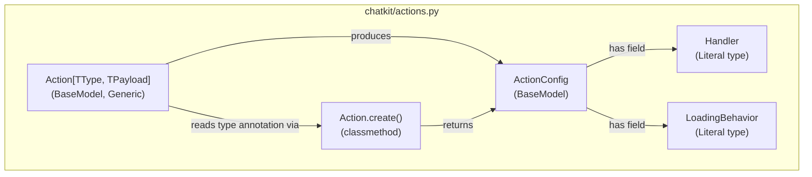
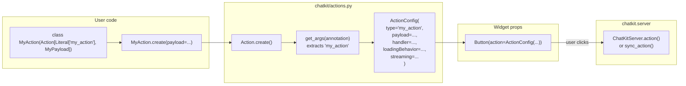

<!-- source: DeepWiki mcp.deepwiki.com · repo openai/chatkit-python · page 6.5 chatkit.actions · fetched 2026-10-26 -->

# chatkit.actions

<details>
<summary>Relevant source files</summary>

The following files were used as context for generating this wiki page:

- [chatkit/actions.py](chatkit/actions.py)

</details>


This page is the API reference for the `chatkit.actions` module ([chatkit/actions.py:1-57]()). It documents the `Action` generic class, the `ActionConfig` model, and the `Handler` and `LoadingBehavior` literal types used to configure how widget actions are dispatched and rendered.

For a conceptual explanation of how actions fit into the widget system and how they route to `ChatKitServer.action`, `sync_action`, or the client-side `onAction` callback, see the Actions System page ([4.2]()). For how widget components reference `ActionConfig` in their properties, see the Widgets reference ([6.6]()).

---

## Module Overview

**Diagram: Module contents and relationships**



Sources: [chatkit/actions.py:1-57]()

---

## Types

### `Handler`

[chatkit/actions.py:7]()

```python
Handler = Literal["client", "server"]
```

Controls where the action is processed when a user triggers it.

| Value | Behavior |
|---|---|
| `"server"` | Action is sent to `ChatKitServer.action()` or `ChatKitServer.sync_action()` on the Python server. Default. |
| `"client"` | Action is handled client-side via the React widget's `onAction` callback. Never reaches the server. |

The module default is exposed as `DEFAULT_HANDLER = "server"` ([chatkit/actions.py:10]()).

---

### `LoadingBehavior`

[chatkit/actions.py:8]()

```python
LoadingBehavior = Literal["auto", "none", "self", "container"]
```

Controls which UI element displays a loading indicator while the action is being processed.

| Value | Behavior |
|---|---|
| `"auto"` | The framework decides which element to show as loading. Default. |
| `"none"` | No loading indicator is shown. |
| `"self"` | The element that triggered the action shows a loading state. |
| `"container"` | The nearest container widget shows a loading state. |

The module default is exposed as `DEFAULT_LOADING_BEHAVIOR = "auto"` ([chatkit/actions.py:11]()).

---

## `ActionConfig`

[chatkit/actions.py:14-19]()

A plain Pydantic `BaseModel` that represents a fully resolved, serializable action descriptor. This is what gets embedded in widget component props and sent over the wire to the client.

| Field | Type | Default | Description |
|---|---|---|---|
| `type` | `str` | — | Discriminator string identifying the action type. Must match a registered action type. |
| `payload` | `Any` | `None` | Arbitrary data passed to the handler when the action fires. |
| `handler` | `Handler` | `"server"` | Where the action is handled (`"client"` or `"server"`). |
| `loadingBehavior` | `LoadingBehavior` | `"auto"` | Which UI element enters a loading state. |
| `streaming` | `bool` | `True` | If `True` and handler is `"server"`, the response is streamed (SSE). If `False`, the response is a synchronous JSON result. |

`ActionConfig` is the concrete output type: you place instances of it in widget component props. You rarely construct it directly — instead, use `Action.create()`.

Sources: [chatkit/actions.py:14-19]()

---

## `Action`

[chatkit/actions.py:22-56]()

`Action` is a generic Pydantic model parameterised by a type literal (`TType`) and a payload type (`TPayload`). Its primary purpose is to act as a typed factory for `ActionConfig` instances via the `create()` classmethod. Concrete subclasses bind `TType` to a specific string literal, which becomes the action's discriminator.

**Type parameters:**

| Parameter | Bound | Purpose |
|---|---|---|
| `TType` | `str` | The action type literal. Must be a `Literal[str]` at the concrete subclass level. |
| `TPayload` | — | The payload data type. |

### Fields

| Field | Type | Default | Notes |
|---|---|---|---|
| `type` | `TType` | `TType` (frozen) | The type string, frozen after construction ([chatkit/actions.py:27]()). |
| `payload` | `TPayload` | `None` | The action payload. Defaults to `None` to support no-payload actions ([chatkit/actions.py:28]()). |

### `Action.create()` classmethod

[chatkit/actions.py:30-56]()

```python
@classmethod
def create(
    cls,
    payload: TPayload,
    handler: Handler = DEFAULT_HANDLER,
    loading_behavior: LoadingBehavior = DEFAULT_LOADING_BEHAVIOR,
    streaming: bool = True,
) -> ActionConfig
```

Introspects the class's `type` field annotation to extract the string literal value, then constructs and returns an `ActionConfig`.

**Type inference behavior:**

The method inspects the annotation of the `"type"` field at runtime using `get_origin` and `get_args` from the `typing` module ([chatkit/actions.py:39-41]()). It requires that the annotation is a `Literal` with exactly one `str` value ([chatkit/actions.py:42-43]()). If this condition is not satisfied (e.g., when called on the base `Action` class without a concrete type parameter), a `TypeError` is raised ([chatkit/actions.py:45-48]()):

> `"Cannot infer 'type' for this Action[...]. Do not call create() on generic Action."`

**Parameters:**

| Parameter | Type | Default | Description |
|---|---|---|---|
| `payload` | `TPayload` | — | The payload to include in the resulting `ActionConfig`. |
| `handler` | `Handler` | `"server"` | Where the action is dispatched. |
| `loading_behavior` | `LoadingBehavior` | `"auto"` | UI loading indicator behaviour. |
| `streaming` | `bool` | `True` | Whether the server handler should stream its response. |

**Returns:** `ActionConfig` ([chatkit/actions.py:50-56]())

Sources: [chatkit/actions.py:30-56]()

---

## Usage Pattern

**Diagram: Defining and using a concrete `Action` subclass**



Sources: [chatkit/actions.py:26-56]()

---

## Constants

| Name | Type | Value |
|---|---|---|
| `DEFAULT_HANDLER` | `Handler` | `"server"` |
| `DEFAULT_LOADING_BEHAVIOR` | `LoadingBehavior` | `"auto"` |

Sources: [chatkit/actions.py:10-11]()

---

## Error Conditions

| Condition | Exception | Message |
|---|---|---|
| `Action.create()` called on the base `Action` class or a subclass without a concrete `Literal` type parameter | `TypeError` | `"Cannot infer 'type' for this Action[...]. Do not call create() on generic Action."` |

Sources: [chatkit/actions.py:45-48]()

---

