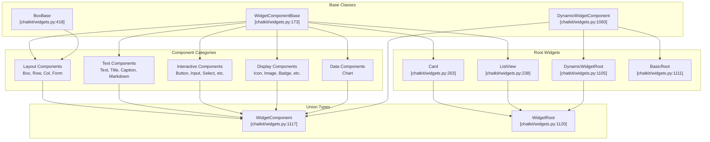
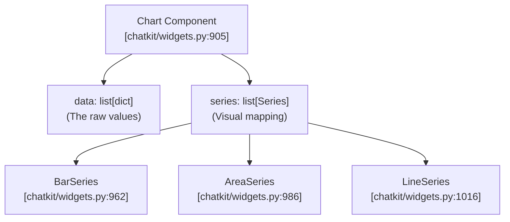

<!-- source: DeepWiki mcp.deepwiki.com · repo openai/chatkit-python · page 6.6 chatkit.widgets · fetched 2026-10-26 -->

# chatkit.widgets

<details>
<summary>Relevant source files</summary>

The following files were used as context for generating this wiki page:

- [chatkit/widgets.py](chatkit/widgets.py)
- [tests/assets/widgets/basic_root.json](tests/assets/widgets/basic_root.json)
- [tests/assets/widgets/basic_root.widget](tests/assets/widgets/basic_root.widget)
- [tests/test_widgets.py](tests/test_widgets.py)

</details>


This page provides API reference documentation for the `chatkit.widgets` module, which defines all widget component types, the `WidgetTemplate` loader, and supporting types for building rich UI components in ChatKit applications.

For architectural concepts and usage patterns of the widget system, see [Widgets and UI Components](#4.3). For details on authoring .widget files and the build process, see [Widget Templates](#4.3.1).

---

## Overview

The `chatkit.widgets` module provides:

- **`WidgetTemplate`**: Class for loading .widget files and hydrating them with data [chatkit/widgets.py:1128-1130]().
- **Root widgets**: Top-level containers (`Card`, `ListView`, `BasicRoot`, `DynamicWidgetRoot`) [chatkit/widgets.py:238-293,1105-1115]().
- **Component types**: 30+ UI components organized into layout, display, interactive, and data categories [chatkit/widgets.py:295-948]().
- **Supporting types**: Configuration objects, type aliases, and utility types [chatkit/widgets.py:31-160]().
- **Type unions**: `WidgetComponent` and `WidgetRoot` discriminated unions for type-safe composition [chatkit/widgets.py:1070-1121]().

All widget types are Pydantic models with runtime validation and serialization. The module includes a deprecation notice encouraging use of `WidgetTemplate` over direct instantiation of widget classes [chatkit/widgets.py:23-27]().

**Sources**: [chatkit/widgets.py:1-30]()

---

## Widget Template System

### WidgetTemplate

```python
class WidgetTemplate:
    """Utility for loading and building widgets from a .widget file."""
```

The primary interface for loading and building widgets from `.widget` files exported from `widgets.chatkit.studio`. It uses Jinja2 for rendering templates and Pydantic for validation [chatkit/widgets.py:1128-1133]().

**Constructor**:
```python
def __init__(self, definition: dict[str, Any])
```
- `definition`: Parsed widget file containing `version`, `name`, `template` (Jinja2), and `jsonSchema` [chatkit/widgets.py:1134-1136]().
- Validates version is `"1.0"` [chatkit/widgets.py:1137-1138]().
- Stores Jinja2 template and JSON schema [chatkit/widgets.py:1141-1142]().

**Class Methods**:

| Method | Signature | Description |
|--------|-----------|-------------|
| `from_file` | `(file_path: str) -> WidgetTemplate` | Load widget from file path (relative to caller) [chatkit/widgets.py:1144-1153](). |

**Instance Methods**:

| Method | Signature | Description |
|--------|-----------|-------------|
| `build` | `(data: dict \| BaseModel \| None) -> DynamicWidgetRoot` | Render template with data, return hydrated widget [chatkit/widgets.py:1163-1180](). |
| `build_basic` | `(data: dict \| BaseModel \| None) -> BasicRoot` | Build `BasicRoot` widget (for entity previews) [chatkit/widgets.py:1182-1191](). |

**Example**:
```python
template = WidgetTemplate.from_file("my_widget.widget")
widget = template.build({"name": "Harry Potter", "score": 95})
```

**Sources**: [chatkit/widgets.py:1128-1191]()

---

## Widget Type Hierarchy

This diagram maps the code entities within `chatkit.widgets` to their logical categories and inheritance structures.



**Sources**: [chatkit/widgets.py:173-1122]()

---

## Root Widget Types

Root widgets are top-level containers that can be embedded in `ThreadItem` objects. Only `Card`, `ListView`, and `DynamicWidgetRoot` can be streamed in conversation threads [chatkit/widgets.py:1099-1121]().

### Card

Versatile container for structuring widget content with optional form capabilities and action buttons [chatkit/widgets.py:263-267]().

**Key Properties**:

| Property | Type | Description |
|----------|------|-------------|
| `children` | `list[WidgetComponent]` | Child components rendered inside the card [chatkit/widgets.py:270-271](). |
| `asForm` | `bool \| None` | Treat card as HTML form for data capture [chatkit/widgets.py:272-273](). |
| `confirm` | `CardAction \| None` | Confirmation button in footer [chatkit/widgets.py:274-275](). |
| `cancel` | `CardAction \| None` | Cancel button in footer [chatkit/widgets.py:276-277](). |
| `collapsed` | `bool \| None` | Collapse body after action completes [chatkit/widgets.py:278-279](). |
| `status` | `WidgetStatus \| None` | Status header above card [chatkit/widgets.py:280-281](). |
| `background` | `str \| ThemeColor \| None` | Background color token or CSS [chatkit/widgets.py:284-285](). |
| `size` | `Literal["sm", "md", "lg", "full"] \| None` | Visual size preset [chatkit/widgets.py:286-287](). |
| `padding` | `float \| str \| Spacing \| None` | Inner spacing [chatkit/widgets.py:288-289](). |
| `theme` | `Literal["light", "dark"] \| None` | Force theme for subtree [chatkit/widgets.py:290-291](). |

**Sources**: [chatkit/widgets.py:263-293]()

### ListView

Container for rendering scrollable collections of list items [chatkit/widgets.py:238-242]().

**Key Properties**:

| Property | Type | Description |
|----------|------|-------------|
| `children` | `list[ListViewItem]` | Items to render in list [chatkit/widgets.py:243-244](). |
| `limit` | `int \| Literal["auto"] \| None` | Max items before "Show more" control [chatkit/widgets.py:245-246](). |
| `status` | `WidgetStatus \| None` | Status header above list [chatkit/widgets.py:247-248](). |
| `theme` | `Literal["light", "dark"] \| None` | Force theme for subtree [chatkit/widgets.py:249-250](). |

**Sources**: [chatkit/widgets.py:238-251]()

### ListViewItem

Single row inside a `ListView` component [chatkit/widgets.py:223-227]().

**Key Properties**:

| Property | Type | Description |
|----------|------|-------------|
| `children` | `list[WidgetComponent]` | Content for list item [chatkit/widgets.py:228-229](). |
| `onClickAction` | `ActionConfig \| None` | Action triggered on click [chatkit/widgets.py:230-231](). |
| `gap` | `int \| str \| None` | Gap between children [chatkit/widgets.py:232-233](). |
| `align` | `Alignment \| None` | Y-axis content alignment [chatkit/widgets.py:234-235](). |

**Sources**: [chatkit/widgets.py:223-236]()

### DynamicWidgetRoot and BasicRoot

- **`DynamicWidgetRoot`**: Dynamic root widget with runtime-validated extra fields from widget templates. Built via `WidgetTemplate.build()`. Supports `Card` and `ListView` types [chatkit/widgets.py:1105-1109]().
- **`BasicRoot`**: Layout root for entity previews, capable of nesting components. Built via `WidgetTemplate.build_basic()` [chatkit/widgets.py:1111-1115]().

---

## Layout Components

Layout components provide flex-based containers for organizing other widgets. All layout components inherit from `BoxBase` [chatkit/widgets.py:418-469]().

### Box, Row, and Col

- **`Box`**: Generic flex container with `direction` control (`row` or `col`) [chatkit/widgets.py:471-478]().
- **`Row`**: Horizontal flex container (shorthand for `Box` with `direction="row"`) [chatkit/widgets.py:480-485]().
- **`Col`**: Vertical flex container (shorthand for `Box` with `direction="col"`) [chatkit/widgets.py:487-492]().

### Form

Form wrapper that captures data from child input components and dispatches `onSubmitAction` on submission [chatkit/widgets.py:494-503]().

---

## Text and Typography Components

### Text

Plain text with typography controls, supports streaming and inline editing [chatkit/widgets.py:306-310]().

**Key Properties**:

| Property | Type | Description |
|----------|------|-------------|
| `value` | `str` | Text content to display [chatkit/widgets.py:311-312](). |
| `streaming` | `bool \| None` | Enable streaming-friendly transitions [chatkit/widgets.py:313-314](). |
| `size` | `TextSize \| None` | Size token: `xs`, `sm`, `md`, `lg`, `xl` [chatkit/widgets.py:315-316](). |
| `color` | `str \| ThemeColor \| None` | Text color token or CSS [chatkit/widgets.py:317-318](). |
| `weight` | `Literal["normal", "medium", "semibold", "bold"] \| None` | Font weight [chatkit/widgets.py:319-320](). |
| `textAlign` | `TextAlign \| None` | Horizontal alignment [chatkit/widgets.py:321-322](). |
| `truncate` | `bool \| None` | Truncate with ellipsis [chatkit/widgets.py:323-324](). |
| `maxLines` | `int \| None` | Line clamp limit [chatkit/widgets.py:325-326](). |
| `editable` | `Literal[False] \| EditableProps \| None` | Inline editing config [chatkit/widgets.py:339-340](). |

**Sources**: [chatkit/widgets.py:306-343]()

### Title, Caption, and Markdown

- **`Title`**: Prominent headline text with larger size presets (`sm` to `5xl`) [chatkit/widgets.py:345-370]().
- **`Caption`**: Supporting caption text with smaller size presets (`sm`, `md`, `lg`) [chatkit/widgets.py:372-397]().
- **`Markdown`**: Renders Markdown content with optional streaming transitions [chatkit/widgets.py:295-304]().

---

## Interactive Components

Interactive components are used to capture user input or trigger actions.

| Component | Purpose | Key Properties |
|-----------|---------|----------------|
| **Button** | Action trigger | `label`, `onClickAction`, `submit`, `iconStart`, `iconEnd` [chatkit/widgets.py:609-654]() |
| **Input** | Single-line text | `name`, `inputType`, `defaultValue`, `placeholder`, `pattern` [chatkit/widgets.py:762-797]() |
| **Select** | Dropdown choice | `name`, `options` (SelectOption), `clearable` [chatkit/widgets.py:665-706]() |
| **Checkbox**| Boolean toggle | `name`, `label`, `defaultChecked` [chatkit/widgets.py:743-760]() |
| **RadioGroup**| Single choice | `name`, `options` (RadioOption) [chatkit/widgets.py:824-857]() |
| **Textarea** | Multi-line text | `name`, `rows`, `autoResize`, `maxRows` [chatkit/widgets.py:859-894]() |
| **DatePicker**| Date selection | `name`, `defaultValue`, `min`, `max` [chatkit/widgets.py:708-741]() |

**Sources**: [chatkit/widgets.py:609-894]()

---

## Data Visualization: Chart

The `Chart` component provides bar, line, and area charts [chatkit/widgets.py:905-909]().

**Data Flow**:
1. **`data`**: A list of dictionaries representing the dataset [chatkit/widgets.py:910-911]().
2. **`series`**: A list of `BarSeries`, `AreaSeries`, or `LineSeries` objects that map keys in `data` to visual elements [chatkit/widgets.py:912-913,962-1058]().
3. **`xAxis`**: Defines the category axis [chatkit/widgets.py:914-915]().



**Sources**: [chatkit/widgets.py:905-1058]()

---

## Supporting Configuration Types

These `TypedDict` and `Literal` types provide the configuration schema for widget properties.

- **`ThemeColor`**: Separate values for light and dark themes [chatkit/widgets.py:31-38]().
- **`Spacing`**: Edge-specific spacing (top, right, bottom, left, x, y) [chatkit/widgets.py:41-56]().
- **`Border` / `Borders`**: Configuration for line thickness, color, and style [chatkit/widgets.py:59-95]().
- **`WidgetStatus`**: Header info with either a `favicon` or an `icon` [chatkit/widgets.py:197-221]().
- **`EditableProps`**: Validation and behavior settings for editable text [chatkit/widgets.py:108-127]().

**Sources**: [chatkit/widgets.py:31-221]()

---

## Serialization and Base Classes

### WidgetComponentBase

The foundation for all components [chatkit/widgets.py:173-174](). It implements a custom `model_serializer` that:
- Recursively removes `None` values to minimize payload size [chatkit/widgets.py:183-189]().
- Ensures the `type` field is preserved even when using default values [chatkit/widgets.py:191-192]().

### DynamicWidgetComponent

Extends `WidgetComponentBase` with `extra="allow"`, permitting the injection of arbitrary properties defined in `.widget` templates [chatkit/widgets.py:1060-1068]().

**Sources**: [chatkit/widgets.py:173-195,1060-1068]()

---

## Deprecation Notice

All named widget classes (e.g., `Card`, `Button`, `Text`) are marked with a deprecation warning [chatkit/widgets.py:23-27]().

**Recommendation**: Use `WidgetTemplate.from_file()` to load UI definitions from `.widget` files created in the ChatKit Widget Studio. This promotes separation of concerns and allows for visual design iterations without code changes [chatkit/widgets.py:23-27,1128-1133]().

**Sources**: [chatkit/widgets.py:23-30,1128-1133]()

---

