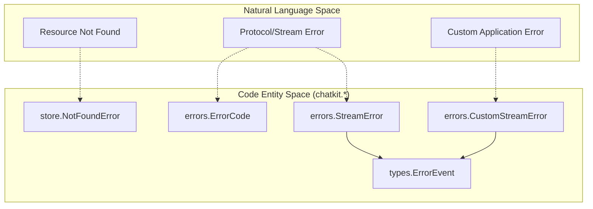
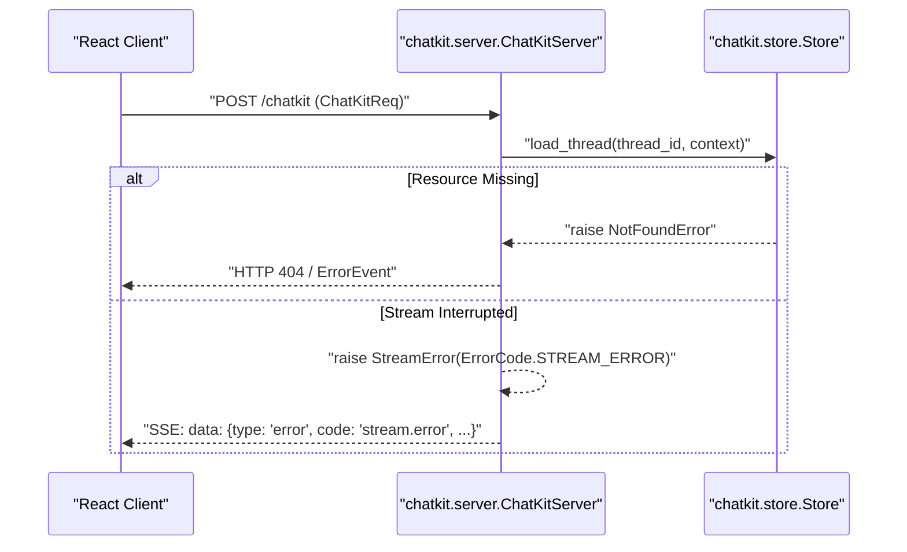

<!-- source: DeepWiki mcp.deepwiki.com · repo openai/chatkit-python · page 6.7 chatkit.errors · fetched 2026-10-26 -->

# chatkit.errors

<details>
<summary>Relevant source files</summary>

The following files were used as context for generating this wiki page:

- [chatkit/errors.py](chatkit/errors.py)
- [chatkit/store.py](chatkit/store.py)
- [tests/helpers/mock_store.py](tests/helpers/mock_store.py)
- [tests/helpers/mock_widget.py](tests/helpers/mock_widget.py)

</details>


This page is a reference for the error types and error-related exceptions in the ChatKit Python SDK. It covers:

- `NotFoundError` — the exception raised by `Store` implementations when a requested resource does not exist.
- `ErrorCode` — the set of predefined machine-readable error codes used in the streaming protocol.
- `StreamError` & `CustomStreamError` — internal SDK exceptions used to trigger error events during streaming.
- `ErrorEvent` — the streaming event that carries error information to the client.

---

## `NotFoundError`

`NotFoundError` is a plain Python exception defined in `chatkit.store` and re-exported as part of the error surface.

[chatkit/store.py:44-45]()

```python
class NotFoundError(Exception):
    pass
```

`Store` implementations raise `NotFoundError` when any load or lookup operation cannot find the requested record. `ChatKitServer.process()` catches this exception at the routing layer and translates it into an appropriate response.

**Contexts where `NotFoundError` is expected:**

| Store method | Raised when |
|---|---|
| `load_thread` | Thread ID does not exist or is not visible to the current context. |
| `load_thread_items` | `after` cursor item does not exist. |
| `load_item` | Item ID does not exist in the given thread. |
| `load_attachment` | Attachment ID does not exist. |

The `SQLiteStore` test helper demonstrates the canonical pattern for raising `NotFoundError` in each of these cases:

[tests/helpers/mock_store.py:92-93]()
[tests/helpers/mock_store.py:132-133]()
[tests/helpers/mock_store.py:183-184]()

Sources: [chatkit/store.py:44-45](), [tests/helpers/mock_store.py:92-184]()

---

## `ErrorCode`

`ErrorCode` is defined in `chatkit/errors.py`. It represents predefined, machine-readable error identifiers used in the streaming protocol.

[chatkit/errors.py:6-7]()

```python
class ErrorCode(str, Enum):
    STREAM_ERROR = "stream.error"
```

The SDK maintains default mappings for these codes to HTTP status codes and retry behaviors:

| ErrorCode | Default Status | Default Allow Retry |
|---|---|---|
| `STREAM_ERROR` | 500 | `True` |

[chatkit/errors.py:10-16]()

Sources: [chatkit/errors.py:6-16]()

---

## Streaming Exceptions

The SDK provides specialized exception classes in `chatkit/errors.py` that represent errors occurring during a streaming response. These are designed to be caught and converted into `ErrorEvent` objects.

### `StreamError`
Used for errors that map to a specific `ErrorCode`. It automatically resolves the `status_code` and `allow_retry` behavior based on the provided code unless overridden.

[chatkit/errors.py:23-43]()

### `CustomStreamError`
Used for application-specific errors with a custom, localized user-facing message.

[chatkit/errors.py:45-62]()

Sources: [chatkit/errors.py:23-62]()

---

## `ErrorEvent`

`ErrorEvent` is the streaming event type emitted into a `ThreadStreamEvent` stream when an error occurs during request processing. It is defined in `chatkit/types.py` and included in the `ThreadStreamEvent` discriminated union.

[chatkit/types.py:403-410]()

| Field | Type | Default | Description |
|---|---|---|---|
| `type` | `Literal["error"]` | `"error"` | Discriminator field. |
| `code` | `ErrorCode \| Literal["custom"]` | `"custom"` | Machine-readable error code. |
| `message` | `str \| None` | `None` | Human-readable error description. |
| `allow_retry` | `bool` | `False` | Whether the client UI should offer a retry action. |

Sources: [chatkit/types.py:403-410]()

---

## Relationship Between Error Entities

The following diagram maps the relationship between the natural language concept of "Errors" and the specific code entities that implement them.

**Mapping Concepts to Code Entities**



Sources: [chatkit/store.py:44-45](), [chatkit/errors.py:6-62](), [chatkit/types.py:403-410]()

---

## Error Flow During Request Processing

This diagram illustrates how a `NotFoundError` raised by a `Store` implementation is handled during the lifecycle of a `ChatKitServer.process()` call.

**Error Propagation and Conversion**



Sources: [chatkit/store.py:44-45](), [chatkit/errors.py:23-43](), [chatkit/types.py:403-410]()

---

## Import Paths

| Symbol | Canonical import path |
|---|---|
| `NotFoundError` | `from chatkit.store import NotFoundError` |
| `ErrorCode` | `from chatkit.errors import ErrorCode` |
| `StreamError` | `from chatkit.errors import StreamError` |
| `CustomStreamError` | `from chatkit.errors import CustomStreamError` |
| `ErrorEvent` | `from chatkit.types import ErrorEvent` |

`NotFoundError` is co-located with `Store` in `chatkit.store` because it is fundamental to the storage interface. `ErrorCode` and streaming exceptions reside in `chatkit.errors`, while the serializable `ErrorEvent` model is part of the `chatkit.types` protocol definition.

Sources: [chatkit/store.py:44-45](), [chatkit/errors.py:1-62](), [chatkit/types.py:403-410]()

---

