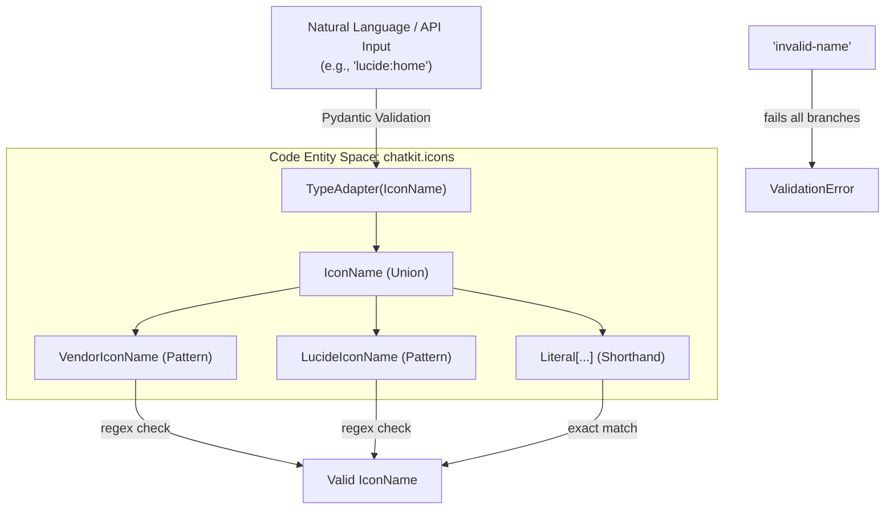
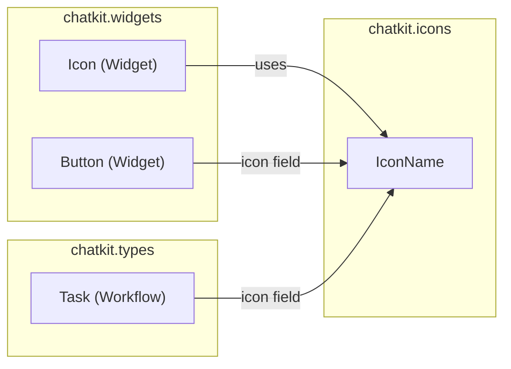

<!-- source: DeepWiki mcp.deepwiki.com · repo openai/chatkit-python · page 6.8 chatkit.icons · fetched 2026-10-26 -->

# chatkit.icons

<details>
<summary>Relevant source files</summary>

The following files were used as context for generating this wiki page:

- [chatkit/icons.py](chatkit/icons.py)
- [tests/test_icons.py](tests/test_icons.py)

</details>


The `chatkit.icons` module defines the `IconName` type and its constituent subtypes. These types act as a validation layer for icon identifiers used throughout the widget system and thread item models. This page covers the type definitions, their validation rules, and the complete list of supported shorthand literals.

---

## Module Overview

`chatkit.icons` [chatkit/icons.py:1-78]() exports three public names that define the icon system's taxonomy:

| Name | Kind | Description |
|---|---|---|
| `VendorIconName` | Annotated type alias | Any string matching the regex pattern `^vendor:` |
| `LucideIconName` | Annotated type alias | Any string matching the regex pattern `^lucide:` |
| `IconName` | Union type | The full set of valid icon identifiers, including literals and patterned strings |

---

## Type Definitions

### `VendorIconName`

[chatkit/icons.py:5]()

```python
VendorIconName = Annotated[str, StringConstraints(pattern=r"^vendor:")]
```

A `str` validated by Pydantic's `StringConstraints` to require the prefix `vendor:`. This allows the SDK to support custom icon sets provided by specific client-side implementations without requiring the server-side SDK to maintain an exhaustive list.

**Example valid values:** `"vendor:custom-logo"`, `"vendor:brand-icon"`

### `LucideIconName`

[chatkit/icons.py:6]()

```python
LucideIconName = Annotated[str, StringConstraints(pattern=r"^lucide:")]
```

A `str` validated to require the prefix `lucide:`. This allows referencing any icon from the [Lucide](https://lucide.dev) icon library. The client is expected to strip the prefix and render the corresponding Lucide component.

**Example valid values:** `"lucide:circle"`, `"lucide:arrow-right"`, `"lucide:user-plus"`

### `IconName`

[chatkit/icons.py:8-77]()

The primary exported type used in Pydantic models. It is a union of three branches:
1. A `Literal` set of predefined shorthand names.
2. `VendorIconName`.
3. `LucideIconName`.

Sources: [chatkit/icons.py:1-77]()

---

## Data Flow and Validation

When a string is assigned to a field typed as `IconName`, Pydantic performs validation against the union branches.

**Diagram: Natural Language Input to Code Validation**



Sources: [chatkit/icons.py:1-77](), [tests/test_icons.py:1-23]()

---

## Predefined Literal Icon Names

The following names are valid `IconName` values without any prefix. These map to optimized, built-in assets in the ChatKit frontend.

[chatkit/icons.py:9-74]()

| Icon Name | Icon Name | Icon Name |
|---|---|---|
| `agent` | `analytics` | `atom` |
| `batch` | `bolt` | `book-open` |
| `book-closed` | `book-clock` | `bug` |
| `calendar` | `chart` | `check` |
| `check-circle` | `check-circle-filled` | `chevron-left` |
| `chevron-right` | `circle-question` | `clock` |
| `compass` | `confetti` | `cube` |
| `desktop` | `document` | `dot` |
| `dots-horizontal` | `dots-vertical` | `empty-circle` |
| `external-link` | `globe` | `keys` |
| `lab` | `images` | `info` |
| `lifesaver` | `lightbulb` | `mail` |
| `map-pin` | `maps` | `mobile` |
| `name` | `notebook` | `notebook-pencil` |
| `page-blank` | `phone` | `play` |
| `plus` | `profile` | `profile-card` |
| `reload` | `star` | `star-filled` |
| `search` | `sparkle` | `sparkle-double` |
| `square-code` | `square-image` | `square-text` |
| `suitcase` | `settings-slider` | `user` |
| `wreath` | `write` | `write-alt` |
| `write-alt2` | | |

Sources: [chatkit/icons.py:9-74]()

---

## System Integration

`IconName` is a foundational type used across the SDK to ensure visual consistency in streaming events and UI components.

**Diagram: IconName usage across ChatKit Entities**



### Validation Behavior in Tests
The validation logic is verified using `pydantic.TypeAdapter` [tests/test_icons.py:9-22]():
*   **Prefix Matching**: `vendor:icon-name` is successfully validated as a `VendorIconName` [tests/test_icons.py:9]().
*   **Literal Matching**: `book-open` is successfully validated against the `Literal` branch [tests/test_icons.py:15]().
*   **Failure Case**: Any string that neither starts with the required prefixes nor exists in the literal list (e.g., `invalid-icon`) results in a `pydantic.ValidationError` [tests/test_icons.py:21-22]().

Sources: [tests/test_icons.py:1-23](), [chatkit/icons.py:1-78]()

---

